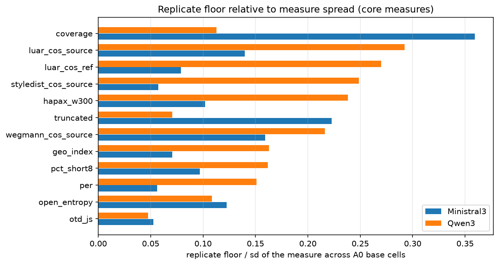
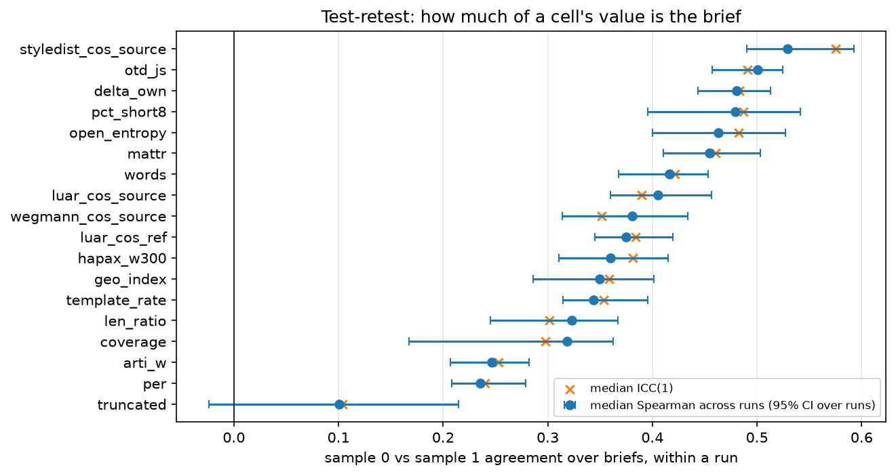
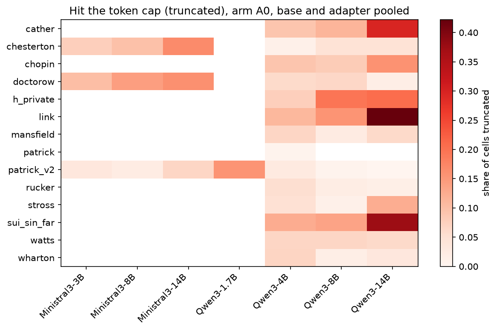

# 10 Inventory and integrity

## What this does

Counts every generated cell against what the design should have produced, records the gate
verdicts and how each adapter was served, measures the noise floor of every numeric measure
from the twice-generated runs, and measures how much of a cell's value is the brief rather
than the sampling draw. It is the script the other analyses lean on for "is this contrast
bigger than the machine's own jitter".

It also runs a set of machine-checkable integrity checks over the master tables and writes
their verdicts to `integrity_flags.csv`; 10 of 13 pass.

## How it does it

Data: `data/master/cells.parquet` (40726 rows x 176 columns),
`runs.csv` (110 runs), `authors.csv` (14 rows). Non-replicate cells
only (36214 of 40726); the 4512 replicate cells are
used only to compute the floors. One of the 14 author rows, `patrick`, is the
v1 chunking control over the same corpus as `patrick_v2`, so these tables cover
13 independent author corpora, not 14.

Unit. The inventory counts cells. The replicate floor is a difference of run means, so its
unit is the run. Test-retest is computed within a run over briefs, so its unit is the brief.
Nothing here is aggregated to the author, and nothing here is a claim about a model, a
family or a size.

Expected counts. Each (author, family, size, kind, arm) row should hold
`test_briefs_passed` x 2 samples. `deficit` is that minus the observed count.

Replicate floor. `lib.replicate_floor` takes the 9 twice-generated
configurations and reports |mean(run) - mean(replicate)| per measure; the floor quoted is
the largest of those differences within a family, over at most 5 pairs.
`floor_over_sd` divides it by the standard deviation of the measure across all A0 base
cells, which puts the floors of measures on different scales on one axis. Floors are
computed on arm A0, so they bound arm-A0 contrasts; no floor here was measured on A1 to A5.
These measures have a floor in one family only: rubric_C, rubric_S.

Test-retest. Within each run and arm A0, each brief has two generated passages (sample 0 and
sample 1). The table reports the Spearman correlation between the two samples across briefs
and a one-way ICC with k = 2. A measure with a low value is dominated by the sampling draw,
not by the brief, so single-cell readings of it mean little. Pooled rows are the median
across runs with a bootstrap interval over runs (2000 draws).

Correction. This script runs no hypothesis family, so no BH-FDR is applied; the p-values in
`test_retest.csv` are descriptive and are not the basis of any claim here.

Runtime 27 s.

### Integrity checks

| check | pass | detail |
|---|---|---|
| cells row count matches the builder's schema.json | True | 40726 rows x 176 cols on disk; schema.json records 40726 x 176 |
| A0 non-replicate cell count matches the builder's schema.json | True | 7876 A0 non-replicate cells on disk; schema.json records 7876 |
| every run in runs.csv has cells | True | missing from cells.parquet: none |
| every cell run is described in runs.csv | True | missing from runs.csv: none |
| no duplicate (run, arm, id, sample) keys | True | 0 duplicates |
| every configuration reaches its expected cell count | True | 0 of 460 configuration x arm rows short of briefs x 2 |
| replicate floors available for every family | True | families without a replicate pair in cells.parquet: none |
| outcome measures vary across arms | True | 0 outcome columns identical to their A0 value on every other arm (0 of them dictionary variables, 0 rubric, 0 constructional z_*):  |
| runs.csv truncated_pct agrees with the cells | True | 0 runs disagree by more than 0.6 points |
| brief counts per author match authors.csv | True | all match |
| every run over the 20% truncation gate has a gate verdict | False | 7 runs exceed 20% truncation with no verdict recorded: sui_sin_far_paire6_14b (72%), h_private_paire6_14b (59%), h_private_paire6_8b (34%), chopin_paire6_14b (31%), sui_sin_far_paire6_4b (24%), cather_pair4b (22%) |
| runs.csv carries a provenance hash for every run | False | 92 of 110 runs have a provenance_hash; file-level SHA-256 is in data/MANIFEST.json instead |
| every run records its sampling temperature | False | 6 runs have no temperature recorded; the rest are 0.8 |

### Replicate floors, core measures

| measure | family | n_pairs | floor_abs_mean_diff | sd_A0_base | floor_over_sd |
|---|---|---|---|---|---|
| coverage | Ministral3 | 4 | 6.282 | 17.492 | 0.359 |
| per | Ministral3 | 4 | 0.004 | 0.066 | 0.056 |
| truncated | Ministral3 | 4 | 0.038 | 0.173 | 0.223 |
| luar_cos_ref | Ministral3 | 4 | 0.006 | 0.077 | 0.079 |
| luar_cos_source | Ministral3 | 4 | 0.011 | 0.078 | 0.140 |
| styledist_cos_source | Ministral3 | 4 | 0.003 | 0.046 | 0.057 |
| wegmann_cos_source | Ministral3 | 4 | 0.030 | 0.188 | 0.159 |
| geo_index | Ministral3 | 4 | 0.028 | 0.396 | 0.071 |
| hapax_w300 | Ministral3 | 4 | 0.006 | 0.064 | 0.102 |
| open_entropy | Ministral3 | 4 | 0.017 | 0.136 | 0.123 |
| otd_js | Ministral3 | 4 | 0.006 | 0.113 | 0.053 |
| pct_short8 | Ministral3 | 4 | 0.020 | 0.202 | 0.097 |
| coverage | Qwen3 | 3 | 1.974 | 17.492 | 0.113 |
| per | Qwen3 | 5 | 0.010 | 0.066 | 0.151 |
| truncated | Qwen3 | 5 | 0.012 | 0.173 | 0.071 |
| luar_cos_ref | Qwen3 | 5 | 0.021 | 0.077 | 0.270 |
| luar_cos_source | Qwen3 | 5 | 0.023 | 0.078 | 0.292 |
| styledist_cos_source | Qwen3 | 5 | 0.011 | 0.046 | 0.249 |
| wegmann_cos_source | Qwen3 | 5 | 0.041 | 0.188 | 0.216 |
| geo_index | Qwen3 | 5 | 0.064 | 0.396 | 0.163 |
| hapax_w300 | Qwen3 | 5 | 0.015 | 0.064 | 0.238 |
| open_entropy | Qwen3 | 5 | 0.015 | 0.136 | 0.109 |
| otd_js | Qwen3 | 5 | 0.005 | 0.113 | 0.048 |
| pct_short8 | Qwen3 | 5 | 0.033 | 0.202 | 0.162 |

### Test-retest across runs (median over runs, 95% CI over runs)

| measure | construct | n_runs | n_runs_degenerate | median_rho | rho_lo | rho_hi | min_rho | max_rho | median_icc1 | icc1_lo | icc1_hi |
|---|---|---|---|---|---|---|---|---|---|---|---|
| styledist_cos_source | voice_embed | 100 | 0 | 0.529 | 0.490 | 0.593 | 0.037 | 0.890 | 0.575 | 0.539 | 0.625 |
| otd_js | voice_structure | 100 | 0 | 0.501 | 0.457 | 0.525 | -0.159 | 0.898 | 0.491 | 0.463 | 0.545 |
| delta_own | voice_structure | 100 | 0 | 0.480 | 0.444 | 0.513 | -0.443 | 0.812 | 0.483 | 0.456 | 0.526 |
| pct_short8 | voice_structure | 100 | 0 | 0.479 | 0.395 | 0.541 | -0.335 | 0.833 | 0.487 | 0.427 | 0.550 |
| open_entropy | voice_structure | 100 | 0 | 0.463 | 0.400 | 0.527 | -0.187 | 0.888 | 0.482 | 0.416 | 0.550 |
| mattr | voice_structure | 100 | 0 | 0.454 | 0.411 | 0.503 | -0.227 | 0.831 | 0.460 | 0.411 | 0.500 |
| words | length | 100 | 0 | 0.416 | 0.368 | 0.453 | -0.330 | 0.798 | 0.422 | 0.373 | 0.473 |
| luar_cos_source | voice_embed | 100 | 0 | 0.405 | 0.360 | 0.456 | -0.103 | 0.757 | 0.390 | 0.362 | 0.430 |
| wegmann_cos_source | voice_embed | 100 | 0 | 0.381 | 0.314 | 0.434 | -0.180 | 0.820 | 0.352 | 0.277 | 0.409 |
| luar_cos_ref | voice_embed | 100 | 0 | 0.375 | 0.345 | 0.419 | -0.321 | 0.804 | 0.384 | 0.349 | 0.426 |
| hapax_w300 | voice_structure | 100 | 0 | 0.360 | 0.310 | 0.415 | -0.121 | 0.750 | 0.381 | 0.320 | 0.431 |
| geo_index | voice_structure | 100 | 0 | 0.350 | 0.286 | 0.402 | -0.616 | 0.929 | 0.358 | 0.315 | 0.408 |
| template_rate | tell | 100 | 0 | 0.344 | 0.315 | 0.395 | -0.221 | 0.676 | 0.354 | 0.279 | 0.381 |
| len_ratio | length | 100 | 0 | 0.323 | 0.245 | 0.367 | -0.298 | 0.699 | 0.302 | 0.270 | 0.367 |
| coverage | adherence | 3 | 0 | 0.318 | 0.167 | 0.362 | 0.167 | 0.362 | 0.298 | 0.176 | 0.600 |
| arti_w | tell | 100 | 0 | 0.246 | 0.207 | 0.282 | -0.255 | 0.559 | 0.253 | 0.207 | 0.275 |
| per | construction | 100 | 0 | 0.235 | 0.208 | 0.279 | -0.192 | 0.730 | 0.240 | 0.204 | 0.301 |
| truncated | length | 57 | 43 | 0.101 | -0.024 | 0.215 | -0.363 | 0.699 | 0.104 | -0.012 | 0.193 |

### Runs that fail the generation gate

| run | family | params_b | kind | truncated_rate | adapter_served |
|---|---|---|---|---|---|
| doctorow_basem8b | Ministral3 | 8.000 | base | 0.266 | none |
| link_paire6_4b | Qwen3 | 4.000 | adapter | 0.229 | lora |
| link_paire6_8b | Qwen3 | 8.000 | adapter | 0.396 | lora |
| sui_sin_far_paire6_8b | Qwen3 | 8.000 | adapter | 0.354 | lora |
| cather_paire6_14b | Qwen3 | 14.000 | adapter | 0.580 | lora |
| link_paire6_14b | Qwen3 | 14.000 | adapter | 0.844 | lora |

### Highest truncation rates

| run | family | params_b | kind | truncated_rate | gate_generation_ok |
|---|---|---|---|---|---|
| link_paire6_14b | Qwen3 | 14.000 | adapter | 0.844 | False |
| sui_sin_far_paire6_14b | Qwen3 | 14.000 | adapter | 0.722 | nan |
| h_private_paire6_14b | Qwen3 | 14.000 | adapter | 0.587 | nan |
| cather_paire6_14b | Qwen3 | 14.000 | adapter | 0.580 | False |
| link_paire6_8b | Qwen3 | 8.000 | adapter | 0.396 | False |
| sui_sin_far_paire6_8b | Qwen3 | 8.000 | adapter | 0.354 | False |

### Configuration x arm rows short of the expected count

| run | author | family | params_b | kind | arm | n_cells | expected_cells | deficit |
|---|---|---|---|---|---|---|---|---|

### Outcome columns identical across arms within a run (covariates excluded)

| measure | source | n_pairs_both_present | share_identical_to_A0 | eval_cache |
|---|---|---|---|---|
| memo_flag | scores.jsonl | 28338 | 0.998 | False |
| geo_n |  | 28338 | 0.998 | False |
| memo_8gram | scores.jsonl | 28338 | 0.960 | False |
| tokens_4bx4b |  | 2192 | 0.906 | False |

### Replicate floors relative to measure spread

### Test-retest agreement between the two samples

### Truncation by author and configuration

## How to read the result, conservatively

Unit of replication. Nothing in this script is an effect. The floors are the yardstick the
effects in scripts 11 to 22 are measured against, and they rest on
9 replicate pairs, all at the small end of the size range
(base4b vs base4b_r2, chesterton_base14b vs chesterton_base14b_r2, chesterton_base4b vs chesterton_base4bc, chesterton_base8b vs chesterton_base8b_r2, chesterton_basem14b vs chesterton_basem14b_r2, chesterton_basem3b vs chesterton_basem3b_r2, chesterton_basem8b vs chesterton_basem8b_r2, mansfield_base4b vs mansfield_base4b_r2, patrick_v2_basem3b vs patrick_v2_basem3b_r2). No family has more than
5 pairs behind any floor, so a floor is itself a noisy estimate; treat
it as an order of magnitude, not a threshold with decimals. Because a floor is the largest
observed difference over a handful of pairs, it understates the true jitter more often than
it overstates it.

Test-retest. Over the core measures the median within-run agreement between the two samples
of a brief runs from 0.10 to 0.53
(Spearman over briefs, median over runs). That is a property of a single generated passage:
roughly half of what one cell reports is the brief and the rest is the sampling draw. It is
not a reliability figure for a run mean, which averages over briefs and samples and is
correspondingly steadier.

Interval width. The test-retest intervals are over runs, not over briefs, so they say how
much run-to-run variation there is in the retest agreement, not how precisely any one run's
agreement is known.

Floors. Both families have a measured floor. Coverage is not uniform: rubric_C, rubric_S have a floor in one family only, so a contrast on those measures is read against the thinnest yardstick in the set.

Judged measures. `coverage` is an LLM judge's reading of how much of the brief is present,
not a mechanical count, so it carries a judge's failure modes as well as the generator's.
It is scored on sample 0, so its test-retest row rests on the 3 runs that
happen to carry sample-1 coverage and is not the measure's reliability.
Judge-derived values are relative instruments throughout this programme and are never read
as absolute quality.

What would overturn this. Generating any configuration a third time, especially at 8B or
14B, would put a measured floor where the present ones are extrapolated from 3B and 4B runs,
and could move them in either direction. A floor that turned out to be twice the value here
would sink several of the smaller contrasts elsewhere in the programme below noise.

What this does not show. Nothing about whether any adaptation worked, and nothing about any
model, family or size: the unit here is the cell, the run and the brief. A high test-retest
correlation means a measure reads the brief consistently, not that it reads voice; a low one
means single passages are noisy, not that the measure is wrong.

## Caveats

- 0 of 460 configuration x arm rows are short of the expected briefs x 2 count
- Every run in runs.csv has cells. The two Ministral3 3B replicates were scored on 2026-09-10, after the rest of the grid and outside the usual `score_runs.py` path (which skips `_r2` ids), so the Ministral3 floors are the newest numbers in this workspace and rest on 3B pairs only; nothing here measures Ministral3 jitter at 8B or 14B.
- No outcome column is identical across every arm of a run, so the arm-key join fault found earlier today is repaired in these tables. The eval-cache measures (per, otd_js, psd, cpd, lexdiv, event order, constructional) and the rubric subscores now carry values on arm A0 and NaN on A1 to A5, which is what they were computed on; no A1 to A5 effect can be claimed for any of them anywhere in the programme.
- A high `share_identical_to_A0` in `arm_broadcast_check.csv` can also mean a column is near-constant (a flag that is almost always zero) rather than broadcast across arms; read the column's spread before reading the share as a join fault.
- `coverage` is an LLM-judged adherence measure scored on sample 0 (3.5% non-null on sample 1, all of it in 3 runs), so its test-retest row is computed on those few runs and is not the measure's reliability.
- Rubric measures are present on 6.1% of cells and 2AFC on 51.7%; every judge claim rests on that subset, not on the full grid. Judge values are relative instruments with known failures (the rubric ranks a 14B base above the private author's own prose, and the two judges are not one instrument), so none of them is a quality figure.
- The coverage and 2AFC rows lost to the 2026-09-09 credit outage have been refilled; `missingness.csv` reflects the repaired grid.
- 6 runs fail the generation gate and 43 have no gate verdict recorded at all; absence of a verdict is not a pass. 7 of the unverdicted runs are over the stated 20% truncation threshold, the worst at 72%, so any sensitivity analysis that drops gate-failed runs leaves them in.
- 14 runs exceed the 20% truncation gate and stay in every table here flagged rather than excluded, including the one Ministral3 base run over the gate, `doctorow_basem8b` at 26.6%. A truncated passage is short for a reason unrelated to voice, so any measure that moves with length is confounded in those cells.
- `chesterton_paire6_m8b` has a positive probe delta (+0.0008 in `inventory_runs.csv`), meaning the training probe found the adapter no closer to the author than the base; it is in the inventory as a run, not as evidence that an adapter was applied.
- The reference pool behind the `*_cos_ref`, attribution and Delta columns counted here is fourteen period authors for every study author, so contemporary and private authors are positioned against strangers from another century. `scripts/23_register_matched_pool.py` holds the register-matched repair; the counts in this script are unaffected but any downstream reading of those measures is.
- The per-run `emb_*.npy` files are not row-aligned with `scores.jsonl` in most runs (an anchor block sits between the generations and the reference rows). Nothing in this script reads them; `scripts/23_register_matched_pool.py` holds the verified repair for anything that does.
- `para_cv_words` is in the variable dictionary but not in cells.parquet, so it is absent from every table here.
- `provenance_hash` is recorded for 92 of 110 runs in runs.csv (the local pre-provenance runs carry none), so run-level provenance cannot be checked for the rest from the master tables; data/MANIFEST.json still carries a SHA-256 per copied file, which is a different guarantee (the copy is intact, not that the run is the one it claims to be).
- 6 runs record no sampling temperature; the remaining 104 all ran at 0.8, so the missing rows are probably the same but that is an assumption.
- The study's limit is the 13 independent author corpora, not the number of tests run. No count in this script becomes evidence about a model, a family or a size without being aggregated to the author first.
