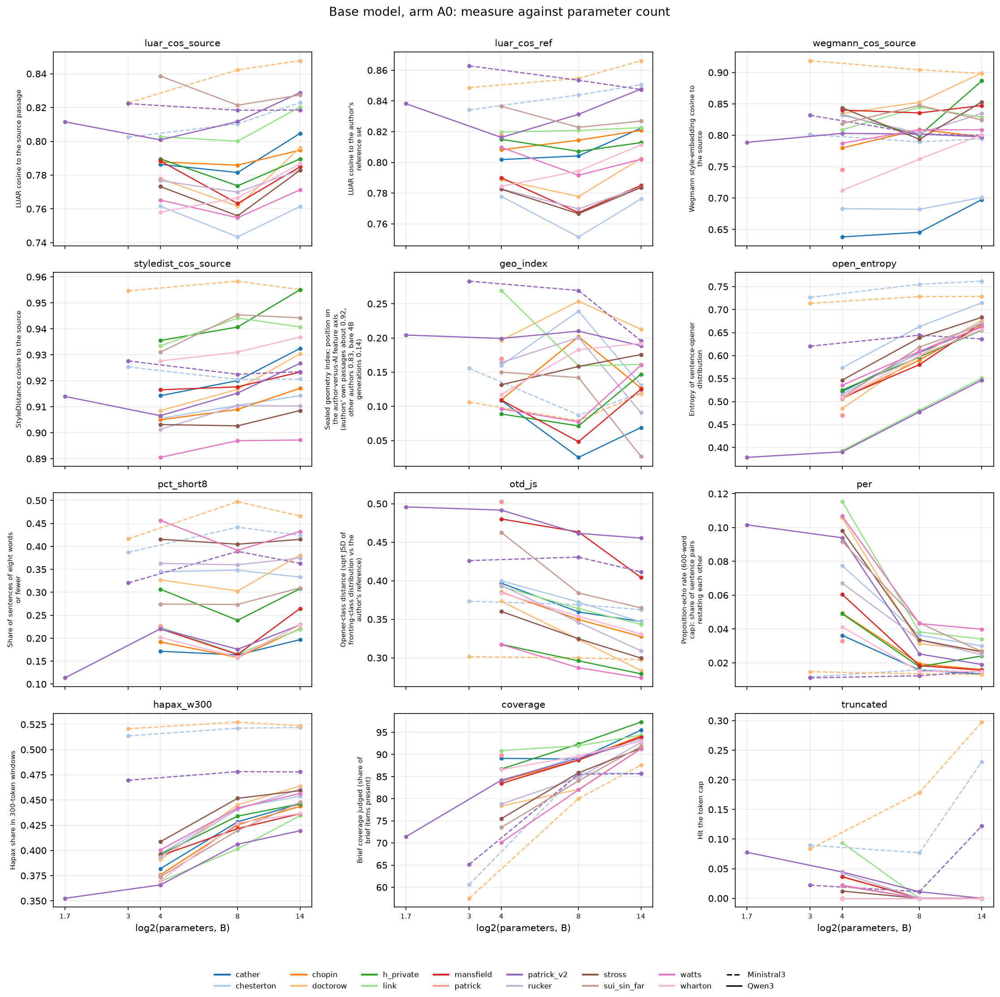
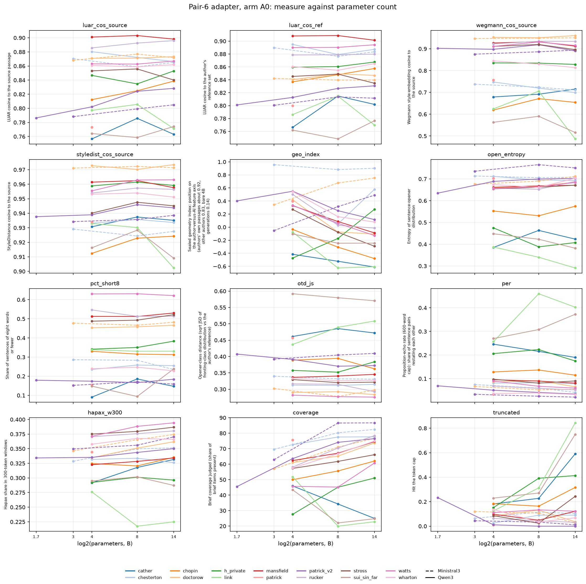
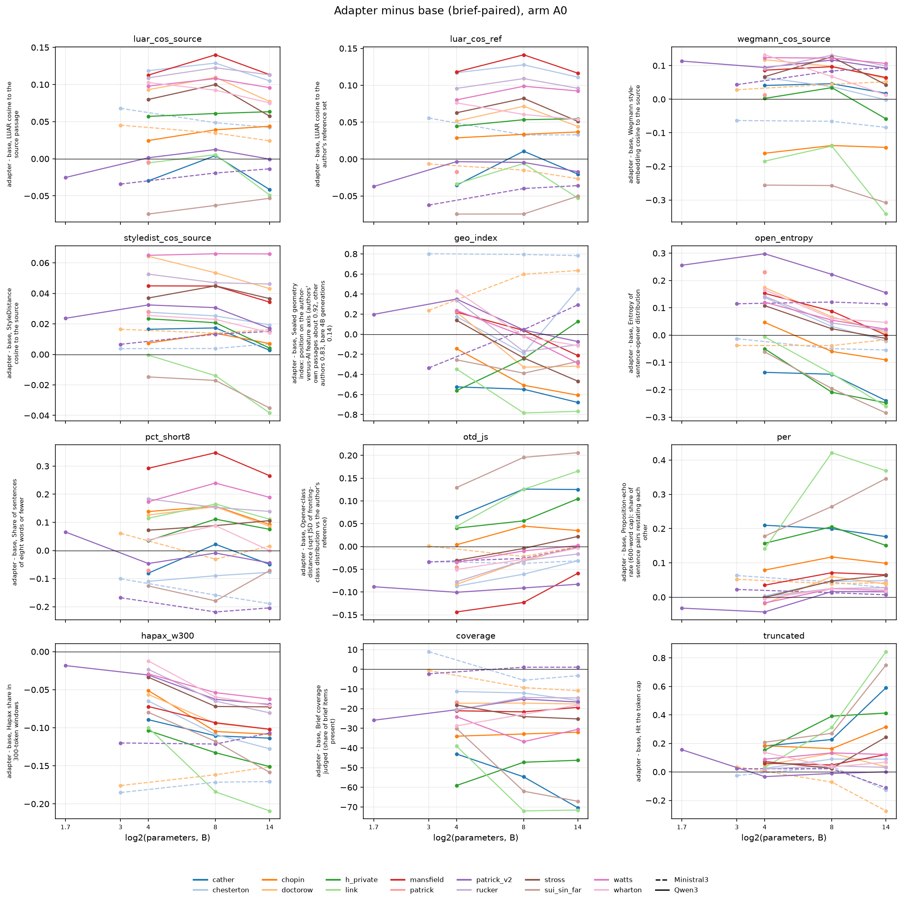
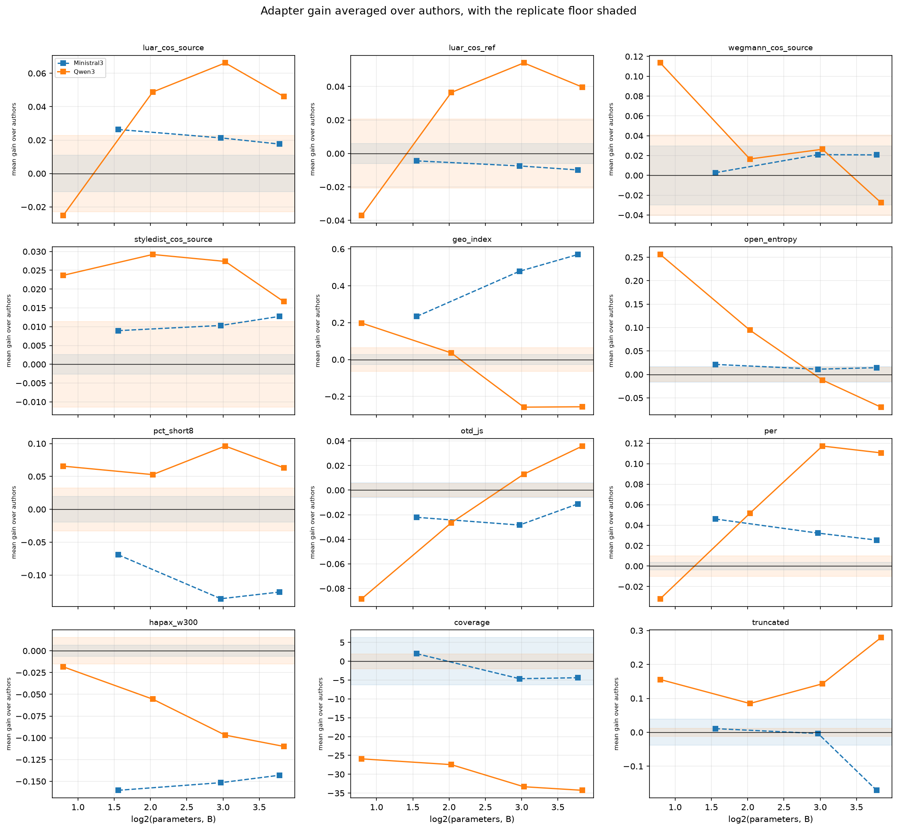

# 11 Scale curves: what parameter count buys

## What this does

For each author and model family, the base and adapter means of 12 core measures
against parameter count (arm A0, non-replicate cells), the brief-paired adapter-minus-base
gain at each size, and whether that gain changes as the model gets bigger.

Across 600 author x family x size x measure contrasts, 457 clear all three
hurdles at once (BH-FDR q < 0.05 within the measure, a bootstrap interval excluding zero,
and a gain larger than the measure's replicate floor). 68 sit inside the floor
and are reported as within noise whatever their p-value.

Clearing the hurdles is not the same as moving toward the author. Of the 457
surviving contrasts, 160 move in the direction the variable dictionary marks as
closer to the author, 170 move away from it, and 127 are on measures the
dictionary marks directionless, where a difference has no better or worse. The largest
blocks moving away are coverage (43), per (40), truncated (25), geo_index (23).

## How it does it

Data. `data/master/cells.parquet`, arm A0 only, replicates excluded: 7876 cells over
14 author rows, 2 families and
5 parameter counts. `truncated` is treated as a 0/1 rate.
`coverage` exists on sample 0 only, so its contrasts rest on half the cells, and it is an
LLM judge's reading of how much of the brief is present rather than a mechanical count.

Unit. Within an author, the brief (`id`) is the cluster: every mean and every gain carries a
cluster bootstrap over briefs (2000 draws). For any statement about models rather than
about one author, the author is the unit: the per-author slopes are averaged with a
bootstrap over authors, and the pooled models take one gain estimate per author x size as
the observation with a random intercept for the author.

Gain. Base and adapter cells are matched on (author, family, size, brief, sample) before
subtracting, so the gain is a within-brief difference and the brief's own difficulty
cancels. Effect sizes accompany it: Cohen's d and Cliff's delta over the unpaired cell
values, and a Wilcoxon signed-rank test over the per-brief mean differences.

Model. `lib.mixed_model` (statsmodels MixedLM, groups = author). Where both families are
present the formula is `gain ~ log2_params * C(family)`; where only Qwen3 is present the
interaction is dropped. Base and adapter levels are modelled the same way on cell-level
values. With 14 authors the random-effect variances are descriptive.
0 of the 36
fitted models returned a singular matrix and are recorded as `fit_failed` in
`pooled_models.csv` rather than being quietly dropped
(none).

Correction. BH-FDR is applied twice and separately: within a measure across its
author x family x size contrasts in `gain.csv` (at most 50 tests in one such
family), and across the 108 model terms in `tests.csv` that make up this script's
own hypothesis family. A q below 0.05 means "within that family", not across the programme;
the programme-wide correction is script 22's job.

Floors. `lib.replicate_floor` on arm A0, from the twice-generated configurations
(base4b vs base4b_r2, chesterton_base14b vs chesterton_base14b_r2, chesterton_base4b vs chesterton_base4bc, chesterton_base8b vs chesterton_base8b_r2, chesterton_basem14b vs chesterton_basem14b_r2, chesterton_basem3b vs chesterton_basem3b_r2, chesterton_basem8b vs chesterton_basem8b_r2, mansfield_base4b vs mansfield_base4b_r2, patrick_v2_basem3b vs patrick_v2_basem3b_r2), at most 5 pairs on Qwen3 and 4 on
Ministral3. 24 of the 24 measure x family floors in `floors.csv`
are measured.
A borrowed floor is an assumption, not a measurement.

Runtime 113 s.

### Mean adapter gain by measure, family and size, against the replicate floor

| measure | family | params_b | mean_gain | n_authors | n_survive | floor | mean_gain_over_floor |
|---|---|---|---|---|---|---|---|
| coverage | Ministral3 | 3.000 | 2.014 | 3 | 0 | 6.282 | 0.321 |
| coverage | Ministral3 | 8.000 | -4.621 | 3 | 1 | 6.282 | 0.736 |
| coverage | Ministral3 | 14.000 | -4.364 | 3 | 1 | 6.282 | 0.695 |
| coverage | Qwen3 | 1.700 | -25.911 | 1 | 1 | 1.974 | 13.124 |
| coverage | Qwen3 | 4.000 | -27.438 | 14 | 14 | 1.974 | 13.897 |
| coverage | Qwen3 | 8.000 | -33.309 | 13 | 13 | 1.974 | 16.871 |
| coverage | Qwen3 | 14.000 | -34.260 | 13 | 13 | 1.974 | 17.352 |
| luar_cos_ref | Ministral3 | 3.000 | -0.004 | 3 | 2 | 0.006 | 0.730 |
| luar_cos_ref | Ministral3 | 8.000 | -0.007 | 3 | 2 | 0.006 | 1.226 |
| luar_cos_ref | Ministral3 | 14.000 | -0.010 | 3 | 3 | 0.006 | 1.624 |
| luar_cos_ref | Qwen3 | 1.700 | -0.037 | 1 | 1 | 0.021 | 1.791 |
| luar_cos_ref | Qwen3 | 4.000 | 0.036 | 14 | 11 | 0.021 | 1.759 |
| luar_cos_ref | Qwen3 | 8.000 | 0.054 | 13 | 10 | 0.021 | 2.612 |
| luar_cos_ref | Qwen3 | 14.000 | 0.040 | 13 | 10 | 0.021 | 1.914 |
| luar_cos_source | Ministral3 | 3.000 | 0.026 | 3 | 3 | 0.011 | 2.409 |
| luar_cos_source | Ministral3 | 8.000 | 0.021 | 3 | 2 | 0.011 | 1.949 |
| luar_cos_source | Ministral3 | 14.000 | 0.018 | 3 | 2 | 0.011 | 1.612 |
| luar_cos_source | Qwen3 | 1.700 | -0.025 | 1 | 1 | 0.023 | 1.102 |
| luar_cos_source | Qwen3 | 4.000 | 0.049 | 14 | 10 | 0.023 | 2.133 |
| luar_cos_source | Qwen3 | 8.000 | 0.066 | 13 | 10 | 0.023 | 2.896 |
| luar_cos_source | Qwen3 | 14.000 | 0.046 | 13 | 11 | 0.023 | 2.017 |
| otd_js | Ministral3 | 3.000 | -0.022 | 3 | 0 | 0.006 | 3.727 |
| otd_js | Ministral3 | 8.000 | -0.028 | 3 | 0 | 0.006 | 4.790 |
| otd_js | Ministral3 | 14.000 | -0.011 | 3 | 0 | 0.006 | 1.879 |
| otd_js | Qwen3 | 1.700 | -0.088 | 1 | 1 | 0.005 | 16.465 |
| otd_js | Qwen3 | 4.000 | -0.027 | 14 | 10 | 0.005 | 4.950 |
| otd_js | Qwen3 | 8.000 | 0.013 | 13 | 10 | 0.005 | 2.424 |
| otd_js | Qwen3 | 14.000 | 0.036 | 13 | 7 | 0.005 | 6.687 |
| per | Ministral3 | 3.000 | 0.046 | 3 | 3 | 0.004 | 12.369 |
| per | Ministral3 | 8.000 | 0.032 | 3 | 3 | 0.004 | 8.661 |
| per | Ministral3 | 14.000 | 0.025 | 3 | 2 | 0.004 | 6.833 |
| per | Qwen3 | 1.700 | -0.032 | 1 | 0 | 0.010 | 3.192 |
| per | Qwen3 | 4.000 | 0.052 | 14 | 7 | 0.010 | 5.168 |
| per | Qwen3 | 8.000 | 0.117 | 13 | 13 | 0.010 | 11.743 |
| per | Qwen3 | 14.000 | 0.111 | 13 | 13 | 0.010 | 11.077 |
| styledist_cos_source | Ministral3 | 3.000 | 0.009 | 3 | 1 | 0.003 | 3.408 |
| styledist_cos_source | Ministral3 | 8.000 | 0.010 | 3 | 2 | 0.003 | 3.932 |
| styledist_cos_source | Ministral3 | 14.000 | 0.013 | 3 | 2 | 0.003 | 4.851 |
| styledist_cos_source | Qwen3 | 1.700 | 0.024 | 1 | 1 | 0.011 | 2.073 |
| styledist_cos_source | Qwen3 | 4.000 | 0.029 | 14 | 11 | 0.011 | 2.560 |
| styledist_cos_source | Qwen3 | 8.000 | 0.027 | 13 | 11 | 0.011 | 2.398 |
| styledist_cos_source | Qwen3 | 14.000 | 0.017 | 13 | 10 | 0.011 | 1.461 |
| truncated | Ministral3 | 3.000 | 0.011 | 3 | 0 | 0.038 | 0.280 |
| truncated | Ministral3 | 8.000 | -0.004 | 3 | 0 | 0.038 | 0.093 |
| truncated | Ministral3 | 14.000 | -0.171 | 3 | 3 | 0.038 | 4.447 |
| truncated | Qwen3 | 1.700 | 0.156 | 1 | 1 | 0.012 | 12.756 |
| truncated | Qwen3 | 4.000 | 0.085 | 14 | 6 | 0.012 | 6.963 |
| truncated | Qwen3 | 8.000 | 0.143 | 13 | 8 | 0.012 | 11.719 |
| truncated | Qwen3 | 14.000 | 0.279 | 13 | 10 | 0.012 | 22.882 |
| wegmann_cos_source | Ministral3 | 3.000 | 0.003 | 3 | 0 | 0.030 | 0.091 |
| wegmann_cos_source | Ministral3 | 8.000 | 0.021 | 3 | 2 | 0.030 | 0.699 |
| wegmann_cos_source | Ministral3 | 14.000 | 0.021 | 3 | 3 | 0.030 | 0.691 |
| wegmann_cos_source | Qwen3 | 1.700 | 0.113 | 1 | 1 | 0.041 | 2.798 |
| wegmann_cos_source | Qwen3 | 4.000 | 0.017 | 14 | 10 | 0.041 | 0.408 |
| wegmann_cos_source | Qwen3 | 8.000 | 0.026 | 13 | 9 | 0.041 | 0.650 |
| wegmann_cos_source | Qwen3 | 14.000 | -0.027 | 13 | 8 | 0.041 | 0.677 |

### Does the gain change with size (mixed model, log2_params term, BH-FDR within the script)

| measure | estimate | ci_low | ci_high | p | q | n_groups |
|---|---|---|---|---|---|---|
| pct_short8 | -0.028 | -0.058 | 0.002 | 0.065 | 0.141 | 14 |
| geo_index | 0.154 | -0.016 | 0.323 | 0.076 | 0.155 | 14 |
| hapax_w300 | 0.008 | -0.002 | 0.017 | 0.112 | 0.208 | 14 |
| truncated | -0.074 | -0.172 | 0.025 | 0.144 | 0.254 | 14 |
| coverage | -3.076 | -9.075 | 2.923 | 0.315 | 0.486 | 14 |
| luar_cos_source | -0.004 | -0.016 | 0.008 | 0.527 | 0.653 | 14 |
| per | -0.009 | -0.038 | 0.019 | 0.523 | 0.653 | 14 |
| wegmann_cos_source | 0.009 | -0.017 | 0.034 | 0.510 | 0.653 | 14 |
| styledist_cos_source | 0.002 | -0.004 | 0.007 | 0.548 | 0.665 | 14 |
| otd_js | 0.004 | -0.010 | 0.017 | 0.575 | 0.674 | 14 |
| luar_cos_ref | -0.002 | -0.014 | 0.009 | 0.676 | 0.761 | 14 |
| open_entropy | -0.004 | -0.028 | 0.020 | 0.770 | 0.832 | 14 |

### Does the base model improve with size (log2_params term)

| measure | estimate | ci_low | ci_high | p | q | significant_q05 |
|---|---|---|---|---|---|---|
| coverage | 11.826 | 10.125 | 13.527 | 0.000 | 0.000 | True |
| geo_index | -0.018 | -0.049 | 0.012 | 0.246 | 0.397 | False |
| hapax_w300 | 0.003 | -0.000 | 0.007 | 0.076 | 0.155 | False |
| luar_cos_ref | 0.002 | -0.003 | 0.008 | 0.422 | 0.584 | False |
| luar_cos_source | 0.006 | 0.000 | 0.012 | 0.048 | 0.110 | False |
| open_entropy | 0.010 | 0.003 | 0.018 | 0.009 | 0.024 | True |
| otd_js | -0.004 | -0.011 | 0.003 | 0.288 | 0.450 | False |
| pct_short8 | 0.023 | 0.009 | 0.037 | 0.001 | 0.004 | True |
| per | 0.001 | -0.004 | 0.006 | 0.738 | 0.814 | False |
| styledist_cos_source | -0.001 | -0.005 | 0.002 | 0.459 | 0.620 | False |
| truncated | 0.062 | 0.049 | 0.075 | 0.000 | 0.000 | True |
| wegmann_cos_source | -0.010 | -0.023 | 0.004 | 0.176 | 0.305 | False |

### Does the adapter endpoint improve with size (log2_params term)

| measure | estimate | ci_low | ci_high | p | q | significant_q05 |
|---|---|---|---|---|---|---|
| coverage | 8.939 | 6.364 | 11.514 | 0.000 | 0.000 | True |
| geo_index | 0.142 | 0.112 | 0.173 | 0.000 | 0.000 | True |
| hapax_w300 | 0.011 | 0.006 | 0.015 | 0.000 | 0.000 | True |
| luar_cos_ref | 0.000 | -0.004 | 0.005 | 0.858 | 0.888 | False |
| luar_cos_source | 0.003 | -0.003 | 0.008 | 0.330 | 0.490 | False |
| open_entropy | 0.007 | -0.002 | 0.016 | 0.120 | 0.219 | False |
| otd_js | 0.000 | -0.007 | 0.008 | 0.963 | 0.972 | False |
| pct_short8 | -0.005 | -0.017 | 0.008 | 0.467 | 0.622 | False |
| per | -0.008 | -0.017 | 0.000 | 0.058 | 0.130 | False |
| styledist_cos_source | 0.000 | -0.003 | 0.003 | 0.794 | 0.849 | False |
| truncated | -0.012 | -0.037 | 0.013 | 0.344 | 0.496 | False |
| wegmann_cos_source | -0.000 | -0.013 | 0.013 | 0.977 | 0.977 | False |

### Family x size interactions

| measure | model | term | estimate | ci_low | ci_high | p | q |
|---|---|---|---|---|---|---|---|
| coverage | adapter level ~ log2_params * family + (1|author) | log2_params:C(family)[T.Qwen3] | -3.758 | -6.710 | -0.807 | 0.013 | 0.032 |
| geo_index | adapter level ~ log2_params * family + (1|author) | log2_params:C(family)[T.Qwen3] | -0.318 | -0.353 | -0.284 | 0.000 | 0.000 |
| hapax_w300 | adapter level ~ log2_params * family + (1|author) | log2_params:C(family)[T.Qwen3] | -0.005 | -0.010 | 0.000 | 0.074 | 0.155 |
| luar_cos_ref | adapter level ~ log2_params * family + (1|author) | log2_params:C(family)[T.Qwen3] | 0.004 | -0.001 | 0.010 | 0.138 | 0.248 |
| luar_cos_source | adapter level ~ log2_params * family + (1|author) | log2_params:C(family)[T.Qwen3] | 0.002 | -0.004 | 0.008 | 0.522 | 0.653 |
| open_entropy | adapter level ~ log2_params * family + (1|author) | log2_params:C(family)[T.Qwen3] | 0.002 | -0.008 | 0.013 | 0.671 | 0.761 |
| otd_js | adapter level ~ log2_params * family + (1|author) | log2_params:C(family)[T.Qwen3] | -0.004 | -0.013 | 0.004 | 0.336 | 0.490 |
| pct_short8 | adapter level ~ log2_params * family + (1|author) | log2_params:C(family)[T.Qwen3] | 0.009 | -0.005 | 0.024 | 0.215 | 0.360 |
| per | adapter level ~ log2_params * family + (1|author) | log2_params:C(family)[T.Qwen3] | 0.003 | -0.007 | 0.013 | 0.556 | 0.667 |
| styledist_cos_source | adapter level ~ log2_params * family + (1|author) | log2_params:C(family)[T.Qwen3] | 0.001 | -0.003 | 0.004 | 0.658 | 0.761 |
| truncated | adapter level ~ log2_params * family + (1|author) | log2_params:C(family)[T.Qwen3] | 0.046 | 0.017 | 0.074 | 0.002 | 0.006 |
| wegmann_cos_source | adapter level ~ log2_params * family + (1|author) | log2_params:C(family)[T.Qwen3] | -0.003 | -0.018 | 0.012 | 0.674 | 0.761 |
| coverage | base level ~ log2_params * family + (1|author) | log2_params:C(family)[T.Qwen3] | -5.363 | -7.310 | -3.416 | 0.000 | 0.000 |
| geo_index | base level ~ log2_params * family + (1|author) | log2_params:C(family)[T.Qwen3] | 0.020 | -0.015 | 0.055 | 0.273 | 0.433 |
| hapax_w300 | base level ~ log2_params * family + (1|author) | log2_params:C(family)[T.Qwen3] | 0.028 | 0.024 | 0.032 | 0.000 | 0.000 |
| luar_cos_ref | base level ~ log2_params * family + (1|author) | log2_params:C(family)[T.Qwen3] | -0.001 | -0.007 | 0.005 | 0.771 | 0.832 |
| luar_cos_source | base level ~ log2_params * family + (1|author) | log2_params:C(family)[T.Qwen3] | -0.003 | -0.009 | 0.004 | 0.428 | 0.586 |
| open_entropy | base level ~ log2_params * family + (1|author) | log2_params:C(family)[T.Qwen3] | 0.068 | 0.059 | 0.077 | 0.000 | 0.000 |
| otd_js | base level ~ log2_params * family + (1|author) | log2_params:C(family)[T.Qwen3] | -0.027 | -0.035 | -0.018 | 0.000 | 0.000 |
| pct_short8 | base level ~ log2_params * family + (1|author) | log2_params:C(family)[T.Qwen3] | -0.008 | -0.024 | 0.008 | 0.332 | 0.490 |
| per | base level ~ log2_params * family + (1|author) | log2_params:C(family)[T.Qwen3] | -0.029 | -0.034 | -0.023 | 0.000 | 0.000 |
| styledist_cos_source | base level ~ log2_params * family + (1|author) | log2_params:C(family)[T.Qwen3] | 0.007 | 0.003 | 0.010 | 0.001 | 0.003 |
| truncated | base level ~ log2_params * family + (1|author) | log2_params:C(family)[T.Qwen3] | -0.080 | -0.094 | -0.065 | 0.000 | 0.000 |
| wegmann_cos_source | base level ~ log2_params * family + (1|author) | log2_params:C(family)[T.Qwen3] | 0.022 | 0.006 | 0.037 | 0.008 | 0.022 |
| coverage | gain ~ log2_params * family + (1|author) | log2_params:C(family)[T.Qwen3] | 0.748 | -6.091 | 7.588 | 0.830 | 0.870 |
| geo_index | gain ~ log2_params * family + (1|author) | log2_params:C(family)[T.Qwen3] | -0.318 | -0.511 | -0.125 | 0.001 | 0.004 |
| hapax_w300 | gain ~ log2_params * family + (1|author) | log2_params:C(family)[T.Qwen3] | -0.035 | -0.046 | -0.024 | 0.000 | 0.000 |
| luar_cos_ref | gain ~ log2_params * family + (1|author) | log2_params:C(family)[T.Qwen3] | 0.006 | -0.007 | 0.018 | 0.401 | 0.562 |
| luar_cos_source | gain ~ log2_params * family + (1|author) | log2_params:C(family)[T.Qwen3] | 0.004 | -0.009 | 0.018 | 0.532 | 0.653 |
| open_entropy | gain ~ log2_params * family + (1|author) | log2_params:C(family)[T.Qwen3] | -0.072 | -0.099 | -0.044 | 0.000 | 0.000 |
| otd_js | gain ~ log2_params * family + (1|author) | log2_params:C(family)[T.Qwen3] | 0.026 | 0.010 | 0.041 | 0.001 | 0.004 |
| pct_short8 | gain ~ log2_params * family + (1|author) | log2_params:C(family)[T.Qwen3] | 0.021 | -0.013 | 0.055 | 0.217 | 0.360 |
| per | gain ~ log2_params * family + (1|author) | log2_params:C(family)[T.Qwen3] | 0.039 | 0.006 | 0.071 | 0.020 | 0.048 |
| styledist_cos_source | gain ~ log2_params * family + (1|author) | log2_params:C(family)[T.Qwen3] | -0.007 | -0.013 | -0.001 | 0.026 | 0.062 |
| truncated | gain ~ log2_params * family + (1|author) | log2_params:C(family)[T.Qwen3] | 0.156 | 0.043 | 0.268 | 0.007 | 0.019 |
| wegmann_cos_source | gain ~ log2_params * family + (1|author) | log2_params:C(family)[T.Qwen3] | -0.028 | -0.057 | 0.001 | 0.060 | 0.132 |

### Mixed models that failed to fit

| measure | model | note |
|---|---|---|

### Mean per-author slope of gain on log2(params)

| measure | family | n_authors | mean_slope_per_doubling | ci_low | ci_high | n_authors_positive |
|---|---|---|---|---|---|---|
| coverage | Ministral3 | 3 | -3.076 | -6.033 | 1.607 | 1 |
| coverage | Qwen3 | 13 | -3.303 | -8.574 | 0.935 | 6 |
| geo_index | Ministral3 | 3 | 0.154 | -0.008 | 0.281 | 2 |
| geo_index | Qwen3 | 13 | -0.148 | -0.245 | -0.032 | 2 |
| hapax_w300 | Ministral3 | 3 | 0.008 | 0.005 | 0.011 | 3 |
| hapax_w300 | Qwen3 | 13 | -0.029 | -0.036 | -0.023 | 0 |
| luar_cos_ref | Ministral3 | 3 | -0.002 | -0.011 | 0.012 | 1 |
| luar_cos_ref | Qwen3 | 13 | 0.001 | -0.003 | 0.005 | 8 |
| luar_cos_source | Ministral3 | 3 | -0.004 | -0.012 | 0.009 | 1 |
| luar_cos_source | Qwen3 | 13 | -0.002 | -0.008 | 0.003 | 6 |
| open_entropy | Ministral3 | 3 | -0.004 | -0.019 | 0.008 | 2 |
| open_entropy | Qwen3 | 13 | -0.082 | -0.099 | -0.067 | 0 |
| otd_js | Ministral3 | 3 | 0.004 | -0.002 | 0.013 | 2 |
| otd_js | Qwen3 | 13 | 0.033 | 0.025 | 0.042 | 13 |
| pct_short8 | Ministral3 | 3 | -0.028 | -0.040 | -0.019 | 0 |
| pct_short8 | Qwen3 | 13 | -0.001 | -0.013 | 0.010 | 7 |
| per | Ministral3 | 3 | -0.009 | -0.016 | -0.005 | 0 |
| per | Qwen3 | 13 | 0.031 | 0.012 | 0.054 | 11 |
| styledist_cos_source | Ministral3 | 3 | 0.002 | -0.000 | 0.004 | 2 |
| styledist_cos_source | Qwen3 | 13 | -0.006 | -0.010 | -0.003 | 3 |
| truncated | Ministral3 | 3 | -0.074 | -0.132 | -0.036 | 0 |
| truncated | Qwen3 | 13 | 0.097 | 0.032 | 0.180 | 10 |
| wegmann_cos_source | Ministral3 | 3 | 0.009 | -0.008 | 0.023 | 2 |
| wegmann_cos_source | Qwen3 | 13 | -0.023 | -0.038 | -0.011 | 2 |

### Contrasts that clear q < 0.05, a non-zero interval and the replicate floor

| author | family | params_b | measure | gain | ci_low | ci_high | floor | abs_gain_over_floor | q_wilcoxon |
|---|---|---|---|---|---|---|---|---|---|
| link | Qwen3 | 14.000 | truncated | 0.844 | 0.688 | 0.969 | 0.012 | 69.187 | 0.002 |
| sui_sin_far | Qwen3 | 14.000 | truncated | 0.750 | 0.604 | 0.875 | 0.012 | 61.500 | 0.000 |
| cather | Qwen3 | 14.000 | truncated | 0.591 | 0.477 | 0.705 | 0.012 | 48.455 | 0.000 |
| link | Qwen3 | 8.000 | per | 0.421 | 0.344 | 0.492 | 0.010 | 42.198 | 0.000 |
| sui_sin_far | Qwen3 | 14.000 | otd_js | 0.206 | 0.156 | 0.258 | 0.005 | 38.342 | 0.000 |
| link | Qwen3 | 14.000 | per | 0.369 | 0.287 | 0.452 | 0.010 | 36.910 | 0.000 |
| link | Qwen3 | 8.000 | coverage | -72.000 | -80.500 | -63.436 | 1.974 | 36.468 | 0.001 |
| sui_sin_far | Qwen3 | 8.000 | otd_js | 0.196 | 0.152 | 0.236 | 0.005 | 36.436 | 0.000 |
| link | Qwen3 | 14.000 | coverage | -71.562 | -83.125 | -58.559 | 1.974 | 36.246 | 0.001 |
| cather | Qwen3 | 14.000 | coverage | -70.395 | -78.210 | -62.047 | 1.974 | 35.655 | 0.000 |
| sui_sin_far | Qwen3 | 14.000 | per | 0.346 | 0.256 | 0.441 | 0.010 | 34.661 | 0.000 |
| sui_sin_far | Qwen3 | 14.000 | coverage | -67.083 | -80.334 | -51.203 | 1.974 | 33.977 | 0.000 |
| h_private | Qwen3 | 14.000 | truncated | 0.413 | 0.261 | 0.565 | 0.012 | 33.870 | 0.003 |
| h_private | Qwen3 | 8.000 | truncated | 0.391 | 0.261 | 0.522 | 0.012 | 32.087 | 0.002 |
| sui_sin_far | Qwen3 | 8.000 | coverage | -62.000 | -72.501 | -50.667 | 1.974 | 31.403 | 0.000 |
| link | Qwen3 | 14.000 | otd_js | 0.165 | 0.120 | 0.214 | 0.005 | 30.788 | 0.000 |
| h_private | Qwen3 | 4.000 | coverage | -59.087 | -67.827 | -50.739 | 1.974 | 29.927 | 0.000 |
| chesterton | Ministral3 | 3.000 | geo_index | 0.801 | 0.712 | 0.895 | 0.028 | 28.701 | 0.000 |
| chesterton | Ministral3 | 3.000 | hapax_w300 | -0.185 | -0.198 | -0.171 | 0.006 | 28.562 | 0.000 |
| chesterton | Ministral3 | 8.000 | geo_index | 0.794 | 0.710 | 0.877 | 0.028 | 28.438 | 0.000 |
| chesterton | Ministral3 | 14.000 | geo_index | 0.783 | 0.682 | 0.881 | 0.028 | 28.034 | 0.000 |
| cather | Qwen3 | 8.000 | coverage | -54.682 | -65.616 | -43.680 | 1.974 | 27.696 | 0.000 |
| doctorow | Ministral3 | 3.000 | hapax_w300 | -0.176 | -0.188 | -0.162 | 0.006 | 27.143 | 0.000 |
| mansfield | Qwen3 | 4.000 | otd_js | -0.144 | -0.174 | -0.117 | 0.005 | 26.776 | 0.000 |
| sui_sin_far | Qwen3 | 8.000 | per | 0.264 | 0.202 | 0.330 | 0.010 | 26.485 | 0.000 |
| chesterton | Ministral3 | 8.000 | hapax_w300 | -0.172 | -0.188 | -0.156 | 0.006 | 26.461 | 0.000 |
| chesterton | Ministral3 | 14.000 | hapax_w300 | -0.171 | -0.185 | -0.156 | 0.006 | 26.337 | 0.000 |
| chopin | Qwen3 | 14.000 | truncated | 0.316 | 0.224 | 0.418 | 0.012 | 25.939 | 0.000 |
| link | Qwen3 | 8.000 | truncated | 0.312 | 0.125 | 0.531 | 0.012 | 25.625 | 0.030 |
| doctorow | Ministral3 | 8.000 | hapax_w300 | -0.162 | -0.176 | -0.148 | 0.006 | 24.959 | 0.000 |
| sui_sin_far | Qwen3 | 4.000 | otd_js | 0.129 | 0.085 | 0.174 | 0.005 | 24.085 | 0.000 |
| h_private | Qwen3 | 8.000 | coverage | -47.261 | -59.175 | -34.347 | 1.974 | 23.937 | 0.000 |
| cather | Qwen3 | 8.000 | otd_js | 0.126 | 0.097 | 0.154 | 0.005 | 23.450 | 0.000 |
| h_private | Qwen3 | 14.000 | coverage | -46.261 | -57.914 | -34.304 | 1.974 | 23.431 | 0.000 |
| link | Qwen3 | 8.000 | otd_js | 0.125 | 0.073 | 0.179 | 0.005 | 23.375 | 0.001 |
| doctorow | Ministral3 | 14.000 | hapax_w300 | -0.151 | -0.163 | -0.140 | 0.006 | 23.374 | 0.000 |
| cather | Qwen3 | 14.000 | otd_js | 0.125 | 0.089 | 0.162 | 0.005 | 23.301 | 0.000 |
| mansfield | Qwen3 | 8.000 | otd_js | -0.123 | -0.150 | -0.095 | 0.005 | 22.882 | 0.000 |
| doctorow | Ministral3 | 14.000 | geo_index | 0.634 | 0.556 | 0.713 | 0.028 | 22.719 | 0.000 |
| sui_sin_far | Qwen3 | 8.000 | truncated | 0.271 | 0.167 | 0.375 | 0.012 | 22.208 | 0.002 |
| cather | Qwen3 | 4.000 | coverage | -43.069 | -50.594 | -35.551 | 1.974 | 21.814 | 0.000 |
| doctorow | Ministral3 | 8.000 | geo_index | 0.597 | 0.505 | 0.689 | 0.028 | 21.397 | 0.000 |
| cather | Qwen3 | 4.000 | per | 0.210 | 0.167 | 0.254 | 0.010 | 21.008 | 0.000 |
| h_private | Qwen3 | 8.000 | per | 0.205 | 0.155 | 0.257 | 0.010 | 20.580 | 0.000 |
| patrick_v2 | Qwen3 | 4.000 | open_entropy | 0.298 | 0.266 | 0.332 | 0.015 | 20.211 | 0.000 |
| cather | Qwen3 | 8.000 | per | 0.200 | 0.153 | 0.250 | 0.010 | 20.006 | 0.000 |
| stross | Qwen3 | 14.000 | truncated | 0.244 | 0.146 | 0.366 | 0.012 | 20.000 | 0.002 |
| link | Qwen3 | 4.000 | coverage | -39.062 | -55.314 | -22.434 | 1.974 | 19.785 | 0.002 |
| h_private | Qwen3 | 14.000 | otd_js | 0.105 | 0.065 | 0.149 | 0.005 | 19.500 | 0.000 |
| sui_sin_far | Qwen3 | 14.000 | open_entropy | -0.285 | -0.345 | -0.226 | 0.015 | 19.332 | 0.000 |
| patrick_v2 | Qwen3 | 4.000 | otd_js | -0.101 | -0.132 | -0.071 | 0.005 | 18.732 | 0.000 |
| patrick_v2 | Ministral3 | 8.000 | hapax_w300 | -0.121 | -0.134 | -0.109 | 0.006 | 18.730 | 0.000 |
| watts | Qwen3 | 8.000 | coverage | -36.800 | -42.356 | -30.999 | 1.974 | 18.639 | 0.000 |
| cather | Qwen3 | 8.000 | truncated | 0.227 | 0.136 | 0.318 | 0.012 | 18.636 | 0.001 |
| patrick_v2 | Ministral3 | 3.000 | hapax_w300 | -0.120 | -0.130 | -0.110 | 0.006 | 18.510 | 0.000 |
| sui_sin_far | Qwen3 | 4.000 | per | 0.178 | 0.094 | 0.259 | 0.010 | 17.829 | 0.002 |
| link | Qwen3 | 14.000 | open_entropy | -0.261 | -0.319 | -0.195 | 0.015 | 17.699 | 0.000 |
| cather | Qwen3 | 14.000 | per | 0.177 | 0.127 | 0.232 | 0.010 | 17.683 | 0.000 |
| patrick_v2 | Qwen3 | 1.700 | open_entropy | 0.256 | 0.221 | 0.292 | 0.015 | 17.360 | 0.000 |
| chopin | Qwen3 | 4.000 | coverage | -34.020 | -41.735 | -26.469 | 1.974 | 17.231 | 0.000 |

(397 more rows in the csv)

### Base model, arm A0: measure against parameter count

### Pair-6 adapter, arm A0: measure against parameter count

### Adapter minus base gain against parameter count

### Mean gain over authors against the replicate floor

## How to read the result, conservatively

Unit of replication. Any claim of the form "adapters gain X at size S" is an author-level
claim and has to be read off the author-level rows. On luar_cos_source it rests on
13 Qwen3 authors at 14B and 14 at 4B, not
on the thousands of cells beneath them. Ministral3 rests on 3 authors at
every size (chesterton, doctorow, patrick_v2), so no Ministral3 row here is a statement about the
family. The per-cell rows in `gain.csv` are inputs to those author counts, not independent
evidence.

Size. Of the 12 measures modelled, 0 size slopes on the
gain reach q < 0.05 within this script's family of 108 terms, so nothing here
supports the statement that an adapter buys more at 14B than at 4B on any measure. What does
move with size is the base model on 4 measures (coverage, open_entropy, pct_short8, truncated)
and the adapter endpoint on 3 (coverage, geo_index, hapax_w300). Coverage and
truncation are among them, which is consistent with larger base models following the brief
and running longer, not with larger models being closer to the author.

Interval width. A typical brief-cluster interval on a single author's gain in
luar_cos_source is about
0.044
wide, against a Qwen3 mean gain at 14B of 0.046 over
13 authors. Intervals that wide can hide a doubling or a halving of
the effect. The families are not pooled in that comparison: their 14B means differ, and a
mean over both would describe neither.

Floor. The floor is the largest mean difference between a run and its own regeneration. A
gain smaller than that is indistinguishable from generating the same configuration twice.
In `gain.csv` the column `abs_gain_over_floor` is the number to read first; anything under
1.0 should not be described as an effect, whatever its q.

Judged measures. `coverage` is an LLM judge's reading of brief adherence, so a coverage gain
is a judge's reading and not a measurement. 43 of the 43 surviving coverage
contrasts move away from the author's brief, which is the largest single block of adverse
survivors in this script. No 2AFC or rubric measure enters this script at all.

What would overturn this. A third generation of any configuration at 8B or 14B, where no
replicate pair exists (every pair behind these floors is a 4B or 3B run); a measured floor
for the borrowed cells; or dropping the 6 runs that
fail the generation gate, several of which are 14B adapters with high truncation. Any of
those could move a size slope's sign for the measures whose gains sit near the floor.

What this does not show. Nothing about prompting arms (A0 only here), nothing about which
adapter is better in a human's judgement, and nothing causal about parameter count: the
sizes are three or four fixed checkpoints of two model families, not a manipulated variable,
and the 1.7B point exists for one author only. A gain is a difference between two runs of
the same author, so it says the adapter changed the text, not that the change is one a
reader would call the author's voice.

## Caveats

- Only Qwen3 has more than 3 authors at any size; the Ministral3 columns are chesterton, doctorow, patrick_v2 throughout, so a Ministral3 size slope is an average over 3 corpora and is reported as such, never as a family result.
- `patrick` and `patrick_v2` are the same corpus at two chunk sizes, so the 14 author rows here are 13 independent corpora; any pooled author count that includes both is counting one person twice.
- Qwen3 1.7B exists for patrick_v2 alone (180 cells) and enters the pooled models as a single author; the per-author slopes for every other author span 4B, 8B and 14B only.
- `per`, `otd_js` and `hapax_w300` come from the eval cache, which was computed on arm A0 only; they carry values on A0 and NaN on A1 to A5. That is why this script is arm-A0 only, and it is why no A1 to A5 effect on those measures can be claimed anywhere in the programme.
- `coverage` is an LLM-judged measure on sample 0 only, so its gains use 42 paired cells per configuration at the median rather than twice that. Judge measures are relative instruments with known failures and are never read here as absolute quality.
- Coverage rows for several Qwen3 runs were error rows from the 2026-09-09 credit outage and were being refilled while this was written, so every coverage gain in these tables is provisional until the final rerun.
- The two Ministral3 3B replicate runs behind the Ministral3 floors were scored on 2026-09-10, after the rest of the grid. The Ministral3 floors are therefore new and rest on 3B pairs only; nothing measures Ministral3 jitter at 8B or 14B, where the Ministral3 gains in this script are computed.
- `doctorow_basem8b` exceeds the 20% truncation gate (26.6% truncated) and is flagged rather than excluded; it is the base half of the doctorow Ministral3 8B gain, so that row compares an adapter against a base that was cut off in a quarter of its passages.
- `chesterton_paire6_m8b` has a positive probe delta (+0.0008), meaning training moved the probe the wrong way and the adapter changed nothing the probe could measure; the chesterton Ministral3 8B gains rest on that adapter.
- 6 runs fail the generation gate and are included here without adjustment; the highest-truncation adapter run reaches 84% truncated, which will distort any length-sensitive measure in that cell.
- The `*_cos_ref` and attribution measures are anchored against a stranger pool of fourteen period authors for every study author, so the contemporary and private authors are positioned against another century. `scripts/23_register_matched_pool.py` holds the register-matched repair; the luar_cos_ref rows here have not had it applied.
- Per-author slopes are fitted on three points (four for patrick_v2), so their standard errors have one or two degrees of freedom and are reported for completeness, not for inference.
- The replicate floor is a maximum over a handful of pairs, so it is a lower bound on the true run-to-run jitter more often than an upper one.
- The limit on every pooled statement here is the number of author corpora, not the number of tests: 14 authors carry the whole grid, and BH-FDR within a family of 50 does nothing about that.
