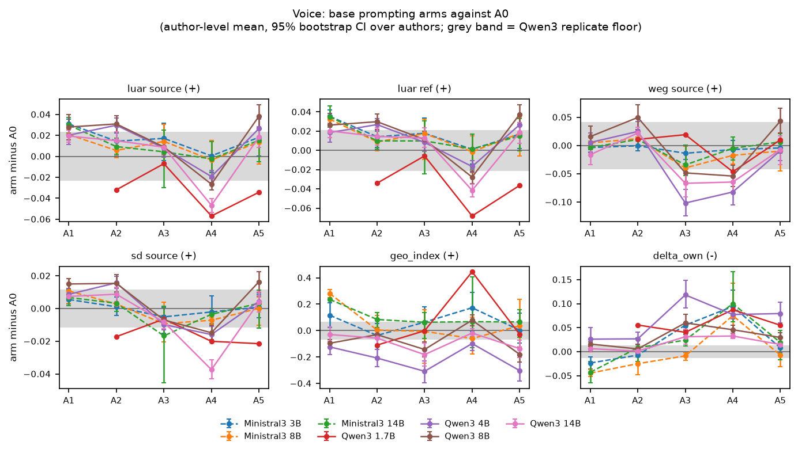
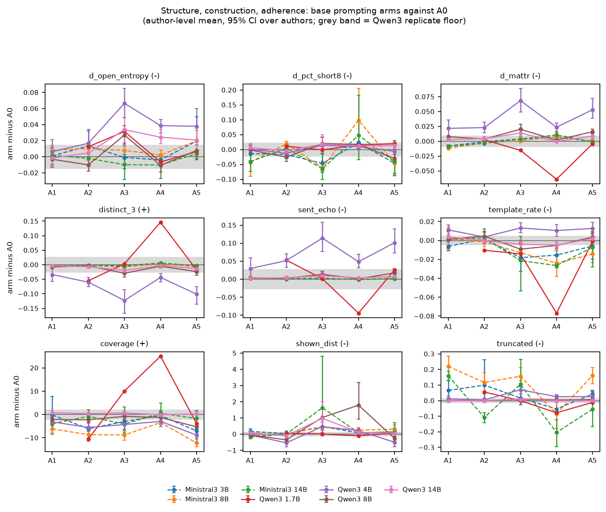
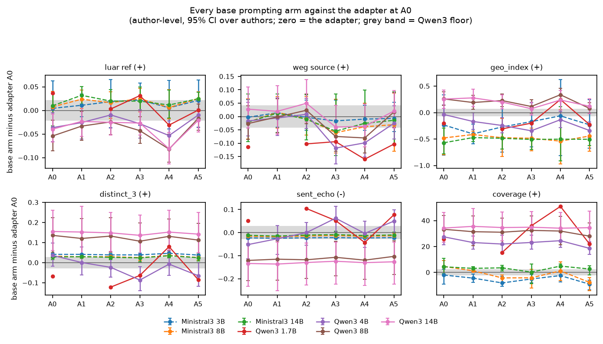
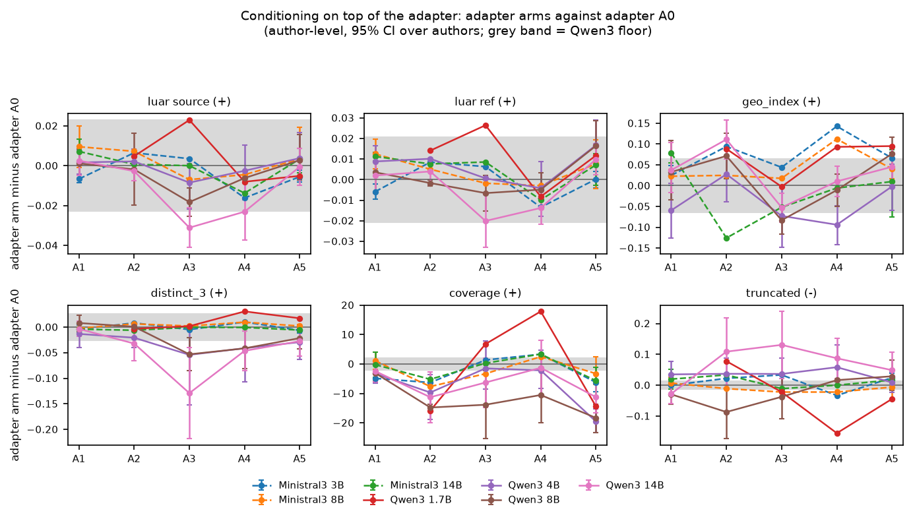
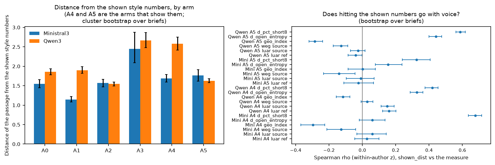

# 12 Arm effects: what prompting buys, and whether it reaches the adapter

## What this does

Asks what each prompting arm buys over the bare brief (A0), whether any prompt reaches the
LoRA adapter, whether showing a model its target style numbers makes it hit them, and
whether conditioning still helps once the adapter is in place.

Five arms are contrasted against A0 inside every base run: A1 (+ the author's name), A2
(+ three retrieved exemplars), A3 (+ the style guide), A4 (+ the quantitative style block),
A5 (everything). 23 measures are used, 21 of them with a defined
direction. 782 pooled contrasts are computed; 202 reach q < 0.05 under BH-FDR
within that family of 782, and 138 of those are also larger than the
replicate floor of their measure. A contrast that clears both is a difference this design
can see, not a difference a reader would notice.

## How it does it

Data: `data/master/cells.parquet`, non-replicate cells; base runs for the arm contrasts,
adapter runs for the adapter-arm contrasts. Author reference means for the descriptive
structure measures come from `data/master/references.parquet` (rows with group `source` or
`ref`, pooled per author so base and adapter share one anchor).

Measures. Only measures recomputed for every arm can carry an arm contrast. The eval-cache
block (per, per_uncapped, otd_js, hapax_w300, tau, terminal_missing, events_present, arti_w,
rfpd_w, cpd_z, burst_an_diff, w1_logpara, para_cv_words) and the whole rubric block were
computed on the arm-A0 passage only. In `broadcast_check.csv` 0 such columns show
a single value across the six arms of a (run, brief, sample), while luar_cos_source,
template_rate, shown_dist, coverage and win_vs_A0 vary; the 0 the check
flags are excluded. The check counts a column as identical when the arms it finds do not
disagree, so a column that carries a value on A0 and nothing on A1 to A5 is flagged the same
way as one whose A0 value was copied across every arm. The two cases differ in the master
table and not in what they permit: an arm contrast on any of them is a structural zero either
way, and no A1 to A5 effect on an eval-cache or rubric measure can be claimed from these
data. The exclusion is decided by the check at run time, not by a hard-coded list:
0 columns were reinstated on this build because the check found them varying
by arm.

Five descriptive structure measures (open_entropy, pct_short8, cr_pos, mattr, sent_len_cv)
have no direction on their own; they are carried as the absolute distance from the author's
own reference mean (`d_*`, lower = closer to the author). `geo_index` is used with direction
"+": the variable dictionary records "-", but the authors' own passages score 0.916 on
it, other authors' passages 0.824 and the A0 generations 0.143, so higher is
closer to the author (`geo_index_direction.csv`).

Unit and model. Inside an author the brief is the cluster: an arm contrast is the mean over
briefs of (arm minus A0), both arms generated from the same brief and sample, with a
bootstrap over briefs (2000 resamples), Cohen's d and Cliff's delta on the brief means. For
any claim about a model the author is the unit: the pooled contrast is the mean over authors
of those per-author values with a bootstrap over authors. Authors per family x size cell:
Ministral3 3B: 3, Ministral3 8B: 3, Ministral3 14B: 3, Qwen3 1.7B: 1, Qwen3 4B: 14, Qwen3 8B: 13, Qwen3 14B: 13. The Qwen3 4B/8B/14B cells, which carry the study, have
13 or 14 authors; Qwen3 1.7B is patrick_v2 alone and is a single
point, not an estimate. Two of those author rows, patrick and patrick_v2, are the same corpus at two chunk sizes, so the independent corpora number one fewer than the author count in any cell that holds both.
p-values are Wilcoxon signed-rank on the per-brief (author level) or per-author (pooled)
differences, BH-FDR adjusted within each table separately: a q here means "within this
table's family", not across the script and not across the programme.

Bootstrap. The per-contrast interval uses a vectorised resample over briefs rather than
`lib.cluster_bootstrap`, which would take minutes over 5497 author-level
contrasts; `bootstrap_crosscheck.csv` runs both on the same contrasts and the largest gap
between the two point estimates is
0.00e+00 and between the interval
endpoints 0.00e+00.

Floors. Every contrast is printed beside a replicate floor for its measure at its arm.
`replicate_floors.csv` now carries measured floors for Ministral3, Qwen3
(no family is missing one),
138 of them on Ministral3. The `floor_qwen` column beside every contrast
in this script's other tables holds the row's own family floor where that family has a
measured pair for the measure (the column name is historical), and the Qwen3 value where it
does not; a Ministral3 row is therefore judged against a floor measured at 3B whatever its
size, since the two Ministral pairs are both 3B.
The Ministral3 floors were measured from two 3B replicate pairs scored on 2026-09-10, so
there is no measured Ministral3 floor at 8B or 14B in either table.

Adapter comparison. Each base arm is paired brief-by-brief against the same author's adapter
at A0, so the difference is a like-for-like swap of mechanism holding the brief fixed.
Equivalence is `lib.tost` with bounds equal to the measure's replicate floor.

Mixed models: `diff ~ C(arm) * log2(params) + C(arm) * C(family)` with a random intercept per
author, one per headline measure. 0 of 6 failed to fit and 0 of
the 6 that fitted sit at the zero boundary for the author variance
(`boundary_fit` in the csv), which is a fit that carries no author variance rather than a
finding of none. With 13 or 14 authors the random-effect variance is descriptive whether or
not it is at the boundary, so the interaction terms are read as pattern and never as a test.

### Arms against A0, pooled over authors: the voice measures at Qwen3 14B

| arm | measure | n_authors | mean_diff | ci_low | ci_high | floor_qwen | above_floor | q_bh |
|---|---|---|---|---|---|---|---|---|
| A1 | geo_index | 11 | -0.029 | -0.078 | 0.028 | 0.066 | False | 0.379 |
| A2 | geo_index | 13 | -0.057 | -0.119 | 0.006 | 0.103 | False | 0.379 |
| A3 | geo_index | 13 | -0.182 | -0.268 | -0.090 | 0.041 | True | 0.021 |
| A4 | geo_index | 13 | -0.018 | -0.054 | 0.016 | 0.046 | False | 0.624 |
| A5 | geo_index | 13 | -0.136 | -0.201 | -0.068 | 0.115 | True | 0.007 |
| A1 | luar_cos_ref | 11 | 0.020 | 0.013 | 0.027 | 0.020 | True | 0.005 |
| A2 | luar_cos_ref | 13 | 0.014 | 0.005 | 0.024 | 0.010 | True | 0.042 |
| A3 | luar_cos_ref | 13 | 0.013 | 0.004 | 0.023 | 0.010 | True | 0.208 |
| A4 | luar_cos_ref | 13 | -0.042 | -0.048 | -0.035 | 0.008 | True | 0.002 |
| A5 | luar_cos_ref | 13 | 0.019 | 0.008 | 0.029 | 0.016 | True | 0.033 |
| A1 | luar_cos_source | 11 | 0.019 | 0.014 | 0.025 | 0.010 | True | 0.005 |
| A2 | luar_cos_source | 13 | 0.015 | 0.006 | 0.024 | 0.010 | True | 0.033 |
| A3 | luar_cos_source | 13 | 0.009 | 0.002 | 0.016 | 0.011 | False | 0.349 |
| A4 | luar_cos_source | 13 | -0.047 | -0.054 | -0.040 | 0.014 | True | 0.002 |
| A5 | luar_cos_source | 13 | 0.018 | 0.008 | 0.028 | 0.016 | True | 0.026 |
| A1 | styledist_cos_source | 11 | 0.007 | 0.005 | 0.010 | 0.004 | True | 0.008 |
| A2 | styledist_cos_source | 13 | 0.009 | 0.005 | 0.013 | 0.008 | True | 0.021 |
| A3 | styledist_cos_source | 13 | -0.008 | -0.012 | -0.005 | 0.004 | True | 0.002 |
| A4 | styledist_cos_source | 13 | -0.037 | -0.043 | -0.032 | 0.003 | True | 0.002 |
| A5 | styledist_cos_source | 13 | 0.004 | -0.003 | 0.010 | 0.008 | False | 0.409 |
| A1 | wegmann_cos_source | 11 | -0.016 | -0.033 | 0.000 | 0.025 | False | 0.379 |
| A2 | wegmann_cos_source | 13 | 0.022 | 0.012 | 0.032 | 0.046 | False | 0.009 |
| A3 | wegmann_cos_source | 13 | -0.067 | -0.091 | -0.042 | 0.051 | True | 0.004 |
| A4 | wegmann_cos_source | 13 | -0.065 | -0.084 | -0.043 | 0.029 | True | 0.003 |
| A5 | wegmann_cos_source | 13 | -0.007 | -0.034 | 0.018 | 0.018 | False | 0.912 |

### Arm ranking over all rankable measures and all seven family x size cells (rank 1 of 6 = best)

| arm | mean_rank | times_best | n_cells | mean_improvement |
|---|---|---|---|---|
| A0 | 2.918 | 33 | 147 | 0.000 |
| A2 | 3.075 | 22 | 147 | -0.234 |
| A1 | 3.095 | 28 | 126 | -0.118 |
| A4 | 3.435 | 46 | 147 | 0.104 |
| A5 | 3.748 | 7 | 147 | -0.287 |
| A3 | 4.313 | 11 | 147 | -0.133 |

### Arm ranking on the five voice measures only

| arm | mean_rank | times_best | n_cells | mean_improvement |
|---|---|---|---|---|
| A1 | 2.067 | 13 | 30 | 0.025 |
| A2 | 2.543 | 9 | 35 | -0.001 |
| A5 | 3.000 | 3 | 35 | -0.009 |
| A0 | 3.743 | 6 | 35 | 0.000 |
| A3 | 4.286 | 1 | 35 | -0.021 |
| A4 | 4.800 | 3 | 35 | -0.003 |

### Arm ranking on construction and coverage only

| arm | mean_rank | times_best | n_cells | mean_improvement |
|---|---|---|---|---|
| A0 | 1.714 | 13 | 28 | 0.000 |
| A4 | 2.036 | 14 | 28 | 0.634 |
| A2 | 3.714 | 0 | 28 | -1.209 |
| A1 | 3.833 | 1 | 24 | -0.622 |
| A3 | 4.643 | 0 | 28 | -0.384 |
| A5 | 4.750 | 0 | 28 | -1.406 |

### The best prompting arm against the adapter (positive = the prompt is closer to the author)

| family | params_b | measure | best_arm | prompt_better_than_adapter | ci_low | ci_high | n_authors | floor_qwen | verdict |
|---|---|---|---|---|---|---|---|---|---|
| Ministral3 | 3.000 | coverage | A0 | -2.014 | -8.949 | 2.311 | 3 | 1.974 | adapter beats every prompt |
| Ministral3 | 8.000 | coverage | A0 | 4.621 | -1.044 | 9.317 | 3 | 1.974 | prompt beats adapter |
| Ministral3 | 14.000 | coverage | A4 | 4.904 | 3.889 | 6.643 | 3 | 3.179 | prompt beats adapter |
| Qwen3 | 1.700 | coverage | A4 | 50.978 |  |  | 1 | 3.179 | prompt beats adapter |
| Qwen3 | 4.000 | coverage | A0 | 27.485 | 21.215 | 34.755 | 14 | 1.974 | prompt beats adapter |
| Qwen3 | 8.000 | coverage | A0 | 33.309 | 23.306 | 44.174 | 13 | 1.974 | prompt beats adapter |
| Qwen3 | 14.000 | coverage | A1 | 35.581 | 23.565 | 49.255 | 11 | 3.103 | prompt beats adapter |
| Ministral3 | 3.000 | d_cr_pos | A3 | 0.207 | 0.114 | 0.330 | 3 | 0.876 | within the replicate floor |
| Ministral3 | 8.000 | d_cr_pos | A4 | 0.180 | 0.066 | 0.272 | 3 | 0.657 | within the replicate floor |
| Ministral3 | 14.000 | d_cr_pos | A4 | 0.155 | 0.016 | 0.231 | 3 | 0.657 | within the replicate floor |
| Qwen3 | 1.700 | d_cr_pos | A4 | -0.363 |  |  | 1 | 0.657 | within the replicate floor |
| Qwen3 | 4.000 | d_cr_pos | A0 | 0.294 | -0.275 | 0.956 | 14 | 0.391 | within the replicate floor |
| Qwen3 | 8.000 | d_cr_pos | A2 | 1.498 | 0.437 | 2.768 | 13 | 0.503 | prompt beats adapter |
| Qwen3 | 14.000 | d_cr_pos | A1 | 2.438 | 0.436 | 4.704 | 11 | 0.086 | prompt beats adapter |
| Ministral3 | 3.000 | d_mattr | A1 | 0.052 | 0.049 | 0.055 | 2 | 0.006 | prompt beats adapter |
| Ministral3 | 8.000 | d_mattr | A1 | 0.041 | 0.039 | 0.043 | 2 | 0.006 | prompt beats adapter |
| Ministral3 | 14.000 | d_mattr | A1 | 0.033 | 0.029 | 0.037 | 2 | 0.006 | prompt beats adapter |
| Qwen3 | 1.700 | d_mattr | A4 | 0.058 |  |  | 1 | 0.015 | prompt beats adapter |
| Qwen3 | 4.000 | d_mattr | A0 | 0.031 | 0.005 | 0.058 | 14 | 0.009 | prompt beats adapter |
| Qwen3 | 8.000 | d_mattr | A0 | 0.093 | 0.056 | 0.137 | 13 | 0.009 | prompt beats adapter |
| Qwen3 | 14.000 | d_mattr | A4 | 0.095 | 0.057 | 0.143 | 13 | 0.015 | prompt beats adapter |
| Ministral3 | 3.000 | d_open_entropy | A1 | 0.023 | 0.021 | 0.026 | 2 | 0.008 | prompt beats adapter |
| Ministral3 | 8.000 | d_open_entropy | A1 | 0.033 | 0.030 | 0.035 | 2 | 0.008 | prompt beats adapter |
| Ministral3 | 14.000 | d_open_entropy | A1 | 0.037 | 0.024 | 0.050 | 2 | 0.008 | prompt beats adapter |
| Qwen3 | 1.700 | d_open_entropy | A4 | -0.249 |  |  | 1 | 0.014 | adapter beats every prompt |
| Qwen3 | 4.000 | d_open_entropy | A1 | -0.080 | -0.133 | -0.020 | 11 | 0.008 | adapter beats every prompt |
| Qwen3 | 8.000 | d_open_entropy | A4 | 0.023 | -0.039 | 0.084 | 13 | 0.014 | prompt beats adapter |
| Qwen3 | 14.000 | d_open_entropy | A1 | 0.080 | 0.018 | 0.154 | 11 | 0.008 | prompt beats adapter |
| Ministral3 | 3.000 | d_pct_short8 | A3 | 0.010 | 0.006 | 0.014 | 3 | 0.034 | within the replicate floor |
| Ministral3 | 8.000 | d_pct_short8 | A3 | -0.012 | -0.035 | 0.024 | 3 | 0.034 | within the replicate floor |
| Ministral3 | 14.000 | d_pct_short8 | A3 | -0.003 | -0.027 | 0.013 | 3 | 0.034 | within the replicate floor |
| Qwen3 | 1.700 | d_pct_short8 | A3 | -0.007 |  |  | 1 | 0.034 | within the replicate floor |
| Qwen3 | 4.000 | d_pct_short8 | A2 | -0.038 | -0.065 | -0.006 | 14 | 0.018 | adapter beats every prompt |
| Qwen3 | 8.000 | d_pct_short8 | A5 | -0.014 | -0.048 | 0.024 | 13 | 0.019 | within the replicate floor |
| Qwen3 | 14.000 | d_pct_short8 | A2 | -0.002 | -0.035 | 0.036 | 13 | 0.018 | within the replicate floor |
| Ministral3 | 3.000 | d_sent_len_cv | A5 | -0.002 | -0.031 | 0.023 | 3 | 0.028 | within the replicate floor |
| Ministral3 | 8.000 | d_sent_len_cv | A1 | -0.031 | -0.059 | -0.003 | 2 | 0.019 | adapter beats every prompt |
| Ministral3 | 14.000 | d_sent_len_cv | A4 | -0.008 | -0.067 | 0.027 | 3 | 0.023 | within the replicate floor |
| Qwen3 | 1.700 | d_sent_len_cv | A0 | -0.046 |  |  | 1 | 0.022 | adapter beats every prompt |
| Qwen3 | 4.000 | d_sent_len_cv | A5 | -0.030 | -0.061 | 0.008 | 14 | 0.028 | adapter beats every prompt |
| Qwen3 | 8.000 | d_sent_len_cv | A5 | 0.001 | -0.043 | 0.052 | 13 | 0.028 | within the replicate floor |
| Qwen3 | 14.000 | d_sent_len_cv | A2 | 0.014 | -0.017 | 0.049 | 13 | 0.032 | within the replicate floor |
| Ministral3 | 3.000 | delta_own | A2 | 0.054 | -0.013 | 0.142 | 3 | 0.022 | prompt beats adapter |
| Ministral3 | 8.000 | delta_own | A2 | 0.085 | 0.019 | 0.173 | 3 | 0.022 | prompt beats adapter |
| Ministral3 | 14.000 | delta_own | A1 | 0.089 | 0.078 | 0.099 | 2 | 0.035 | prompt beats adapter |

### Distance from the shown style numbers, by arm and family

| family | arm | n_cells | n_briefs | shown_dist_mean | ci_low | ci_high |
|---|---|---|---|---|---|---|
| Ministral3 | A0 | 756 | 126 | 1.549 | 1.449 | 1.654 |
| Ministral3 | A1 | 486 | 81 | 1.145 | 1.079 | 1.220 |
| Ministral3 | A2 | 756 | 126 | 1.570 | 1.472 | 1.667 |
| Ministral3 | A3 | 756 | 126 | 2.447 | 2.089 | 2.875 |
| Ministral3 | A4 | 756 | 126 | 1.690 | 1.596 | 1.787 |
| Ministral3 | A5 | 756 | 126 | 1.761 | 1.618 | 1.913 |
| Qwen3 | A0 | 3182 | 546 | 1.855 | 1.778 | 1.938 |
| Qwen3 | A1 | 2592 | 432 | 1.898 | 1.815 | 1.990 |
| Qwen3 | A2 | 3182 | 546 | 1.544 | 1.494 | 1.595 |
| Qwen3 | A3 | 3182 | 546 | 2.665 | 2.482 | 2.866 |
| Qwen3 | A4 | 3182 | 546 | 2.576 | 2.419 | 2.749 |
| Qwen3 | A5 | 3182 | 546 | 1.626 | 1.578 | 1.678 |

### Conditioning on top of the adapter: the contrasts above their floor with an interval off zero on eight or more authors (2 of the 276 testable adapter-arm contrasts clear BH-FDR at q < 0.05 within that family)

| family | params_b | arm | measure | n_authors | mean_diff | ci_low | ci_high | floor_qwen | p_wilcoxon | q_bh |
|---|---|---|---|---|---|---|---|---|---|---|
| Qwen3 | 4.000 | A5 | coverage | 13 | -19.545 | -23.180 | -15.197 | 4.231 | 0.000 | 0.034 |
| Qwen3 | 8.000 | A5 | coverage | 13 | -18.299 | -23.064 | -13.368 | 4.231 | 0.000 | 0.034 |
| Qwen3 | 4.000 | A5 | luar_cos_ref | 13 | 0.017 | 0.008 | 0.029 | 0.016 | 0.001 | 0.084 |
| Qwen3 | 8.000 | A5 | luar_cos_ref | 13 | 0.016 | 0.008 | 0.028 | 0.016 | 0.002 | 0.135 |
| Qwen3 | 14.000 | A5 | coverage | 13 | -11.263 | -16.403 | -5.441 | 4.231 | 0.005 | 0.183 |
| Qwen3 | 8.000 | A5 | delta_own | 13 | 0.045 | 0.022 | 0.069 | 0.026 | 0.005 | 0.183 |
| Qwen3 | 14.000 | A5 | rep_4 | 13 | 0.036 | 0.009 | 0.070 | 0.032 | 0.010 | 0.322 |
| Qwen3 | 8.000 | A5 | d_cr_pos | 13 | 0.757 | 0.232 | 1.442 | 0.328 | 0.013 | 0.371 |
| Qwen3 | 4.000 | A5 | rep_4 | 13 | 0.038 | 0.006 | 0.077 | 0.032 | 0.027 | 0.525 |
| Qwen3 | 4.000 | A5 | d_cr_pos | 13 | 0.560 | 0.079 | 1.193 | 0.328 | 0.027 | 0.525 |
| Qwen3 | 8.000 | A5 | words | 13 | -59.795 | -98.924 | -17.297 | 24.885 | 0.027 | 0.525 |
| Qwen3 | 14.000 | A1 | shown_dist | 11 | -0.928 | -2.676 | -0.019 | 0.158 | 0.032 | 0.564 |
| Qwen3 | 8.000 | A5 | len_ratio | 13 | -0.079 | -0.132 | -0.023 | 0.033 | 0.033 | 0.564 |
| Qwen3 | 14.000 | A5 | shown_dist | 13 | -1.082 | -2.454 | -0.097 | 0.075 | 0.040 | 0.644 |
| Qwen3 | 8.000 | A1 | d_open_entropy | 11 | -0.013 | -0.027 | -0.000 | 0.008 | 0.067 | 0.651 |
| Qwen3 | 8.000 | A1 | len_ratio | 11 | -0.028 | -0.053 | -0.003 | 0.014 | 0.083 | 0.651 |
| Qwen3 | 4.000 | A1 | d_mattr | 11 | 0.016 | 0.002 | 0.033 | 0.006 | 0.083 | 0.651 |
| Qwen3 | 4.000 | A1 | staccato_anaphora | 11 | 0.013 | 0.001 | 0.032 | 0.012 | 0.102 | 0.651 |
| Qwen3 | 8.000 | A1 | words | 11 | -20.823 | -38.725 | -1.728 | 11.427 | 0.102 | 0.651 |
| Qwen3 | 8.000 | A5 | shown_dist | 13 | 0.132 | 0.003 | 0.286 | 0.075 | 0.110 | 0.651 |
| Qwen3 | 4.000 | A1 | sent_echo | 11 | 0.018 | 0.001 | 0.044 | 0.011 | 0.147 | 0.651 |
| Qwen3 | 4.000 | A1 | coverage | 11 | -3.238 | -6.618 | -0.170 | 3.103 | 0.206 | 0.651 |

### Columns the master build broadcast from A0 to every arm (why they are excluded here)

| column | rows_checked | share_identical_across_arms | distinct_values_overall | verdict |
|---|---|---|---|---|
| coverage | 170 | 0.059 | 35 | varies by arm |
| win_vs_A0 | 170 | 0.024 | 5 | varies by arm |
| luar_cos_source | 340 | 0.000 | 1949 | varies by arm |
| shown_dist | 340 | 0.000 | 1949 | varies by arm |
| template_rate | 340 | 0.000 | 1901 | varies by arm |
| per | 0 |  | 97 | present on one arm only, undecidable |
| per_uncapped | 0 |  | 132 | present on one arm only, undecidable |
| otd_js | 0 |  | 340 | present on one arm only, undecidable |
| hapax_w300 | 0 |  | 80 | present on one arm only, undecidable |
| tau | 0 |  | 98 | present on one arm only, undecidable |
| terminal_missing | 0 |  | 2 | present on one arm only, undecidable |
| events_present | 0 |  | 43 | present on one arm only, undecidable |
| arti_w | 0 |  | 330 | present on one arm only, undecidable |
| rfpd_w | 0 |  | 340 | present on one arm only, undecidable |
| cpd_z | 0 |  | 340 | present on one arm only, undecidable |
| burst_an_diff | 0 |  | 340 | present on one arm only, undecidable |
| w1_logpara | 0 |  | 340 | present on one arm only, undecidable |
| rubric_C | 0 |  | 90 | present on one arm only, undecidable |
| rubric_S | 0 |  | 91 | present on one arm only, undecidable |

### Vectorised bootstrap against lib.cluster_bootstrap on the same contrasts

| measure | run | vectorised_mean | vectorised_lo | vectorised_hi | lib_cluster_mean | lib_cluster_lo | lib_cluster_hi | abs_mean_gap | abs_ci_gap |
|---|---|---|---|---|---|---|---|---|---|
| luar_cos_source | chesterton_base4b | 0.016 | -0.008 | 0.041 | 0.016 | -0.008 | 0.041 | 0.000 | 0.000 |
| luar_cos_source | wharton_base8b | 0.012 | -0.009 | 0.033 | 0.012 | -0.009 | 0.033 | 0.000 | 0.000 |
| luar_cos_source | doctorow_base14b | 0.018 | 0.001 | 0.033 | 0.018 | 0.001 | 0.033 | 0.000 | 0.000 |
| geo_index | chesterton_base4b | -0.199 | -0.341 | -0.055 | -0.199 | -0.341 | -0.055 | 0.000 | 0.000 |
| geo_index | wharton_base8b | -0.111 | -0.222 | 0.005 | -0.111 | -0.222 | 0.005 | 0.000 | 0.000 |
| geo_index | doctorow_base14b | -0.322 | -0.435 | -0.212 | -0.322 | -0.435 | -0.212 | 0.000 | 0.000 |
| coverage | chesterton_base4b | -2.615 | -10.848 | 5.103 | -2.615 | -10.848 | 5.103 | 0.000 | 0.000 |
| coverage | wharton_base8b | -2.773 | -7.977 | 1.887 | -2.773 | -7.977 | 1.887 | 0.000 | 0.000 |
| coverage | doctorow_base14b | 2.341 | -1.585 | 5.854 | 2.341 | -1.585 | 5.854 | 0.000 | 0.000 |

### Arm profile, voice

### Arm profile, structure, construction and adherence

### Prompting arms against the adapter

### Adapter arms

### A4/A5 numeric compliance

### Headline numbers

- Prompting and structure do not agree about the sign. Across the 6 family x size cells
  that rest on more than one author (Ministral3 3, Qwen3 3), A2 and A5 raise luar_cos_source in every one (A2
  +0.0057 to +0.0310, 4 of 6 above the floor
  and 3 at q < 0.05; A5 +0.0135 to +0.0383, 5
  above the floor and 3 at q < 0.05; the floor is 0.0229),
  while 14 of the 15 arm x size cells on Qwen3 4B and above lower geo_index
  (-0.308 to +0.079, 11 above the
  floor and 11 at q < 0.05; the exceptions are A4 at 8B). The embedding reads the
  prompted passage as closer to the author and the sealed geometry reads it as further away.
  Half of those cells are Ministral3 cells resting on three authors, so this is a statement about
  3 to 14 authors per cell, not about either
  family as a whole.
- Arm ranking, which carries no interval and is not a test. Lowest mean rank overall across
  147 measure x cell rankings: **A0**
  (2.92 of 6, first in 33); the arm
  that comes first most often is **A4** (46), so the two
  columns of the same table pick different winners. On the 5 voice measures the lowest mean
  rank is **A1** (2.07, first in
  13 of 30) and the highest is
  **A4** (4.80). Arms are not ranked on identical
  cell sets, so the gaps between adjacent arms are not comparisons of like with like.
- Showing a model its target numbers does not bring it closer to them. On Qwen3 the mean distance
  from the shown style numbers is +0.721 higher at A4 (the arm that shows the numbers)
  than at A0, +0.810 higher at A3 (the style guide) and -0.229 at A5. These are
  differences of two point estimates from `compliance_shown_dist.csv`, each bootstrapped over
  briefs with the authors pooled: the unit is the brief, no interval is computed on the
  difference itself, and no replicate floor exists for a between-arm difference of pooled means.
- Compliance with the shown numbers tracks the structure it is built from and not the embedding.
  Within Qwen3 A4 cells, shown_dist correlates with the structural distances it is built from
  (d_pct_short8 +0.42 [+0.38, +0.45], d_open_entropy
  +0.33 [+0.29, +0.36]) and with geo_index in the expected direction
  (-0.12 [-0.16, -0.07]), while its correlation with the embedding runs the other
  way: luar_cos_ref +0.16 [+0.12, +0.20], so on the arm that shows the numbers the
  passages landing closest to them are the ones LUAR scores furthest from the author. At A5 that
  reverses to -0.04 [-0.09, -0.00]. These are brief-level correlations over
  546 briefs with each author standardised separately and the authors then pooled, BH-FDR
  over the 36 correlations in `compliance_vs_voice.csv`; the unit is the brief within
  an author, so no author-level interval stands behind them.
- Best prompt against the adapter, over 147 measure x cell rows:
  74 prompt beats adapter, 37 within the replicate floor, 36 adapter beats every prompt. On voice alone: 14 adapter beats every prompt, 12 within the replicate floor, 9 prompt beats adapter. On construction and coverage:
  26 prompt beats adapter, 1 adapter beats every prompt, 1 within the replicate floor, spread over coverage 7, distinct_3 7, rep_4 7, sent_echo 7. The construction verdict rests mostly
  on n-gram measures the dictionary marks length-contaminated rather than on coverage, and the
  eval-cache construction measures cannot enter it at all. Read it as: the adapter is ahead on
  the embedding measures, the prompts are ahead on the n-gram and coverage measures.
- The adapter costs brief coverage as an LLM judge counts it. Base A0 minus adapter A0 on
  coverage runs -2.0 to +34.3 points over the 6 cells that rest
  on three or more authors (3 to 14 authors each), against a floor of
  1.97. The 1 single-author cell is left out of that range. Every one
  of these cells is Ministral3, Qwen3: coverage does not exist on the other family, so this is not a
  statement about adapters in general.
- Conditioning on top of the adapter buys very little. 2 of the
  276 testable adapter-arm contrasts clear BH-FDR at q < 0.05, and the smallest q
  in the whole table is 0.03: the correction runs over
  276 tests, 138 of them on three authors or
  fewer. The largest effects that clear their floor with an interval off zero on eight or more
  authors are A5 on coverage at Qwen3 4B, -19.5449 [-23.1797, -15.1972] against a floor of 4.2308 (13 authors, q = 0.03); A5 on coverage at Qwen3 8B, -18.2990 [-23.0635, -13.3679] against a floor of 4.2308 (13 authors, q = 0.03); A5 on luar_cos_ref at Qwen3 4B, +0.0167 [+0.0075, +0.0290] against a floor of 0.0158 (13 authors, q = 0.08); where those rows are coverage rows they are a judge's reading of
  brief adherence, not a measurement. A5 on the adapter moves luar_cos_source by
  -0.0055 to +0.0038 across the multi-author
  cells, at or below the floor of 0.0165, which is the range
  in which regenerating the same configuration would land.
- 12 interaction terms in the mixed models reach p < 0.05 without correction, with
  0 of the 6 fitted models at the zero boundary for the author
  variance. On 13-14 authors these are descriptive, not tests.

## How to read the result, conservatively

The unit of replication is the author, not the passage. Every pooled number rests on
13-14 authors on Qwen3 4B-14B, three on Ministral3 and one at
Qwen3 1.7B, and the intervals are correspondingly wide: at Qwen3 14B the A5-minus-A0 interval on
luar_cos_source spans 0.0082 to
0.0282 around a point estimate of
+0.0183. Three authors carry every Ministral3 cell, so
the Ministral3 rows are descriptive; a Wilcoxon test on three values cannot reach q < 0.05
whatever the effect size.

Read a contrast as real only when its interval excludes zero, its q is below 0.05 within its
own table, and its magnitude exceeds the floor in the same row. Of 782 pooled arm
contrasts, 138 meet all three. They are not evenly spread, and the embedding
measures and the structural ones do not agree on the sign of what prompting does, which is
consistent with the two instrument families reading different things rather than with either
of them being wrong.

The ranking is a ranking, not a test. `arm_rank_summary.csv` carries no interval, and the
arms are not ranked on the same set of cells:
A1 appear in fewer cells than the rest (A0: 147, A1: 126, A2: 147, A3: 147, A4: 147, A5: 147),
so a mean-rank difference between two arms with different denominators is not a comparison
of like with like. The same table disagrees with itself depending on which column is read:
the lowest mean rank is A0 while the arm that comes first most often is
A4 (46 of 147 cells). Neither
column is a measurement of quality.

Floors. A contrast smaller than the replicate floor of its measure is within the range of
generating the same configuration twice, whatever its q. The `floor_qwen` column carries the
row's own family floor where one is measured and the Qwen3 value otherwise; on Ministral3
rows the floor is a 3B measurement applied at 8B and 14B as well.

Judged measures. `coverage` is an LLM judge's count of brief items, so every coverage row in
this folder is a judge's reading and not a measurement, and the coverage rows for several
Qwen3 runs were error rows from the 2026-09-09 credit outage that were still being refilled
when this was written. Ministral3 has no judge data at all, so no coverage row exists for
that family. Judge measures are relative instruments with known failures and are never read
here as absolute quality.

What would overturn this. The arm ranking is computed on pooled author means with A0 pinned
at zero, so one author with a large opposite effect can move an arm by a rank inside a cell;
`arm_ranks_by_cell.csv` shows the spread. The best-arm-versus-adapter table selects the
winning arm on the same authors it then reports, which biases it toward the prompt; the
unselected per-arm version is `prompt_vs_adapter_pooled.csv` and should be read first. If the
geo_index sign in the variable dictionary is right and the reference passages are wrong, the
dissociation reported below reverses into agreement.

What this does not show. Nothing here speaks to construction as the eval cache measures it
(PER, OTD, hapax, event order): those exist for A0 only, so "does A5 restate itself more than
A0" cannot be answered from this master table in either direction. What stands in for
construction here is distinct_3, sent_echo, rep_4, coverage, and three of those are n-gram measures the
variable dictionary marks as length-contaminated, so a construction verdict in this folder is
partly a verdict about passage length. Nor does it speak to judged craft by arm: the rubric
was run on arm A0, sample 0 alone. The 2AFC column win_vs_A0 does vary by arm and belongs to
script 16. And nothing here is evidence about absolute quality.

## Caveats

- 0 columns in cells.parquet carry no usable arm variation (the eval cache and the whole rubric block, computed on arm A0 alone). They are excluded from every contrast in this script; see broadcast_check.csv, whose 'broadcast' verdict covers both a copied A0 value and an A0-only column.
- The `floor_qwen` column in every contrast table here is the row's own family floor where one is measured and the Qwen3 value otherwise. The Ministral3 floors (138 rows in replicate_floors.csv) come from two 3B replicate pairs scored on 2026-09-10 and are applied to the 8B and 14B rows of that family as well, so a Ministral3 above_floor verdict at 8B or 14B rests on a floor measured at another size.
- Ministral3 cells rest on three authors (chesterton, doctorow, patrick_v2); their pooled intervals are bootstraps over three values and their Wilcoxon p-values cannot fall below 0.25.
- `doctorow_basem8b` exceeds the 20% truncation gate and is flagged rather than excluded, and `chesterton_paire6_m8b` has a positive probe delta (the adapter changed nothing the probe could measure). Both sit inside the Ministral3 8B cells, which already rest on three authors.
- The `*_cos_ref` and attribution measures are anchored against a stranger pool of fourteen period authors for every study author, so contemporary and private authors are positioned against another century; scripts/23_register_matched_pool.py holds the register-matched repair, which has not been applied here.
- Arm coverage is not balanced across authors: A1 is missing from the base runs of h_private, patrick, patrick_v2, and A2, A3 and A4 exist on the adapter runs of h_private, patrick, patrick_v2 only. Rows in the ranking therefore rest on different arm sets for different authors, which is why the arms in arm_rank_summary.csv do not share one denominator.
- coverage is an LLM-judged measure on sample 0 only, so its brief pairing has half the rows of the other measures, it is missing entirely for some adapter runs, and it does not exist at all on Ministral3. Rows for several Qwen3 runs were error rows from the 2026-09-09 credit outage and were being refilled while this was written, so every coverage number in this folder is provisional until the final rerun.
- `distinct_3, sent_echo, rep_4, coverage` stand in for construction here because the eval-cache construction measures exist on arm A0 only. Three of them are n-gram measures the variable dictionary marks length-contaminated (distinct_3 correlates with words at rho -0.44), so a construction verdict in this folder is partly a length verdict; script 17 holds the length null.
- geo_index is used with the opposite sign to the variable dictionary; every geo_index row in this folder flips if the dictionary is right.
- The d_* distances use one reference mean per author, so an author whose own passages are widely spread on a measure gets a noisier distance than one whose are tight.
- The adapter-arm BH-FDR runs over 276 testable contrasts, of which 138 rest on three authors or fewer and cannot reach q < 0.05 however large the effect. Nothing in that table survives the correction, so its above-floor rows are reported with intervals and uncorrected p-values and should be treated as leads, not findings.
- Mixed models: 0 of 6 failed to fit and 0 sit at the zero boundary for the author variance. With 13-14 authors every random-effect variance here is descriptive. lib.mixed_model was changed on 2026-09-10 to drop the lbfgs optimiser, which returned zero variances and 1e4 intercept standard errors on these data; running this script against an older lib.py will not reproduce the mixed-model rows.
