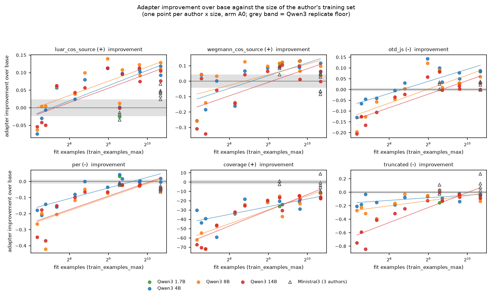
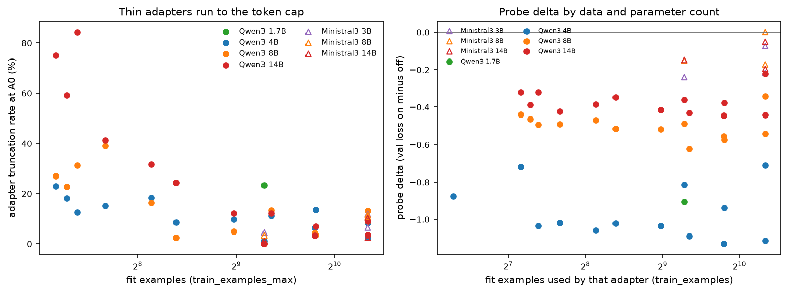
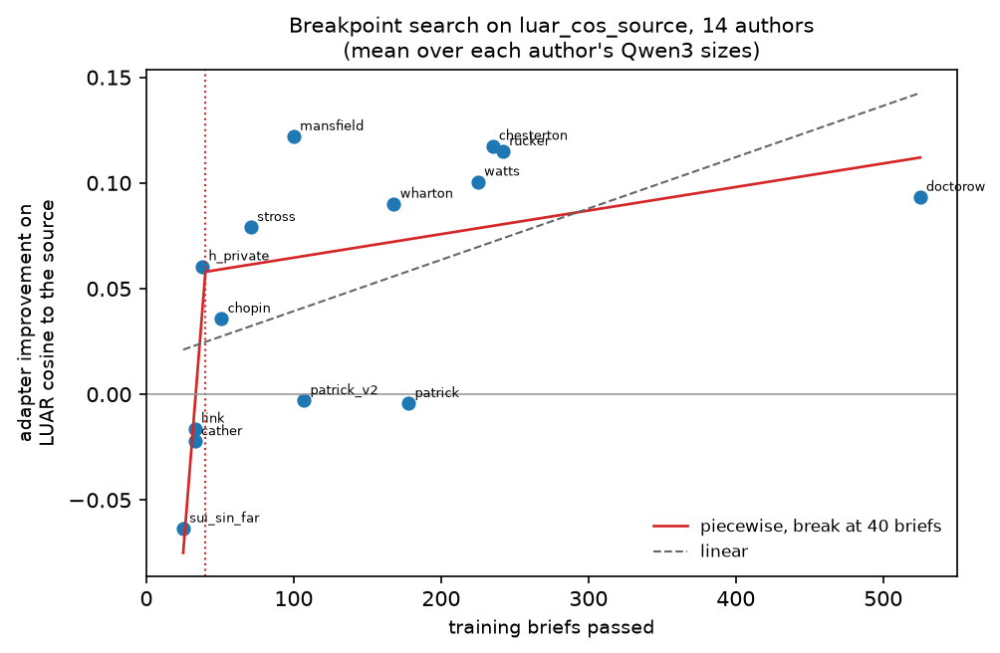
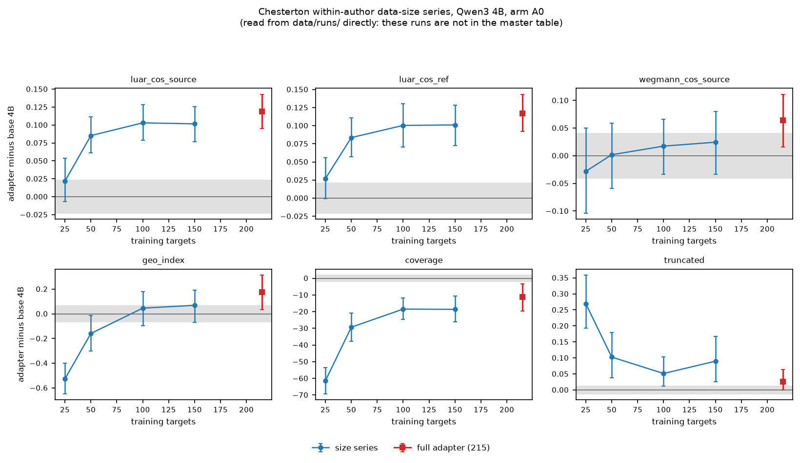

# 13 Corpus and data effects: what the author's corpus buys the adapter

## What this does

Asks what an author's corpus buys the adapter: whether more training briefs, more fit
examples, more words or more distinct works produce a larger adapter gain, whether the
relationship bends at a data floor, whether the thin-corpus adapters are the ones that run
to the token cap, and whether private, period and contemporary authors behave differently.

The adapter gain is the brief-paired difference (adapter A0 minus base A0) per author x
family x size on 12 measures, 6 of them primary. Author-level
analyses rest on 14 author rows in total and 13 once
`train_examples_max` is required, so every correlation below is an n = 13 or
14 estimate and its interval is reported next to it.
Two of those rows, patrick and patrick_v2, are the same corpus at two chunk sizes, so the independent corpora number 13.

## How it does it

Data: `data/master/cells.parquet` at arm A0, non-replicate cells only, so the eval-cache
measures (per, otd_js, hapax_w300) are the values actually computed for these passages
rather than the A0 copy the master build broadcasts onto the other arms. Corpus covariates
come from `data/master/authors.csv`, adapter covariates from `data/master/runs.csv`.

Unit. Inside an author the brief is the cluster: the gain is the mean over briefs of
(adapter minus base) on the same brief and sample, with a bootstrap over briefs. For any
claim about corpora the author is the unit, and the correlations are computed over authors
with `lib.spearman_ci` (2000 bootstrap resamples of the author set). p-values are BH-FDR
adjusted within each table.

Data-size series: no run in runs.csv has a name containing n25, n50, n100 or n150, so the within-author data-size series does not exist as a generation run in the master table and the cross-author comparison is the primary analysis. The four generation runs do exist on disk (chesterton_size100, chesterton_size150, chesterton_size25, chesterton_size50) with gens, scores, embeddings and coverage, and the four training records exist as well; they were left out of the master table because `lib.parse_run` cannot parse their names (the tag `size25` is not in `lib.PARAMS`). They are read here directly from `data/runs/` and reported as a supplement, clearly separated from everything built on `cells.parquet`.

Piecewise fit: a continuous two-segment linear fit of the author-level improvement on
training briefs, with the breakpoint searched over 176 candidate positions on a
one-brief grid from 25 to 200 and a bootstrap over authors for the breakpoint itself. The
permutation p-values in `gain_piecewise_breakpoint.csv` are not BH-adjusted; they are read
against the 9 measures searched, and a single measure's p there is not a q.

Floors: every gain is printed beside `lib.replicate_floor` for its measure at A0. Measured
floors now exist for Ministral3, Qwen3
(no family is missing one),
with 12 of this script's measures carrying a measured Ministral3 floor.
The `floor_qwen` column beside every gain here is the Qwen3 value whatever the family of the
row, so a Ministral3 above-floor verdict in this folder is a borrowed one. The Ministral3
floors were measured from two 3B replicate pairs scored on 2026-09-10 and none exists at 8B
or 14B.

Mixed models: `gain ~ C(author_class) + log2(params) + log2(fit examples)` with a random
intercept per author, Qwen3 only, one per primary measure. 0 of 6 failed
to fit and 0 of the 6 that fitted sit at the zero
boundary for the author variance (`boundary_fit` in the csv). Because author_class does not
vary within an author, its contrast is identified only across authors: with 11 to 14 of them
split three ways it is descriptive, and no author_class row here should be read as a test.

### Is the Chesterton data-size series in the master table?

| question | answer | detail |
|---|---|---|
| generation runs in data/master/runs.csv whose name contains n25/n50/n100/n150 | 0 | none |
| generation run folders on disk under data/runs/ | 4 | chesterton_size100, chesterton_size150, chesterton_size25, chesterton_size50 |
| training run folders on disk under data/runs/ | 4 | train_chesterton_pair_n100_e6, train_chesterton_pair_n150_e6, train_chesterton_pair_n25_e6, train_chesterton_pair_n50_e6 |
| size-series generation runs on disk for any author (analysed in script 25) | 16 | chesterton_size100, chesterton_size150, chesterton_size25, chesterton_size50, doctorow_size100, doctorow_size150, doctorow_size215, doctorow_size25, doctorow_size300, doctorow_size50, doctorow_size50_s1, doctorow_size525, patrick_v2_size25, patrick_v2_size50, patrick_v2_size50_s1, patrick_v2_size75 |
| authors with a within-author size series on disk | 3 | chesterton, doctorow, patrick_v2 |

### Adapter improvement against the corpus, Spearman over authors (pooled over the Qwen3 sizes; read the interval, not the point)

| measure | covariate | n_authors | spearman | ci_low | ci_high | interval_width | q_bh |
|---|---|---|---|---|---|---|---|
| coverage | n_works_train | 14 | 0.313 | -0.282 | 0.781 | 1.063 | 0.337 |
| coverage | train_briefs_passed | 14 | 0.858 | 0.530 | 0.968 | 0.438 | 0.002 |
| coverage | train_examples_max | 13 | 0.858 | 0.494 | 0.979 | 0.485 | 0.003 |
| coverage | words_total | 14 | 0.736 | 0.246 | 0.914 | 0.668 | 0.007 |
| geo_index | n_works_train | 14 | 0.507 | -0.121 | 0.818 | 0.939 | 0.089 |
| geo_index | train_briefs_passed | 14 | 0.726 | 0.211 | 0.927 | 0.715 | 0.008 |
| geo_index | train_examples_max | 13 | 0.809 | 0.367 | 0.967 | 0.599 | 0.005 |
| geo_index | words_total | 14 | 0.560 | -0.080 | 0.823 | 0.903 | 0.054 |
| hapax_w300 | n_works_train | 0 |  |  |  |  |  |
| hapax_w300 | train_briefs_passed | 0 |  |  |  |  |  |
| hapax_w300 | train_examples_max | 0 |  |  |  |  |  |
| hapax_w300 | words_total | 0 |  |  |  |  |  |
| len_ratio | n_works_train | 0 |  |  |  |  |  |
| len_ratio | train_briefs_passed | 0 |  |  |  |  |  |
| len_ratio | train_examples_max | 0 |  |  |  |  |  |
| len_ratio | words_total | 0 |  |  |  |  |  |
| luar_cos_ref | n_works_train | 14 | 0.024 | -0.718 | 0.585 | 1.304 | 0.948 |
| luar_cos_ref | train_briefs_passed | 14 | 0.594 | 0.030 | 0.905 | 0.875 | 0.038 |
| luar_cos_ref | train_examples_max | 13 | 0.669 | 0.171 | 0.916 | 0.745 | 0.021 |
| luar_cos_ref | words_total | 14 | 0.745 | 0.341 | 0.924 | 0.583 | 0.007 |
| luar_cos_source | n_works_train | 14 | 0.104 | -0.606 | 0.649 | 1.255 | 0.767 |
| luar_cos_source | train_briefs_passed | 14 | 0.722 | 0.235 | 0.954 | 0.719 | 0.008 |
| luar_cos_source | train_examples_max | 13 | 0.779 | 0.326 | 0.976 | 0.650 | 0.006 |
| luar_cos_source | words_total | 14 | 0.802 | 0.433 | 0.958 | 0.525 | 0.004 |
| otd_js | n_works_train | 14 | 0.463 | -0.190 | 0.766 | 0.956 | 0.129 |
| otd_js | train_briefs_passed | 14 | 0.722 | 0.124 | 0.970 | 0.846 | 0.008 |
| otd_js | train_examples_max | 13 | 0.776 | 0.235 | 0.990 | 0.755 | 0.006 |
| otd_js | words_total | 14 | 0.622 | 0.002 | 0.932 | 0.930 | 0.029 |
| per | n_works_train | 14 | 0.137 | -0.494 | 0.619 | 1.113 | 0.695 |
| per | train_briefs_passed | 14 | 0.768 | 0.181 | 0.955 | 0.774 | 0.006 |
| per | train_examples_max | 13 | 0.795 | 0.270 | 0.956 | 0.686 | 0.006 |
| per | words_total | 14 | 0.662 | 0.045 | 0.937 | 0.892 | 0.018 |
| styledist_cos_source | n_works_train | 14 | -0.251 | -0.715 | 0.370 | 1.085 | 0.449 |
| styledist_cos_source | train_briefs_passed | 14 | 0.812 | 0.435 | 0.960 | 0.524 | 0.004 |
| styledist_cos_source | train_examples_max | 13 | 0.724 | 0.190 | 0.939 | 0.749 | 0.011 |
| styledist_cos_source | words_total | 14 | 0.855 | 0.488 | 0.960 | 0.472 | 0.002 |
| truncated | n_works_train | 14 | 0.324 | -0.259 | 0.695 | 0.954 | 0.321 |
| truncated | train_briefs_passed | 14 | 0.801 | 0.384 | 0.979 | 0.595 | 0.004 |
| truncated | train_examples_max | 13 | 0.828 | 0.416 | 0.979 | 0.563 | 0.004 |
| truncated | words_total | 14 | 0.640 | -0.016 | 0.940 | 0.955 | 0.023 |
| wegmann_cos_source | n_works_train | 14 | -0.304 | -0.783 | 0.330 | 1.113 | 0.352 |
| wegmann_cos_source | train_briefs_passed | 14 | 0.695 | 0.219 | 0.920 | 0.701 | 0.011 |
| wegmann_cos_source | train_examples_max | 13 | 0.624 | 0.075 | 0.922 | 0.847 | 0.035 |
| wegmann_cos_source | words_total | 14 | 0.811 | 0.412 | 0.955 | 0.543 | 0.004 |
| words | n_works_train | 0 |  |  |  |  |  |
| words | train_briefs_passed | 0 |  |  |  |  |  |
| words | train_examples_max | 0 |  |  |  |  |  |
| words | words_total | 0 |  |  |  |  |  |

### Log-linear slope of improvement per doubling of fit examples

| family | params_b | measure | n_authors | slope_per_doubling | ci_low | ci_high | r2 |
|---|---|---|---|---|---|---|---|
| Qwen3 | 4.000 | coverage | 13 | 8.299 | 4.285 | 13.135 | 0.543 |
| Qwen3 | 8.000 | coverage | 13 | 14.995 | 9.987 | 19.810 | 0.766 |
| Qwen3 | 14.000 | coverage | 13 | 16.916 | 9.954 | 21.903 | 0.791 |
| Qwen3 |  | coverage | 13 | 13.335 | 9.526 | 16.463 | 0.820 |
| Qwen3 | 4.000 | luar_cos_source | 13 | 0.043 | 0.023 | 0.060 | 0.632 |
| Qwen3 | 8.000 | luar_cos_source | 13 | 0.041 | 0.022 | 0.059 | 0.582 |
| Qwen3 | 14.000 | luar_cos_source | 13 | 0.041 | 0.018 | 0.058 | 0.584 |
| Qwen3 |  | luar_cos_source | 13 | 0.041 | 0.020 | 0.058 | 0.597 |
| Qwen3 | 4.000 | otd_js | 13 | 0.056 | 0.038 | 0.076 | 0.698 |
| Qwen3 | 8.000 | otd_js | 13 | 0.065 | 0.038 | 0.093 | 0.659 |
| Qwen3 | 14.000 | otd_js | 13 | 0.063 | 0.037 | 0.094 | 0.682 |
| Qwen3 |  | otd_js | 13 | 0.061 | 0.038 | 0.087 | 0.692 |
| Qwen3 | 4.000 | per | 13 | 0.066 | 0.042 | 0.090 | 0.775 |
| Qwen3 | 8.000 | per | 13 | 0.084 | 0.042 | 0.132 | 0.634 |
| Qwen3 | 14.000 | per | 13 | 0.084 | 0.036 | 0.129 | 0.653 |
| Qwen3 |  | per | 13 | 0.078 | 0.044 | 0.111 | 0.731 |
| Qwen3 | 4.000 | truncated | 13 | 0.039 | 0.006 | 0.068 | 0.360 |
| Qwen3 | 8.000 | truncated | 13 | 0.076 | 0.033 | 0.125 | 0.503 |
| Qwen3 | 14.000 | truncated | 13 | 0.222 | 0.140 | 0.304 | 0.803 |
| Qwen3 |  | truncated | 13 | 0.111 | 0.078 | 0.148 | 0.819 |
| Qwen3 | 4.000 | wegmann_cos_source | 13 | 0.083 | 0.030 | 0.132 | 0.542 |
| Qwen3 | 8.000 | wegmann_cos_source | 13 | 0.069 | 0.015 | 0.125 | 0.411 |
| Qwen3 | 14.000 | wegmann_cos_source | 13 | 0.087 | 0.017 | 0.156 | 0.462 |
| Qwen3 |  | wegmann_cos_source | 13 | 0.080 | 0.022 | 0.140 | 0.486 |

### Piecewise fit, breakpoint searched over 25-200 training briefs

| measure | n_authors | breakpoint_briefs | bp_boot_lo | bp_boot_hi | bp_boot_at_grid_edge_share | slope_below | slope_above | r2_piecewise | r2_linear | r2_adj_piecewise | r2_adj_linear | r2_gain_from_break | r2_gain_null_median | p_permutation_break | q_permutation_break | breakpoint_identified |
|---|---|---|---|---|---|---|---|---|---|---|---|---|---|---|---|---|
| coverage | 14 | 68.000 | 55.975 | 111.000 | 0.000 | 0.921 | 0.009 | 0.910 | 0.387 | 0.883 | 0.336 | 0.523 | 0.122 | 0.012 | 0.022 | True |
| geo_index | 14 | 119.000 | 40.000 | 178.000 | 0.018 | 0.007 | -0.001 | 0.822 | 0.199 | 0.769 | 0.132 | 0.623 | 0.132 | 0.005 | 0.015 | True |
| luar_cos_ref | 14 | 40.000 | 34.000 | 200.000 | 0.102 | 0.009 | 0.000 | 0.507 | 0.176 | 0.359 | 0.107 | 0.332 | 0.134 | 0.082 | 0.123 | False |
| luar_cos_source | 14 | 40.000 | 34.000 | 200.000 | 0.072 | 0.009 | 0.000 | 0.602 | 0.285 | 0.483 | 0.225 | 0.317 | 0.132 | 0.117 | 0.132 | False |
| otd_js | 14 | 83.000 | 45.975 | 100.000 | 0.000 | 0.004 | -0.000 | 0.906 | 0.255 | 0.878 | 0.193 | 0.652 | 0.143 | 0.002 | 0.015 | True |
| per | 14 | 63.000 | 43.000 | 115.025 | 0.000 | 0.007 | 0.000 | 0.915 | 0.323 | 0.890 | 0.266 | 0.592 | 0.133 | 0.005 | 0.015 | True |
| styledist_cos_source | 14 | 63.000 | 34.000 | 200.000 | 0.045 | 0.001 | 0.000 | 0.714 | 0.430 | 0.628 | 0.383 | 0.283 | 0.137 | 0.167 | 0.167 | False |
| truncated | 14 | 79.000 | 65.975 | 113.050 | 0.000 | 0.007 | -0.000 | 0.961 | 0.359 | 0.950 | 0.305 | 0.603 | 0.132 | 0.007 | 0.017 | True |
| wegmann_cos_source | 14 | 73.000 | 33.000 | 109.025 | 0.015 | 0.005 | 0.000 | 0.633 | 0.262 | 0.523 | 0.201 | 0.371 | 0.132 | 0.107 | 0.132 | False |

### Adapter truncation at A0 against the corpus

| family | params_b | covariate | n_authors | spearman_vs_adapter_truncation | ci_low | ci_high | p | q_bh |
|---|---|---|---|---|---|---|---|---|
| Qwen3 | 1.700 | train_examples_max | 1 |  |  |  |  |  |
| Qwen3 | 1.700 | train_briefs_passed | 1 |  |  |  |  |  |
| Qwen3 | 1.700 | words_total | 1 |  |  |  |  |  |
| Qwen3 | 1.700 | n_works_train | 1 |  |  |  |  |  |
| Qwen3 | 4.000 | train_examples_max | 13 | -0.721 | -0.928 | -0.243 | 0.005 | 0.013 |
| Qwen3 | 4.000 | train_briefs_passed | 14 | -0.726 | -0.894 | -0.304 | 0.003 | 0.010 |
| Qwen3 | 4.000 | words_total | 14 | -0.565 | -0.841 | 0.045 | 0.035 | 0.047 |
| Qwen3 | 4.000 | n_works_train | 14 | -0.161 | -0.584 | 0.460 | 0.583 | 0.583 |
| Qwen3 | 8.000 | train_examples_max | 13 | -0.608 | -0.861 | -0.003 | 0.027 | 0.047 |
| Qwen3 | 8.000 | train_briefs_passed | 13 | -0.589 | -0.838 | 0.059 | 0.034 | 0.047 |
| Qwen3 | 8.000 | words_total | 13 | -0.588 | -0.883 | 0.109 | 0.035 | 0.047 |
| Qwen3 | 8.000 | n_works_train | 13 | -0.176 | -0.687 | 0.433 | 0.564 | 0.583 |
| Qwen3 | 14.000 | train_examples_max | 13 | -0.847 | -0.983 | -0.487 | 0.000 | 0.002 |
| Qwen3 | 14.000 | train_briefs_passed | 13 | -0.869 | -0.988 | -0.513 | 0.000 | 0.001 |
| Qwen3 | 14.000 | words_total | 13 | -0.780 | -0.967 | -0.246 | 0.002 | 0.007 |
| Qwen3 | 14.000 | n_works_train | 13 | -0.198 | -0.667 | 0.394 | 0.516 | 0.583 |

### Qwen3 14B adapters ordered by truncation

| author | author_class | train_examples_max | train_briefs_passed | adapter_truncated_rate_A0 | base_truncated_rate_A0 | probe_delta | gate_generation_ok |
|---|---|---|---|---|---|---|---|
| link | contemporary | 168.000 | 33 | 0.844 | 0.000 | -0.321 | FAIL |
| sui_sin_far | period | 144.000 | 25 | 0.750 | 0.000 | -0.321 | not gated |
| cather | period | 156.000 | 33 | 0.591 | 0.000 | -0.387 | FAIL |
| h_private | private | 204.000 | 38 | 0.413 | 0.000 | -0.424 | not gated |
| chopin | period | 282.000 | 51 | 0.316 | 0.000 | -0.384 | not gated |
| stross | contemporary | 336.000 | 71 | 0.244 | 0.000 | -0.347 | pass |
| watts | contemporary | 654.000 | 225 | 0.122 | 0.000 | -0.431 | pass |
| mansfield | period | 504.000 | 100 | 0.122 | 0.000 | -0.414 | not gated |
| chesterton | period | 1290.000 | 235 | 0.090 | 0.000 | -0.220 | pass |
| wharton | period | 894.000 | 168 | 0.068 | 0.000 | -0.378 | not gated |
| doctorow | contemporary | 1290.000 | 525 | 0.036 | 0.000 | -0.443 | pass |
| rucker | contemporary | 888.000 | 242 | 0.032 | 0.000 | -0.444 | pass |
| patrick_v2 | private | 624.000 | 107 | 0.000 | 0.000 | -0.361 | pass |

### Improvement by author class (Qwen3, one value per author)

| measure | author_class | n_authors | mean_improvement | ci_low | ci_high | n_author_size_cells |
|---|---|---|---|---|---|---|
| coverage | contemporary | 5 | -29.556 | -46.097 | -18.236 | 15 |
| coverage | period | 6 | -33.227 | -45.922 | -20.637 | 18 |
| coverage | private | 3 | -29.068 | -50.870 | -16.761 | 8 |
| luar_cos_source | contemporary | 5 | 0.074 | 0.029 | 0.105 | 15 |
| luar_cos_source | period | 6 | 0.047 | -0.012 | 0.101 | 18 |
| luar_cos_source | private | 3 | 0.018 | -0.004 | 0.060 | 8 |
| otd_js | contemporary | 5 | -0.003 | -0.058 | 0.035 | 15 |
| otd_js | period | 6 | -0.019 | -0.102 | 0.053 | 18 |
| otd_js | private | 3 | 0.023 | -0.067 | 0.091 | 8 |
| per | contemporary | 5 | -0.080 | -0.197 | -0.016 | 15 |
| per | period | 6 | -0.110 | -0.187 | -0.041 | 18 |
| per | private | 3 | -0.054 | -0.171 | 0.011 | 8 |
| truncated | contemporary | 5 | -0.146 | -0.275 | -0.064 | 15 |
| truncated | period | 6 | -0.198 | -0.316 | -0.098 | 18 |
| truncated | private | 3 | -0.119 | -0.319 | -0.011 | 8 |
| wegmann_cos_source | contemporary | 5 | 0.035 | -0.096 | 0.109 | 15 |
| wegmann_cos_source | period | 6 | -0.033 | -0.144 | 0.061 | 18 |
| wegmann_cos_source | private | 3 | 0.036 | -0.007 | 0.104 | 8 |

### Probe delta by family and size

| family | params_b | n_adapters | probe_delta_mean | probe_delta_min | probe_delta_max | eval_best_mean |
|---|---|---|---|---|---|---|
| Ministral3 | 3.000 | 3 | -0.177 | -0.239 | -0.074 | 2.665 |
| Ministral3 | 8.000 | 3 | -0.107 | -0.171 | 0.001 | 2.530 |
| Ministral3 | 14.000 | 3 | -0.132 | -0.195 | -0.051 | 2.457 |
| Qwen3 | 1.700 | 1 | -0.907 | -0.907 | -0.907 | 3.433 |
| Qwen3 | 4.000 | 13 | -0.966 | -1.130 | -0.710 | 2.635 |
| Qwen3 | 8.000 | 13 | -0.501 | -0.623 | -0.342 | 2.488 |
| Qwen3 | 14.000 | 13 | -0.375 | -0.444 | -0.220 | 2.394 |

### Probe delta against data and parameter count

| family | params_b | covariate | n_adapters | spearman_vs_probe_delta | ci_low | ci_high | p | q_bh |
|---|---|---|---|---|---|---|---|---|
| Ministral3 | 3.000 | train_examples | 3 |  |  |  |  |  |
| Ministral3 | 3.000 | train_examples_max | 3 |  |  |  |  |  |
| Ministral3 | 3.000 | words_total | 3 |  |  |  |  |  |
| Ministral3 | 8.000 | train_examples | 3 |  |  |  |  |  |
| Ministral3 | 8.000 | train_examples_max | 3 |  |  |  |  |  |
| Ministral3 | 8.000 | words_total | 3 |  |  |  |  |  |
| Ministral3 | 14.000 | train_examples | 3 |  |  |  |  |  |
| Ministral3 | 14.000 | train_examples_max | 3 |  |  |  |  |  |
| Ministral3 | 14.000 | words_total | 3 |  |  |  |  |  |
| Qwen3 | 1.700 | train_examples | 1 |  |  |  |  |  |
| Qwen3 | 1.700 | train_examples_max | 1 |  |  |  |  |  |
| Qwen3 | 1.700 | words_total | 1 |  |  |  |  |  |
| Qwen3 | 4.000 | train_examples | 13 | -0.245 | -0.860 | 0.450 | 0.420 | 0.420 |
| Qwen3 | 4.000 | train_examples_max | 13 | -0.256 | -0.887 | 0.423 | 0.399 | 0.420 |
| Qwen3 | 4.000 | words_total | 13 | -0.495 | -0.882 | 0.158 | 0.086 | 0.209 |
| Qwen3 | 8.000 | train_examples | 13 | -0.459 | -0.945 | 0.188 | 0.114 | 0.209 |
| Qwen3 | 8.000 | train_examples_max | 13 | -0.459 | -0.944 | 0.222 | 0.114 | 0.209 |
| Qwen3 | 8.000 | words_total | 13 | -0.599 | -0.916 | 0.020 | 0.031 | 0.168 |
| Qwen3 | 14.000 | train_examples | 13 | -0.261 | -0.843 | 0.446 | 0.388 | 0.420 |
| Qwen3 | 14.000 | train_examples_max | 13 | -0.261 | -0.833 | 0.440 | 0.388 | 0.420 |
| Qwen3 | 14.000 | words_total | 13 | -0.489 | -0.867 | 0.210 | 0.090 | 0.209 |
| Ministral3 |  | log2(params_b) | 9 | 0.369 | -0.455 | 0.889 | 0.329 | 0.420 |
| Qwen3 |  | log2(params_b) | 40 | 0.904 | 0.825 | 0.939 | 0.000 | 0.000 |

### Sensitivity of the pooled improvement

| measure | subset | n_authors | mean_improvement | ci_low | ci_high | floor_qwen |
|---|---|---|---|---|---|---|
| luar_cos_source | all Qwen3 adapters | 14 | 0.050 | 0.018 | 0.080 | 0.023 |
| luar_cos_source | gate_generation_ok is not False | 13 | 0.056 | 0.024 | 0.085 | 0.023 |
| luar_cos_source | period + contemporary only | 11 | 0.059 | 0.020 | 0.093 | 0.023 |
| wegmann_cos_source | all Qwen3 adapters | 14 | 0.006 | -0.065 | 0.067 | 0.041 |
| wegmann_cos_source | gate_generation_ok is not False | 13 | 0.024 | -0.045 | 0.075 | 0.041 |
| wegmann_cos_source | period + contemporary only | 11 | -0.002 | -0.088 | 0.069 | 0.041 |
| otd_js | all Qwen3 adapters | 14 | -0.004 | -0.048 | 0.036 | 0.005 |
| otd_js | gate_generation_ok is not False | 13 | 0.006 | -0.036 | 0.042 | 0.005 |
| otd_js | period + contemporary only | 11 | -0.012 | -0.059 | 0.033 | 0.005 |
| per | all Qwen3 adapters | 14 | -0.087 | -0.140 | -0.038 | 0.010 |
| per | gate_generation_ok is not False | 13 | -0.071 | -0.118 | -0.029 | 0.010 |
| per | period + contemporary only | 11 | -0.096 | -0.160 | -0.042 | 0.010 |
| coverage | all Qwen3 adapters | 14 | -31.025 | -39.498 | -23.116 | 1.974 |
| coverage | gate_generation_ok is not False | 13 | -27.841 | -35.473 | -20.922 | 1.974 |
| coverage | period + contemporary only | 11 | -31.558 | -41.181 | -21.987 | 1.974 |
| truncated | all Qwen3 adapters | 14 | -0.162 | -0.237 | -0.093 | 0.012 |
| truncated | gate_generation_ok is not False | 13 | -0.140 | -0.216 | -0.079 | 0.012 |
| truncated | period + contemporary only | 11 | -0.174 | -0.256 | -0.099 | 0.012 |

### Chesterton data-size series, adapter minus base 4B (from data/runs/, not the master table)

| measure | label | n_targets | n_briefs | level | gain_vs_base | ci_low | ci_high | floor_qwen |
|---|---|---|---|---|---|---|---|---|
| coverage | base 4B (no adapter) | 0 | 39 | 83.872 | 0.000 | 0.000 | 0.000 | 1.974 |
| coverage | adapter n=25 | 25 | 39 | 22.385 | -61.487 | -68.822 | -53.551 | 1.974 |
| coverage | adapter n=50 | 50 | 39 | 54.538 | -29.333 | -37.423 | -20.615 | 1.974 |
| coverage | adapter n=100 | 100 | 39 | 65.397 | -18.474 | -24.488 | -11.846 | 1.974 |
| coverage | adapter n=150 | 150 | 39 | 65.244 | -18.628 | -26.168 | -10.346 | 1.974 |
| coverage | full adapter 4B (215 targets) | 215 | 39 | 72.564 | -11.308 | -19.360 | -2.845 | 1.974 |
| geo_index | base 4B (no adapter) | 0 | 39 | 0.160 | 0.000 | 0.000 | 0.000 | 0.064 |
| geo_index | adapter n=25 | 25 | 39 | -0.367 | -0.527 | -0.655 | -0.391 | 0.064 |
| geo_index | adapter n=50 | 50 | 39 | 0.001 | -0.159 | -0.303 | -0.019 | 0.064 |
| geo_index | adapter n=100 | 100 | 39 | 0.206 | 0.046 | -0.091 | 0.183 | 0.064 |
| geo_index | adapter n=150 | 150 | 39 | 0.229 | 0.069 | -0.071 | 0.198 | 0.064 |
| geo_index | full adapter 4B (215 targets) | 215 | 39 | 0.335 | 0.175 | 0.022 | 0.314 | 0.064 |
| luar_cos_ref | base 4B (no adapter) | 0 | 39 | 0.778 | 0.000 | 0.000 | 0.000 | 0.021 |
| luar_cos_ref | adapter n=25 | 25 | 39 | 0.805 | 0.027 | 0.000 | 0.057 | 0.021 |
| luar_cos_ref | adapter n=50 | 50 | 39 | 0.861 | 0.084 | 0.056 | 0.110 | 0.021 |
| luar_cos_ref | adapter n=100 | 100 | 39 | 0.878 | 0.100 | 0.070 | 0.131 | 0.021 |
| luar_cos_ref | adapter n=150 | 150 | 39 | 0.879 | 0.101 | 0.073 | 0.129 | 0.021 |
| luar_cos_ref | full adapter 4B (215 targets) | 215 | 39 | 0.895 | 0.117 | 0.091 | 0.143 | 0.021 |
| luar_cos_source | base 4B (no adapter) | 0 | 39 | 0.762 | 0.000 | 0.000 | 0.000 | 0.023 |
| luar_cos_source | adapter n=25 | 25 | 39 | 0.783 | 0.022 | -0.007 | 0.053 | 0.023 |
| luar_cos_source | adapter n=50 | 50 | 39 | 0.847 | 0.085 | 0.061 | 0.113 | 0.023 |
| luar_cos_source | adapter n=100 | 100 | 39 | 0.865 | 0.103 | 0.077 | 0.129 | 0.023 |
| luar_cos_source | adapter n=150 | 150 | 39 | 0.863 | 0.102 | 0.077 | 0.125 | 0.023 |
| luar_cos_source | full adapter 4B (215 targets) | 215 | 39 | 0.880 | 0.119 | 0.096 | 0.143 | 0.023 |
| truncated | base 4B (no adapter) | 0 | 39 | 0.000 | 0.000 | 0.000 | 0.000 | 0.012 |
| truncated | adapter n=25 | 25 | 39 | 0.269 | 0.269 | 0.179 | 0.359 | 0.012 |
| truncated | adapter n=50 | 50 | 39 | 0.103 | 0.103 | 0.038 | 0.179 | 0.012 |
| truncated | adapter n=100 | 100 | 39 | 0.051 | 0.051 | 0.013 | 0.103 | 0.012 |
| truncated | adapter n=150 | 150 | 39 | 0.090 | 0.090 | 0.026 | 0.167 | 0.012 |
| truncated | full adapter 4B (215 targets) | 215 | 39 | 0.026 | 0.026 | 0.000 | 0.064 | 0.012 |
| wegmann_cos_source | base 4B (no adapter) | 0 | 39 | 0.683 | 0.000 | 0.000 | 0.000 | 0.041 |
| wegmann_cos_source | adapter n=25 | 25 | 39 | 0.655 | -0.028 | -0.101 | 0.049 | 0.041 |
| wegmann_cos_source | adapter n=50 | 50 | 39 | 0.685 | 0.002 | -0.056 | 0.057 | 0.041 |
| wegmann_cos_source | adapter n=100 | 100 | 39 | 0.701 | 0.017 | -0.031 | 0.064 | 0.041 |
| wegmann_cos_source | adapter n=150 | 150 | 39 | 0.708 | 0.024 | -0.032 | 0.078 | 0.041 |
| wegmann_cos_source | full adapter 4B (215 targets) | 215 | 39 | 0.748 | 0.064 | 0.014 | 0.109 | 0.041 |

### Training records for that series

| train_run | n_targets | n_examples | steps | best_eval_loss | probe_delta | wall_s |
|---|---|---|---|---|---|---|
| train_chesterton_pair_n25_e6 | 25 | 150 | 19 | 2.754 | -0.648 | 955.873 |
| train_chesterton_pair_n50_e6 | 50 | 300 | 38 | 2.692 | -0.695 | 1061.715 |
| train_chesterton_pair_n100_e6 | 100 | 600 | 75 | 2.641 | -0.716 | 2749.354 |
| train_chesterton_pair_n150_e6 | 150 | 900 | 113 | 2.620 | -0.717 | 2457.857 |
| train_chesterton_pair_e6 | 215 | 1290 | 162 | 2.610 | -0.710 | 2305.258 |

### Comparability of the series runs with the master-table runs

| run | started | backend | base_model | temperature_requested | top_p | max_new_cap | len_mult | seeds | arms | n_generated | adapter | has_provenance_block | in_master_table |
|---|---|---|---|---|---|---|---|---|---|---|---|---|---|
| chesterton_base4b | 2026-09-07T13:06:05 | llamacpp | Qwen/Qwen3-4B | 0.800 | 0.950 | 1500 | 2.200 | [0, 1] | A0,A1,A2,A3,A4,A5 | 468 | none | True | True |
| chesterton_paire6_4b | 2026-09-06T02:53:22 | llamacpp | Qwen/Qwen3-4B | 0.800 | 0.950 | 1500 | 2.200 | [0, 1] | A0,A1,A5 | 234 | train_chesterton_pair_e6 | False | True |
| chesterton_size100 | 2026-09-06T13:01:37 | llamacpp | Qwen/Qwen3-4B | 0.800 | 0.950 | 1500 | 2.200 | [0, 1] | A0,A1 | 156 | train_chesterton_pair_n100_e6 | False | False |
| chesterton_size150 | 2026-09-06T14:06:30 | llamacpp | Qwen/Qwen3-4B | 0.800 | 0.950 | 1500 | 2.200 | [0, 1] | A0,A1 | 156 | train_chesterton_pair_n150_e6 | False | False |
| chesterton_size25 | 2026-09-06T11:06:12 | llamacpp | Qwen/Qwen3-4B | 0.800 | 0.950 | 1500 | 2.200 | [0, 1] | A0,A1 | 156 | train_chesterton_pair_n25_e6 | False | False |
| chesterton_size50 | 2026-09-06T11:52:21 | llamacpp | Qwen/Qwen3-4B | 0.800 | 0.950 | 1500 | 2.200 | [0, 1] | A0,A1 | 156 | train_chesterton_pair_n50_e6 | False | False |

### Gain against corpus size

### Truncation and probe delta against data size

### Piecewise breakpoint

### Chesterton data-size series

### Headline numbers

- What the adapter buys and what it costs, pooled over the Qwen3 authors (one value per author,
  averaged over the sizes that author has; positive = closer to the author on that measure):
  luar_cos_source +0.0503 [+0.0183, +0.0797] (floor 0.0229, n=14); wegmann_cos_source +0.0060 [-0.0647, +0.0667] (floor 0.0406, n=14); otd_js -0.0042 [-0.0476, +0.0363] (floor 0.0054, n=14); per -0.0872 [-0.1397, -0.0379] (floor 0.0100, n=14); coverage -31.0246 [-39.4985, -23.1160] (floor 1.9744, n=14); truncated -0.1625 [-0.2368, -0.0931] (floor 0.0122, n=14).
  4 of the 6 clear their replicate floor (luar_cos_source, per, coverage, truncated), and
  3 of those 4 move away from the author rather than toward it
  (per, coverage, truncated); 1 move toward it (luar_cos_source). The measures that do not
  clear their floor are not evidence of no effect, only of an effect this design cannot separate
  from regenerating the same run twice.
- The within-author data-size series is not in the master table. No run in runs.csv has a name containing n25, n50, n100 or n150, so the within-author data-size series does not exist as a generation run in the master table and the cross-author comparison is the primary analysis. The four generation runs do exist on disk (chesterton_size100, chesterton_size150, chesterton_size25, chesterton_size50) with gens, scores, embeddings and coverage, and the four training records exist as well; they were left out of the master table because `lib.parse_run` cannot parse their names (the tag `size25` is not in `lib.PARAMS`). They are read here directly from `data/runs/` and reported as a supplement, clearly separated from everything built on `cells.parquet`.
- Adapter improvement against corpus size, pooled over the Qwen3 sizes, n =
  14 author rows at most: the 6 largest
  correlations by absolute value are coverage vs train_examples_max rho +0.86 [+0.49, +0.98]; coverage vs train_briefs_passed rho +0.86 [+0.53, +0.97]; styledist_cos_source vs words_total rho +0.85 [+0.49, +0.96]; truncated vs train_examples_max rho +0.83 [+0.42, +0.98]; styledist_cos_source vs train_briefs_passed rho +0.81 [+0.44, +0.96]; wegmann_cos_source vs words_total rho +0.81 [+0.41, +0.96]. They are the largest of
  48 pooled correlations and were picked on the same data they are reported on,
  so their point estimates are the high end of a selected set; read the intervals. Of all
  384 correlations computed, 95 clear BH-FDR at q < 0.05 within that family.
- 189 of 246 Qwen3 author x size adapter gains on the 6
  primary measures clear both BH-FDR within their table and their replicate floor.
- Thin corpora are the ones that hit the token cap. At Qwen3 14B the adapter truncation rate at
  A0 runs from 0.0% (patrick_v2,
  624 fit examples) to
  84.4% (link,
  168 fit examples). The Spearman of adapter truncation on
  fit examples is negative at all three Qwen3 sizes (4B rho -0.72 [-0.93, -0.24], q 0.013, n = 13; 8B rho -0.61 [-0.86, -0.00], q 0.047, n = 13; 14B rho -0.85 [-0.98, -0.49], q 0.002, n = 13), which is consistent with thin
  corpora truncating more; it does not separate a data-size effect from a token-cap setting, and
  script 17 holds that test. The order of the three correlations is not itself evidence that
  parameter count makes it worse.
- Probe delta moves toward zero with parameter count on Qwen3 and is not estimable on Ministral3:
  mean
  -0.966 at
  Qwen3 4B against
  -0.375 at
  Qwen3 14B, and Ministral3 means between
  -0.177 and
  -0.107. Against
  log2(parameters) the correlation is Ministral3 rho +0.37 [-0.45, +0.89], q 0.420, over 9 adapter runs; Qwen3 rho +0.90 [+0.83, +0.94], q 0.000, over 40 adapter runs, so the Ministral3 interval covers both
  signs and the family is not evidence of anything here. The unit in that correlation is the
  adapter run and each author appears at every size, so the points are not independent. One
  adapter has a probe delta on the wrong side of zero (Ministral3 8B (max +0.0008)): the probe found it no
  closer to the author than the base, so its gains are not evidence that an adapter took hold.
- The gain flattens rather than growing with corpus size. Of 9 measures fitted with a
  searched breakpoint over 25-200 training briefs, 5 survive both a permutation test on
  the searched R-squared gain and a check that the bootstrap breakpoint stays off the grid edges:
  coverage at 68 briefs [56, 111], permutation p 0.012; geo_index at 119 briefs [40, 178], permutation p 0.005; otd_js at 83 briefs [46, 100], permutation p 0.002; per at 63 briefs [43, 115], permutation p 0.005; truncated at 79 briefs [66, 113], permutation p 0.007. In 3 of those 5 the slope above the break is at or below zero,
  and in all 5 it is a small fraction of the slope below it
  (-0.0008 to +0.0094 above,
  +0.0036 to +0.9213 below). Those slopes are in
  each measure's own units and are not comparable across measures. The permutation p-values carry
  no correction across the 9 measures searched.
- luar_cos_source is not one of them: its breakpoint bootstrap interval is
  34 to 200 briefs, spanning most of
  the search grid, with permutation p 0.117. The bend the
  other measures show is not detectable on the embedding measure at this sample size, which is
  not the same as its being absent.

- The one within-author series in the study points the same way, on one author (Chesterton) at
  Qwen3 4B, read straight from `data/runs/`. Adapter minus base 4B on luar_cos_source:
  n=25: +0.022 [-0.007, +0.053], n=50: +0.085 [+0.061, +0.113], n=100: +0.103 [+0.077, +0.129], n=150: +0.102 [+0.077, +0.125], n=215: +0.119 [+0.096, +0.143] (Qwen3 floor 0.0229). Brief coverage,
  which is an LLM judge's count: n=25: -61.487 [-68.822, -53.551], n=50: -29.333 [-37.423, -20.615], n=100: -18.474 [-24.488, -11.846], n=150: -18.628 [-26.168, -10.346], n=215: -11.308 [-19.360, -2.845] (floor 1.9744).
  Truncation rate: n=25: +0.269 [+0.179, +0.359], n=50: +0.103 [+0.038, +0.179], n=100: +0.051 [+0.013, +0.103], n=150: +0.090 [+0.026, +0.167], n=215: +0.026 [+0.000, +0.064] (floor 0.0122). The voice gain
  rises to n=100 targets and the intervals above it overlap each other, so the series is
  consistent with the gain flattening by about that point without locating where. The coverage
  and truncation costs are largest at n=25 and smaller at every step above it. Every run in that
  series used the same base model, backend, temperature (0.8), top_p, token cap, length
  multiplier and seeds as the two master-table runs it is compared against
  (`size_series_comparability.csv`). One author is one author: nothing here generalises to a
  second, and the series is a supplement to the cross-author analysis, not a replication of it.

## How to read the result, conservatively

The unit is the author and there are 13 independent corpora behind every pooled
number here, so a Spearman correlation is barely an estimate. The widest pooled interval in
this folder runs from -0.72 to 0.59 (luar_cos_ref against
n_works_train, n = 14), which is almost the whole possible range of
the statistic. Read the intervals, not the point estimates, and read the sign only where the
interval stays on one side of zero. Across all 384 correlations in
`gain_vs_corpus_spearman.csv`, 95 reach q < 0.05 within that family of
384. The limit on all of it is the 13 corpora, not the multiplicity: BH-FDR
does nothing about thirteen points.

The corpus covariates are collinear with one another: an author with more training briefs
also has more words and usually more works, so a correlation with any one of them is not
evidence that that one is the cause. `train_examples_max` is additionally censored at
1290 for 2 authors (chesterton (235 training briefs), doctorow (525 training briefs)), which flattens the top of every curve
fitted against it and biases the log-linear slope toward zero.

The breakpoint is searched, not estimated: 176 candidate positions are tried on
14 points, and the R-squared it gains
over a straight line is inflated by that search. Two guards are applied and reported per
measure: a permutation test that repeats the whole search on shuffled outcomes, and the
share of bootstrap breakpoints that land on an edge of the grid. 5 of
9 measures pass both: coverage at 68 briefs [56, 111], permutation p 0.012; geo_index at 119 briefs [40, 178], permutation p 0.005; otd_js at 83 briefs [46, 100], permutation p 0.002; per at 63 briefs [43, 115], permutation p 0.005; truncated at 79 briefs [66, 113], permutation p 0.007. The rest do not: luar_cos_ref (10% of bootstrap breakpoints on a grid edge, permutation p 0.082); luar_cos_source (7% of bootstrap breakpoints on a grid edge, permutation p 0.117); styledist_cos_source (4% of bootstrap breakpoints on a grid edge, permutation p 0.167); wegmann_cos_source (2% of bootstrap breakpoints on a grid edge, permutation p 0.107). Those permutation
p-values carry no multiplicity correction across the 9 measures. Read a breakpoint
as a description of these 14 author
rows, not as a training-data threshold that would transfer to a fifteenth.

Judged measures. `coverage` is an LLM judge's count of brief items, so every coverage row
here, including the breakpoint fitted to it, is a judge's reading and not a measurement.
Coverage rows for several Qwen3 runs were error rows from the 2026-09-09 credit outage and
were being refilled while this was written, and coverage does not exist at all on Ministral3.
Judge measures are relative instruments and are never read here as absolute quality.

What would overturn this. One author moves these numbers: `gain_sensitivity.csv` re-runs the
pooled improvement dropping the private authors and dropping the runs whose generation gate
failed. If the truncation relationship is really a token-cap artefact rather than a
data-size effect, the whole "thin adapters" reading collapses into a generation-settings
problem, and the right test is the length null in script 17, not anything here. The refilled
coverage rows would move every coverage row in this folder, including the breakpoint.

What this does not show. It does not show that more data causes a better adapter: no author
was trained twice at different corpus sizes inside the master table, so every point on these
curves is a different author with a different prose style, a different era and a different
number of works. The Chesterton series is the only within-author evidence in the study, it
covers one author, one family, one parameter count and four sizes, and it is not in the
master table. Nothing here is a claim about a model or a family: the covariate is the corpus,
and the model rows are strata within it.

## Caveats

- The raw-file series cross-check in this script covers Chesterton only; 2 other authors (doctorow, patrick_v2) have a within-author size series on disk, analysed with seed replicates in script 25 (`25_series_and_frontier/size_series.csv`).
- n = 14 author rows (13 with a fit-example count; patrick, the v1 chunking control, has no e6 training record), which is 13 independent corpora because patrick and patrick_v2 are the same person's prose at two chunk sizes. Every author-level interval in this folder is that wide, and no correction narrows it.
- train_examples_max is censored at 1290 fit examples, which 2 authors reach (chesterton (235 training briefs), doctorow (525 training briefs)), so the largest corpora are recorded as equal on that covariate although their brief counts differ.
- The corpus covariates are mutually collinear; nothing here separates briefs from words from works.
- The `floor_qwen` column beside every gain is the Qwen3 floor whatever the family of the row, so Ministral3 above-floor verdicts here are borrowed. Measured Ministral3 floors exist for 12 of this script's measures, from two 3B replicate pairs scored on 2026-09-10, and none exists at 8B or 14B.
- Ministral3 has three authors at each size, so its Spearman rows are computed over three points and are printed for completeness only.
- The Chesterton size-series runs are absent from cells.parquet and runs.csv; the supplement here is read from raw scores.jsonl and is not covered by data/MANIFEST.json's master-table build.
- coverage is an LLM-judged measure on sample 0 only, missing for several adapter runs and absent from Ministral3 entirely, so its author counts are smaller than the other measures'. Rows for several Qwen3 runs were error rows from the 2026-09-09 credit outage and were being refilled while this was written, so every coverage number here, including the coverage breakpoint, is provisional.
- `per` is close to permutation-invariant: shuffling an author's own sentences moves it less than swapping in another author's passages does (LOG.md, 2026-09-10). It is reported here as a raw rate and a difference of raw rates, and no calibrated position or fidelity value should be quoted for it.
- `doctorow_basem8b` exceeds the 20% truncation gate and is flagged rather than excluded, so it sits inside the Ministral3 8B truncation rows as a base with a quarter of its passages cut off.
- The `*_cos_ref` and attribution measures are anchored against a stranger pool of fourteen period authors for every study author, so contemporary and private authors are positioned against another century; scripts/23_register_matched_pool.py holds the register-matched repair, unapplied here.
- geo_index is used with direction '+' (higher = closer to the author), against the variable dictionary; see analysis/12_arm_effects/geo_index_direction.csv.
- Mixed models: 0 of 6 failed to fit and 0 sit at the zero boundary for the author variance. author_class is between-author, so its contrast rests on 11-14 authors split three ways and is descriptive. lib.mixed_model was changed on 2026-09-10 to drop the lbfgs optimiser, which returned zero variances and 1e4 intercept standard errors on these data; running this script against an older lib.py will not reproduce the mixed-model rows.
