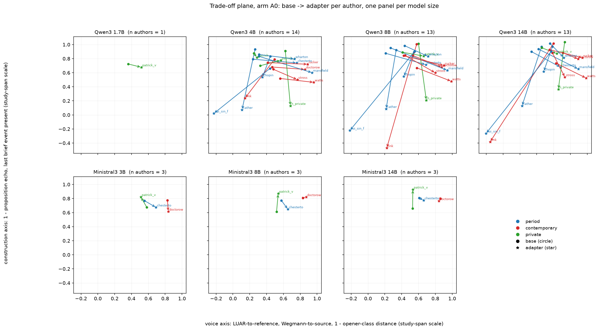
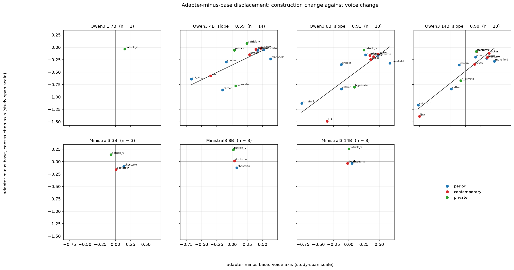
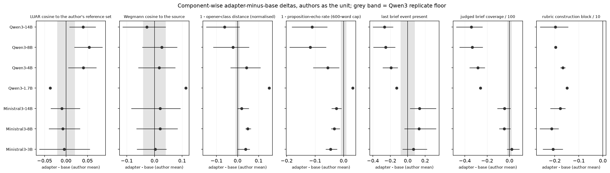

# 14 - Style / construction trade-off

## What this does

Asks whether a pair-6 LoRA adapter buys voice at construction's expense, and how the
exchange rate changes with model size and family. Every configuration in the study
(author x family x size x kind at arm A0, 100 configurations over 7,876 cells from
100 runs) is placed on two axes: a **voice axis** built from LUAR cosine to the
author's reference set, Wegmann cosine to the source and the inverted opener-class
distance, and a **construction axis** built from the inverted proposition-echo rate
(600-word cap) and the presence of the last brief event. Judged coverage and the rubric
construction block enter an extended construction axis at configuration level only,
because they exist for 100 and 54 of the 100 configurations. Both of those are
LLM-judged: coverage is a judged adherence rate and the rubric block is a relative judge
instrument, so neither is read here as a level of quality.

## How it does it

**Data.** `data/master/cells.parquet`, arm A0, non-replicate, both samples, both kinds:
7,876 cells, 14 authors, 100 configurations. `per`, `otd_js` and
`terminal_missing` exist for arm A0 only, which is why the whole script is A0.

**Axis construction.** Each component is oriented so that higher is closer to the author
(`otd_inv = 1 - otd_js / 0.5875`, the 95th percentile of otd_js over these cells;
`per_inv = 1 - per`; `term_ok = 1 - terminal_missing`). Each component is then put on a
common scale by a fixed affine map in which 0 is the 5th-percentile and 1 the
95th-percentile *configuration mean* of that component (`axis_components.csv` carries the
two constants). The axes are the unweighted mean of their components. The scale is the
study's own span, not an absolute fidelity scale: only differences and directions on it
mean anything, and cell-level values may fall outside [0, 1].

**Unit.** The brief (`id`) is the cluster within an author; the author is the unit for
every claim about models. Base and adapter cells are paired on (author, family, size,
brief, sample), giving 3,938 paired cells. Per-configuration deltas carry a
cluster bootstrap over briefs (2000 resamples), Cohen's d, Cliff's delta and a
permutation p-value; author-level claims use a sign test and Wilcoxon over the
13 usable authors (`patrick`, the v1-chunking control, is excluded from the
author-level tests and reported separately in `sensitivity_include_patrick_v1.csv`).

**Correction.** BH-FDR within each family of tests: across configurations within a
measure in `paired_deltas_by_configuration.csv`, across the whole sign-test grid in
`author_level_tests.csv`, across the slope table.

**Floors.** `replicate_floors.csv` gives the replicate floor of every component and both
axes, per family, with the number of twice-generated base pairs behind each one: at most
5 pairs on Qwen3 and 4 on Ministral3. 0 rows rest on a single pair and
0 on none at all; a row with no pair carries the Qwen3 number and is marked
`borrowed_from_Qwen3`. Per-configuration deltas are compared with their own family's floor.
The pooled and per-size rows of `author_level_tests.csv` use the Qwen3 floor, which is the
larger of the two families on 6 of the 8 components that have both. Any delta
smaller than its floor is labelled "within noise" whatever its p-value.

**Length.** `length_flags.csv` reports the Spearman correlation of every component with
generated words; flagged components (|rho| >= 0.4) are none, and
`cov_frac` sits just under the threshold at -0.356, so it should be read as
length-sensitive as well. `length_null_mixed_models.csv` repeats the adapter-vs-base
contrast on the two axes with standardised words as a covariate and the author as a random
effect. Length is downstream of the adapter as well as of the measure, so that model
removes an amount that travels with length, not a confound established as external to the
adapter.

### Adapter minus base on both axes, authors as the unit, by family and size

| group | measure | n_authors | mean_delta | ci_low | ci_high | n_positive | p_sign | q_sign_bh | floor | above_floor |
|---|---|---|---|---|---|---|---|---|---|---|
| Ministral3-14B | constr_axis | 3 | 0.063 | -0.034 | 0.258 | 1 | 1.000 | 1.000 | 0.060 | True |
| Ministral3-3B | constr_axis | 3 | -0.039 | -0.159 | 0.139 | 1 | 1.000 | 1.000 | 0.060 | False |
| Ministral3-8B | constr_axis | 3 | 0.044 | -0.124 | 0.243 | 2 | 1.000 | 1.000 | 0.060 | False |
| Qwen3-1.7B | constr_axis | 1 | -0.034 |  |  | 0 |  |  | 0.065 | False |
| Qwen3-14B | constr_axis | 13 | -0.459 | -0.722 | -0.272 | 0 | 0.000 | 0.001 | 0.065 | True |
| Qwen3-4B | constr_axis | 13 | -0.282 | -0.469 | -0.133 | 1 | 0.003 | 0.013 | 0.065 | True |
| Qwen3-8B | constr_axis | 13 | -0.464 | -0.739 | -0.261 | 0 | 0.000 | 0.001 | 0.065 | True |
| Ministral3-14B | voice_axis | 3 | 0.012 | -0.018 | 0.052 | 2 | 1.000 | 1.000 | 0.025 | False |
| Ministral3-3B | voice_axis | 3 | 0.025 | -0.071 | 0.137 | 2 | 1.000 | 1.000 | 0.025 | False |
| Ministral3-8B | voice_axis | 3 | 0.046 | 0.020 | 0.078 | 3 | 0.250 | 0.424 | 0.025 | True |
| Qwen3-1.7B | voice_axis | 1 | 0.154 |  |  | 1 |  |  | 0.083 | True |
| Qwen3-14B | voice_axis | 13 | 0.023 | -0.214 | 0.212 | 8 | 0.581 | 0.772 | 0.083 | False |
| Qwen3-4B | voice_axis | 13 | 0.166 | -0.061 | 0.347 | 9 | 0.267 | 0.424 | 0.083 | True |
| Qwen3-8B | voice_axis | 13 | 0.153 | -0.084 | 0.342 | 9 | 0.267 | 0.424 | 0.083 | True |

### Adapter minus base on every component, pooled over all configurations

| measure | n_authors | mean_delta | ci_low | ci_high | n_positive | p_sign | q_sign_bh | floor | above_floor |
|---|---|---|---|---|---|---|---|---|---|
| voice_axis | 49 | 0.099 | -0.004 | 0.190 | 34 | 0.009 | 0.028 | 0.083 | True |
| constr_axis | 49 | -0.316 | -0.433 | -0.207 | 5 | 0.000 | 0.000 | 0.065 | True |
| luar_cos_ref | 49 | 0.034 | 0.017 | 0.050 | 31 | 0.085 | 0.220 | 0.021 | True |
| wegmann_cos_source | 49 | 0.009 | -0.026 | 0.041 | 35 | 0.004 | 0.013 | 0.041 | False |
| otd_inv | 49 | -0.001 | -0.040 | 0.034 | 30 | 0.152 | 0.353 | 0.010 | False |
| per_inv | 49 | -0.081 | -0.112 | -0.054 | 6 | 0.000 | 0.000 | 0.010 | True |
| term_ok | 49 | -0.171 | -0.235 | -0.104 | 7 | 0.000 | 0.000 | 0.081 | True |
| cov_frac | 49 | -0.264 | -0.321 | -0.208 | 3 | 0.000 | 0.000 | 0.063 | True |
| rubric_C10 | 27 | -0.188 | -0.211 | -0.169 | 0 | 0.000 | 0.000 | 0.021 | True |

### Trade-off slope: construction change regressed on voice change

| group | n_points | n_authors | slope | slope_lo | slope_hi | rho | rho_p | q_bh |
|---|---|---|---|---|---|---|---|---|
| all configurations | 49 | 13 | 0.778 | 0.208 | 1.088 | 0.447 | 0.001 | 0.003 |
| Ministral3 pooled | 9 | 3 | -1.250 | -1.764 | 1.288 | -0.417 | 0.265 | 0.265 |
| Qwen3 pooled | 40 | 13 | 0.842 | 0.529 | 1.180 | 0.700 | 0.000 | 0.000 |
| Ministral3-3B | 3 | 3 |  |  |  |  |  |  |
| Ministral3-8B | 3 | 3 |  |  |  |  |  |  |
| Ministral3-14B | 3 | 3 |  |  |  |  |  |  |
| Qwen3-1.7B | 1 | 1 |  |  |  |  |  |  |
| Qwen3-4B | 13 | 13 | 0.613 | 0.400 | 1.121 | 0.621 | 0.024 | 0.031 |
| Qwen3-8B | 13 | 13 | 0.915 | 0.465 | 1.574 | 0.626 | 0.022 | 0.031 |
| Qwen3-14B | 13 | 13 | 0.979 | 0.622 | 1.210 | 0.747 | 0.003 | 0.007 |
| author_class = contemporary | 18 | 5 | 1.035 | -0.156 | 1.251 | 0.451 | 0.060 | 0.069 |
| author_class = period | 21 | 6 | 0.653 | 0.014 | 1.036 | 0.683 | 0.001 | 0.003 |
| author_class = private | 10 | 2 |  |  |  |  |  |  |

### Length: Spearman of each component with generated words

| measure | rho_with_words | ci_low | ci_high | n | length_flag |
|---|---|---|---|---|---|
| luar_cos_ref | 0.102 | 0.082 | 0.124 | 7876 | False |
| wegmann_cos_source | 0.044 | 0.020 | 0.065 | 7876 | False |
| otd_inv | 0.123 | 0.099 | 0.147 | 7876 | False |
| per_inv | -0.203 | -0.223 | -0.180 | 7876 | False |
| term_ok | -0.127 | -0.147 | -0.102 | 7760 | False |
| cov_frac | -0.356 | -0.385 | -0.328 | 4057 | False |
| rubric_C10 | -0.318 | -0.362 | -0.283 | 2202 | False |
| voice_axis | 0.133 | 0.112 | 0.157 | 7876 | False |
| constr_axis | -0.205 | -0.227 | -0.183 | 7876 | False |

### Replicate floors

| component | family | n_pairs | floor_max_abs_mean_diff | borrowed_from_Qwen3 |
|---|---|---|---|---|
| constr_axis | Ministral3 | 4 | 0.060 | False |
| constr_axis | Qwen3 | 5 | 0.065 | False |
| cov_frac | Ministral3 | 4 | 0.063 | False |
| cov_frac | Qwen3 | 3 | 0.020 | False |
| luar_cos_ref | Ministral3 | 4 | 0.006 | False |
| luar_cos_ref | Qwen3 | 5 | 0.021 | False |
| otd_inv | Ministral3 | 4 | 0.010 | False |
| otd_inv | Qwen3 | 5 | 0.009 | False |
| per_inv | Ministral3 | 4 | 0.004 | False |
| per_inv | Qwen3 | 5 | 0.010 | False |
| rubric_C10 | Ministral3 | 2 | 0.021 | False |
| term_ok | Ministral3 | 4 | 0.064 | False |
| term_ok | Qwen3 | 5 | 0.081 | False |
| voice_axis | Ministral3 | 4 | 0.025 | False |
| voice_axis | Qwen3 | 5 | 0.083 | False |
| wegmann_cos_source | Ministral3 | 4 | 0.030 | False |
| wegmann_cos_source | Qwen3 | 5 | 0.041 | False |

### Length null: the same contrast with and without generated words as a covariate (statsmodels default optimiser)

| measure | term | estimate | se | ci_low | ci_high | p | n_obs | n_groups | fit_note |
|---|---|---|---|---|---|---|---|---|---|
| voice_axis | is_adapter | 0.147 | 0.008 | 0.131 | 0.163 | 0.000 | 7692 | 13 | converged |
| voice_axis | words_c | 0.001 | 0.004 | -0.007 | 0.010 | 0.731 | 7692 | 13 | converged |
| voice_axis (no words covariate) | is_adapter | 0.148 | 0.008 | 0.132 | 0.163 | 0.000 | 7692 | 13 | converged |
| constr_axis | is_adapter | -0.209 | 0.011 | -0.230 | -0.188 | 0.000 | 7692 | 13 | converged |
| constr_axis | words_c | -0.100 | 0.005 | -0.110 | -0.089 | 0.000 | 7692 | 13 | converged |
| constr_axis (no words covariate) | is_adapter | -0.247 | 0.011 | -0.268 | -0.227 | 0.000 | 7692 | 13 | converged |

### The six adapter configurations lowest on the construction axis

| author | family | params_b | voice_axis | constr_axis | per_inv | term_ok |
|---|---|---|---|---|---|---|
| link | Qwen3 | 8.000 | 0.223 | -0.471 | 0.540 | 0.300 |
| link | Qwen3 | 14.000 | -0.154 | -0.383 | 0.597 | 0.267 |
| sui_sin_far | Qwen3 | 14.000 | -0.202 | -0.263 | 0.627 | 0.333 |
| sui_sin_far | Qwen3 | 8.000 | -0.216 | -0.222 | 0.692 | 0.229 |
| sui_sin_far | Qwen3 | 4.000 | -0.226 | 0.021 | 0.730 | 0.417 |
| cather | Qwen3 | 4.000 | 0.109 | 0.073 | 0.754 | 0.420 |

### Trade-off plane, base -> adapter, one panel per size

### Displacement: construction change against voice change

### Component-wise deltas with the replicate floor

### Headline numbers

- Pooled over 49 author-by-configuration points (13 authors), the adapter moves the
  voice axis by +0.0992 [-0.0035, +0.1901]
  (34/49 positive, sign test q = 0.0282) and the construction axis by
  -0.3162 [-0.4332, -0.2072]
  (5/49 positive, sign test q = 1.231e-07).
- 30 of 49 configurations move up on voice and down on construction at the same time;
  34 of 49 move up on voice at all, 44 of 49 move down on construction.
- The slope of construction change on voice change over all configurations is
  +0.778 [+0.208, +1.088] with Spearman rho =
  +0.447 (n = 49 points, 13 authors, bootstrap over authors) and an
  intercept of -0.393. The slope is positive, which is consistent with the
  configurations that gained the most voice also losing the least construction rather than with
  a fixed exchange of one for the other. The level of the construction change sits in the
  intercept: at zero voice change the fitted construction axis is -0.393, and
  44 of 49 configurations move down on construction at all. The Qwen3 per-size slopes are
  ordered by parameter count
  (+0.61 at 4B, +0.91 at 8B,
  +0.98 at 14B), on 13 authors per size, with bootstrap intervals that
  overlap each other; the ordering is descriptive and no test of the difference between sizes
  is run here.
- The pooled voice gain is carried by one instrument. LUAR-to-reference moves
  +0.0336 against a floor of
  0.0207; Wegmann-to-source moves
  +0.0092 against a floor of
  0.0406 and the inverted opener distance
  -0.0012 against a floor of
  0.0091 - both within noise. LUAR is the only one of the three whose mean delta
  clears its floor, and its own sign test does not survive correction
  (31/49 positive, q = 0.22 across the 90 tests in this grid), while the Wegmann sign
  test does survive (q = 0.0132) on a delta smaller than its own floor. The three
  instruments do not agree, and the voice axis is an average taken over that disagreement.
- **Part of the construction loss is length.** Only `rubric_C10` clears the |rho| >= 0.4
  length flag (-0.318 with generated words), but the construction axis is
  correlated with words at -0.205, and putting standardised words into the model
  shrinks the adapter effect on it from -0.2474 to
  -0.2092 (words coefficient -0.0996, 13 authors as a random effect).
  About 15% of the raw construction loss travels with length; the rest does not.
  The voice-axis effect does not move at all
  (+0.1477 to +0.1472).
- Component-wise, the two construction components move by -0.0809
  (1 - PER) and -0.1707
  (last event present); the three voice components by
  +0.0336 (LUAR-ref),
  +0.0092 (Wegmann-source) and
  -0.0012 (inverted opener distance).

## How to read the result, conservatively

**Unit of replication.** The author, not the passage. The pooled row rests on
49 author-by-configuration points from 13 distinct authors, and the
Ministral3 rows rest on 3 authors (chesterton, doctorow, patrick_v2) - a
3-point sign test cannot reach q < 0.05 on its own, so read those rows as descriptive.

**What the intervals are.** The per-configuration intervals are cluster bootstraps over
briefs, which is the right width for "would this author's other briefs give the same
answer"; they are not the width for "would another author". The per-size rows hold one
point per author and are the ones to quote for a claim about a model size. The pooled
"all configurations" row is not an author-level test: its 49 points are the same
13 authors counted about 3.8 times each, once per family-by-size configuration, and
both its bootstrap and its sign test treat those repeats as independent, so the pooled
interval is narrower and the pooled sign test more confident than 13 authors warrant. The
column is named `n_authors` in `author_level_tests.csv` but holds the number of
configuration points on the row.
On the voice axis the two disagree in the way that matters: the pooled mean is
+0.0992 with a bootstrap interval [-0.0035, +0.1901] that contains
zero, while the sign test on the same 49 points is
34/49 positive at q = 0.0282. The direction is consistent;
the size is not estimated well enough to quote a magnitude. On the construction axis both
agree (-0.3162 [-0.4332, -0.2072], 5/49 positive).

**The floor.** Voice-axis floor 0.0834, construction-axis floor
0.0647 (Qwen3, 5 replicate pairs). The pooled voice delta
+0.0992 is above its floor;
the pooled construction delta -0.3162 is
above its floor. A floor
estimated from 5 pairs at one size and one family is itself uncertain, and it is the
weakest link in every "within noise" verdict here.

**What would overturn it.** A different weighting of the components. The axes are
unweighted means of three and two components on a study-span scale; the trade-off slope
of +0.78 [+0.21, +1.09] would change if the
construction axis were dominated by `per` alone or if coverage were included everywhere.
The component table exists so that the reader can check each piece separately, and the
component rows of `author_level_tests.csv` are the primary evidence; the axis rows are a
summary of them.

**What it does not show.** It does not show that adapters are worse. The construction
axis is built from two automatic proxies for holding together (proposition echo and one
adherence flag), not from a reading. It says nothing about arms A1-A5, nothing about
absolute quality (no judge score is quoted as a level anywhere here), and nothing about
whether a reader would prefer the adapter's prose. The plane's origin is a percentile of
this study's own configurations, so a point at 1.0 is "the best configuration in this
study on this component", not "the author".

## Caveats

- Arm A0 only, because `per`, `otd_js` and `terminal_missing` were only computed for A0.
- Ministral3 has 3 authors at each of 3 sizes; every Ministral3 row is a 3-author claim.
- Qwen3 1.7B is one author (patrick_v2); its row is a single point and no test is meaningful.
- Replicate floors rest on 5 twice-generated Qwen3 pairs and 4 Ministral3 pairs, and the Ministral3 pairs were scored on 2026-09-10. These components have one pair or none behind them: none. A component with no pair has no floor, and its `above_floor` column reads False for want of one, not because the delta is small.
- The pooled and per-size sign-test rows carry the Qwen3 floor even where they are Ministral3 rows, because the family column on those rows is a group label; the per-configuration table in `paired_deltas_by_configuration.csv` uses each family's own floor and is the one to read for a Ministral3 contrast.
- The extended construction axis (with judged coverage and the rubric block) covers only 54 of 100 configurations, all Qwen3; it is reported in `configuration_axes.csv` and never used for a contrast.
- The axis scale is a percentile span of this study's configurations, so the numbers are comparable within this table and nowhere else.
- `patrick` (v1 chunking) is excluded from author-level tests; `patrick_v2` is the usable private corpus.
- 0 of 8 mixed-model fits in `length_null_mixed_models.csv` carry a convergence warning; `fit_note` reproduces it verbatim. All 0 are the boundary warning on , under both optimisers, so the random-effect variance on those rows sits at an edge of the parameter space and must not be quoted. Every model was fitted twice, once through `lib.mixed_model` (which passes `method=['lbfgs']`) and once under statsmodels' default optimiser; on this data the two agree to 1e-4 on 14 of 14 terms, so the optimiser is not carrying any result here. Both are in the table with an `optimizer` column; lib.py was not modified.
- No slope is fitted for a group with fewer than four author points, because a three-point Spearman is +-1 by construction and scipy returns p = 0 for it; that is why the Ministral3 per-size rows, the private author class and Qwen3 1.7B are blank in `tradeoff_slope.csv`.
- The `cov_frac` rows are judged brief coverage, an LLM-judged adherence rate rather than a measured one. The Qwen3 runs listed under the 2026-09-09 credit outage in LOG.md carry error rows for coverage and are being rejudged; the coverage component and the extended construction axis change when that rerun lands, and no other component in this folder is affected by it.
- The `rubric_C10` rows are a relative judge instrument with known failures (the same rubric ranks a 14B base above one author's own prose, and two judges are not one instrument), so its delta is a statement about the judges' preferences and not about the prose. It exists for Qwen3 only.
- 14 of the 100 configurations here are runs that fail the study's 20% truncation gate (`truncation_gate_ok` in runs.csv), the worst at 84.4%. They are flagged rather than excluded, so every length-sensitive component in those cells carries a truncation artefact.
- Adapter runs with a non-negative probe delta (chesterton_paire6_m8b) changed nothing measurable on their own training probe, and they sit inside the pooled and per-size rows like any other adapter.
- The pooled sign test and the pooled bootstrap resample configuration points, several per author. Only the per-size rows hold one point per author, so a claim about adapters in general should be read off those rows and the number of authors stated with it.
