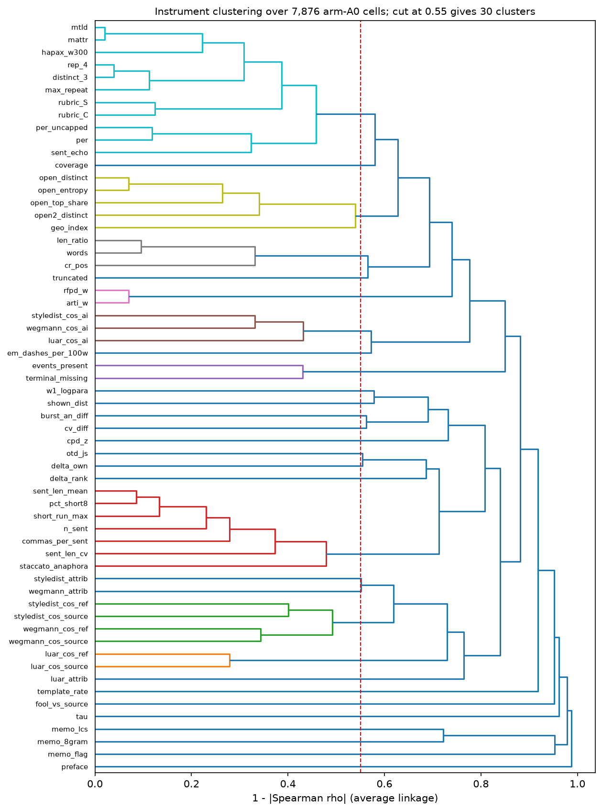
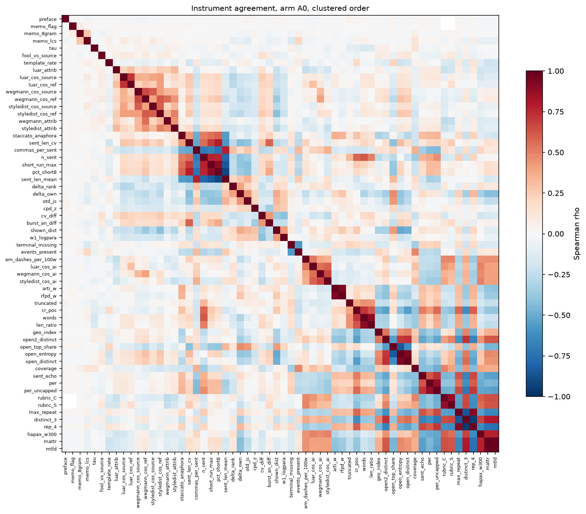
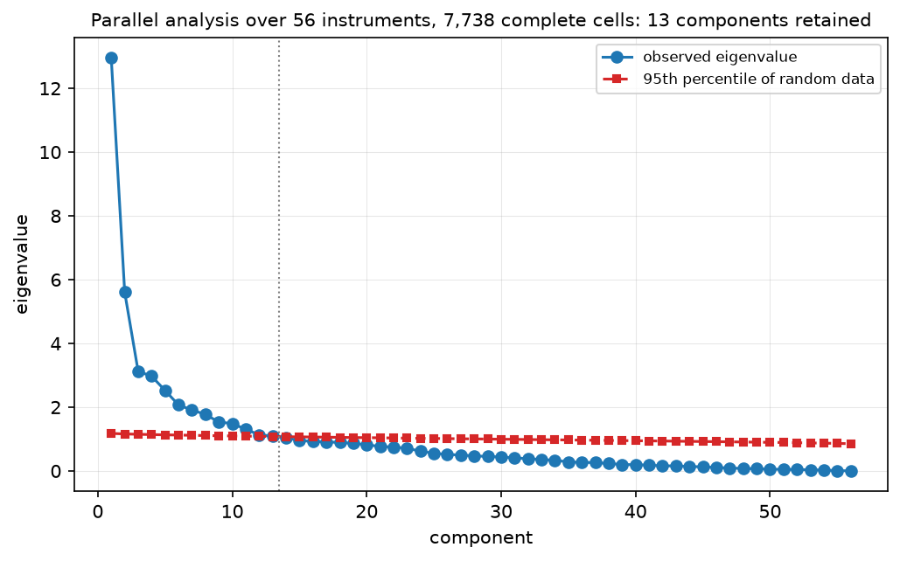
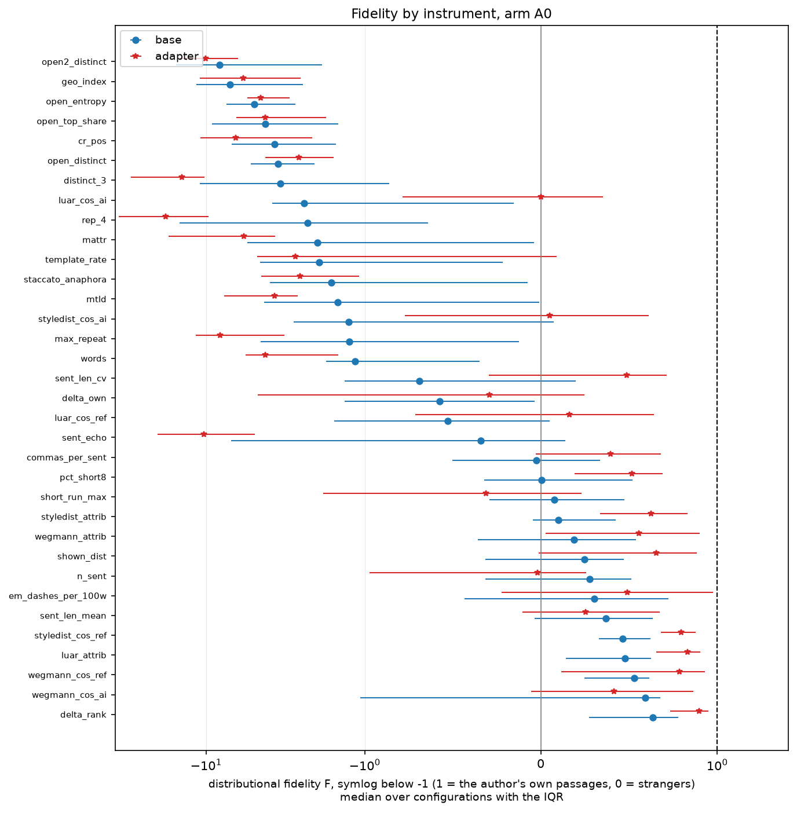
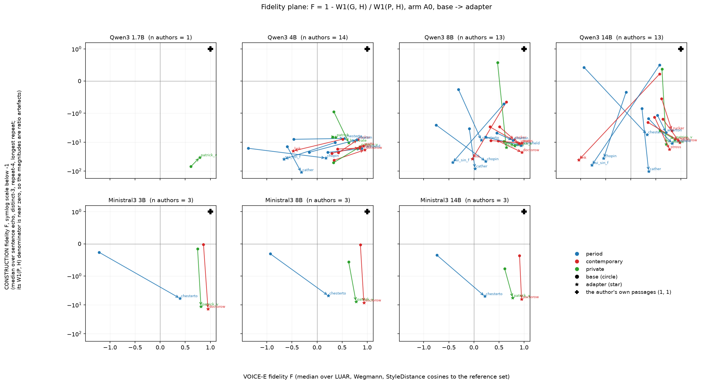
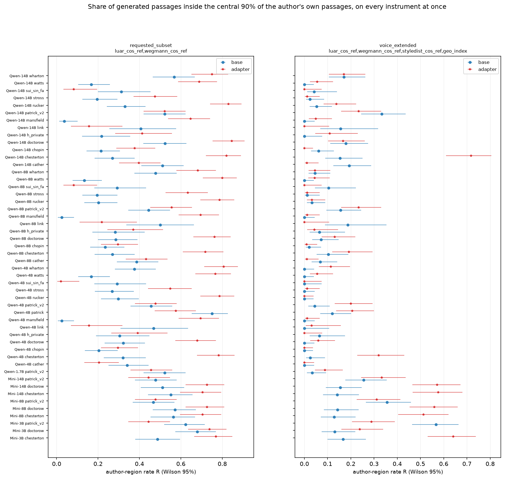

# 15 - Instrument agreement and calibrated fidelity

## What this does

Two questions. First, how many separate things do the 60 numeric instruments in the
variable dictionary actually measure on these 7,876 arm-A0 passages, and which of them are
redundant with each other. Second, which instruments can be put on the author-calibrated
scale that `FIDELITY_SYNTHESIS.md` specifies - a position between the stranger pool P and
the author's own held-out passages H, and a distributional fidelity
F = 1 - W1(G, H) / W1(P, H) - and what those numbers say about the 100 configurations.
The script also computes the author-region rate R: the share of generated passages that
fall inside the central 90% interval of the author's own passages on every calibrated
instrument at once.

## How it does it

**Data.** `data/master/cells.parquet` at arm A0, non-replicate, both samples, both kinds
(7,876 cells, 100 runs, 100 configurations) for G, and
`data/master/references.parquet` for the anchors. H is the `group == "source"` rows of a
run: the author's own held-out passages, scored inside that run against the author's
reference profile (50 per run at the median). P is the `group == "other:*"` rows
of the same run (1301 per run at the median). A given reference passage gets the same
value in every run of its author on 30 of the 34 calibratable instruments, which is the
consistency check that the reference scoring is deterministic; the 4 that fail it are
named below and in `anchor_stability.csv`.

**Which instruments could be calibrated.** `instrument_calibration_coverage.csv` lists
every one of the 64 dictionary variables with the reason it is or is not calibratable.
34 are: all of them are `scores.jsonl` measures, because those are the only ones the
reference passages were scored on. 30 are not. The important exclusions are the
14 eval-cache measures -
`arti_w`, `burst_an_diff`, `cpd_z`, `cv_diff`, `events_present`, `hapax_w300`, `otd_js`, `para_cv_words`, `per`, `per_uncapped`, `rfpd_w`, `tau`, `terminal_missing`, `w1_logpara` -
which exist for generations only. The caches in
`data/eval_results/cache/*.json` carry a `source_stats` block, but that block is a single
mean and standard deviation of the author's own passages per author, not per-passage
values, and it contains nothing at all for other authors. Without a per-passage H there
is no Wasserstein distance and without any P there is no denominator, so **F and pos are
not computed for `otd_js` or `per`**, and the author region cannot use them either.

**Positions and F.** For each configuration and each calibratable instrument:
pos = (mean G - mean P) / (mean H - mean P), and F = 1 - W1(G, H) / W1(P, H) using
`scipy.stats.wasserstein_distance`. F carries a cluster bootstrap over briefs
(400 resamples; the same brief resamples are reused across instruments within a
configuration so that instruments are compared on the same resampling). `anchor_separation.csv`
reports |mean H - mean P| against each instrument's replicate floor: where the two anchors
are closer together than twice the floor the position is a ratio of two noise terms and is
marked unusable (20 of 34 instruments pass that test).

**Agreement.** Spearman over A0 cells, pooled and per family; average-linkage clustering on
1 - |rho| cut at 0.55; PCA with Horn parallel analysis (200 random matrices, 95th percentile)
on the 56 instruments with at least 95% completeness over 7,738 complete cells; and the
brief-paired adapter gain of the three style embeddings per author, with the
FIDELITY_SYNTHESIS disagreement rule (two instruments in a family disagree when their
gains differ by more than twice the larger replicate floor).

**Correction.** BH-FDR within each family of tests (the embedding-gain agreement table,
the region tables). Effect sizes and intervals lead; p-values follow.

**Floors.** Replicate floors come from `lib.replicate_floor`, which finds
5 twice-generated Qwen3 base pairs in the master table and 4 Ministral3 pairs. This
script takes one floor per instrument, the largest absolute difference over every pair of
either family, so a floor here is a pooled worst case and not a per-family noise model;
where a family is noisier than the other its own contrasts are compared with a floor set
partly by the quieter one. The Ministral3 pairs were scored on 2026-09-10, so any earlier
reading of this folder saw Qwen3-only floors.

### Instruments that could not be calibrated, and why

| measure | construct | source | reason_if_not |
|---|---|---|---|
| coverage | adherence | coverage.jsonl | LLM-judge measure; the reference passages were never put through this judge pass |
| events_present | adherence | eval cache event_order_A0 | eval-cache measure computed on generations only; the cache keeps a per-author mean and sd of the author's own passages under source_stats, not per-passage values, and nothing at all for other authors, so neither H nor P exists |
| tau | adherence | eval cache event_order_A0 | eval-cache measure computed on generations only; the cache keeps a per-author mean and sd of the author's own passages under source_stats, not per-passage values, and nothing at all for other authors, so neither H nor P exists |
| terminal_missing | adherence | eval cache event_order_A0 | eval-cache measure computed on generations only; the cache keeps a per-author mean and sd of the author's own passages under source_stats, not per-passage values, and nothing at all for other authors, so neither H nor P exists |
| delta_nearest | attribution | scores.jsonl | categorical, no distance defined |
| luar_nearest | attribution | scores.jsonl | categorical, no distance defined |
| per | construction | eval cache per_A0_cap600 | eval-cache measure computed on generations only; the cache keeps a per-author mean and sd of the author's own passages under source_stats, not per-passage values, and nothing at all for other authors, so neither H nor P exists |
| per_uncapped | construction | eval cache per_A0 | eval-cache measure computed on generations only; the cache keeps a per-author mean and sd of the author's own passages under source_stats, not per-passage values, and nothing at all for other authors, so neither H nor P exists |
| rubric_C | construction | eval_results/judge | LLM-judge measure; the reference passages were never put through this judge pass |
| fool_vs_source | judge | judge.jsonl | LLM-judge measure; the reference passages were never put through this judge pass |
| rubric_S | judge | eval_results/judge | LLM-judge measure; the reference passages were never put through this judge pass |
| win_vs_A0 | judge | judge.jsonl | LLM-judge measure; the reference passages were never put through this judge pass |
| len_ratio | length | scores.jsonl | column exists in references.parquet but is empty for the author's own passages |
| truncated | length | gens flags | a decoding flag of the generation run; a human passage has no analogue |
| arti_w | tell | eval cache constructional_A0 | eval-cache measure computed on generations only; the cache keeps a per-author mean and sd of the author's own passages under source_stats, not per-passage values, and nothing at all for other authors, so neither H nor P exists |
| memo_8gram | tell | scores.jsonl | overlap with the author's training text; only defined for a generation |
| memo_flag | tell | scores.jsonl | overlap with the author's training text; only defined for a generation |
| memo_lcs | tell | scores.jsonl | overlap with the author's training text; only defined for a generation |
| preface | tell | gens flags | a decoding flag of the generation run; a human passage has no analogue |
| luar_cos_source | voice_embed | scores.jsonl | defined against the brief's own source passage; for a reference passage the source is itself, so the quantity is not comparable and was not scored |
| styledist_cos_source | voice_embed | scores.jsonl | defined against the brief's own source passage; for a reference passage the source is itself, so the quantity is not comparable and was not scored |
| wegmann_cos_source | voice_embed | scores.jsonl | defined against the brief's own source passage; for a reference passage the source is itself, so the quantity is not comparable and was not scored |
| burst_an_diff | voice_structure | eval cache cpd_A0 | eval-cache measure computed on generations only; the cache keeps a per-author mean and sd of the author's own passages under source_stats, not per-passage values, and nothing at all for other authors, so neither H nor P exists |
| cpd_z | voice_structure | eval cache cpd_A0 | eval-cache measure computed on generations only; the cache keeps a per-author mean and sd of the author's own passages under source_stats, not per-passage values, and nothing at all for other authors, so neither H nor P exists |
| cv_diff | voice_structure | eval cache psd_A0 | eval-cache measure computed on generations only; the cache keeps a per-author mean and sd of the author's own passages under source_stats, not per-passage values, and nothing at all for other authors, so neither H nor P exists |
| hapax_w300 | voice_structure | eval cache lexdiv_A0 | eval-cache measure computed on generations only; the cache keeps a per-author mean and sd of the author's own passages under source_stats, not per-passage values, and nothing at all for other authors, so neither H nor P exists |
| otd_js | voice_structure | eval cache otd_A0 | eval-cache measure computed on generations only; the cache keeps a per-author mean and sd of the author's own passages under source_stats, not per-passage values, and nothing at all for other authors, so neither H nor P exists |
| para_cv_words | voice_structure | eval cache psd_A0 | not in the master cell table |
| rfpd_w | voice_structure | eval cache constructional_A0 | eval-cache measure computed on generations only; the cache keeps a per-author mean and sd of the author's own passages under source_stats, not per-passage values, and nothing at all for other authors, so neither H nor P exists |
| w1_logpara | voice_structure | eval cache psd_A0 | eval-cache measure computed on generations only; the cache keeps a per-author mean and sd of the author's own passages under source_stats, not per-passage values, and nothing at all for other authors, so neither H nor P exists |

### Anchor stability: does a reference passage get the same value in every run?

| measure | construct | n_reference_passages | share_run_dependent | max_distinct_values_one_passage | median_within_over_between_sd |
|---|---|---|---|---|---|
| luar_cos_ai | voice_embed | 635 | 0.921 | 8 | 0.218 |
| wegmann_cos_ai | voice_embed | 635 | 0.921 | 8 | 0.188 |
| geo_index | voice_structure | 635 | 0.921 | 8 | 0.401 |
| styledist_cos_ai | voice_embed | 635 | 0.921 | 8 | 0.103 |
| luar_cos_ref | voice_embed | 635 | 0.000 | 1 | 0.000 |
| luar_attrib | attribution | 635 | 0.000 | 1 | 0.000 |
| wegmann_attrib | attribution | 635 | 0.000 | 1 | 0.000 |
| wegmann_cos_ref | voice_embed | 635 | 0.000 | 1 | 0.000 |

### Anchor separation: can a position be estimated on this instrument at all

| measure | median_abs_separation | floor | separation_over_floor | position_usable | median_pos | pos_iqr |
|---|---|---|---|---|---|---|
| styledist_attrib | 0.733 | 0.033 | 21.977 | True | 0.449 | 0.707 |
| luar_attrib | 0.696 | 0.057 | 12.252 | True | 0.784 | 0.543 |
| shown_dist | 1.071 | 0.102 | 10.478 | True | 0.374 | 0.990 |
| delta_rank | 7.321 | 0.800 | 9.151 | True | 0.791 | 0.508 |
| wegmann_attrib | 0.458 | 0.064 | 7.141 | True | 0.632 | 1.052 |
| styledist_cos_ref | 0.048 | 0.008 | 6.293 | True | 0.781 | 0.575 |
| em_dashes_per_100w | 0.454 | 0.089 | 5.116 | True | 1.004 | 1.195 |
| wegmann_cos_ref | 0.217 | 0.043 | 5.104 | True | 0.625 | 0.499 |
| styledist_cos_ai | 0.018 | 0.004 | 4.979 | True | 2.544 | 3.330 |
| delta_own | 0.082 | 0.017 | 4.965 | True | -0.031 | 1.403 |
| sent_len_cv | 0.088 | 0.021 | 4.136 | True | 1.083 | 1.700 |
| template_rate | 0.019 | 0.005 | 4.126 | True | -0.579 | 8.889 |
| sent_len_mean | 3.345 | 0.839 | 3.988 | True | 0.819 | 1.303 |
| pct_short8 | 0.119 | 0.033 | 3.647 | True | 0.740 | 1.300 |
| commas_per_sent | 0.312 | 0.087 | 3.584 | True | 0.316 | 1.306 |
| luar_cos_ref | 0.073 | 0.021 | 3.529 | True | -0.129 | 1.495 |
| n_sent | 9.395 | 3.115 | 3.016 | True | 0.707 | 1.657 |
| wegmann_cos_ai | 0.108 | 0.036 | 3.002 | True | 1.028 | 0.822 |
| short_run_max | 2.263 | 1.026 | 2.206 | True | 0.857 | 1.665 |
| mtld | 7.854 | 3.579 | 2.195 | True | 3.163 | 6.995 |
| open_distinct | 0.050 | 0.028 | 1.812 | False | 2.532 | 9.324 |
| open_entropy | 0.024 | 0.017 | 1.450 | False | 2.181 | 18.838 |
| mattr | 0.011 | 0.008 | 1.375 | False | 0.914 | 9.714 |
| luar_cos_ai | 0.019 | 0.014 | 1.354 | False | 1.545 | 3.710 |
| geo_index | 0.078 | 0.064 | 1.217 | False | -2.276 | 15.679 |
| words | 26.762 | 47.634 | 0.562 | False | 1.223 | 3.827 |
| open_top_share | 0.008 | 0.020 | 0.369 | False | -1.698 | 19.663 |
| open2_distinct | 0.010 | 0.030 | 0.351 | False | 11.090 | 23.749 |
| max_repeat | 0.744 | 2.524 | 0.295 | False | -0.017 | 12.430 |
| cr_pos | 0.109 | 0.373 | 0.293 | False | 5.988 | 13.868 |
| staccato_anaphora | 0.003 | 0.010 | 0.291 | False | 1.410 | 10.470 |
| distinct_3 | 0.003 | 0.026 | 0.127 | False | 9.447 | 62.034 |
| sent_echo | 0.003 | 0.027 | 0.097 | False | -0.092 | 12.767 |
| rep_4 | 0.002 | 0.032 | 0.076 | False | -1.538 | 23.302 |

### Distributional fidelity by instrument, base and adapter

| measure | construct | median_F_base | median_F_adapter | adapter_minus_base_median_F | median_W1_P_H_base |
|---|---|---|---|---|---|
| delta_rank | attribution | 0.634 | 0.898 | 0.263 | 7.321 |
| wegmann_cos_ai | voice_embed | 0.592 | 0.415 | -0.177 | 0.113 |
| wegmann_cos_ref | voice_embed | 0.529 | 0.785 | 0.256 | 0.217 |
| luar_attrib | attribution | 0.475 | 0.833 | 0.358 | 0.696 |
| styledist_cos_ref | voice_embed | 0.464 | 0.796 | 0.332 | 0.048 |
| sent_len_mean | voice_structure | 0.367 | 0.255 | -0.112 | 3.601 |
| em_dashes_per_100w | voice_structure | 0.303 | 0.490 | 0.187 | 0.454 |
| n_sent | length | 0.275 | -0.020 | -0.295 | 9.512 |
| shown_dist | adherence | 0.246 | 0.653 | 0.407 | 1.071 |
| wegmann_attrib | attribution | 0.187 | 0.556 | 0.369 | 0.458 |
| styledist_attrib | attribution | 0.099 | 0.626 | 0.527 | 0.733 |
| short_run_max | voice_structure | 0.075 | -0.313 | -0.388 | 2.311 |
| pct_short8 | voice_structure | 0.002 | 0.517 | 0.516 | 0.122 |
| commas_per_sent | voice_structure | -0.025 | 0.394 | 0.419 | 0.330 |
| sent_echo | construction | -0.343 | -10.266 | -9.923 | 0.003 |
| luar_cos_ref | voice_embed | -0.529 | 0.160 | 0.689 | 0.073 |
| delta_own | voice_structure | -0.575 | -0.292 | 0.283 | 0.082 |
| sent_len_cv | voice_structure | -0.691 | 0.486 | 1.177 | 0.091 |
| words | length | -1.152 | -4.233 | -3.082 | 34.567 |
| max_repeat | construction | -1.245 | -8.138 | -6.893 | 0.744 |
| styledist_cos_ai | voice_embed | -1.259 | 0.050 | 1.309 | 0.021 |
| mtld | voice_structure | -1.476 | -3.705 | -2.230 | 8.023 |
| staccato_anaphora | tell | -1.624 | -2.563 | -0.938 | 0.004 |
| template_rate | tell | -1.940 | -2.728 | -0.788 | 0.020 |
| mattr | voice_structure | -1.978 | -5.777 | -3.800 | 0.011 |
| rep_4 | construction | -2.290 | -17.926 | -15.637 | 0.002 |
| luar_cos_ai | voice_embed | -2.408 | 0.000 | 2.408 | 0.020 |
| distinct_3 | construction | -3.400 | -14.238 | -10.838 | 0.004 |
| open_distinct | voice_structure | -3.510 | -2.598 | 0.911 | 0.054 |
| cr_pos | voice_structure | -3.691 | -6.499 | -2.808 | 0.126 |
| open_top_share | voice_structure | -4.212 | -4.216 | -0.004 | 0.018 |
| open_entropy | voice_structure | -4.971 | -4.516 | 0.454 | 0.032 |
| geo_index | voice_structure | -7.055 | -5.816 | 1.239 | 0.089 |
| open2_distinct | voice_structure | -8.200 | -10.077 | -1.877 | 0.013 |

### Parallel analysis

| component | eigenvalue | parallel_95th | retained | variance_share | cumulative_share |
|---|---|---|---|---|---|
| 1 | 12.953 | 1.178 | True | 0.231 | 0.231 |
| 2 | 5.607 | 1.161 | True | 0.100 | 0.331 |
| 3 | 3.126 | 1.150 | True | 0.056 | 0.387 |
| 4 | 2.973 | 1.140 | True | 0.053 | 0.440 |
| 5 | 2.526 | 1.133 | True | 0.045 | 0.485 |
| 6 | 2.071 | 1.126 | True | 0.037 | 0.522 |
| 7 | 1.912 | 1.119 | True | 0.034 | 0.557 |
| 8 | 1.774 | 1.111 | True | 0.032 | 0.588 |
| 9 | 1.534 | 1.105 | True | 0.027 | 0.616 |
| 10 | 1.488 | 1.098 | True | 0.027 | 0.642 |
| 11 | 1.308 | 1.092 | True | 0.023 | 0.666 |
| 12 | 1.135 | 1.086 | True | 0.020 | 0.686 |
| 13 | 1.095 | 1.081 | True | 0.020 | 0.705 |
| 14 | 1.037 | 1.074 | False | 0.019 | 0.724 |
| 15 | 0.955 | 1.069 | False | 0.017 | 0.741 |

### Redundancy pairs at |rho| >= 0.8 (top 20)

| a | b | rho | construct_a | construct_b |
|---|---|---|---|---|
| mattr | mtld | 0.980 | voice_structure | voice_structure |
| distinct_3 | rep_4 | -0.961 | construction | construction |
| arti_w | rfpd_w | 0.930 | tell | voice_structure |
| open_entropy | open_distinct | 0.930 | voice_structure | voice_structure |
| rep_4 | max_repeat | 0.919 | construction | construction |
| pct_short8 | sent_len_mean | -0.914 | voice_structure | voice_structure |
| words | len_ratio | 0.905 | length | length |
| pct_short8 | short_run_max | 0.893 | voice_structure | voice_structure |
| per | per_uncapped | 0.882 | construction | construction |
| rubric_C | rubric_S | 0.876 | construction | judge |
| distinct_3 | max_repeat | -0.856 | construction | construction |
| open_entropy | open_top_share | -0.840 | voice_structure | voice_structure |
| sent_len_mean | short_run_max | -0.839 | voice_structure | voice_structure |
| mtld | distinct_3 | 0.804 | voice_structure | construction |

### Measures that are empty or constant within a family at arm A0 (their correlation row is NaN by necessity, not by error)

| family | measure | construct | n_cells | n_non_null | n_distinct |
|---|---|---|---|---|---|
| Ministral3 | memo_flag | tell | 1512 | 1512 | 1 |
| Ministral3 | preface | tell | 1512 | 1512 | 1 |

### Embedding disagreement on adapter gain, per author

| author | family | params_b | gain_luar_cos_ref | gain_wegmann_cos_ref | gain_styledist_cos_ref | n_disagreements | disagreement_flags |
|---|---|---|---|---|---|---|---|
| cather | Qwen3 | 4.000 | -0.035 | 0.027 | 0.016 | 1 | luar!=styledist |
| cather | Qwen3 | 8.000 | 0.011 | 0.008 | 0.009 | 0 |  |
| cather | Qwen3 | 14.000 | -0.020 | -0.005 | 0.002 | 0 |  |
| chesterton | Ministral3 | 3.000 | 0.056 | -0.111 | -0.006 | 3 | luar!=wegmann,luar!=styledist,wegmann!=styledist |
| chesterton | Ministral3 | 8.000 | 0.033 | -0.113 | -0.011 | 3 | luar!=wegmann,luar!=styledist,wegmann!=styledist |
| chesterton | Ministral3 | 14.000 | 0.033 | -0.115 | -0.004 | 2 | luar!=wegmann,wegmann!=styledist |
| chesterton | Qwen3 | 4.000 | 0.117 | 0.044 | 0.018 | 1 | luar!=styledist |
| chesterton | Qwen3 | 8.000 | 0.128 | -0.025 | 0.012 | 2 | luar!=wegmann,luar!=styledist |
| chesterton | Qwen3 | 14.000 | 0.111 | -0.053 | 0.009 | 2 | luar!=wegmann,luar!=styledist |
| chopin | Qwen3 | 4.000 | 0.029 | 0.063 | 0.024 | 0 |  |
| chopin | Qwen3 | 8.000 | 0.034 | 0.027 | 0.024 | 0 |  |
| chopin | Qwen3 | 14.000 | 0.037 | -0.004 | 0.013 | 0 |  |
| doctorow | Ministral3 | 3.000 | -0.007 | 0.020 | 0.003 | 0 |  |
| doctorow | Ministral3 | 8.000 | -0.015 | 0.030 | 0.003 | 0 |  |
| doctorow | Ministral3 | 14.000 | -0.027 | 0.036 | 0.006 | 0 |  |
| doctorow | Qwen3 | 4.000 | 0.051 | 0.112 | 0.048 | 0 |  |
| doctorow | Qwen3 | 8.000 | 0.072 | 0.088 | 0.037 | 0 |  |
| doctorow | Qwen3 | 14.000 | 0.044 | 0.051 | 0.027 | 0 |  |
| h_private | Qwen3 | 4.000 | 0.045 | -0.009 | 0.028 | 0 |  |
| h_private | Qwen3 | 8.000 | 0.053 | 0.020 | 0.018 | 0 |  |
| h_private | Qwen3 | 14.000 | 0.055 | -0.081 | 0.005 | 3 | luar!=wegmann,luar!=styledist,wegmann!=styledist |
| link | Qwen3 | 4.000 | -0.034 | -0.236 | -0.013 | 2 | luar!=wegmann,wegmann!=styledist |
| link | Qwen3 | 8.000 | -0.006 | -0.172 | -0.020 | 2 | luar!=wegmann,wegmann!=styledist |
| link | Qwen3 | 14.000 | -0.053 | -0.366 | -0.046 | 2 | luar!=wegmann,wegmann!=styledist |
| mansfield | Qwen3 | 4.000 | 0.118 | 0.086 | 0.040 | 1 | luar!=styledist |
| mansfield | Qwen3 | 8.000 | 0.141 | 0.104 | 0.042 | 1 | luar!=styledist |
| mansfield | Qwen3 | 14.000 | 0.116 | 0.071 | 0.028 | 1 | luar!=styledist |
| patrick | Qwen3 | 4.000 | -0.017 | -0.022 | 0.018 | 0 |  |
| patrick_v2 | Ministral3 | 3.000 | -0.062 | 0.019 | -0.003 | 1 | luar!=styledist |
| patrick_v2 | Ministral3 | 8.000 | -0.040 | 0.065 | 0.008 | 2 | luar!=wegmann,luar!=styledist |
| patrick_v2 | Ministral3 | 14.000 | -0.036 | 0.080 | 0.015 | 2 | luar!=wegmann,luar!=styledist |
| patrick_v2 | Qwen3 | 1.700 | -0.037 | 0.088 | 0.013 | 2 | luar!=wegmann,luar!=styledist |
| patrick_v2 | Qwen3 | 4.000 | -0.003 | 0.083 | 0.028 | 1 | luar!=wegmann |
| patrick_v2 | Qwen3 | 8.000 | -0.005 | 0.096 | 0.017 | 1 | luar!=wegmann |
| patrick_v2 | Qwen3 | 14.000 | -0.017 | 0.081 | 0.006 | 1 | luar!=wegmann |
| rucker | Qwen3 | 4.000 | 0.096 | 0.092 | 0.049 | 1 | luar!=styledist |
| rucker | Qwen3 | 8.000 | 0.109 | 0.122 | 0.039 | 1 | luar!=styledist |
| rucker | Qwen3 | 14.000 | 0.096 | 0.091 | 0.036 | 1 | luar!=styledist |
| stross | Qwen3 | 4.000 | 0.063 | 0.071 | 0.035 | 0 |  |
| stross | Qwen3 | 8.000 | 0.082 | 0.131 | 0.039 | 2 | luar!=styledist,wegmann!=styledist |
| stross | Qwen3 | 14.000 | 0.051 | 0.042 | 0.031 | 0 |  |
| sui_sin_far | Qwen3 | 4.000 | -0.074 | -0.253 | -0.012 | 3 | luar!=wegmann,luar!=styledist,wegmann!=styledist |
| sui_sin_far | Qwen3 | 8.000 | -0.074 | -0.247 | -0.012 | 3 | luar!=wegmann,luar!=styledist,wegmann!=styledist |
| sui_sin_far | Qwen3 | 14.000 | -0.050 | -0.296 | -0.026 | 2 | luar!=wegmann,wegmann!=styledist |
| watts | Qwen3 | 4.000 | 0.080 | 0.145 | 0.066 | 0 |  |
| watts | Qwen3 | 8.000 | 0.099 | 0.142 | 0.068 | 0 |  |
| watts | Qwen3 | 14.000 | 0.092 | 0.130 | 0.067 | 0 |  |
| wharton | Qwen3 | 4.000 | 0.076 | 0.090 | 0.020 | 1 | luar!=styledist |
| wharton | Qwen3 | 8.000 | 0.060 | 0.049 | 0.017 | 1 | luar!=styledist |
| wharton | Qwen3 | 14.000 | 0.054 | -0.000 | 0.011 | 1 | luar!=styledist |

### Author-region rate summary by family, size and kind

| family | params_b | kind | n_configs | mean_R | median_R | mean_R_at_2 | mean_ceiling | mean_floor | mean_R_scaled | n_authors |
|---|---|---|---|---|---|---|---|---|---|---|
| Ministral3 | 3.000 | adapter | 3 | 0.651 | 0.738 | 0.793 | 0.773 | 0.401 | 0.738 | 3 |
| Ministral3 | 3.000 | base | 3 | 0.596 | 0.622 | 0.756 | 0.773 | 0.401 | -0.261 | 3 |
| Ministral3 | 8.000 | adapter | 3 | 0.636 | 0.705 | 0.830 | 0.773 | 0.401 | 0.508 | 3 |
| Ministral3 | 8.000 | base | 3 | 0.534 | 0.564 | 0.785 | 0.773 | 0.401 | -0.139 | 3 |
| Ministral3 | 14.000 | adapter | 3 | 0.625 | 0.705 | 0.782 | 0.773 | 0.401 | 0.487 | 3 |
| Ministral3 | 14.000 | base | 3 | 0.514 | 0.512 | 0.700 | 0.773 | 0.401 | -0.221 | 3 |
| Qwen3 | 1.700 | adapter | 1 | 0.456 | 0.456 | 0.600 | 0.780 | 0.238 | 0.401 | 1 |
| Qwen3 | 1.700 | base | 1 | 0.522 | 0.522 | 0.689 | 0.780 | 0.238 | 0.524 | 1 |
| Qwen3 | 4.000 | adapter | 14 | 0.513 | 0.562 | 0.686 | 0.761 | 0.392 | 0.371 | 14 |
| Qwen3 | 4.000 | base | 14 | 0.328 | 0.312 | 0.481 | 0.761 | 0.392 | -0.555 | 14 |
| Qwen3 | 8.000 | adapter | 13 | 0.541 | 0.634 | 0.725 | 0.760 | 0.377 | 0.318 | 13 |
| Qwen3 | 8.000 | base | 13 | 0.287 | 0.283 | 0.430 | 0.760 | 0.377 | -0.663 | 13 |
| Qwen3 | 14.000 | adapter | 13 | 0.539 | 0.522 | 0.720 | 0.760 | 0.377 | 0.461 | 13 |
| Qwen3 | 14.000 | base | 13 | 0.329 | 0.312 | 0.487 | 0.760 | 0.377 | -0.548 | 13 |

### The five configurations with the highest author-region rate

| author | family | params_b | kind | R | R_lo | R_hi | R_at_2 |
|---|---|---|---|---|---|---|---|
| doctorow | Qwen3 | 14.000 | adapter | 0.845 | 0.753 | 0.907 | 0.976 |
| rucker | Qwen3 | 14.000 | adapter | 0.830 | 0.741 | 0.892 | 0.957 |
| chesterton | Qwen3 | 14.000 | adapter | 0.821 | 0.721 | 0.890 | 0.923 |
| wharton | Qwen3 | 4.000 | adapter | 0.807 | 0.712 | 0.876 | 0.977 |
| watts | Qwen3 | 8.000 | adapter | 0.800 | 0.706 | 0.870 | 0.978 |

### Instrument dendrogram

### Spearman heatmap in clustered order

### Parallel analysis scree

### Fidelity by instrument

### Fidelity plane, base -> adapter

### Author-region rate per configuration

### Headline numbers

- **34 of the 64 dictionary variables can be put on the author-calibrated scale.**
  Every calibratable one is a `scores.jsonl` measure. The whole eval-cache layer - PER, opener-class
  distance, hapax, cadence, paragraph shape, event order, the constructional tell index - was
  computed on generations only, and the caches keep a per-author mean and sd of the author's own
  passages rather than the values, so neither F nor a position exists for any of them.
- **Only 20 of 34 calibratable instruments have anchors far enough apart to carry a
  position.** The median |mean H - mean P| over instruments is 0.0976 against a median
  replicate floor of 0.0330. Where the ratio is below 2 the position is two noise terms
  divided by each other.
- **The three style embeddings do not agree on what the adapter did.** Over
  50 author-by-family-by-size cells from 14 authors (`patrick`, the v1-chunking control,
  among them), 31 carry at least one pairwise disagreement flag. The cells of one author are
  not independent of each other, so the rank correlations below describe the spread across
  configurations and are not an author-level estimate.
  The rank correlation between LUAR gain and Wegmann gain across cells is
  +0.491
  [+0.219,
  +0.696], and between LUAR and StyleDistance
  +0.695
  [+0.519,
  +0.816].
  78 of 100 configurations carry a VOICE-E disagreement flag on F.
- **The instruments measure fewer things than there are instruments, but not far fewer.**
  Horn's parallel analysis retains **13 components** of 56, carrying
  70.5% of the variance; the first component alone carries
  23.1% and the first five 48.5%. It takes
  19 components to reach 80%. Horn's test is liberal at
  7,738 rows - the 95th-percentile random eigenvalue is only 1.18 - so read
  "13 components" as an upper bound on the number of separable things, not a factor solution.
  Average-linkage clustering at 1 - |rho| = 0.55 gives 30 clusters
  (21 of them singletons; see `cluster_counts_by_cut.csv` for other cuts), and
  14 instrument pairs sit at |rho| >= 0.8 - `mattr`/`mtld` at +0.980,
  `distinct_3`/`rep_4` at -0.961, and `rubric_C`/`rubric_S` at
  +0.876, which is the judge's construction block and its craft block measuring one thing.
  The correlation structure is stable across model families: Spearman between the Qwen3 and
  Ministral3 off-diagonal correlations is +0.593.
- **Four anchors are not anchors.** `anchor_stability.csv` runs the check that a reference
  passage must get the same value in every run of its author. 30 of the 34 calibratable
  instruments pass bit-exactly. **`geo_index`, `luar_cos_ai`, `styledist_cos_ai`, `wegmann_cos_ai` do not**:
  92.1% of the author's own reference passages take a different value depending
  on which run scored them, up to 8 distinct values for one passage. All four depend on the
  "generic AI prose" side of the comparison, which is drawn from the scoring run's own output,
  so the anchor moves with the thing being measured. `geo_index`, whose within-passage spread
  is 0.40 of its between-passage spread, is the one of the four that the plan uses as a
  voice-structure instrument; its position, F and region bound are conditional on the run and
  should not be compared across runs.
- **Fidelity on voice is well below the author and the three cosines disagree about where it
  sits.** Median F over configurations on the three cosines to the reference set: base
  +0.464, adapter +0.785. That pair of numbers is a median over three instruments whose
  own medians run from -0.529 to +0.529 at base and +0.160 to +0.796 under the adapter, it is
  not a brief-paired contrast, and no floor applies to a ratio of Wasserstein distances, so it
  supports a direction and not a size. 23 instruments have a negative median F, meaning the generated
  distribution sits further from the author than the stranger pool does.
- **The author-region rate is higher under the adapter than under the base, and it has to be
  read against its own ceiling.** These are means over configurations from 14 authors
  (`patrick`, the v1-chunking control, among them), unpaired and untested, with several
  configurations per author. On luar_cos_ref, wegmann_cos_ref (the calibratable members of the requested set;
  otd_js, per had to be dropped for want of reference values), mean R is
  0.361 for base configurations and 0.548 for adapters, with R@2
  0.521 and 0.724. The same rule applied to the author's own passages puts
  the ceiling at 0.763 and applied to the stranger pool puts the floor at
  0.383. The floor is that high because 2 instruments with a 90% interval each is a
  wide region - a stranger's passage lands inside it 38% of the time - which is the price of
  dropping `per` and `otd_js` from it. On the floor-to-ceiling scale the base sits at
  0.038 (median; mean -0.491) and the adapter at 0.517
  (median; mean 0.421). 24 of 50 base configurations sit **below** their own stranger
  floor - their passages land in the author's region less often than a random other author's
  passages do - against 13 of 50 adapter configurations. The adapter's contribution on
  this measure is to move the generator from at or below the stranger floor to part of the way
  towards the author. 0 of 100 configurations have R exactly 0.
  On the four-instrument extended voice region the region is tighter (floor
  0.232, ceiling 0.597) and mean R is
  0.091 (base) and
  0.151 (adapter).
  Within Qwen3 the adapter's mean R is flat across parameter count
  (0.513 at 4B on 14 authors,
  0.541 at 8B on 13,
  0.539 at 14B on 13). No test of that flatness is run here, and three means over
  thirteen or fourteen authors cannot rule out a change smaller than they can resolve.

## How to read the result, conservatively

**Unit of replication.** The configuration (author x family x size x kind) for F and pos,
the author for anything said about models. F intervals are cluster bootstraps over the
84-odd generated passages of one configuration, grouped by brief: they answer "would
this author's other briefs give the same F", not "would another author".

**How wide the intervals are.** The median F interval half-width over all
3,400 configuration-by-instrument rows is
0.411, which is the resolution at which two configurations can be
told apart on one instrument. Differences smaller than that are not differences.

**The denominator is the fragile part.** F is a ratio whose denominator is W1(P, H), the
distance between strangers and the author on that instrument. Where the instrument does
not separate strangers from the author the denominator is near zero and F swings wildly;
`fidelity_by_instrument_wide.csv` carries `median_W1_P_H_base` next to every F for exactly
this reason. The construction instruments are the clear case: strangers' prose is as
coherent as the author's, so W1(P, H) on sentence echo and repeat rate is tiny and the
construction axis of the fidelity plane is the least trustworthy number in this folder.
`FIDELITY_SYNTHESIS.md` section 2 proposed the author's own sentence-shuffled passages as
the construction anchor instead. Its 2026-09-10 amendment withdraws that: proposition echo
is close to permutation-invariant, so a sentence shuffle fails the anchor's own
manipulation check, and no shuffled floor and no F value may be quoted for `per` from any
pool. The plane's vertical axis is therefore a placeholder with no replacement currently
available, and it is labelled as one.

**What would overturn it.** Per-passage reference values for `per` and `otd_js`, and a
register-matched stranger pool. Both measures are named in the plan as members of the
region and of the construction family, both are absent from the reference scoring, and
adding them would change R directly rather than adjust it at the margin; `per` would enter
only as a raw rate and as region membership, because the 2026-09-10 amendment forbids an F
for it. Register matching is the larger change: `scripts/23_register_matched_pool.py`
reports that it moves contemporary and private authors' positions down by more than the
adapter gain and halves the share of usable rows, so every position and F for those two
author classes here is provisional. The correlation and clustering results would not
change; they rest on the generations alone.

**What it does not show.** It does not show that any configuration writes like the author.
F near 1 on an instrument means the generated distribution on that one statistic is as
close to the author's as the author's own passages are to each other, which is a
necessary condition and nowhere near a sufficient one. R is the summary to quote and it is
small. No judge score is quoted as a level anywhere: `coverage`, `rubric_C`, `rubric_S`,
`fool_vs_source` and `win_vs_A0` are not calibratable and appear only inside the
correlation matrix, where the `rubric_C`/`rubric_S` pair is read as two judge instruments
tracking each other rather than as a measure of the prose.

## Caveats

- The stranger pool P is period fiction for every author: the fourteen `other:*` groups are austen, cather, chesterton, chopin, conrad, joyce, lovecraft, mansfield, melville, sui_sin_far, watanna, wells, wharton, woolf. For the five contemporary and three private authors the population anchor therefore comes from a different century and register than H, which is not the pool FIDELITY_SYNTHESIS section 1 specifies. Positions and F for those authors are on a different scale from the period authors' and the two groups should not be pooled.
- `per` and `otd_js` have no per-passage reference values anywhere in data/, so they enter neither F nor pos nor the author region; the region is computed on the calibratable subset and the dropped members are named in the table.
- The construction family's F has a near-zero denominator by construction (strangers are coherent); read it as a diagnostic, not as a fidelity.
- Replicate floors rest on 5 Qwen3 pairs and 4 Ministral3 pairs and are taken as one pooled worst case per instrument, not per family, so an 'above floor' verdict on either family is read against the noisier of the two. The Ministral3 pairs were scored on 2026-09-10.
- Ministral3 covers three authors; Qwen3 1.7B covers one. Their rows are descriptive.
- 2 measures are empty or constant across every Ministral3 arm-A0 cell (memo_flag, preface), so `spearman_matrix_Ministral3.csv` carries NaN rows for them. The judge measures were never run on Ministral3 at all; the rest are constant. The cross-family correlation-structure agreement is computed on the pairs that exist in both.
- H is 25 to 50 passages per author (25 at the minimum, for link), so the central 90% interval of H is estimated from as few as 25 values and its tails are unstable; R inherits that.
- Arm A0 only. The A4/A5 arms show the model the author's own statistics, so a position on those arms would be compliance, not fidelity.
- geo_index, luar_cos_ai, styledist_cos_ai, wegmann_cos_ai are run-dependent even on the author's own passages (92% of reference passages take more than one value across the runs of their author). All four are measured against 'generic AI prose' taken from the scoring run itself, so the anchor is not fixed and their positions, F values and region bounds are conditional on the run. Every other calibratable instrument is bit-identical across runs, which is the check that the rest of the reference scoring is deterministic.
- The author-region rate has a high floor: with only 2 instruments and a 90% interval each, a stranger's passage lands inside the region 38% of the time. Quote `R_scaled` (floor to ceiling) rather than R when comparing regions of different width.
- Wilson intervals on R treat the passages of a configuration as independent; they are two samples per brief and are not, so the interval is optimistic. R@2 is the brief-level number and is the safer one.
- Generated and reference passages were not matched on length before F was computed; `words` is included as a calibratable instrument so that its own F can be read as the length-matching diagnostic.
- Proposition echo is close to permutation-invariant, so the sentence-shuffled construction floor that FIDELITY_SYNTHESIS section 2 prescribed fails its own manipulation check. No shuffled floor and no F value may be quoted for `per` from any pool; raw rates and region membership are the only permitted readings of it, here or anywhere in this workspace.
- The event-order measure has a ceiling on the authors' own passages, reported per author in the 2026-09-10 amendment to FIDELITY_SYNTHESIS.md, so a tau at or above it on a generation is not evidence of fidelity. `tau` is not calibratable here, and is listed among the exclusions for a different reason (no per-passage reference values), which does not make that ceiling irrelevant to anyone reading tau elsewhere.
- The per-run `emb_*.npy` files are not row-aligned with `scores.jsonl` in most runs; this script reads `references.parquet` and the stored scores only, and `scripts/23_register_matched_pool.py` holds the verified repair. Any follow-up that reads an embedding row directly must reproduce a stored cosine first.
- `patrick` (the v1-chunking control) is included in the configuration counts, the region tables and the embedding-disagreement table here, unlike script 14, which excludes it from author-level tests. `patrick` and `patrick_v2` are the same corpus chunked two ways, so the author counts in this folder are one higher than the study's usable author count.
- The Qwen3 runs listed under the 2026-09-09 credit outage in LOG.md carry error rows for coverage and are being rejudged. `coverage` is not calibratable and enters only the Spearman matrix and the degenerate-column table, both of which shift slightly when that rerun lands.
- The 14 authors in these tables, not the number of tests, are what limits every claim in this folder; BH-FDR within a table does not buy back replication, and one of those authors (`patrick`) is a chunking control on the same corpus as `patrick_v2`.
