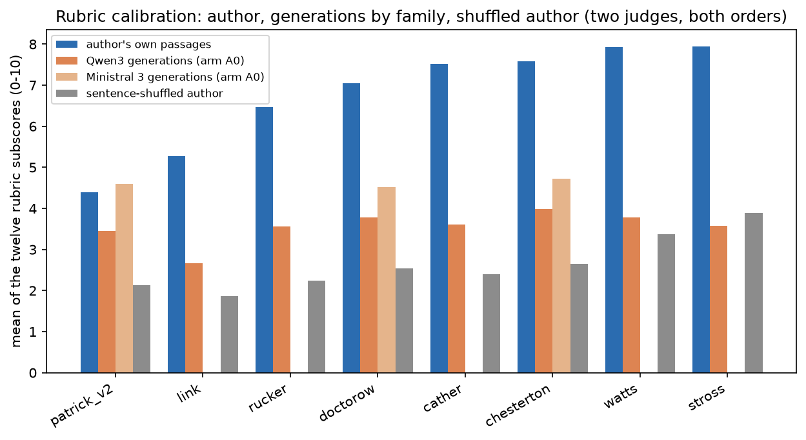
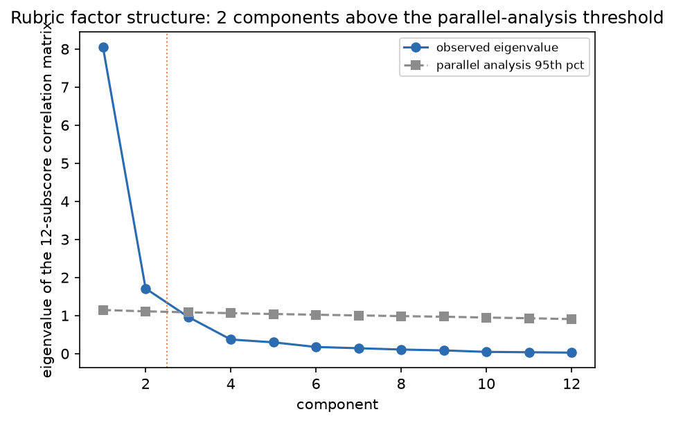
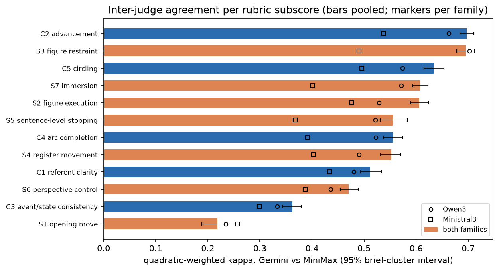
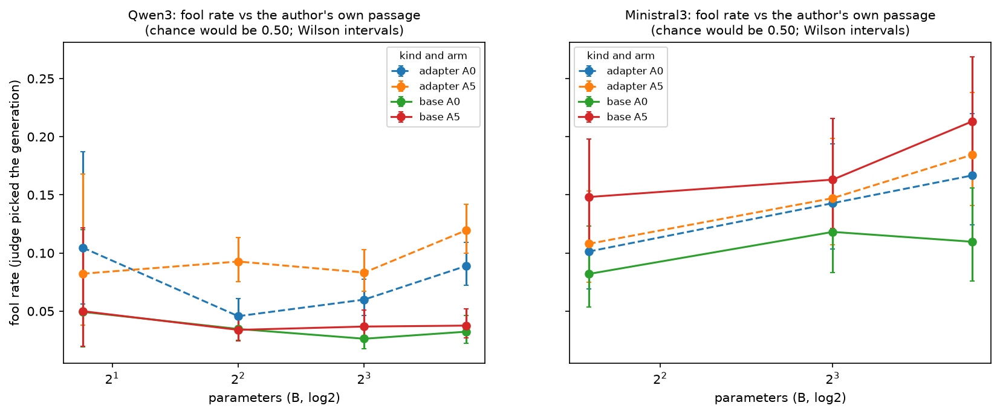
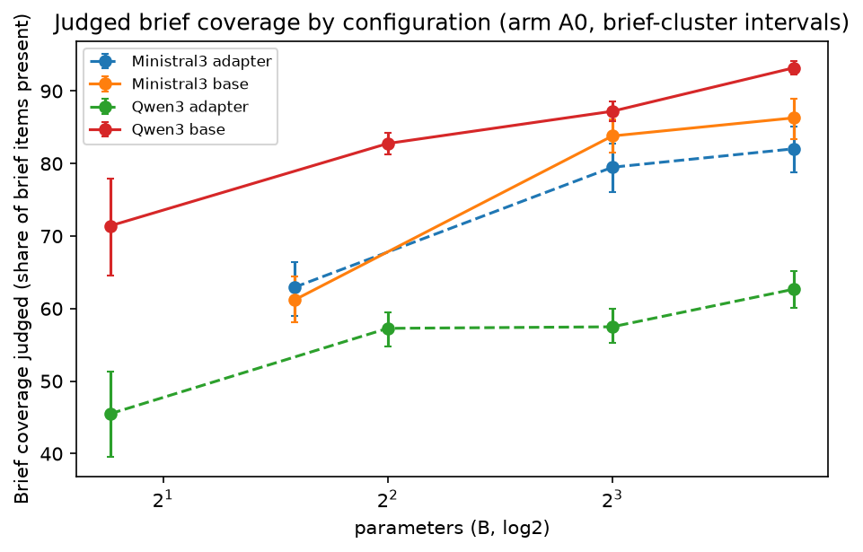
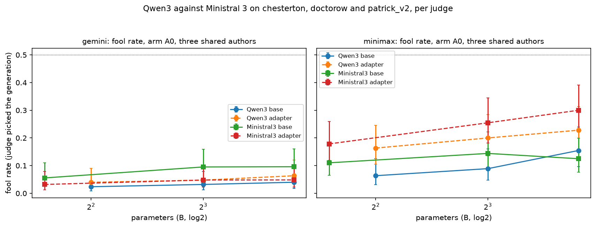

# 16_judges: what the LLM judges measure, and how much of it is noise

## What this does

Everything the two surviving LLM judges produced, treated as an instrument to be validated
rather than as a criterion. Three questions. (1) Does the rubric measure anything: does it
separate an author's own held-out passages from the same passages with their sentences
shuffled, do the two judges agree, does the order of the rubric items move the scores, and
how many independent dimensions do the twelve subscores actually carry. (2) What does the
rubric track: the Spearman relation of every subscore to proposition echo, opener-class
distance, judged coverage, LUAR cosine and passage length, pooled and within configuration.
(3) What the 2AFC forced choice says: how often a judge picks a generation over the author's
own passage (fool rate) and over the A0 arm (win rate), by family, size, kind and arm, how
much the two judges agree with each other and with themselves on repeats, and whether the
fool rate tracks any mechanical measure. Judged brief coverage is reported alongside.

The validity check the study cares about most is section 6: on the construction block,
2 of 11 author x base-14B cells score the bare model strictly above
the author's own passages scored blind in the same batch (patrick_v2 Ministral3, patrick_v2 Qwen3); on the craft block
1 of 11 do. That is a fact about the judges, and the reason no rubric
number in this folder is read as a level of quality: an instrument that can rank a bare model
above the author it is scoring can order two configurations, and cannot say either is good.

Both families carry a judge layer. 22 of the 22 Ministral 3 runs have
`judged_2afc = True` and 22 have `has_coverage = True` in runs.csv. Those records
were produced on 2026-09-10 and 2026-09-11 with the same two judges (Gemini 3.1 flash-lite and
MiniMax M3), the same rubric and 2AFC prompts, the same forward and reverse item orders and the
same sample-0 protocol as the Qwen3 records, so the two families are read on one instrument
rather than two. Every table in this folder therefore carries `family` as a grouping column,
with a `both families` or `all families` row where pooling is meaningful. The rubric now covers
1446 judged Qwen3 passages and 756 judged Ministral 3 passages at arm A0, and the
2AFC layer 47200 Qwen3 verdicts against 12042 Ministral 3 verdicts. Ministral runs
exist for 3 authors (chesterton, doctorow, patrick_v2), so a Ministral row that pools over
authors pools over those 3 and no others, while a pooled Qwen3 row pools over
8 rubric authors. The explicit like-for-like comparison is
afc_fool_shared_authors.csv and coverage_shared_authors.csv, which restrict both families to
those 3 authors.

## How it does it

Data. Raw rubric records from `data/eval_results/judge/*.jsonl` (12200 records over two
judges x two rubric orders; the Mistral judge file is excluded as pre-registered).
719 records (5.9%) failed to parse and carry no
subscores; they are dropped and counted. Calibration rows (the author's own passages and their
sentence-shuffled versions) live in the same files and in `data/master/rubric_calibration.csv`.
2AFC records from `data/runs/<run>/judge.jsonl` (100922 raw records over 172 run directories).
Cell-level values from `data/master/cells.parquet`.

Unit. Rubric judging ran on arm A0, sample 0 only (2286 non-null rubric
cells in cells.parquet for 2202 judged passages at arm A0, sample 0,
non-replicate), so every cell-level rubric analysis here is restricted to that slice. The rubric
reaches 8 distinct authors: all 8 of them have
Qwen3 passages judged and 3 of them also have Ministral 3
passages judged. 2AFC is restricted to parseable
non-replicate runs, arms A0-A5, sample 0. Repeated records for the same (run, id, arm, sample,
judge, comparison) are de-duplicated keeping the first non-missing verdict; 1533
items were judged twice by the same judge and 230 of them
(15%) got the opposite verdict the second time,
which is this design's within-judge test-retest floor.

Family as a grouping column. Every rubric record is given the family of its run from the master
tables, not from the run name: runs.csv for the main ladder and cells_series.parquet for the
Qwen3 corpus-size adapters. 2523 of the judged generation records come from those
off-ladder corpus-size runs, and 318 records from replicate base runs are dropped
before any of this, as the programme's non-replicate convention requires; those replicate runs
are the material the floors are built from instead. A row labelled `both families` or
`all families` pools everything;
a row labelled Qwen3 or Ministral 3 uses that family's main-ladder runs only, so the two
families are compared on the same design. Ministral rows pool 3 authors
(chesterton, doctorow, patrick_v2) and say so in their n_authors column. The two shared-author tables
(afc_fool_shared_authors.csv, coverage_shared_authors.csv) keep only the size rungs at which all
3 authors were run in that family, which drops Qwen3 1.7B;
every row in them carries all 3 authors.

Statistics. Proportions carry two intervals: a Wilson interval on the judge-level verdicts
(which treats the two judges' verdicts on one passage as independent, so it is the optimistic
one) and a bootstrap over briefs on the passage-level rate. Any claim about models pools author
means and bootstraps over authors. Quadratic-weighted kappa is computed on integer ratings
0-10 with a 400-replicate bootstrap over briefs. The rubric-order effect is a paired
fwd-vs-rev contrast per judge x subscore with a brief-cluster interval, a Wilcoxon p and BH-FDR
across the 24 tests inside each scope. Factor structure is a PCA of the
standardised twelve subscores with permutation parallel analysis (500 permutations, 95th
percentile), run once per scope. Subscore correlations are Spearman, reported pooled and again
after centring both variables within run, with BH-FDR across the 70 tests inside
each scope. Rubric values are never quoted as absolute quality: every generation mean is placed
next to the author's own calibration items scored blind by the same judges in the same batch.
Judged brief coverage is an LLM-judged adherence rate on the same footing, not a measurement of
what the passage contains, and it carries no calibration items of its own.

Floors. judge_replicate_floors.csv holds the replicate floor of each judged measure per family,
computed by lib.replicate_floor over the twice-generated base runs. Coverage has
3 Qwen3 pairs at 4B, 8B, 14B and
4 Ministral 3 pairs at 3B, 8B, 14B;
fool_vs_source has 3 Qwen3 pairs at
4B, 8B, 14B and 4
Ministral 3 pairs at 3B, 8B, 14B. The rubric blocks have
0 Qwen3 pairs and 2
Ministral 3 pairs at 3B, because no Qwen3 replicate run was
rubric-judged. Every coverage and fool-rate contrast in this folder carries the floor of its own
family, and a contrast smaller than that floor is marked within_noise whatever its interval.

### Rubric calibration per family, author and judge

| family | author | judge | n_author_items | n_shuffled_items | n_gen_records | n_gen_runs | author_mean | shuffled_mean | gen_mean | gap_C2_author_minus_shuffled | gap_C5_author_minus_shuffled | author_minus_gen | shuffle_separation_pass | author_above_gen | shuffle_gate_pass |
|---|---|---|---|---|---|---|---|---|---|---|---|---|---|---|---|
| Ministral3 | chesterton | gemini | 10 | 10 | 468 | 6 | 8.550 | 2.467 | 5.577 | 6.200 | 7.400 | 2.973 | True | True | True |
| Ministral3 | chesterton | minimax | 9 | 9 | 385 | 6 | 6.611 | 2.843 | 3.874 | 4.222 | 4.889 | 2.737 | True | True | True |
| Ministral3 | doctorow | gemini | 10 | 8 | 501 | 6 | 7.800 | 2.469 | 5.280 | 6.850 | 7.100 | 2.520 | True | True | True |
| Ministral3 | doctorow | minimax | 10 | 5 | 425 | 6 | 6.292 | 2.617 | 3.772 | 4.700 | 5.100 | 2.520 | True | True | True |
| Ministral3 | patrick_v2 | gemini | 10 | 10 | 535 | 6 | 5.258 | 2.533 | 5.503 | 2.800 | 3.200 | -0.244 | True | False | False |
| Ministral3 | patrick_v2 | minimax | 9 | 8 | 482 | 6 | 3.519 | 1.729 | 3.694 | 2.389 | 2.028 | -0.175 | False | False | False |
| Qwen3 | cather | gemini | 11 | 10 | 185 | 2 | 8.530 | 2.300 | 4.212 | 7.464 | 8.318 | 4.319 | True | True | True |
| Qwen3 | cather | minimax | 10 | 9 | 147 | 2 | 6.508 | 2.509 | 3.012 | 4.778 | 6.489 | 3.496 | True | True | True |
| Qwen3 | chesterton | gemini | 10 | 10 | 468 | 6 | 8.550 | 2.467 | 4.589 | 6.200 | 7.400 | 3.961 | True | True | True |
| Qwen3 | chesterton | minimax | 9 | 9 | 461 | 6 | 6.611 | 2.843 | 3.390 | 4.222 | 4.889 | 3.221 | True | True | True |
| Qwen3 | doctorow | gemini | 10 | 8 | 339 | 4 | 7.800 | 2.469 | 4.269 | 6.850 | 7.100 | 3.531 | True | True | True |
| Qwen3 | doctorow | minimax | 10 | 5 | 217 | 4 | 6.292 | 2.617 | 3.288 | 4.700 | 5.100 | 3.004 | True | True | True |
| Qwen3 | link | gemini | 11 | 10 | 137 | 4 | 5.977 | 1.808 | 3.084 | 3.373 | 3.273 | 2.893 | True | True | True |
| Qwen3 | link | minimax | 7 | 10 | 120 | 4 | 4.583 | 1.917 | 2.262 | 3.214 | 3.157 | 2.322 | True | True | True |
| Qwen3 | patrick_v2 | gemini | 10 | 10 | 718 | 8 | 5.258 | 2.533 | 3.992 | 2.800 | 3.200 | 1.267 | True | True | True |
| Qwen3 | patrick_v2 | minimax | 9 | 8 | 707 | 8 | 3.519 | 1.729 | 2.903 | 2.389 | 2.028 | 0.615 | False | True | False |
| Qwen3 | rucker | gemini | 10 | 10 | 393 | 4 | 7.333 | 2.417 | 3.996 | 6.000 | 6.200 | 3.338 | True | True | True |
| Qwen3 | rucker | minimax | 9 | 10 | 328 | 4 | 5.611 | 2.058 | 3.128 | 4.422 | 4.867 | 2.483 | True | True | True |
| Qwen3 | stross | gemini | 11 | 11 | 334 | 4 | 8.636 | 4.417 | 4.077 | 4.636 | 6.364 | 4.560 | True | True | True |
| Qwen3 | stross | minimax | 9 | 9 | 287 | 4 | 7.259 | 3.352 | 3.079 | 4.556 | 5.444 | 4.181 | True | True | True |
| Qwen3 | watts | gemini | 10 | 10 | 359 | 4 | 8.783 | 3.850 | 4.359 | 5.900 | 5.800 | 4.425 | True | True | True |
| Qwen3 | watts | minimax | 9 | 9 | 341 | 4 | 7.065 | 2.907 | 3.204 | 4.889 | 5.333 | 3.861 | True | True | True |
| both families | cather | gemini | 11 | 10 | 185 | 2 | 8.530 | 2.300 | 4.212 | 7.464 | 8.318 | 4.319 | True | True | True |
| both families | cather | minimax | 10 | 9 | 147 | 2 | 6.508 | 2.509 | 3.012 | 4.778 | 6.489 | 3.496 | True | True | True |
| both families | chesterton | gemini | 10 | 10 | 1242 | 16 | 8.550 | 2.467 | 4.459 | 6.200 | 7.400 | 4.091 | True | True | True |
| both families | chesterton | minimax | 9 | 9 | 1108 | 16 | 6.611 | 2.843 | 3.179 | 4.222 | 4.889 | 3.432 | True | True | True |
| both families | doctorow | gemini | 10 | 8 | 1502 | 18 | 7.800 | 2.469 | 3.975 | 6.850 | 7.100 | 3.825 | True | True | True |
| both families | doctorow | minimax | 10 | 5 | 1227 | 18 | 6.292 | 2.617 | 2.870 | 4.700 | 5.100 | 3.422 | True | True | True |
| both families | link | gemini | 11 | 10 | 137 | 4 | 5.977 | 1.808 | 3.084 | 3.373 | 3.273 | 2.893 | True | True | True |
| both families | link | minimax | 7 | 10 | 120 | 4 | 4.583 | 1.917 | 2.262 | 3.214 | 3.157 | 2.322 | True | True | True |
| both families | patrick_v2 | gemini | 10 | 10 | 1611 | 18 | 5.258 | 2.533 | 4.235 | 2.800 | 3.200 | 1.023 | True | True | True |
| both families | patrick_v2 | minimax | 9 | 8 | 1539 | 18 | 3.519 | 1.729 | 2.974 | 2.389 | 2.028 | 0.545 | False | True | False |
| both families | rucker | gemini | 10 | 10 | 393 | 4 | 7.333 | 2.417 | 3.996 | 6.000 | 6.200 | 3.338 | True | True | True |
| both families | rucker | minimax | 9 | 10 | 328 | 4 | 5.611 | 2.058 | 3.128 | 4.422 | 4.867 | 2.483 | True | True | True |
| both families | stross | gemini | 11 | 11 | 334 | 4 | 8.636 | 4.417 | 4.077 | 4.636 | 6.364 | 4.560 | True | True | True |
| both families | stross | minimax | 9 | 9 | 287 | 4 | 7.259 | 3.352 | 3.079 | 4.556 | 5.444 | 4.181 | True | True | True |
| both families | watts | gemini | 10 | 10 | 359 | 4 | 8.783 | 3.850 | 4.359 | 5.900 | 5.800 | 4.425 | True | True | True |
| both families | watts | minimax | 9 | 9 | 341 | 4 | 7.065 | 2.907 | 3.204 | 4.889 | 5.333 | 3.861 | True | True | True |

### Rubric calibration rolled up per family (the shuffle gate on the second family)

| family | n_author_x_judge_cells | n_authors | gate_passes | shuffle_separation_passes | author_above_gen | min_gap_C2 | min_gap_C5 | mean_author_minus_gen | min_author_minus_gen | n_author_below_gen |
|---|---|---|---|---|---|---|---|---|---|---|
| Ministral3 | 6 | 3 | 4 | 5 | 4 | 2.389 | 2.028 | 1.722 | -0.244 | 2 |
| Qwen3 | 16 | 8 | 15 | 15 | 16 | 2.389 | 2.028 | 3.217 | 0.615 | 0 |
| both families | 16 | 8 | 15 | 15 | 16 | 2.389 | 2.028 | 3.263 | 0.545 | 0 |

### Inter-judge quadratic-weighted kappa per subscore and family

| family | subscore | label | block | n_paired | qwk_gemini_vs_minimax | qwk_lo | qwk_hi | spearman | mean_gemini | mean_minimax |
|---|---|---|---|---|---|---|---|---|---|---|
| both families | C1 | referent clarity | construction | 5053 | 0.512 | 0.493 | 0.533 | 0.779 | 6.815 | 4.454 |
| both families | C2 | advancement | construction | 5053 | 0.697 | 0.684 | 0.711 | 0.828 | 3.628 | 2.651 |
| both families | C3 | event/state consistency | construction | 5053 | 0.362 | 0.344 | 0.379 | 0.703 | 6.313 | 3.307 |
| both families | C4 | arc completion | construction | 5053 | 0.555 | 0.537 | 0.574 | 0.739 | 4.150 | 2.985 |
| both families | C5 | circling | construction | 5053 | 0.634 | 0.615 | 0.653 | 0.776 | 2.801 | 1.898 |
| both families | S1 | opening move | craft | 5053 | 0.219 | 0.189 | 0.253 | 0.204 | 3.844 | 3.916 |
| both families | S2 | figure execution | craft | 5053 | 0.606 | 0.589 | 0.623 | 0.723 | 3.570 | 2.785 |
| both families | S3 | figure restraint | craft | 5053 | 0.695 | 0.678 | 0.712 | 0.735 | 2.613 | 2.262 |
| both families | S4 | register movement | craft | 5053 | 0.552 | 0.532 | 0.571 | 0.597 | 3.040 | 2.761 |
| both families | S5 | sentence-level stopping | craft | 5053 | 0.556 | 0.531 | 0.583 | 0.649 | 3.526 | 2.857 |
| both families | S6 | perspective control | craft | 5053 | 0.471 | 0.454 | 0.489 | 0.755 | 6.063 | 3.818 |
| both families | S7 | immersion | craft | 5053 | 0.607 | 0.593 | 0.623 | 0.800 | 3.558 | 2.454 |
| Qwen3 | C1 | referent clarity | construction | 2586 | 0.480 | 0.459 | 0.503 | 0.762 | 7.155 | 4.689 |
| Qwen3 | C2 | advancement | construction | 2586 | 0.663 | 0.640 | 0.681 | 0.793 | 3.578 | 2.684 |
| Qwen3 | C3 | event/state consistency | construction | 2586 | 0.334 | 0.314 | 0.351 | 0.679 | 6.589 | 3.453 |
| Qwen3 | C4 | arc completion | construction | 2586 | 0.522 | 0.497 | 0.548 | 0.736 | 4.387 | 3.102 |
| Qwen3 | C5 | circling | construction | 2586 | 0.574 | 0.544 | 0.599 | 0.727 | 2.690 | 1.869 |
| Qwen3 | S1 | opening move | craft | 2586 | 0.234 | 0.197 | 0.271 | 0.260 | 3.582 | 3.895 |
| Qwen3 | S2 | figure execution | craft | 2586 | 0.528 | 0.504 | 0.554 | 0.616 | 3.485 | 2.828 |
| Qwen3 | S3 | figure restraint | craft | 2586 | 0.702 | 0.677 | 0.722 | 0.723 | 2.580 | 2.358 |
| Qwen3 | S4 | register movement | craft | 2586 | 0.490 | 0.456 | 0.522 | 0.492 | 2.758 | 2.739 |
| Qwen3 | S5 | sentence-level stopping | craft | 2586 | 0.521 | 0.488 | 0.555 | 0.596 | 3.460 | 2.907 |
| Qwen3 | S6 | perspective control | craft | 2586 | 0.436 | 0.416 | 0.456 | 0.727 | 6.300 | 4.000 |
| Qwen3 | S7 | immersion | craft | 2586 | 0.572 | 0.547 | 0.593 | 0.735 | 3.485 | 2.516 |
| Ministral3 | C1 | referent clarity | construction | 1285 | 0.434 | 0.396 | 0.467 | 0.751 | 7.708 | 5.114 |
| Ministral3 | C2 | advancement | construction | 1285 | 0.537 | 0.511 | 0.560 | 0.763 | 5.421 | 3.736 |
| Ministral3 | C3 | event/state consistency | construction | 1285 | 0.299 | 0.266 | 0.327 | 0.683 | 7.384 | 3.895 |
| Ministral3 | C4 | arc completion | construction | 1285 | 0.391 | 0.358 | 0.428 | 0.605 | 5.380 | 3.837 |
| Ministral3 | C5 | circling | construction | 1285 | 0.496 | 0.460 | 0.528 | 0.689 | 4.529 | 2.918 |
| Ministral3 | S1 | opening move | craft | 1285 | 0.256 | 0.198 | 0.308 | 0.262 | 4.138 | 4.497 |
| Ministral3 | S2 | figure execution | craft | 1285 | 0.475 | 0.433 | 0.509 | 0.709 | 4.975 | 3.553 |
| Ministral3 | S3 | figure restraint | craft | 1285 | 0.491 | 0.446 | 0.530 | 0.592 | 3.760 | 2.865 |
| Ministral3 | S4 | register movement | craft | 1285 | 0.403 | 0.357 | 0.440 | 0.557 | 4.650 | 3.489 |
| Ministral3 | S5 | sentence-level stopping | craft | 1285 | 0.368 | 0.325 | 0.411 | 0.539 | 4.857 | 3.542 |
| Ministral3 | S6 | perspective control | craft | 1285 | 0.387 | 0.355 | 0.417 | 0.729 | 7.170 | 4.500 |
| Ministral3 | S7 | immersion | craft | 1285 | 0.402 | 0.364 | 0.432 | 0.707 | 5.127 | 3.300 |

### Rubric order effect (rev minus fwd), largest twelve pooled

| family | judge | subscore | label | n_paired | mean_fwd | mean_rev | rev_minus_fwd | ci_low | ci_high | mean_abs_shift | spearman_fwd_rev | p | q_bh | qwk_fwd_vs_rev |
|---|---|---|---|---|---|---|---|---|---|---|---|---|---|---|
| both families | gemini | C2 | advancement | 2850 | 4.394 | 2.881 | -1.513 | -1.567 | -1.461 | 1.536 | 0.917 | 0.000 | 0.000 | 0.718 |
| both families | gemini | C1 | referent clarity | 2850 | 7.440 | 6.178 | -1.262 | -1.336 | -1.187 | 1.416 | 0.871 | 0.000 | 0.000 | 0.785 |
| both families | minimax | C1 | referent clarity | 2262 | 4.971 | 3.866 | -1.105 | -1.185 | -1.030 | 1.442 | 0.792 | 0.000 | 0.000 | 0.685 |
| both families | gemini | S7 | immersion | 2850 | 3.104 | 4.082 | 0.978 | 0.935 | 1.017 | 1.021 | 0.918 | 0.000 | 0.000 | 0.809 |
| both families | gemini | S6 | perspective control | 2850 | 6.522 | 5.593 | -0.929 | -1.040 | -0.828 | 1.425 | 0.805 | 0.000 | 0.000 | 0.736 |
| both families | gemini | C3 | event/state consistency | 2850 | 6.762 | 5.855 | -0.908 | -0.974 | -0.835 | 1.204 | 0.885 | 0.000 | 0.000 | 0.844 |
| both families | minimax | C2 | advancement | 2262 | 3.038 | 2.187 | -0.851 | -0.899 | -0.807 | 1.027 | 0.818 | 0.000 | 0.000 | 0.683 |
| both families | gemini | C5 | circling | 2850 | 3.215 | 2.406 | -0.809 | -0.880 | -0.751 | 1.017 | 0.895 | 0.000 | 0.000 | 0.777 |
| both families | gemini | S5 | sentence-level stopping | 2850 | 3.174 | 3.964 | 0.789 | 0.737 | 0.840 | 0.947 | 0.831 | 0.000 | 0.000 | 0.739 |
| both families | minimax | S5 | sentence-level stopping | 2262 | 2.553 | 3.156 | 0.603 | 0.546 | 0.653 | 0.940 | 0.662 | 0.000 | 0.000 | 0.599 |
| both families | gemini | C4 | arc completion | 2850 | 4.414 | 3.846 | -0.568 | -0.652 | -0.489 | 1.276 | 0.872 | 0.000 | 0.000 | 0.811 |
| both families | minimax | S7 | immersion | 2262 | 2.221 | 2.676 | 0.455 | 0.418 | 0.489 | 0.754 | 0.777 | 0.000 | 0.000 | 0.736 |

### Rubric order effect rolled up per family and judge

| family | judge | n_tests | n_q_below_05 | max_abs_rev_minus_fwd | mean_abs_shift |
|---|---|---|---|---|---|
| Ministral3 | gemini | 12 | 10 | 1.768 | 1.111 |
| Ministral3 | minimax | 12 | 11 | 1.423 | 1.032 |
| Qwen3 | gemini | 12 | 11 | 1.603 | 1.086 |
| Qwen3 | minimax | 12 | 11 | 1.107 | 0.898 |
| both families | gemini | 12 | 11 | 1.513 | 1.052 |
| both families | minimax | 12 | 11 | 1.105 | 0.911 |

### Factor structure: eigenvalues against parallel analysis, per family

| family | component | eigenvalue | parallel_p95 | retained | var_explained | cum_var_explained | n_passages |
|---|---|---|---|---|---|---|---|
| both families | 1 | 8.044 | 1.146 | True | 0.670 | 0.670 | 2202 |
| both families | 2 | 1.710 | 1.110 | True | 0.143 | 0.813 | 2202 |
| both families | 3 | 0.965 | 1.084 | False | 0.080 | 0.893 | 2202 |
| both families | 4 | 0.370 | 1.062 | False | 0.031 | 0.924 | 2202 |
| both families | 5 | 0.296 | 1.041 | False | 0.025 | 0.949 | 2202 |
| both families | 6 | 0.174 | 1.021 | False | 0.015 | 0.963 | 2202 |
| both families | 7 | 0.142 | 1.003 | False | 0.012 | 0.975 | 2202 |
| both families | 8 | 0.107 | 0.985 | False | 0.009 | 0.984 | 2202 |
| both families | 9 | 0.085 | 0.969 | False | 0.007 | 0.991 | 2202 |
| both families | 10 | 0.045 | 0.948 | False | 0.004 | 0.995 | 2202 |
| both families | 11 | 0.036 | 0.929 | False | 0.003 | 0.998 | 2202 |
| both families | 12 | 0.026 | 0.907 | False | 0.002 | 1.000 | 2202 |
| Qwen3 | 1 | 7.560 | 1.182 | True | 0.630 | 0.630 | 1446 |
| Qwen3 | 2 | 2.054 | 1.137 | True | 0.171 | 0.801 | 1446 |
| Qwen3 | 3 | 1.026 | 1.105 | False | 0.086 | 0.887 | 1446 |
| Qwen3 | 4 | 0.385 | 1.079 | False | 0.032 | 0.919 | 1446 |
| Qwen3 | 5 | 0.257 | 1.050 | False | 0.021 | 0.940 | 1446 |
| Qwen3 | 6 | 0.223 | 1.026 | False | 0.019 | 0.959 | 1446 |
| Qwen3 | 7 | 0.131 | 1.004 | False | 0.011 | 0.970 | 1446 |
| Qwen3 | 8 | 0.125 | 0.982 | False | 0.010 | 0.980 | 1446 |
| Qwen3 | 9 | 0.112 | 0.961 | False | 0.009 | 0.989 | 1446 |
| Qwen3 | 10 | 0.058 | 0.936 | False | 0.005 | 0.994 | 1446 |
| Qwen3 | 11 | 0.041 | 0.913 | False | 0.003 | 0.998 | 1446 |
| Qwen3 | 12 | 0.028 | 0.886 | False | 0.002 | 1.000 | 1446 |
| Ministral3 | 1 | 8.369 | 1.265 | True | 0.697 | 0.697 | 756 |
| Ministral3 | 2 | 1.152 | 1.190 | False | 0.096 | 0.793 | 756 |
| Ministral3 | 3 | 0.965 | 1.147 | False | 0.080 | 0.874 | 756 |
| Ministral3 | 4 | 0.511 | 1.102 | False | 0.043 | 0.916 | 756 |
| Ministral3 | 5 | 0.356 | 1.067 | False | 0.030 | 0.946 | 756 |
| Ministral3 | 6 | 0.189 | 1.034 | False | 0.016 | 0.962 | 756 |
| Ministral3 | 7 | 0.178 | 1.003 | False | 0.015 | 0.977 | 756 |
| Ministral3 | 8 | 0.098 | 0.973 | False | 0.008 | 0.985 | 756 |
| Ministral3 | 9 | 0.081 | 0.942 | False | 0.007 | 0.992 | 756 |
| Ministral3 | 10 | 0.048 | 0.913 | False | 0.004 | 0.996 | 756 |
| Ministral3 | 11 | 0.030 | 0.881 | False | 0.003 | 0.998 | 756 |
| Ministral3 | 12 | 0.023 | 0.843 | False | 0.002 | 1.000 | 756 |

### Block means against the mechanical measures, per family

| family | subscore | label | measure | n | spearman_pooled | ci_low | ci_high | spearman_within_run | p | q_bh |
|---|---|---|---|---|---|---|---|---|---|---|
| both families | C | block mean | per | 2202 | -0.386 | -0.448 | -0.308 | -0.201 | 0.000 | 0.000 |
| both families | C | block mean | otd_js | 2202 | -0.018 | -0.147 | 0.103 | -0.021 | 0.404 | 0.422 |
| both families | C | block mean | coverage | 2196 | 0.497 | 0.400 | 0.573 | 0.249 | 0.000 | 0.000 |
| both families | C | block mean | luar_cos_source | 2202 | -0.086 | -0.186 | 0.013 | 0.002 | 0.000 | 0.000 |
| both families | C | block mean | words | 2202 | -0.318 | -0.427 | -0.183 | -0.409 | 0.000 | 0.000 |
| both families | S | block mean | per | 2202 | -0.392 | -0.470 | -0.302 | -0.243 | 0.000 | 0.000 |
| both families | S | block mean | otd_js | 2202 | -0.083 | -0.208 | 0.052 | -0.061 | 0.000 | 0.000 |
| both families | S | block mean | coverage | 2196 | 0.400 | 0.269 | 0.489 | 0.245 | 0.000 | 0.000 |
| both families | S | block mean | luar_cos_source | 2202 | 0.071 | -0.026 | 0.159 | 0.067 | 0.001 | 0.001 |
| both families | S | block mean | words | 2202 | -0.257 | -0.373 | -0.110 | -0.384 | 0.000 | 0.000 |
| Qwen3 | C | block mean | per | 1446 | -0.372 | -0.455 | -0.266 | -0.247 | 0.000 | 0.000 |
| Qwen3 | C | block mean | otd_js | 1446 | -0.066 | -0.220 | 0.083 | -0.031 | 0.013 | 0.015 |
| Qwen3 | C | block mean | coverage | 1441 | 0.592 | 0.484 | 0.667 | 0.261 | 0.000 | 0.000 |
| Qwen3 | C | block mean | luar_cos_source | 1446 | -0.145 | -0.264 | -0.012 | -0.016 | 0.000 | 0.000 |
| Qwen3 | C | block mean | words | 1446 | -0.471 | -0.547 | -0.384 | -0.384 | 0.000 | 0.000 |
| Qwen3 | S | block mean | per | 1446 | -0.374 | -0.477 | -0.268 | -0.298 | 0.000 | 0.000 |
| Qwen3 | S | block mean | otd_js | 1446 | -0.166 | -0.318 | -0.014 | -0.080 | 0.000 | 0.000 |
| Qwen3 | S | block mean | coverage | 1441 | 0.499 | 0.353 | 0.610 | 0.264 | 0.000 | 0.000 |
| Qwen3 | S | block mean | luar_cos_source | 1446 | 0.050 | -0.072 | 0.166 | 0.063 | 0.055 | 0.062 |
| Qwen3 | S | block mean | words | 1446 | -0.435 | -0.522 | -0.331 | -0.382 | 0.000 | 0.000 |
| Ministral3 | C | block mean | per | 756 | -0.263 | -0.355 | -0.130 | -0.105 | 0.000 | 0.000 |
| Ministral3 | C | block mean | otd_js | 756 | 0.071 | -0.099 | 0.227 | -0.001 | 0.052 | 0.091 |
| Ministral3 | C | block mean | coverage | 755 | 0.370 | 0.214 | 0.500 | 0.232 | 0.000 | 0.000 |
| Ministral3 | C | block mean | luar_cos_source | 756 | -0.059 | -0.220 | 0.106 | 0.036 | 0.106 | 0.155 |
| Ministral3 | C | block mean | words | 756 | -0.097 | -0.287 | 0.030 | -0.447 | 0.008 | 0.015 |
| Ministral3 | S | block mean | per | 756 | -0.252 | -0.345 | -0.124 | -0.132 | 0.000 | 0.000 |
| Ministral3 | S | block mean | otd_js | 756 | 0.042 | -0.139 | 0.214 | -0.026 | 0.244 | 0.328 |
| Ministral3 | S | block mean | coverage | 755 | 0.349 | 0.159 | 0.485 | 0.215 | 0.000 | 0.000 |
| Ministral3 | S | block mean | luar_cos_source | 756 | 0.005 | -0.171 | 0.172 | 0.073 | 0.900 | 0.900 |
| Ministral3 | S | block mean | words | 756 | -0.014 | -0.219 | 0.113 | -0.387 | 0.693 | 0.770 |

### Does the judge rank the model above the author (base runs, all three blocks)

| author | family | params_b | kind | block | n_gen | n_author_items | gen_mean | author_item_mean | gen_minus_author | ci_low | ci_high | judge_prefers_model |
|---|---|---|---|---|---|---|---|---|---|---|---|---|
| chesterton | Ministral3 | 3.000 | base | C (construction) | 39 | 19 | 4.978 | 7.884 | -2.906 | -3.775 | -2.054 | False |
| chesterton | Ministral3 | 8.000 | base | C (construction) | 39 | 19 | 6.594 | 7.884 | -1.290 | -2.068 | -0.449 | False |
| chesterton | Ministral3 | 14.000 | base | C (construction) | 39 | 19 | 6.730 | 7.884 | -1.154 | -1.962 | -0.323 | False |
| doctorow | Ministral3 | 3.000 | base | C (construction) | 42 | 20 | 4.960 | 7.500 | -2.540 | -3.255 | -1.851 | False |
| doctorow | Ministral3 | 8.000 | base | C (construction) | 42 | 20 | 6.134 | 7.500 | -1.366 | -2.030 | -0.734 | False |
| doctorow | Ministral3 | 14.000 | base | C (construction) | 42 | 20 | 6.629 | 7.500 | -0.871 | -1.504 | -0.217 | False |
| patrick_v2 | Ministral3 | 3.000 | base | C (construction) | 45 | 19 | 5.475 | 4.926 | 0.548 | -0.270 | 1.396 | False |
| patrick_v2 | Ministral3 | 8.000 | base | C (construction) | 45 | 19 | 6.814 | 4.926 | 1.888 | 1.108 | 2.678 | True |
| patrick_v2 | Ministral3 | 14.000 | base | C (construction) | 45 | 19 | 6.793 | 4.926 | 1.866 | 1.073 | 2.710 | True |
| cather | Qwen3 | 14.000 | base | C (construction) | 44 | 21 | 6.189 | 8.238 | -2.050 | -2.664 | -1.414 | False |
| chesterton | Qwen3 | 4.000 | base | C (construction) | 39 | 19 | 4.529 | 7.884 | -3.356 | -4.144 | -2.514 | False |
| chesterton | Qwen3 | 8.000 | base | C (construction) | 39 | 19 | 5.437 | 7.884 | -2.447 | -3.218 | -1.607 | False |
| chesterton | Qwen3 | 14.000 | base | C (construction) | 39 | 19 | 5.838 | 7.884 | -2.046 | -2.809 | -1.181 | False |
| doctorow | Qwen3 | 4.000 | base | C (construction) | 42 | 20 | 4.580 | 7.500 | -2.920 | -3.662 | -2.255 | False |
| doctorow | Qwen3 | 14.000 | base | C (construction) | 42 | 20 | 5.808 | 7.500 | -1.692 | -2.382 | -1.027 | False |
| link | Qwen3 | 4.000 | base | C (construction) | 16 | 18 | 3.298 | 4.856 | -1.558 | -2.366 | -0.729 | False |
| link | Qwen3 | 14.000 | base | C (construction) | 16 | 18 | 4.587 | 4.856 | -0.268 | -0.992 | 0.495 | False |
| patrick_v2 | Qwen3 | 1.700 | base | C (construction) | 45 | 19 | 3.310 | 4.926 | -1.616 | -2.462 | -0.804 | False |
| patrick_v2 | Qwen3 | 4.000 | base | C (construction) | 45 | 19 | 4.418 | 4.926 | -0.509 | -1.308 | 0.313 | False |
| patrick_v2 | Qwen3 | 8.000 | base | C (construction) | 45 | 19 | 5.318 | 4.926 | 0.391 | -0.350 | 1.190 | False |
| patrick_v2 | Qwen3 | 14.000 | base | C (construction) | 45 | 19 | 6.054 | 4.926 | 1.128 | 0.374 | 1.922 | True |
| rucker | Qwen3 | 4.000 | base | C (construction) | 47 | 19 | 4.157 | 7.021 | -2.864 | -3.549 | -2.137 | False |
| rucker | Qwen3 | 14.000 | base | C (construction) | 47 | 19 | 5.270 | 7.021 | -1.751 | -2.425 | -1.040 | False |
| stross | Qwen3 | 4.000 | base | C (construction) | 41 | 20 | 4.133 | 8.400 | -4.267 | -4.808 | -3.708 | False |
| stross | Qwen3 | 14.000 | base | C (construction) | 41 | 20 | 5.504 | 8.400 | -2.896 | -3.410 | -2.367 | False |
| watts | Qwen3 | 4.000 | base | C (construction) | 45 | 19 | 4.027 | 7.937 | -3.909 | -4.571 | -3.167 | False |
| watts | Qwen3 | 14.000 | base | C (construction) | 45 | 19 | 5.534 | 7.937 | -2.403 | -3.024 | -1.670 | False |
| chesterton | Ministral3 | 3.000 | base | S (craft) | 39 | 19 | 4.126 | 7.451 | -3.325 | -3.807 | -2.842 | False |
| chesterton | Ministral3 | 8.000 | base | S (craft) | 39 | 19 | 5.136 | 7.451 | -2.315 | -2.760 | -1.839 | False |
| chesterton | Ministral3 | 14.000 | base | S (craft) | 39 | 19 | 5.361 | 7.451 | -2.090 | -2.544 | -1.600 | False |
| doctorow | Ministral3 | 3.000 | base | S (craft) | 42 | 20 | 4.332 | 6.721 | -2.389 | -2.925 | -1.870 | False |
| doctorow | Ministral3 | 8.000 | base | S (craft) | 42 | 20 | 5.319 | 6.721 | -1.402 | -1.969 | -0.867 | False |
| doctorow | Ministral3 | 14.000 | base | S (craft) | 42 | 20 | 5.580 | 6.721 | -1.141 | -1.671 | -0.628 | False |
| patrick_v2 | Ministral3 | 3.000 | base | S (craft) | 45 | 19 | 4.839 | 4.083 | 0.756 | 0.257 | 1.309 | True |
| patrick_v2 | Ministral3 | 8.000 | base | S (craft) | 45 | 19 | 5.832 | 4.083 | 1.749 | 1.236 | 2.255 | True |
| patrick_v2 | Ministral3 | 14.000 | base | S (craft) | 45 | 19 | 5.769 | 4.083 | 1.686 | 1.184 | 2.221 | True |
| cather | Qwen3 | 14.000 | base | S (craft) | 44 | 21 | 4.500 | 7.088 | -2.588 | -3.074 | -2.061 | False |
| chesterton | Qwen3 | 4.000 | base | S (craft) | 39 | 19 | 3.259 | 7.451 | -4.192 | -4.659 | -3.710 | False |
| chesterton | Qwen3 | 8.000 | base | S (craft) | 39 | 19 | 3.813 | 7.451 | -3.639 | -4.095 | -3.174 | False |
| chesterton | Qwen3 | 14.000 | base | S (craft) | 39 | 19 | 4.048 | 7.451 | -3.404 | -3.859 | -2.906 | False |
| doctorow | Qwen3 | 4.000 | base | S (craft) | 42 | 20 | 3.285 | 6.721 | -3.437 | -3.958 | -2.924 | False |
| doctorow | Qwen3 | 14.000 | base | S (craft) | 42 | 20 | 3.993 | 6.721 | -2.728 | -3.256 | -2.190 | False |
| link | Qwen3 | 4.000 | base | S (craft) | 16 | 18 | 2.981 | 5.849 | -2.869 | -3.548 | -2.152 | False |
| link | Qwen3 | 14.000 | base | S (craft) | 16 | 18 | 3.928 | 5.849 | -1.921 | -2.596 | -1.208 | False |
| patrick_v2 | Qwen3 | 1.700 | base | S (craft) | 45 | 19 | 2.384 | 4.083 | -1.699 | -2.183 | -1.216 | False |
| patrick_v2 | Qwen3 | 4.000 | base | S (craft) | 45 | 19 | 3.330 | 4.083 | -0.753 | -1.227 | -0.262 | False |
| patrick_v2 | Qwen3 | 8.000 | base | S (craft) | 45 | 19 | 4.047 | 4.083 | -0.036 | -0.514 | 0.453 | False |
| patrick_v2 | Qwen3 | 14.000 | base | S (craft) | 45 | 19 | 4.514 | 4.083 | 0.431 | -0.043 | 0.917 | False |
| rucker | Qwen3 | 4.000 | base | S (craft) | 47 | 19 | 3.144 | 6.158 | -3.014 | -3.491 | -2.517 | False |
| rucker | Qwen3 | 14.000 | base | S (craft) | 47 | 19 | 3.805 | 6.158 | -2.353 | -2.834 | -1.894 | False |
| stross | Qwen3 | 4.000 | base | S (craft) | 41 | 20 | 3.129 | 7.743 | -4.613 | -5.015 | -4.189 | False |
| stross | Qwen3 | 14.000 | base | S (craft) | 41 | 20 | 3.922 | 7.743 | -3.821 | -4.254 | -3.392 | False |
| watts | Qwen3 | 4.000 | base | S (craft) | 45 | 19 | 3.074 | 7.992 | -4.919 | -5.513 | -4.269 | False |
| watts | Qwen3 | 14.000 | base | S (craft) | 45 | 19 | 3.861 | 7.992 | -4.132 | -4.710 | -3.493 | False |
| chesterton | Ministral3 | 3.000 | base | all 12 subscores | 39 | 19 | 4.481 | 7.632 | -3.151 | -3.736 | -2.538 | False |
| chesterton | Ministral3 | 8.000 | base | all 12 subscores | 39 | 19 | 5.744 | 7.632 | -1.888 | -2.450 | -1.320 | False |
| chesterton | Ministral3 | 14.000 | base | all 12 subscores | 39 | 19 | 5.932 | 7.632 | -1.700 | -2.314 | -1.106 | False |
| doctorow | Ministral3 | 3.000 | base | all 12 subscores | 42 | 20 | 4.594 | 7.046 | -2.452 | -3.045 | -1.906 | False |
| doctorow | Ministral3 | 8.000 | base | all 12 subscores | 42 | 20 | 5.659 | 7.046 | -1.387 | -1.956 | -0.813 | False |
| doctorow | Ministral3 | 14.000 | base | all 12 subscores | 42 | 20 | 6.017 | 7.046 | -1.028 | -1.633 | -0.489 | False |

(21 more rows in the csv)

### The same ranking rolled up per family

| block | family | n_cells | n_authors | n_model_above_author | mean_gen_minus_author | max_gen_minus_author |
|---|---|---|---|---|---|---|
| C (construction) | Ministral3 | 9 | 3 | 2 | -0.647 | 1.888 |
| C (construction) | Qwen3 | 18 | 8 | 1 | -1.946 | 1.128 |
| S (craft) | Ministral3 | 9 | 3 | 3 | -0.941 | 1.749 |
| S (craft) | Qwen3 | 18 | 8 | 0 | -2.760 | 0.431 |
| all 12 subscores | Ministral3 | 9 | 3 | 3 | -0.819 | 1.807 |
| all 12 subscores | Qwen3 | 18 | 8 | 1 | -2.421 | 0.722 |

### 2AFC rates by configuration (arm A0)

| family | params_b | kind | arm | n_verdicts | n_picked_gen | rate | wilson_low | wilson_high | n_passages | passage_rate | cluster_low | cluster_high | comparison |
|---|---|---|---|---|---|---|---|---|---|---|---|---|---|
| Ministral3 | 3.000 | adapter | A0 | 237 | 24 | 0.101 | 0.069 | 0.146 | 126 | 0.099 | 0.063 | 0.139 | fool_vs_source |
| Ministral3 | 3.000 | base | A0 | 244 | 20 | 0.082 | 0.054 | 0.123 | 126 | 0.079 | 0.044 | 0.119 | fool_vs_source |
| Ministral3 | 8.000 | adapter | A0 | 231 | 33 | 0.143 | 0.104 | 0.194 | 126 | 0.131 | 0.091 | 0.171 | fool_vs_source |
| Ministral3 | 8.000 | base | A0 | 237 | 28 | 0.118 | 0.083 | 0.165 | 126 | 0.115 | 0.071 | 0.159 | fool_vs_source |
| Ministral3 | 14.000 | adapter | A0 | 234 | 39 | 0.167 | 0.124 | 0.220 | 126 | 0.159 | 0.115 | 0.202 | fool_vs_source |
| Ministral3 | 14.000 | base | A0 | 237 | 26 | 0.110 | 0.076 | 0.156 | 126 | 0.111 | 0.067 | 0.155 | fool_vs_source |
| Qwen3 | 1.700 | adapter | A0 | 86 | 9 | 0.105 | 0.056 | 0.187 | 45 | 0.100 | 0.033 | 0.178 | fool_vs_source |
| Qwen3 | 1.700 | base | A0 | 81 | 4 | 0.049 | 0.019 | 0.120 | 45 | 0.044 | 0.011 | 0.089 | fool_vs_source |
| Qwen3 | 4.000 | adapter | A0 | 985 | 45 | 0.046 | 0.034 | 0.061 | 545 | 0.043 | 0.030 | 0.056 | fool_vs_source |
| Qwen3 | 4.000 | base | A0 | 1009 | 35 | 0.035 | 0.025 | 0.048 | 545 | 0.032 | 0.022 | 0.043 | fool_vs_source |
| Qwen3 | 8.000 | adapter | A0 | 901 | 54 | 0.060 | 0.046 | 0.077 | 499 | 0.054 | 0.040 | 0.068 | fool_vs_source |
| Qwen3 | 8.000 | base | A0 | 913 | 24 | 0.026 | 0.018 | 0.039 | 500 | 0.025 | 0.015 | 0.035 | fool_vs_source |
| Qwen3 | 14.000 | adapter | A0 | 923 | 82 | 0.089 | 0.072 | 0.109 | 498 | 0.083 | 0.068 | 0.101 | fool_vs_source |
| Qwen3 | 14.000 | base | A0 | 866 | 28 | 0.032 | 0.022 | 0.046 | 500 | 0.028 | 0.018 | 0.039 | fool_vs_source |

### 2AFC rates split by family and judge

| family | comparison | judge | n_verdicts | n_picked_gen | rate | wilson_low | wilson_high | n_authors | n_runs | missing_rate |
|---|---|---|---|---|---|---|---|---|---|---|
| Ministral3 | vs_A0 | gemini | 2772 | 1627 | 0.587 | 0.569 | 0.605 | 3 | 18 | 0.003 |
| Ministral3 | vs_A0 | minimax | 2545 | 1348 | 0.530 | 0.510 | 0.549 | 3 | 18 | 0.085 |
| Qwen3 | vs_A0 | gemini | 11332 | 6055 | 0.534 | 0.525 | 0.543 | 14 | 82 | 0.005 |
| Qwen3 | vs_A0 | minimax | 9388 | 4858 | 0.517 | 0.507 | 0.528 | 14 | 82 | 0.176 |
| all families | vs_A0 | gemini | 14104 | 7682 | 0.545 | 0.536 | 0.553 | 14 | 100 | 0.005 |
| all families | vs_A0 | minimax | 11933 | 6206 | 0.520 | 0.511 | 0.529 | 14 | 100 | 0.158 |
| Ministral3 | vs_source | gemini | 3503 | 337 | 0.096 | 0.087 | 0.106 | 3 | 18 | 0.010 |
| Ministral3 | vs_source | minimax | 3222 | 630 | 0.196 | 0.182 | 0.210 | 3 | 18 | 0.089 |
| Qwen3 | vs_source | gemini | 14432 | 276 | 0.019 | 0.017 | 0.021 | 14 | 82 | 0.009 |
| Qwen3 | vs_source | minimax | 12048 | 1143 | 0.095 | 0.090 | 0.100 | 14 | 82 | 0.173 |
| all families | vs_source | gemini | 17935 | 613 | 0.034 | 0.032 | 0.037 | 14 | 100 | 0.009 |
| all families | vs_source | minimax | 15270 | 1773 | 0.116 | 0.111 | 0.121 | 14 | 100 | 0.157 |

### 2AFC fool rate on the three shared authors, per family, judge, size and kind

| family | judge | params_b | kind | n_authors | n_verdicts | n_picked_gen | rate | wilson_low | wilson_high | n_passages | passage_rate | cluster_low | cluster_high |
|---|---|---|---|---|---|---|---|---|---|---|---|---|---|
| Ministral3 | gemini | 3.000 | adapter | 3 | 125 | 4 | 0.032 | 0.013 | 0.079 | 125 | 0.032 | 0.008 | 0.064 |
| Ministral3 | gemini | 3.000 | base | 3 | 126 | 7 | 0.056 | 0.027 | 0.110 | 126 | 0.056 | 0.016 | 0.095 |
| Ministral3 | gemini | 8.000 | adapter | 3 | 125 | 6 | 0.048 | 0.022 | 0.101 | 125 | 0.048 | 0.016 | 0.088 |
| Ministral3 | gemini | 8.000 | base | 3 | 126 | 12 | 0.095 | 0.055 | 0.159 | 126 | 0.095 | 0.048 | 0.159 |
| Ministral3 | gemini | 14.000 | adapter | 3 | 124 | 6 | 0.048 | 0.022 | 0.102 | 124 | 0.048 | 0.016 | 0.089 |
| Ministral3 | gemini | 14.000 | base | 3 | 125 | 12 | 0.096 | 0.056 | 0.160 | 125 | 0.096 | 0.048 | 0.144 |
| Ministral3 | minimax | 3.000 | adapter | 3 | 112 | 20 | 0.179 | 0.119 | 0.260 | 112 | 0.179 | 0.107 | 0.250 |
| Ministral3 | minimax | 3.000 | base | 3 | 118 | 13 | 0.110 | 0.066 | 0.179 | 118 | 0.110 | 0.059 | 0.169 |
| Ministral3 | minimax | 8.000 | adapter | 3 | 106 | 27 | 0.255 | 0.181 | 0.345 | 106 | 0.255 | 0.170 | 0.340 |
| Ministral3 | minimax | 8.000 | base | 3 | 111 | 16 | 0.144 | 0.091 | 0.221 | 111 | 0.144 | 0.081 | 0.216 |
| Ministral3 | minimax | 14.000 | adapter | 3 | 110 | 33 | 0.300 | 0.222 | 0.391 | 110 | 0.300 | 0.218 | 0.391 |
| Ministral3 | minimax | 14.000 | base | 3 | 112 | 14 | 0.125 | 0.076 | 0.199 | 112 | 0.125 | 0.071 | 0.188 |
| Qwen3 | gemini | 4.000 | adapter | 3 | 125 | 5 | 0.040 | 0.017 | 0.090 | 125 | 0.040 | 0.008 | 0.072 |
| Qwen3 | gemini | 4.000 | base | 3 | 126 | 3 | 0.024 | 0.008 | 0.068 | 126 | 0.024 | 0.000 | 0.056 |
| Qwen3 | gemini | 8.000 | adapter | 3 | 126 | 6 | 0.048 | 0.022 | 0.100 | 126 | 0.048 | 0.016 | 0.087 |
| Qwen3 | gemini | 8.000 | base | 3 | 125 | 4 | 0.032 | 0.013 | 0.079 | 125 | 0.032 | 0.008 | 0.064 |
| Qwen3 | gemini | 14.000 | adapter | 3 | 126 | 8 | 0.063 | 0.033 | 0.120 | 126 | 0.063 | 0.024 | 0.111 |
| Qwen3 | gemini | 14.000 | base | 3 | 125 | 5 | 0.040 | 0.017 | 0.090 | 125 | 0.040 | 0.008 | 0.080 |
| Qwen3 | minimax | 4.000 | adapter | 3 | 104 | 17 | 0.163 | 0.105 | 0.246 | 104 | 0.163 | 0.096 | 0.240 |
| Qwen3 | minimax | 4.000 | base | 3 | 110 | 7 | 0.064 | 0.031 | 0.126 | 110 | 0.064 | 0.027 | 0.118 |
| Qwen3 | minimax | 8.000 | adapter | 3 | 110 | 22 | 0.200 | 0.136 | 0.284 | 110 | 0.200 | 0.136 | 0.282 |
| Qwen3 | minimax | 8.000 | base | 3 | 101 | 9 | 0.089 | 0.048 | 0.161 | 101 | 0.089 | 0.040 | 0.139 |
| Qwen3 | minimax | 14.000 | adapter | 3 | 114 | 26 | 0.228 | 0.161 | 0.313 | 114 | 0.228 | 0.149 | 0.307 |
| Qwen3 | minimax | 14.000 | base | 3 | 97 | 15 | 0.155 | 0.096 | 0.240 | 97 | 0.155 | 0.082 | 0.227 |

### 2AFC fool rate, adapter minus base on the three shared authors, against the family floor

| family | judge | params_b | n_authors | n_briefs | base_rate | adapter_rate | adapter_minus_base | ci_low | ci_high | floor | within_noise |
|---|---|---|---|---|---|---|---|---|---|---|---|
| Ministral3 | gemini | 3.000 | 3 | 125 | 0.056 | 0.032 | -0.024 | -0.064 | 0.008 | 0.051 | True |
| Ministral3 | gemini | 8.000 | 3 | 125 | 0.096 | 0.048 | -0.048 | -0.096 | -0.008 | 0.051 | True |
| Ministral3 | gemini | 14.000 | 3 | 124 | 0.097 | 0.048 | -0.048 | -0.097 | 0.000 | 0.051 | True |
| Ministral3 | minimax | 3.000 | 3 | 112 | 0.116 | 0.179 | 0.062 | -0.009 | 0.143 | 0.051 | False |
| Ministral3 | minimax | 8.000 | 3 | 104 | 0.154 | 0.250 | 0.096 | 0.000 | 0.192 | 0.051 | False |
| Ministral3 | minimax | 14.000 | 3 | 110 | 0.127 | 0.300 | 0.173 | 0.082 | 0.273 | 0.051 | False |
| Qwen3 | gemini | 4.000 | 3 | 125 | 0.024 | 0.040 | 0.016 | 0.000 | 0.040 | 0.038 | True |
| Qwen3 | gemini | 8.000 | 3 | 125 | 0.032 | 0.048 | 0.016 | -0.016 | 0.048 | 0.038 | True |
| Qwen3 | gemini | 14.000 | 3 | 125 | 0.040 | 0.064 | 0.024 | -0.016 | 0.064 | 0.038 | True |
| Qwen3 | minimax | 4.000 | 3 | 97 | 0.072 | 0.165 | 0.093 | 0.010 | 0.175 | 0.038 | False |
| Qwen3 | minimax | 8.000 | 3 | 96 | 0.094 | 0.198 | 0.104 | 0.010 | 0.188 | 0.038 | False |
| Qwen3 | minimax | 14.000 | 3 | 93 | 0.151 | 0.226 | 0.075 | -0.022 | 0.172 | 0.038 | False |

### 2AFC judge agreement per family

| family | comparison | n_items_both_judges | agreement | agreement_lo | agreement_hi | cohens_kappa | gemini_rate | minimax_rate | judge_self_repeat_pairs | judge_self_repeat_flips |
|---|---|---|---|---|---|---|---|---|---|---|
| all families | vs_A0 | 11884 | 0.534 | 0.524 | 0.544 | 0.065 | 0.546 | 0.520 | 1533 | 230 |
| all families | vs_source | 15126 | 0.875 | 0.863 | 0.888 | 0.133 | 0.037 | 0.116 | 1533 | 230 |
| Qwen3 | vs_A0 | 9348 | 0.540 | 0.529 | 0.550 | 0.078 | 0.534 | 0.517 | 1533 | 230 |
| Qwen3 | vs_source | 11937 | 0.900 | 0.891 | 0.910 | 0.102 | 0.020 | 0.095 | 1533 | 230 |
| Ministral3 | vs_A0 | 2536 | 0.513 | 0.493 | 0.535 | 0.016 | 0.587 | 0.529 | 1533 | 230 |
| Ministral3 | vs_source | 3189 | 0.782 | 0.759 | 0.808 | 0.142 | 0.098 | 0.194 | 1533 | 230 |

### Fool rate against the mechanical measures, per family

| family | measure | n_cells | spearman_pooled | ci_low | ci_high | spearman_within_run | n_configs | spearman_config_level |
|---|---|---|---|---|---|---|---|---|
| all families | luar_cos_source | 4067 | 0.080 | 0.039 | 0.121 | 0.028 | 100 | 0.402 |
| all families | luar_cos_ref | 4067 | 0.071 | 0.028 | 0.112 | 0.022 | 100 | 0.397 |
| all families | per | 4067 | -0.058 | -0.098 | -0.008 | -0.028 | 100 | -0.249 |
| all families | words | 4067 | -0.016 | -0.062 | 0.025 | 0.014 | 100 | -0.087 |
| all families | coverage | 4052 | 0.008 | -0.034 | 0.052 | -0.015 | 100 | 0.005 |
| Qwen3 | luar_cos_source | 3311 | 0.086 | 0.026 | 0.132 | 0.029 | 82 | 0.359 |
| Qwen3 | luar_cos_ref | 3311 | 0.068 | 0.022 | 0.112 | 0.017 | 82 | 0.333 |
| Qwen3 | per | 3311 | -0.046 | -0.086 | -0.006 | -0.018 | 82 | -0.153 |
| Qwen3 | words | 3311 | -0.017 | -0.065 | 0.040 | 0.008 | 82 | -0.040 |
| Qwen3 | coverage | 3297 | -0.006 | -0.051 | 0.040 | -0.022 | 82 | -0.024 |
| Ministral3 | luar_cos_source | 756 | 0.006 | -0.059 | 0.084 | 0.020 | 18 | 0.025 |
| Ministral3 | luar_cos_ref | 756 | 0.009 | -0.060 | 0.087 | 0.064 | 18 | 0.191 |
| Ministral3 | per | 756 | 0.008 | -0.074 | 0.115 | -0.006 | 18 | 0.065 |
| Ministral3 | words | 756 | -0.021 | -0.088 | 0.045 | 0.016 | 18 | -0.239 |
| Ministral3 | coverage | 755 | 0.059 | -0.040 | 0.129 | 0.012 | 18 | 0.213 |

### Coverage by configuration

| family | params_b | kind | n_cells | n_authors | coverage_mean | brief_ci_low | brief_ci_high | coverage_author_mean | author_ci_low | author_ci_high | floor |
|---|---|---|---|---|---|---|---|---|---|---|---|
| Ministral3 | 3.000 | adapter | 126 | 3 | 62.944 | 58.975 | 66.445 | 63.104 | 56.905 | 69.564 | 6.282 |
| Ministral3 | 3.000 | base | 126 | 3 | 61.198 | 58.182 | 64.429 | 61.090 | 57.500 | 65.156 | 6.282 |
| Ministral3 | 8.000 | adapter | 125 | 3 | 79.496 | 76.086 | 82.720 | 79.278 | 70.976 | 86.578 | 6.282 |
| Ministral3 | 8.000 | base | 126 | 3 | 83.810 | 81.562 | 86.111 | 83.818 | 80.048 | 85.872 | 6.282 |
| Ministral3 | 14.000 | adapter | 126 | 3 | 82.040 | 78.801 | 85.159 | 81.938 | 76.690 | 86.689 | 6.282 |
| Ministral3 | 14.000 | base | 126 | 3 | 86.302 | 83.365 | 88.906 | 86.303 | 85.644 | 87.571 | 6.282 |
| Qwen3 | 1.700 | adapter | 45 | 1 | 45.511 | 39.556 | 51.334 | 45.511 |  |  | 1.974 |
| Qwen3 | 1.700 | base | 45 | 1 | 71.422 | 64.508 | 77.889 | 71.422 |  |  | 1.974 |
| Qwen3 | 4.000 | adapter | 631 | 14 | 57.281 | 54.794 | 59.442 | 55.174 | 48.468 | 61.603 | 1.974 |
| Qwen3 | 4.000 | base | 590 | 14 | 82.771 | 81.307 | 84.282 | 82.487 | 79.461 | 85.573 | 1.974 |
| Qwen3 | 8.000 | adapter | 496 | 13 | 57.494 | 55.245 | 59.997 | 54.229 | 43.297 | 64.320 | 1.974 |
| Qwen3 | 8.000 | base | 499 | 13 | 87.216 | 85.812 | 88.565 | 87.525 | 85.778 | 89.328 | 1.974 |
| Qwen3 | 14.000 | adapter | 496 | 13 | 62.677 | 60.107 | 65.237 | 59.085 | 47.302 | 69.681 | 1.974 |
| Qwen3 | 14.000 | base | 500 | 13 | 93.202 | 92.314 | 94.138 | 93.350 | 92.484 | 94.359 | 1.974 |

### Coverage, adapter minus base on the three shared authors, against the family floor

| family | params_b | n_authors | n_briefs | base_mean | adapter_mean | adapter_minus_base | ci_low | ci_high | floor | within_noise |
|---|---|---|---|---|---|---|---|---|---|---|
| Ministral3 | 3.000 | 3 | 126 | 61.198 | 62.944 | 1.746 | -2.698 | 6.286 | 6.282 | True |
| Ministral3 | 8.000 | 3 | 125 | 83.920 | 79.496 | -4.424 | -7.376 | -1.502 | 6.282 | True |
| Ministral3 | 14.000 | 3 | 126 | 86.302 | 82.040 | -4.262 | -8.311 | -0.015 | 6.282 | True |
| Qwen3 | 4.000 | 3 | 125 | 82.160 | 65.560 | -16.600 | -21.203 | -12.408 | 1.974 | False |
| Qwen3 | 8.000 | 3 | 122 | 87.041 | 72.230 | -14.811 | -19.011 | -10.719 | 1.974 | False |
| Qwen3 | 14.000 | 3 | 126 | 92.683 | 75.921 | -16.762 | -19.913 | -13.571 | 1.974 | False |

### Replicate floors for the judged measures, per family

| measure | family | n_pairs | floor | sizes_b |
|---|---|---|---|---|
| coverage | Ministral3 | 4 | 6.282 | 3B, 8B, 14B |
| coverage | Qwen3 | 3 | 1.974 | 4B, 8B, 14B |
| fool_vs_source | Ministral3 | 4 | 0.051 | 3B, 8B, 14B |
| fool_vs_source | Qwen3 | 3 | 0.038 | 4B, 8B, 14B |
| rubric_C | Ministral3 | 2 | 0.215 | 3B |
| rubric_S | Ministral3 | 2 | 0.125 | 3B |

### Rubric calibration ladder

### Rubric scree and parallel analysis

### Inter-judge quadratic-weighted kappa

### 2AFC fool rate by configuration

### Coverage by configuration

### Fool rate on the three shared authors, per judge and family

### 2AFC verdict loss (the largest data problem in this script)

| run | family | params_b | kind | n_requested | n_missing | missing_rate |
|---|---|---|---|---|---|---|
| mansfield_base4b | Qwen3 | 4.000 | base | 902.000 | 166.000 | 0.184 |
| sui_sin_far_base4b | Qwen3 | 4.000 | base | 528.000 | 97.000 | 0.184 |
| doctorow_paire6_8b | Qwen3 | 8.000 | adapter | 420.000 | 74.000 | 0.176 |
| patrick_v2_base14b | Qwen3 | 14.000 | base | 810.000 | 137.000 | 0.169 |
| wharton_base14b | Qwen3 | 14.000 | base | 968.000 | 162.000 | 0.167 |
| watts_paire6_14b | Qwen3 | 14.000 | adapter | 450.000 | 72.000 | 0.160 |
| watts_base14b | Qwen3 | 14.000 | base | 990.000 | 146.000 | 0.147 |
| watts_base8b | Qwen3 | 8.000 | base | 990.000 | 143.000 | 0.144 |
| mansfield_paire6_14b | Qwen3 | 14.000 | adapter | 410.000 | 59.000 | 0.144 |
| link_paire6_8b | Qwen3 | 8.000 | adapter | 160.000 | 23.000 | 0.144 |
| mansfield_paire6_4b | Qwen3 | 4.000 | adapter | 410.000 | 57.000 | 0.139 |
| chopin_paire6_8b | Qwen3 | 8.000 | adapter | 490.000 | 68.000 | 0.139 |

Error text on the missing verdicts, most common first:

- `empty completion, finish=length` x 4497
- `HTTP 402: {"error":{"message":"Insufficient credits. Add mor` x 571
- `'choices'` x 218
- `<urlopen error [WinError 10060] A connection attempt failed ` x 10
- `<urlopen error [Errno 11001] getaddrinfo failed>` x 7
- `unparsed: Neither` x 2

## How to read the result, conservatively

Unit of replication. The rubric exists for 8 authors across the two families,
with 2202 judged passages (8 authors on Qwen3,
3 on Ministral 3); the calibration anchor for each author is
7 to 11 of that author's own
passages per judge. An author-level claim on the rubric therefore rests on 8
points pooled and on 3 points inside the second family, and a per-author anchor
rests on a handful of passages: the author-versus-shuffled gaps below are large but their
intervals are wide, and the author-versus-generation comparison inherits that width. The 2AFC
table printed here pools verdicts within a size, which counts each author's briefs as
independent replicates of the size; `afc_fool_by_author_unit.csv` holds the same quantity with
the author as the unit and is the one to quote for any statement about a model size. The
coverage table carries both, and its author-level interval is the wider of the two. The 2AFC
rates rest on 64552 requested verdicts of which 5310
(8.2%) never arrived, and the loss is not random.
No run now loses more than 90 percent of its verdicts, the worst standing at 18% (mansfield_base4b), but MiniMax
lost 16% of its verdicts against Gemini's
1%. The loss is also uneven across families
(9% of the requested Qwen3 verdicts against
5% of the Ministral 3 ones). Any 2AFC
comparison across sizes, kinds or families is therefore over an unbalanced subset of
configurations, and the pooled rate is weighted towards the runs that survived the credit
exhaustion.

The second family on the same instrument. The shuffle gate passes on
4 of the 6 Ministral 3 author x judge cells and
15 of the 16 Qwen3 ones (rubric_calibration.csv,
rubric_calibration_by_family.csv). The gate has two halves and they behave differently. The
shuffle separation, an author's own passages against the same passages sentence-shuffled,
passes 5 of 6 on Ministral 3 and 15 of 16 on
Qwen3; it is computed from the calibration items alone, so the two families read it off the same
rows and it says the rubric is measuring something on both. The second half, the author still
scoring above this family's generations, holds in 4 of 6 Ministral 3
cells against 16 of 16 Qwen3 cells. The Ministral cells that fail are
patrick_v2/gemini (generations above the author by 0.24); patrick_v2/minimax (shuffle gap 2.39 below 3 and generations above the author by 0.18). The Qwen3 cells that fail are patrick_v2/minimax (shuffle gap 2.39 below 3). Inter-judge agreement is of the
same order on both
(rubric_interjudge_kappa.csv: Qwen3 kappa runs
0.23 to
0.70, Ministral 3
0.26 to
0.54). On the fool
comparison restricted to the 3 shared authors at arm A0
(afc_fool_shared_authors.csv), Gemini reads Ministral 3 at 3B 0.056 base against 0.032 adapter; 8B 0.095 base against 0.048 adapter; 14B 0.096 base against 0.048 adapter,
and MiniMax at 3B 0.110 base against 0.179 adapter; 8B 0.144 base against 0.255 adapter; 14B 0.125 base against 0.300 adapter; the same judges read Qwen3 at
4B 0.024 base against 0.040 adapter; 8B 0.032 base against 0.048 adapter; 14B 0.040 base against 0.063 adapter and 4B 0.064 base against 0.163 adapter; 8B 0.089 base against 0.200 adapter; 14B 0.155 base against 0.228 adapter. Those are relative
instrument readings on one pair of judges, not measurements of how often a human would be
fooled, and the two judges' levels differ by more than any adapter-versus-base step inside
either family.

Judged adherence across the families. On the same 3 authors, brief-paired,
the adapter minus base coverage difference is 4B -16.6 [-21.2, -12.4]; 8B -14.8 [-19.0, -10.7]; 14B -16.8 [-19.9, -13.6] on Qwen3 and
3B +1.7 [-2.7, +6.3]; 8B -4.4 [-7.4, -1.5]; 14B -4.3 [-8.3, -0.0] on Ministral 3 (coverage_shared_authors.csv), against coverage floors
of 1.97 and 6.28 points from
3 and 4 replicate
pairs. Read the floor column in that table before the interval: the Ministral floor is the
larger of the two, so a Ministral coverage step has to be bigger to mean anything.

Interval width. The overall fool rate is 0.072 [0.069,
0.075] on judge-level verdicts; the same quantity bootstrapped over briefs is
wider by roughly a factor of two in the per-configuration table, and that is the honest one.
The inter-judge kappas run from 0.22 (S1
opening move) to 0.70 (C2 advancement); a
subscore whose interval includes 0.4 should not be used to separate two configurations on its
own.

Floor. The judge's own noise floor is set by the two repeat measurements it made of itself: the
15% verdict flip rate on repeated 2AFC items and
the rubric-order shift (largest: C2 advancement on
gemini, rev minus fwd -1.51
[-1.57, -1.46], mean absolute shift
1.54 points on a 0-10 scale). A difference between two
configurations smaller than about one rubric point is inside the instrument's own repeat
variation. On top of that, judge_replicate_floors.csv gives the regeneration floor of each
judged measure per family from lib.replicate_floor: coverage
1.97 points on Qwen3 from 3
pairs at 4B, 8B, 14B and 6.28 on
Ministral 3 from 4 pairs at
3B, 8B, 14B; fool_vs_source
0.038 and 0.051.
The rubric blocks carry a floor on Ministral 3 only
(rubric_C 0.215, rubric_S 0.125,
from 2 pairs at 3B),
because the Qwen3 replicate runs were never rubric-judged, so a Qwen3 rubric contrast still has
no floor of its own to be read against.

The two judges are not one instrument. On the fool comparison Gemini picks the generation
0.034 of the time and MiniMax 0.116 - a factor of
3.4 - and their agreement on that comparison
(0.875) is almost entirely the shared base rate, since Cohen's
kappa is 0.133. The same split holds inside the second family:
on Ministral 3 the two judges agree 0.782 of the
time with kappa 0.142, against
0.900 and
0.102 on Qwen3. On the win-vs-A0 comparison they agree
0.534 of the time with kappa 0.065, which
is close to chance for a two-alternative choice. `win_vs_A0` carries little reliable signal
about which arm a judge prefers, and its mean should not be quoted without that.

What would overturn this. A third judge family that reproduces the shuffle calibration but not
the base-above-author ranking would localise that ranking to these two judges rather than to
the rubric. Re-running the missing 2AFC verdicts would overturn any claim about the size or
kind ordering of the fool rate, because whole configurations are currently absent. A human
2AFC panel on the same passages would settle whether the fool rate measures anything a reader
would call voice. On the cross-family side, a fourth and fifth Ministral author would move the
comparison more than any additional brief could: the second family's judge rows pool
3 authors.

What this does not show. Nothing here licenses a statement that one configuration writes better
prose than another. The construction block scores the bare 14B model above the author for
2 of 11 author cells (1 of 8 on Qwen3,
1 of 3 on Ministral 3), which is a statement about the judges'
preferences, not about the writing. The correlations in section 5 are associations across
passages that differ in configuration, author and length at once; the within-run column is the
one that survives removing configuration-level differences, and it is usually smaller. The
cross-family judge numbers are readings from one pair of judges on 3 authors;
they do not establish that either family emulates authors better than the other.

## Caveats

- Rubric records are arm A0, sample 0 only: 2286 non-null rubric cells in cells.parquet for 2202 judged passages in the A0, sample-0, non-replicate slice used here. Any analysis that groups rubric_* by arm would be counting the same judgement several times.
- 719 of 12200 rubric records (5.9%) failed to parse, and the failures are not evenly spread across judges or orders (see rubric_order_effect.csv counts).
- 5310 of 64552 2AFC verdicts (8.2%) are missing, dominated by OpenRouter credit exhaustion and empty completions; 0 runs lost more than 90 percent of their judging and the worst-hit run now stands at 18% (mansfield_base4b). The loss rate differs by family (9% Qwen3 against 5% Ministral 3), so a family contrast on a pooled rate is a contrast over different denominators.
- Wilson intervals treat two judges' verdicts on the same passage as independent. They are reported because the plan asks for them, but the brief-cluster interval in the same table is the one to quote.
- Both families are judged, but not on the same authors. The Ministral 3 judge rows cover 3 authors (chesterton, doctorow, patrick_v2) against 8 on the rubric pooled, so a Ministral row that pools over authors pools over 3 of them. Quote afc_fool_shared_authors.csv and coverage_shared_authors.csv, which hold both families on the same 3 authors, for any cross-family statement.
- The Ministral 3 judge records were produced on 2026-09-10 and 2026-09-11, after the Qwen3 ones, with the same judges, prompts, item orders and sample-0 protocol. They are the same instrument, not the same batch: a judge endpoint can drift between batches, and nothing here measures that drift.
- The two judges differ by a factor of 3.4 on the fool rate and agree at kappa 0.065 on win-vs-A0; the pooled rate is an average of two instruments that are not measuring the same thing. That is why the cross-family fool rates are reported per judge and never averaged across judges.
- Coverage, fool rate and win rate are judged on sample 0 only; the handful of sample-1 records is excluded rather than mixed in.
- Calibration items number a handful per author per judge, so the author anchor itself is noisy; the shuffle gap is large enough to survive that, the author-versus-generation difference often is not.
- Judged brief coverage is an LLM-judged adherence measure, not an accuracy. The Qwen3 runs listed under the 2026-09-09 credit outage in LOG.md carry error rows for coverage and are being rejudged, which is why the Qwen3 rows of coverage_by_config.csv rest on 13 to 14 authors depending on the size and kind; the Ministral 3 rows rest on 3 to 3, which is the whole second family. Every coverage number here changes when that rerun lands, and the 2AFC rows for the same runs change with it.
- The rubric blocks have a replicate floor on Ministral 3 only (2 pairs at 3B) because no Qwen3 replicate run was rubric-judged. A Qwen3 rubric contrast in this folder still cannot be read against a floor.
- Fool rate, win rate and coverage are judged instruments with an unbalanced denominator; none of them is a measurement of whether the prose is good, and none of them is comparable to a rate from another judge pair or another batch.
- The number of authors, 8 on the rubric pooled and 3 inside the second family, is what limits every claim here. BH-FDR is applied within each family of tests and within each scope in this script, and does not buy back replication across authors.
