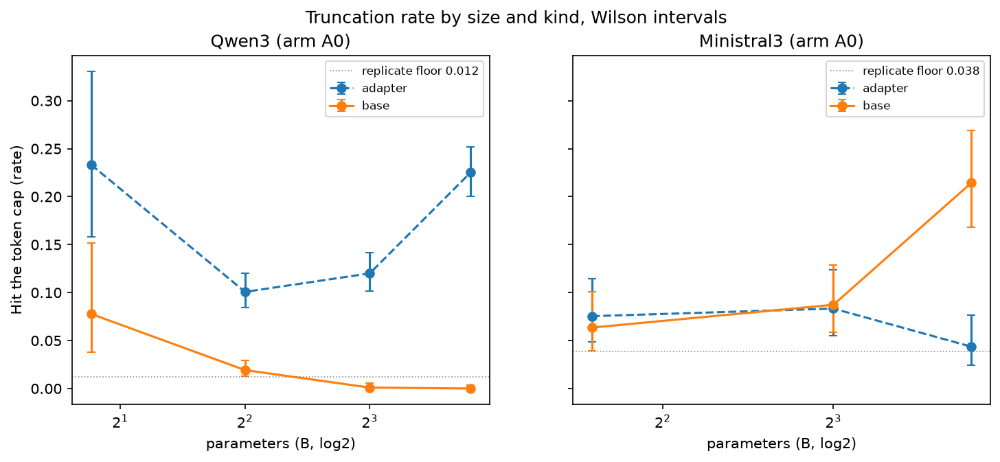
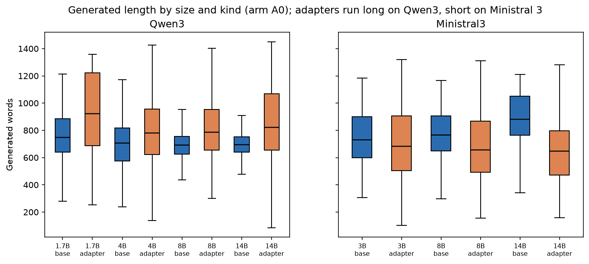
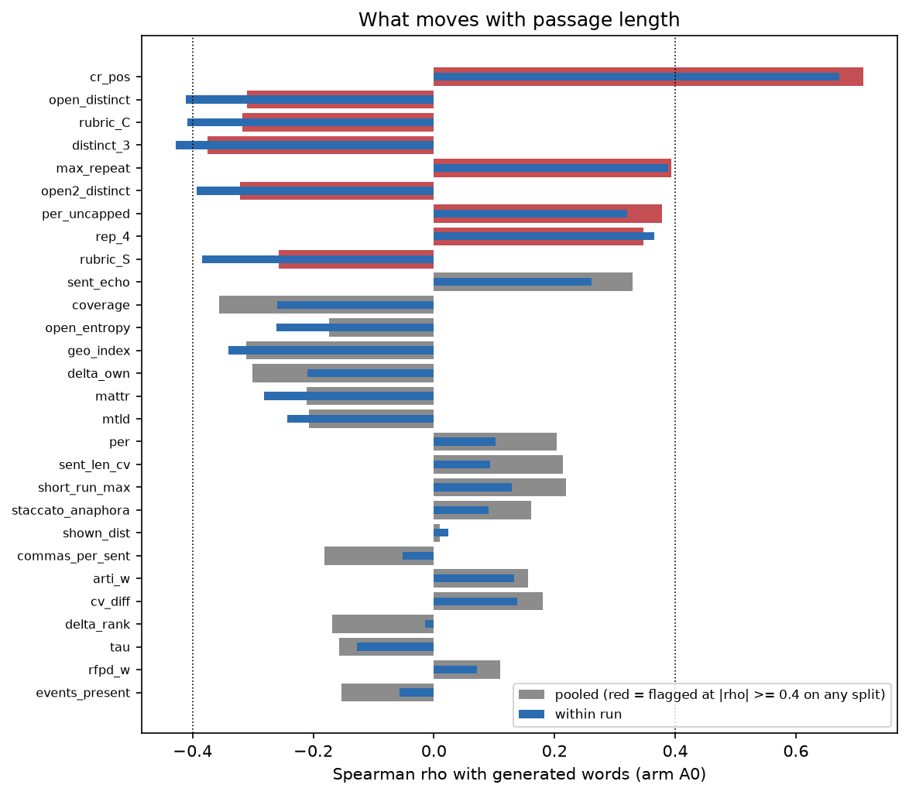
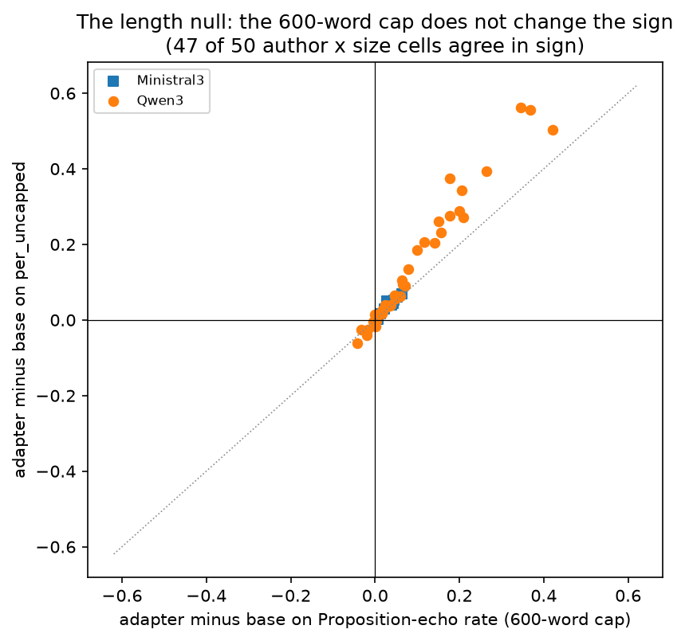

# 17_length_truncation: how much of the result is length

## What this does

Length is the study's most obvious confound and truncation is where it comes from, so this
script measures both before any other script leans on a length-sensitive measure. Four parts.
(1) How often a generation hit the token cap or opened with a preface, by family, size, kind
and arm, with Wilson intervals on cells and a bootstrap over briefs, next to the replicate
floor of the truncation flag itself. (2) What the length distributions look like, and how much
of the adapter's length change is paired within a brief. (3) What predicts an adapter run's
truncation: training examples, probe delta, parameter count, family. (4) The length null in
three forms: which dictionary measures move with `words` at all; whether the adapter-versus-base
contrast on proposition echo survives the 600-word cap (per against per_uncapped); whether it
survives adding length as a covariate; and whether it survives deleting every brief where
either side was truncated.

The headline is that the truncation pattern differs between the two families, on 14 Qwen3
authors and 3 Ministral 3 authors. On Qwen3 the base rarely truncates at A0 (0.000 to
0.078) and the adapter truncates more (0.101 to 0.233), by more than the replicate floor at
4 of 4 sizes. On Ministral 3 the base range is 0.063 to 0.214 and the adapter range
0.044 to 0.083, and the two differ by more than the floor at 1 of 3 sizes (14B), where the
base is the one that truncates. At the other Ministral sizes base and adapter sit inside the
floor of each other, so a statement that the two families truncate in opposite directions rests
on one Ministral size and 3 authors, not on the family.

## How it does it

Data. `data/master/cells.parquet` (non-replicate rows; arm A0 for anything that uses the
eval-cache measures), `runs.csv` for probe delta and training size, `authors.csv` for
`train_examples_max`.

Unit. Flag rates are computed over cells and given two intervals: a Wilson interval, which
assumes cells are independent, and a bootstrap over briefs, which does not. Every
adapter-versus-base contrast is brief-paired inside one author x family x size block and
bootstrapped over briefs (550 rows in `truncation_sensitivity.csv`, 528 of them with a usable
no-truncation counterpart). Truncation predictors are correlated at the run level (50 adapter
runs), where the unit is a run: those runs come from 14 Qwen3 and 3 Ministral authors at
several sizes each, and 2 of the 6 predictors (`train_examples_max`, `words_total`) are author-level
constants, so a run-level correlation with one of those repeats an author's value once per
size and its interval is narrower than the number of authors warrants. The cell-level
linear probability model with author random effects asks the same question with the author as
the grouping factor and is the one to quote.

Statistics. Spearman with bootstrap intervals; BH-FDR within each family of tests
(6 predictor tests, 50 length correlations,
118 covariate-adjusted contrasts). The words correlation is
reported pooled and again after centring both variables within run, because a pooled
correlation over cells that differ in configuration will read length differences that are
really configuration differences. Mixed models are statsmodels MixedLM with the author as the
grouping factor; with three to fourteen authors the random-effect variance is descriptive only.
Every contrast is printed next to the replicate floor of its measure.

Replicate floors. `lib.replicate_floor` finds both families: 5 twice-generated
Qwen3 base pairs and 4 Ministral 3 pairs on the truncation flag. The Ministral replicate runs
were scored on 2026-09-10, so contrasts here are compared with their own family's floor rather
than a borrowed one: 550 of the 550 rows in `truncation_sensitivity.csv` carry
`floor_source = own family`. Both floors are thin and the Ministral one is the thinner, so a
verdict that sits just either side of a floor should not be leaned on.

### Truncation rate by configuration (arm A0)

| family | params_b | kind | arm | n_cells | n_flagged | rate | wilson_low | wilson_high | brief_ci_low | brief_ci_high | n_authors | replicate_floor |
|---|---|---|---|---|---|---|---|---|---|---|---|---|
| Ministral3 | 3.000 | adapter | A0 | 252 | 19 | 0.075 | 0.049 | 0.115 | 0.044 | 0.115 | 3 | 0.038 |
| Ministral3 | 3.000 | base | A0 | 252 | 16 | 0.063 | 0.039 | 0.101 | 0.036 | 0.087 | 3 | 0.038 |
| Ministral3 | 8.000 | adapter | A0 | 252 | 21 | 0.083 | 0.055 | 0.124 | 0.048 | 0.131 | 3 | 0.038 |
| Ministral3 | 8.000 | base | A0 | 252 | 22 | 0.087 | 0.058 | 0.129 | 0.052 | 0.127 | 3 | 0.038 |
| Ministral3 | 14.000 | adapter | A0 | 252 | 11 | 0.044 | 0.025 | 0.076 | 0.016 | 0.071 | 3 | 0.038 |
| Ministral3 | 14.000 | base | A0 | 252 | 54 | 0.214 | 0.168 | 0.269 | 0.163 | 0.278 | 3 | 0.038 |
| Qwen3 | 1.700 | adapter | A0 | 90 | 21 | 0.233 | 0.158 | 0.331 | 0.144 | 0.311 | 1 | 0.012 |
| Qwen3 | 1.700 | base | A0 | 90 | 7 | 0.078 | 0.038 | 0.152 | 0.033 | 0.133 | 1 | 0.012 |
| Qwen3 | 4.000 | adapter | A0 | 1092 | 110 | 0.101 | 0.084 | 0.120 | 0.083 | 0.119 | 14 | 0.012 |
| Qwen3 | 4.000 | base | A0 | 1092 | 21 | 0.019 | 0.013 | 0.029 | 0.011 | 0.028 | 14 | 0.012 |
| Qwen3 | 8.000 | adapter | A0 | 1000 | 120 | 0.120 | 0.101 | 0.142 | 0.097 | 0.140 | 13 | 0.012 |
| Qwen3 | 8.000 | base | A0 | 1000 | 1 | 0.001 | 0.000 | 0.006 | 0.000 | 0.003 | 13 | 0.012 |
| Qwen3 | 14.000 | adapter | A0 | 1000 | 225 | 0.225 | 0.200 | 0.252 | 0.195 | 0.259 | 13 | 0.012 |
| Qwen3 | 14.000 | base | A0 | 1000 | 0 | 0.000 | 0.000 | 0.004 | 0.000 | 0.000 | 13 | 0.012 |

### Length distributions (arm A0)

| family | params_b | kind | n_cells | words_mean | words_ci_low | words_ci_high | words_sd | words_p10 | words_median | words_p90 | len_ratio_mean | len_ratio_median | share_len_ratio_lt_0.8 | share_len_ratio_gt_1.2 | truncation_rate |
|---|---|---|---|---|---|---|---|---|---|---|---|---|---|---|---|
| Ministral3 | 3.000 | adapter | 252 | 706.190 | 668.080 | 744.962 | 262.714 | 360.400 | 685.000 | 1086.600 | 0.976 | 0.919 | 0.349 | 0.278 | 0.075 |
| Ministral3 | 3.000 | base | 252 | 759.817 | 727.448 | 790.939 | 201.446 | 496.800 | 732.000 | 1062.200 | 1.049 | 1.018 | 0.187 | 0.274 | 0.063 |
| Ministral3 | 8.000 | adapter | 252 | 688.933 | 649.699 | 726.701 | 267.405 | 356.300 | 658.500 | 1078.600 | 0.947 | 0.906 | 0.361 | 0.250 | 0.083 |
| Ministral3 | 8.000 | base | 252 | 781.099 | 752.474 | 809.726 | 187.144 | 537.100 | 766.000 | 1059.400 | 1.075 | 1.069 | 0.087 | 0.310 | 0.087 |
| Ministral3 | 14.000 | adapter | 252 | 654.087 | 615.887 | 689.547 | 240.581 | 352.100 | 648.500 | 964.900 | 0.903 | 0.875 | 0.393 | 0.155 | 0.044 |
| Ministral3 | 14.000 | base | 252 | 876.214 | 844.497 | 905.256 | 192.272 | 615.200 | 883.500 | 1106.800 | 1.207 | 1.195 | 0.071 | 0.496 | 0.214 |
| Qwen3 | 1.700 | adapter | 90 | 927.878 | 859.911 | 995.161 | 298.856 | 519.000 | 925.000 | 1304.100 | 1.321 | 1.309 | 0.100 | 0.600 | 0.233 |
| Qwen3 | 1.700 | base | 90 | 776.344 | 718.520 | 829.304 | 228.486 | 541.900 | 748.500 | 1083.700 | 1.102 | 1.065 | 0.144 | 0.333 | 0.078 |
| Qwen3 | 4.000 | adapter | 1092 | 796.172 | 778.769 | 814.814 | 251.643 | 476.000 | 781.000 | 1155.600 | 1.112 | 1.100 | 0.136 | 0.353 | 0.101 |
| Qwen3 | 4.000 | base | 1092 | 697.146 | 682.287 | 710.830 | 190.786 | 434.000 | 707.000 | 900.900 | 0.968 | 0.954 | 0.169 | 0.081 | 0.019 |
| Qwen3 | 8.000 | adapter | 1000 | 817.403 | 801.681 | 834.823 | 235.052 | 540.900 | 787.000 | 1161.100 | 1.114 | 1.071 | 0.123 | 0.326 | 0.120 |
| Qwen3 | 8.000 | base | 1000 | 681.832 | 672.262 | 690.777 | 117.815 | 532.000 | 693.000 | 810.100 | 0.928 | 0.937 | 0.130 | 0.006 | 0.001 |
| Qwen3 | 14.000 | adapter | 1000 | 859.688 | 840.436 | 880.226 | 274.933 | 525.000 | 823.000 | 1274.100 | 1.174 | 1.117 | 0.148 | 0.422 | 0.225 |
| Qwen3 | 14.000 | base | 1000 | 691.966 | 683.478 | 699.304 | 95.103 | 580.800 | 697.500 | 802.200 | 0.943 | 0.938 | 0.036 | 0.011 | 0.000 |

### Adapter minus base on generated words

| family | params_b | author | n_briefs | adapter_minus_base | ci_low | ci_high | base_mean | adapter_mean | cohens_d |
|---|---|---|---|---|---|---|---|---|---|
| Ministral3 | 3.000 | chesterton | 39 | -51.167 | -121.594 | 25.661 | 724.051 | 672.885 | -0.260 |
| Ministral3 | 3.000 | doctorow | 42 | -38.500 | -95.343 | 16.220 | 852.643 | 814.143 | -0.227 |
| Ministral3 | 3.000 | patrick_v2 | 45 | -69.878 | -149.664 | 5.560 | 704.178 | 634.300 | -0.372 |
| Ministral3 | 8.000 | chesterton | 39 | 15.000 | -53.446 | 78.684 | 732.936 | 747.936 | 0.076 |
| Ministral3 | 8.000 | doctorow | 42 | -79.702 | -133.307 | -25.411 | 878.310 | 798.607 | -0.489 |
| Ministral3 | 8.000 | patrick_v2 | 45 | -196.678 | -257.536 | -135.904 | 732.111 | 535.433 | -1.199 |
| Ministral3 | 14.000 | chesterton | 39 | -81.051 | -163.431 | 3.190 | 818.269 | 737.218 | -0.358 |
| Ministral3 | 14.000 | doctorow | 42 | -234.274 | -282.894 | -184.997 | 932.131 | 697.857 | -1.744 |
| Ministral3 | 14.000 | patrick_v2 | 45 | -333.056 | -383.782 | -284.655 | 874.244 | 541.189 | -2.052 |
| Qwen3 | 1.700 | patrick_v2 | 45 | 151.533 | 75.136 | 232.954 | 776.344 | 927.878 | 0.712 |
| Qwen3 | 4.000 | cather | 44 | 145.307 | 76.371 | 215.531 | 655.091 | 800.398 | 0.686 |
| Qwen3 | 4.000 | chesterton | 39 | 166.090 | 111.223 | 222.412 | 631.449 | 797.538 | 0.916 |
| Qwen3 | 4.000 | chopin | 49 | 165.847 | 122.663 | 210.510 | 742.255 | 908.102 | 0.952 |
| Qwen3 | 4.000 | doctorow | 42 | 65.321 | 1.780 | 128.454 | 803.310 | 868.631 | 0.434 |
| Qwen3 | 4.000 | h_private | 23 | 137.283 | 61.152 | 224.518 | 702.261 | 839.543 | 0.741 |
| Qwen3 | 4.000 | link | 16 | -31.969 | -169.096 | 98.729 | 776.531 | 744.562 | -0.171 |
| Qwen3 | 4.000 | mansfield | 41 | 71.915 | 21.620 | 129.251 | 729.537 | 801.451 | 0.379 |
| Qwen3 | 4.000 | patrick | 46 | 81.815 | 56.262 | 108.616 | 409.707 | 491.522 | 1.083 |
| Qwen3 | 4.000 | patrick_v2 | 45 | 69.589 | 25.374 | 115.180 | 699.811 | 769.400 | 0.445 |
| Qwen3 | 4.000 | rucker | 47 | 70.021 | 23.510 | 115.119 | 742.415 | 812.436 | 0.448 |
| Qwen3 | 4.000 | stross | 41 | 59.683 | 13.254 | 105.494 | 727.683 | 787.366 | 0.450 |
| Qwen3 | 4.000 | sui_sin_far | 24 | -2.792 | -117.404 | 122.328 | 776.021 | 773.229 | -0.011 |
| Qwen3 | 4.000 | watts | 45 | 70.144 | 16.842 | 119.666 | 757.456 | 827.600 | 0.509 |
| Qwen3 | 4.000 | wharton | 44 | 204.784 | 157.565 | 253.862 | 700.398 | 905.182 | 1.214 |
| Qwen3 | 8.000 | cather | 44 | 141.966 | 74.465 | 215.911 | 636.295 | 778.261 | 0.740 |
| Qwen3 | 8.000 | chesterton | 39 | 227.679 | 175.095 | 277.900 | 621.013 | 848.692 | 1.307 |
| Qwen3 | 8.000 | chopin | 49 | 185.776 | 142.292 | 232.770 | 705.949 | 891.724 | 1.141 |
| Qwen3 | 8.000 | doctorow | 42 | 124.571 | 71.766 | 178.012 | 724.536 | 849.107 | 1.044 |
| Qwen3 | 8.000 | h_private | 23 | 266.196 | 187.352 | 351.680 | 700.478 | 966.674 | 1.785 |
| Qwen3 | 8.000 | link | 16 | 178.438 | 78.524 | 293.507 | 708.625 | 887.062 | 1.135 |
| Qwen3 | 8.000 | mansfield | 41 | 110.659 | 72.407 | 147.599 | 676.634 | 787.293 | 0.702 |
| Qwen3 | 8.000 | patrick_v2 | 45 | 31.556 | -9.318 | 71.074 | 671.811 | 703.367 | 0.234 |
| Qwen3 | 8.000 | rucker | 47 | 98.936 | 57.529 | 134.519 | 700.021 | 798.957 | 0.827 |
| Qwen3 | 8.000 | stross | 41 | 62.024 | 28.607 | 98.943 | 673.207 | 735.232 | 0.639 |
| Qwen3 | 8.000 | sui_sin_far | 24 | 144.875 | 61.336 | 225.855 | 709.125 | 854.000 | 0.864 |
| Qwen3 | 8.000 | watts | 45 | 101.133 | 60.736 | 142.791 | 721.211 | 822.344 | 0.771 |
| Qwen3 | 8.000 | wharton | 44 | 185.659 | 150.431 | 221.401 | 642.705 | 828.364 | 1.612 |
| Qwen3 | 14.000 | cather | 44 | 352.114 | 260.176 | 449.252 | 663.148 | 1015.261 | 1.518 |
| Qwen3 | 14.000 | chesterton | 39 | 181.449 | 127.628 | 234.751 | 648.385 | 829.833 | 1.126 |
| Qwen3 | 14.000 | chopin | 49 | 229.786 | 185.129 | 274.329 | 710.561 | 940.347 | 1.502 |
| Qwen3 | 14.000 | doctorow | 42 | 66.643 | 27.808 | 110.049 | 722.476 | 789.119 | 0.593 |
| Qwen3 | 14.000 | h_private | 23 | 297.739 | 189.239 | 405.771 | 694.130 | 991.870 | 1.482 |
| Qwen3 | 14.000 | link | 16 | 400.219 | 293.308 | 502.086 | 741.281 | 1141.500 | 2.514 |
| Qwen3 | 14.000 | mansfield | 41 | 117.915 | 68.784 | 174.135 | 678.610 | 796.524 | 0.730 |
| Qwen3 | 14.000 | patrick_v2 | 45 | 0.511 | -27.378 | 28.993 | 666.922 | 667.433 | 0.005 |
| Qwen3 | 14.000 | rucker | 47 | 46.266 | 2.781 | 83.359 | 719.585 | 765.851 | 0.391 |
| Qwen3 | 14.000 | stross | 41 | 157.756 | 99.339 | 215.460 | 705.049 | 862.805 | 1.058 |
| Qwen3 | 14.000 | sui_sin_far | 24 | 440.667 | 370.720 | 512.545 | 693.417 | 1134.083 | 2.559 |
| Qwen3 | 14.000 | watts | 45 | 81.900 | 33.478 | 132.291 | 704.911 | 786.811 | 0.603 |
| Qwen3 | 14.000 | wharton | 44 | 141.364 | 86.549 | 200.970 | 672.852 | 814.216 | 0.971 |

### What predicts an adapter run's truncation

| predictor | n_runs | spearman | ci_low | ci_high | p | q_bh |
|---|---|---|---|---|---|---|
| train_examples_max | 49 | -0.590 | -0.745 | -0.345 | 0.000 | 0.000 |
| probe_delta | 49 | -0.064 | -0.300 | 0.199 | 0.664 | 0.664 |
| eval_best | 49 | -0.425 | -0.679 | -0.131 | 0.002 | 0.003 |
| params_b | 50 | 0.081 | -0.225 | 0.361 | 0.574 | 0.664 |
| words_total | 50 | -0.502 | -0.696 | -0.209 | 0.000 | 0.000 |
| train_steps | 49 | -0.600 | -0.749 | -0.363 | 0.000 | 0.000 |

### Measures that move with passage length (top 20 by the largest |rho| on any split)

| measure | n | spearman_with_words | ci_low | ci_high | spearman_within_run | spearman_base | spearman_adapter | p | q_bh | length_flag | max_abs_rho | length_flag_any |
|---|---|---|---|---|---|---|---|---|---|---|---|---|
| cr_pos | 7875 | 0.711 | 0.667 | 0.752 | 0.672 | 0.639 | 0.776 | 0.000 | 0.000 | True | 0.776 | True |
| open_distinct | 7876 | -0.310 | -0.386 | -0.233 | -0.412 | -0.150 | -0.512 | 0.000 | 0.000 | False | 0.512 | True |
| rubric_C | 2202 | -0.318 | -0.421 | -0.200 | -0.409 | -0.114 | -0.503 | 0.000 | 0.000 | False | 0.503 | True |
| distinct_3 | 7876 | -0.376 | -0.447 | -0.299 | -0.428 | -0.190 | -0.489 | 0.000 | 0.000 | False | 0.489 | True |
| max_repeat | 7876 | 0.394 | 0.331 | 0.457 | 0.388 | 0.235 | 0.480 | 0.000 | 0.000 | False | 0.480 | True |
| open2_distinct | 7875 | -0.321 | -0.385 | -0.250 | -0.393 | -0.160 | -0.453 | 0.000 | 0.000 | False | 0.453 | True |
| per_uncapped | 7876 | 0.378 | 0.318 | 0.435 | 0.320 | 0.225 | 0.450 | 0.000 | 0.000 | False | 0.450 | True |
| rep_4 | 7876 | 0.347 | 0.274 | 0.415 | 0.366 | 0.168 | 0.447 | 0.000 | 0.000 | False | 0.447 | True |
| rubric_S | 2202 | -0.257 | -0.366 | -0.142 | -0.384 | -0.013 | -0.433 | 0.000 | 0.000 | False | 0.433 | True |
| sent_echo | 7876 | 0.329 | 0.270 | 0.388 | 0.262 | 0.155 | 0.398 | 0.000 | 0.000 | False | 0.398 | False |
| coverage | 4057 | -0.356 | -0.410 | -0.294 | -0.260 | -0.246 | -0.389 | 0.000 | 0.000 | False | 0.389 | False |
| open_entropy | 7873 | -0.174 | -0.251 | -0.092 | -0.261 | -0.028 | -0.368 | 0.000 | 0.000 | False | 0.368 | False |
| geo_index | 7876 | -0.312 | -0.376 | -0.250 | -0.341 | -0.278 | -0.354 | 0.000 | 0.000 | False | 0.354 | False |
| delta_own | 7876 | -0.300 | -0.389 | -0.207 | -0.209 | -0.336 | -0.231 | 0.000 | 0.000 | False | 0.336 | False |
| mattr | 7876 | -0.211 | -0.303 | -0.122 | -0.281 | 0.015 | -0.301 | 0.000 | 0.000 | False | 0.301 | False |
| mtld | 7874 | -0.207 | -0.300 | -0.115 | -0.243 | 0.017 | -0.298 | 0.000 | 0.000 | False | 0.298 | False |
| per | 7876 | 0.203 | 0.152 | 0.251 | 0.102 | 0.066 | 0.233 | 0.000 | 0.000 | False | 0.233 | False |
| sent_len_cv | 7876 | 0.214 | 0.148 | 0.269 | 0.094 | 0.220 | 0.138 | 0.000 | 0.000 | False | 0.220 | False |
| short_run_max | 7876 | 0.219 | 0.165 | 0.279 | 0.129 | 0.197 | 0.201 | 0.000 | 0.000 | False | 0.219 | False |
| staccato_anaphora | 7876 | 0.161 | 0.111 | 0.206 | 0.091 | 0.093 | 0.196 | 0.000 | 0.000 | False | 0.196 | False |

### The length null on proposition echo

| family | params_b | author | per_gain | per_lo | per_hi | n_briefs | per_uncapped_gain | per_uncapped_lo | per_uncapped_hi | sign_agrees | per_floor | per_uncapped_floor | per_above_floor | per_uncapped_above_floor |
|---|---|---|---|---|---|---|---|---|---|---|---|---|---|---|
| Ministral3 | 3.000 | chesterton | 0.063 | 0.047 | 0.082 | 39 | 0.068 | 0.050 | 0.088 | True | 0.004 | 0.004 | True | True |
| Ministral3 | 3.000 | doctorow | 0.052 | 0.040 | 0.065 | 42 | 0.060 | 0.045 | 0.075 | True | 0.004 | 0.004 | True | True |
| Ministral3 | 3.000 | patrick_v2 | 0.023 | 0.012 | 0.033 | 45 | 0.029 | 0.016 | 0.045 | True | 0.004 | 0.004 | True | True |
| Ministral3 | 8.000 | chesterton | 0.044 | 0.029 | 0.059 | 39 | 0.053 | 0.036 | 0.069 | True | 0.004 | 0.004 | True | True |
| Ministral3 | 8.000 | doctorow | 0.039 | 0.027 | 0.052 | 42 | 0.039 | 0.027 | 0.052 | True | 0.004 | 0.004 | True | True |
| Ministral3 | 8.000 | patrick_v2 | 0.013 | 0.005 | 0.023 | 45 | 0.017 | 0.003 | 0.034 | True | 0.004 | 0.004 | True | True |
| Ministral3 | 14.000 | chesterton | 0.027 | 0.017 | 0.039 | 39 | 0.050 | 0.032 | 0.071 | True | 0.004 | 0.004 | True | True |
| Ministral3 | 14.000 | doctorow | 0.042 | 0.030 | 0.055 | 42 | 0.044 | 0.032 | 0.058 | True | 0.004 | 0.004 | True | True |
| Ministral3 | 14.000 | patrick_v2 | 0.007 | -0.002 | 0.015 | 45 | 0.003 | -0.006 | 0.012 | True | 0.004 | 0.004 | True | False |
| Qwen3 | 1.700 | patrick_v2 | -0.032 | -0.067 | 0.006 | 45 | -0.025 | -0.075 | 0.030 | True | 0.010 | 0.025 | True | True |
| Qwen3 | 4.000 | cather | 0.210 | 0.169 | 0.253 | 44 | 0.272 | 0.224 | 0.328 | True | 0.010 | 0.025 | True | True |
| Qwen3 | 4.000 | chesterton | 0.004 | -0.021 | 0.029 | 39 | -0.002 | -0.027 | 0.024 | False | 0.010 | 0.025 | False | False |
| Qwen3 | 4.000 | chopin | 0.079 | 0.057 | 0.103 | 49 | 0.134 | 0.106 | 0.163 | True | 0.010 | 0.025 | True | True |
| Qwen3 | 4.000 | doctorow | -0.019 | -0.058 | 0.012 | 42 | -0.041 | -0.090 | -0.002 | True | 0.010 | 0.025 | True | True |
| Qwen3 | 4.000 | h_private | 0.157 | 0.109 | 0.205 | 23 | 0.231 | 0.175 | 0.282 | True | 0.010 | 0.025 | True | True |
| Qwen3 | 4.000 | link | 0.141 | 0.052 | 0.234 | 16 | 0.204 | 0.092 | 0.306 | True | 0.010 | 0.025 | True | True |
| Qwen3 | 4.000 | mansfield | 0.035 | 0.013 | 0.057 | 41 | 0.038 | 0.002 | 0.069 | True | 0.010 | 0.025 | True | True |
| Qwen3 | 4.000 | patrick | 0.001 | -0.013 | 0.015 | 46 | 0.003 | -0.010 | 0.017 | True | 0.010 | 0.025 | False | False |
| Qwen3 | 4.000 | patrick_v2 | -0.043 | -0.076 | -0.016 | 45 | -0.062 | -0.103 | -0.026 | True | 0.010 | 0.025 | True | True |
| Qwen3 | 4.000 | rucker | 0.002 | -0.024 | 0.024 | 47 | -0.017 | -0.058 | 0.017 | False | 0.010 | 0.025 | False | False |
| Qwen3 | 4.000 | stross | -0.001 | -0.026 | 0.025 | 41 | 0.015 | -0.011 | 0.044 | False | 0.010 | 0.025 | False | False |
| Qwen3 | 4.000 | sui_sin_far | 0.178 | 0.097 | 0.251 | 24 | 0.276 | 0.183 | 0.361 | True | 0.010 | 0.025 | True | True |
| Qwen3 | 4.000 | watts | -0.017 | -0.037 | 0.001 | 45 | -0.026 | -0.051 | -0.003 | True | 0.010 | 0.025 | True | True |
| Qwen3 | 4.000 | wharton | -0.004 | -0.028 | 0.016 | 44 | -0.004 | -0.029 | 0.020 | True | 0.010 | 0.025 | False | False |
| Qwen3 | 8.000 | cather | 0.200 | 0.153 | 0.251 | 44 | 0.289 | 0.231 | 0.360 | True | 0.010 | 0.025 | True | True |
| Qwen3 | 8.000 | chesterton | 0.046 | 0.026 | 0.073 | 39 | 0.066 | 0.041 | 0.097 | True | 0.010 | 0.025 | True | True |
| Qwen3 | 8.000 | chopin | 0.117 | 0.092 | 0.147 | 49 | 0.207 | 0.164 | 0.250 | True | 0.010 | 0.025 | True | True |
| Qwen3 | 8.000 | doctorow | 0.060 | 0.040 | 0.086 | 42 | 0.063 | 0.037 | 0.094 | True | 0.010 | 0.025 | True | True |
| Qwen3 | 8.000 | h_private | 0.205 | 0.156 | 0.251 | 23 | 0.343 | 0.276 | 0.405 | True | 0.010 | 0.025 | True | True |
| Qwen3 | 8.000 | link | 0.421 | 0.346 | 0.493 | 16 | 0.504 | 0.418 | 0.582 | True | 0.010 | 0.025 | True | True |
| Qwen3 | 8.000 | mansfield | 0.071 | 0.057 | 0.087 | 41 | 0.089 | 0.069 | 0.108 | True | 0.010 | 0.025 | True | True |
| Qwen3 | 8.000 | patrick_v2 | 0.017 | 0.001 | 0.032 | 45 | 0.025 | 0.002 | 0.048 | True | 0.010 | 0.025 | True | True |
| Qwen3 | 8.000 | rucker | 0.025 | 0.016 | 0.035 | 47 | 0.037 | 0.024 | 0.050 | True | 0.010 | 0.025 | True | True |
| Qwen3 | 8.000 | stross | 0.047 | 0.033 | 0.062 | 41 | 0.065 | 0.045 | 0.091 | True | 0.010 | 0.025 | True | True |
| Qwen3 | 8.000 | sui_sin_far | 0.264 | 0.204 | 0.332 | 24 | 0.394 | 0.317 | 0.476 | True | 0.010 | 0.025 | True | True |
| Qwen3 | 8.000 | watts | 0.025 | 0.012 | 0.036 | 45 | 0.039 | 0.027 | 0.050 | True | 0.010 | 0.025 | True | True |
| Qwen3 | 8.000 | wharton | 0.024 | 0.012 | 0.037 | 44 | 0.038 | 0.025 | 0.052 | True | 0.010 | 0.025 | True | True |
| Qwen3 | 14.000 | cather | 0.177 | 0.129 | 0.232 | 44 | 0.375 | 0.312 | 0.445 | True | 0.010 | 0.025 | True | True |
| Qwen3 | 14.000 | chesterton | 0.048 | 0.033 | 0.065 | 39 | 0.057 | 0.045 | 0.072 | True | 0.010 | 0.025 | True | True |
| Qwen3 | 14.000 | chopin | 0.099 | 0.072 | 0.131 | 49 | 0.185 | 0.148 | 0.226 | True | 0.010 | 0.025 | True | True |
| Qwen3 | 14.000 | doctorow | 0.038 | 0.027 | 0.051 | 42 | 0.040 | 0.028 | 0.053 | True | 0.010 | 0.025 | True | True |
| Qwen3 | 14.000 | h_private | 0.151 | 0.106 | 0.200 | 23 | 0.260 | 0.189 | 0.337 | True | 0.010 | 0.025 | True | True |
| Qwen3 | 14.000 | link | 0.369 | 0.287 | 0.451 | 16 | 0.556 | 0.461 | 0.645 | True | 0.010 | 0.025 | True | True |
| Qwen3 | 14.000 | mansfield | 0.065 | 0.050 | 0.082 | 41 | 0.094 | 0.076 | 0.111 | True | 0.010 | 0.025 | True | True |
| Qwen3 | 14.000 | patrick_v2 | 0.016 | 0.004 | 0.028 | 45 | 0.017 | 0.005 | 0.031 | True | 0.010 | 0.025 | True | False |
| Qwen3 | 14.000 | rucker | 0.028 | 0.017 | 0.038 | 47 | 0.036 | 0.025 | 0.047 | True | 0.010 | 0.025 | True | True |
| Qwen3 | 14.000 | stross | 0.064 | 0.045 | 0.086 | 41 | 0.105 | 0.079 | 0.137 | True | 0.010 | 0.025 | True | True |
| Qwen3 | 14.000 | sui_sin_far | 0.346 | 0.263 | 0.443 | 24 | 0.563 | 0.480 | 0.654 | True | 0.010 | 0.025 | True | True |
| Qwen3 | 14.000 | watts | 0.020 | 0.009 | 0.032 | 45 | 0.030 | 0.018 | 0.042 | True | 0.010 | 0.025 | True | True |
| Qwen3 | 14.000 | wharton | 0.018 | 0.008 | 0.029 | 44 | 0.023 | 0.011 | 0.035 | True | 0.010 | 0.025 | True | False |

### Adapter effect with and without words as a covariate

| family | params_b | measure | n_obs | n_authors | adapter_effect_raw | raw_lo | raw_hi | adapter_effect_adj_words | adj_lo | adj_hi | words_coefficient | attenuation | sign_flips | p_raw | p_adj | q_raw | q_adj | floor | raw_above_floor |
|---|---|---|---|---|---|---|---|---|---|---|---|---|---|---|---|---|---|---|---|
| Ministral3 | 3.000 | coverage | 252 | 3 | 1.746 | -3.037 | 6.529 | 0.689 | -4.023 | 5.400 | -4.614 | -1.057 | False | 0.474 | 0.774 | 0.487 | 0.776 | 6.282 | False |
| Ministral3 | 3.000 | cr_pos | 504 | 3 | -0.045 | -0.137 | 0.047 | 0.061 | 0.010 | 0.112 | 0.468 | 0.016 | True | 0.335 | 0.018 | 0.347 | 0.021 | 0.099 | False |
| Ministral3 | 3.000 | distinct_3 | 504 | 3 | -0.041 | -0.046 | -0.036 | -0.044 | -0.049 | -0.040 | -0.013 | 0.003 | False | 0.000 | 0.000 | 0.000 | 0.000 | 0.002 | True |
| Ministral3 | 3.000 | geo_index | 504 | 3 | 0.207 | 0.133 | 0.281 | 0.177 | 0.106 | 0.249 | -0.130 | -0.030 | False | 0.000 | 0.000 | 0.000 | 0.000 | 0.028 | True |
| Ministral3 | 3.000 | hapax_w300 | 502 | 3 | -0.158 | -0.166 | -0.150 | -0.159 | -0.167 | -0.151 | -0.003 | 0.001 | False | 0.000 | 0.000 | 0.000 | 0.000 | 0.006 | True |
| Ministral3 | 3.000 | luar_cos_ref | 504 | 3 | -0.007 | -0.019 | 0.004 | -0.008 | -0.019 | 0.004 | -0.001 | 0.000 | False | 0.210 | 0.195 | 0.220 | 0.215 | 0.006 | True |
| Ministral3 | 3.000 | luar_cos_source | 504 | 3 | 0.024 | 0.012 | 0.036 | 0.025 | 0.013 | 0.037 | 0.003 | 0.001 | False | 0.000 | 0.000 | 0.000 | 0.000 | 0.011 | True |
| Ministral3 | 3.000 | max_repeat | 504 | 3 | 3.563 | 2.998 | 4.129 | 3.853 | 3.324 | 4.382 | 1.271 | 0.290 | False | 0.000 | 0.000 | 0.000 | 0.000 | 0.564 | True |
| Ministral3 | 3.000 | open2_distinct | 504 | 3 | -0.065 | -0.081 | -0.049 | -0.075 | -0.089 | -0.060 | -0.043 | 0.010 | False | 0.000 | 0.000 | 0.000 | 0.000 | 0.012 | True |
| Ministral3 | 3.000 | open_distinct | 504 | 3 | 0.049 | 0.028 | 0.070 | 0.034 | 0.016 | 0.053 | -0.063 | -0.014 | False | 0.000 | 0.000 | 0.000 | 0.000 | 0.028 | True |
| Ministral3 | 3.000 | open_entropy | 504 | 3 | 0.024 | 0.009 | 0.040 | 0.018 | 0.003 | 0.033 | -0.030 | -0.007 | False | 0.002 | 0.022 | 0.003 | 0.025 | 0.017 | True |
| Ministral3 | 3.000 | otd_js | 504 | 3 | -0.022 | -0.038 | -0.006 | -0.026 | -0.041 | -0.010 | -0.016 | 0.004 | False | 0.006 | 0.001 | 0.007 | 0.002 | 0.006 | True |
| Ministral3 | 3.000 | pct_short8 | 504 | 3 | -0.071 | -0.097 | -0.044 | -0.070 | -0.097 | -0.043 | 0.004 | -0.001 | False | 0.000 | 0.000 | 0.000 | 0.000 | 0.020 | True |
| Ministral3 | 3.000 | per | 504 | 3 | 0.045 | 0.037 | 0.053 | 0.047 | 0.039 | 0.055 | 0.007 | 0.002 | False | 0.000 | 0.000 | 0.000 | 0.000 | 0.004 | True |
| Ministral3 | 3.000 | per_uncapped | 504 | 3 | 0.052 | 0.042 | 0.061 | 0.056 | 0.047 | 0.064 | 0.017 | 0.004 | False | 0.000 | 0.000 | 0.000 | 0.000 | 0.004 | True |
| Ministral3 | 3.000 | rep_4 | 504 | 3 | 0.037 | 0.032 | 0.042 | 0.039 | 0.034 | 0.044 | 0.010 | 0.002 | False | 0.000 | 0.000 | 0.000 | 0.000 | 0.001 | True |
| Ministral3 | 3.000 | rubric_C | 252 | 3 | -2.095 | -2.380 | -1.810 | -2.221 | -2.475 | -1.966 | -0.547 | 0.125 | False | 0.000 | 0.000 | 0.000 | 0.000 | 0.215 | True |
| Ministral3 | 3.000 | rubric_S | 252 | 3 | -1.466 | -1.658 | -1.275 | -1.542 | -1.716 | -1.367 | -0.328 | 0.075 | False | 0.000 | 0.000 | 0.000 | 0.000 | 0.125 | True |
| Ministral3 | 3.000 | styledist_cos_source | 504 | 3 | 0.009 | 0.002 | 0.016 | 0.010 | 0.004 | 0.017 | 0.005 | 0.001 | False | 0.007 | 0.003 | 0.009 | 0.003 | 0.003 | True |
| Ministral3 | 3.000 | wegmann_cos_source | 504 | 3 | 0.005 | -0.022 | 0.032 | 0.009 | -0.018 | 0.036 | 0.016 | 0.004 | False | 0.701 | 0.522 | 0.714 | 0.545 | 0.030 | False |
| Ministral3 | 8.000 | coverage | 251 | 3 | -4.357 | -8.243 | -0.472 | -5.660 | -9.409 | -1.910 | -5.196 | 1.302 | False | 0.028 | 0.003 | 0.032 | 0.004 | 6.282 | False |
| Ministral3 | 8.000 | cr_pos | 504 | 3 | -0.210 | -0.311 | -0.109 | -0.009 | -0.070 | 0.052 | 0.513 | -0.201 | False | 0.000 | 0.768 | 0.000 | 0.776 | 0.099 | True |
| Ministral3 | 8.000 | distinct_3 | 504 | 3 | -0.032 | -0.037 | -0.027 | -0.038 | -0.043 | -0.033 | -0.015 | 0.006 | False | 0.000 | 0.000 | 0.000 | 0.000 | 0.002 | True |
| Ministral3 | 8.000 | geo_index | 504 | 3 | 0.461 | 0.394 | 0.528 | 0.436 | 0.368 | 0.504 | -0.064 | -0.025 | False | 0.000 | 0.000 | 0.000 | 0.000 | 0.028 | True |
| Ministral3 | 8.000 | hapax_w300 | 501 | 3 | -0.151 | -0.159 | -0.142 | -0.153 | -0.162 | -0.144 | -0.006 | 0.002 | False | 0.000 | 0.000 | 0.000 | 0.000 | 0.006 | True |
| Ministral3 | 8.000 | luar_cos_ref | 504 | 3 | -0.009 | -0.020 | 0.001 | -0.007 | -0.018 | 0.004 | 0.005 | -0.002 | False | 0.090 | 0.191 | 0.095 | 0.212 | 0.006 | True |
| Ministral3 | 8.000 | luar_cos_source | 504 | 3 | 0.020 | 0.009 | 0.031 | 0.024 | 0.013 | 0.035 | 0.010 | 0.004 | False | 0.000 | 0.000 | 0.000 | 0.000 | 0.011 | True |
| Ministral3 | 8.000 | max_repeat | 504 | 3 | 2.488 | 1.928 | 3.049 | 3.072 | 2.555 | 3.589 | 1.490 | 0.584 | False | 0.000 | 0.000 | 0.000 | 0.000 | 0.564 | True |
| Ministral3 | 8.000 | open2_distinct | 504 | 3 | -0.046 | -0.061 | -0.032 | -0.060 | -0.074 | -0.047 | -0.035 | 0.014 | False | 0.000 | 0.000 | 0.000 | 0.000 | 0.012 | True |
| Ministral3 | 8.000 | open_distinct | 504 | 3 | 0.046 | 0.025 | 0.066 | 0.022 | 0.004 | 0.041 | -0.060 | -0.023 | False | 0.000 | 0.018 | 0.000 | 0.021 | 0.028 | True |
| Ministral3 | 8.000 | open_entropy | 504 | 3 | 0.015 | 0.000 | 0.030 | 0.005 | -0.010 | 0.020 | -0.026 | -0.010 | False | 0.048 | 0.497 | 0.054 | 0.523 | 0.017 | False |
| Ministral3 | 8.000 | otd_js | 504 | 3 | -0.028 | -0.044 | -0.012 | -0.035 | -0.051 | -0.019 | -0.017 | 0.007 | False | 0.000 | 0.000 | 0.001 | 0.000 | 0.006 | True |
| Ministral3 | 8.000 | pct_short8 | 504 | 3 | -0.137 | -0.164 | -0.111 | -0.138 | -0.165 | -0.112 | -0.003 | 0.001 | False | 0.000 | 0.000 | 0.000 | 0.000 | 0.020 | True |
| Ministral3 | 8.000 | per | 504 | 3 | 0.031 | 0.025 | 0.038 | 0.034 | 0.028 | 0.040 | 0.006 | 0.002 | False | 0.000 | 0.000 | 0.000 | 0.000 | 0.004 | True |
| Ministral3 | 8.000 | per_uncapped | 504 | 3 | 0.035 | 0.028 | 0.043 | 0.043 | 0.036 | 0.050 | 0.019 | 0.008 | False | 0.000 | 0.000 | 0.000 | 0.000 | 0.004 | True |
| Ministral3 | 8.000 | rep_4 | 504 | 3 | 0.027 | 0.021 | 0.033 | 0.032 | 0.026 | 0.038 | 0.013 | 0.005 | False | 0.000 | 0.000 | 0.000 | 0.000 | 0.001 | True |
| Ministral3 | 8.000 | rubric_C | 252 | 3 | -2.149 | -2.418 | -1.881 | -2.274 | -2.517 | -2.032 | -0.510 | 0.125 | False | 0.000 | 0.000 | 0.000 | 0.000 | 0.215 | True |
| Ministral3 | 8.000 | rubric_S | 252 | 3 | -1.609 | -1.823 | -1.395 | -1.673 | -1.880 | -1.466 | -0.260 | 0.064 | False | 0.000 | 0.000 | 0.000 | 0.000 | 0.125 | True |
| Ministral3 | 8.000 | styledist_cos_source | 504 | 3 | 0.011 | 0.003 | 0.018 | 0.012 | 0.005 | 0.020 | 0.004 | 0.002 | False | 0.004 | 0.001 | 0.005 | 0.002 | 0.003 | True |
| Ministral3 | 8.000 | wegmann_cos_source | 504 | 3 | 0.024 | -0.003 | 0.052 | 0.026 | -0.003 | 0.054 | 0.004 | 0.001 | False | 0.084 | 0.074 | 0.092 | 0.086 | 0.030 | False |
| Ministral3 | 14.000 | coverage | 252 | 3 | -4.262 | -8.571 | 0.047 | -7.910 | -12.566 | -3.254 | -4.090 | 3.648 | False | 0.053 | 0.001 | 0.059 | 0.001 | 6.282 | False |
| Ministral3 | 14.000 | cr_pos | 504 | 3 | -0.369 | -0.458 | -0.279 | 0.076 | 0.019 | 0.132 | 0.489 | -0.293 | True | 0.000 | 0.009 | 0.000 | 0.010 | 0.099 | True |
| Ministral3 | 14.000 | distinct_3 | 504 | 3 | -0.028 | -0.032 | -0.024 | -0.038 | -0.043 | -0.034 | -0.012 | 0.011 | False | 0.000 | 0.000 | 0.000 | 0.000 | 0.002 | True |
| Ministral3 | 14.000 | geo_index | 504 | 3 | 0.558 | 0.493 | 0.623 | 0.478 | 0.407 | 0.550 | -0.088 | -0.080 | False | 0.000 | 0.000 | 0.000 | 0.000 | 0.028 | True |
| Ministral3 | 14.000 | hapax_w300 | 501 | 3 | -0.141 | -0.149 | -0.133 | -0.144 | -0.153 | -0.134 | -0.003 | 0.003 | False | 0.000 | 0.000 | 0.000 | 0.000 | 0.006 | True |
| Ministral3 | 14.000 | luar_cos_ref | 504 | 3 | -0.011 | -0.022 | -0.001 | -0.007 | -0.018 | 0.005 | 0.005 | -0.005 | False | 0.030 | 0.265 | 0.034 | 0.287 | 0.006 | True |
| Ministral3 | 14.000 | luar_cos_source | 504 | 3 | 0.016 | 0.006 | 0.027 | 0.022 | 0.010 | 0.034 | 0.006 | 0.005 | False | 0.003 | 0.000 | 0.004 | 0.001 | 0.011 | True |
| Ministral3 | 14.000 | max_repeat | 504 | 3 | 2.413 | 1.755 | 3.070 | 4.183 | 3.521 | 4.844 | 1.947 | 1.770 | False | 0.000 | 0.000 | 0.000 | 0.000 | 0.564 | True |
| Ministral3 | 14.000 | open2_distinct | 504 | 3 | -0.046 | -0.061 | -0.032 | -0.082 | -0.097 | -0.067 | -0.039 | 0.036 | False | 0.000 | 0.000 | 0.000 | 0.000 | 0.012 | True |
| Ministral3 | 14.000 | open_distinct | 504 | 3 | 0.057 | 0.036 | 0.078 | -0.008 | -0.028 | 0.013 | -0.071 | -0.049 | True | 0.000 | 0.459 | 0.000 | 0.488 | 0.028 | True |
| Ministral3 | 14.000 | open_entropy | 504 | 3 | 0.018 | 0.003 | 0.034 | -0.012 | -0.029 | 0.005 | -0.034 | -0.006 | True | 0.020 | 0.154 | 0.023 | 0.175 | 0.017 | True |
| Ministral3 | 14.000 | otd_js | 504 | 3 | -0.010 | -0.026 | 0.005 | -0.023 | -0.041 | -0.006 | -0.014 | 0.013 | False | 0.191 | 0.009 | 0.201 | 0.010 | 0.006 | True |
| Ministral3 | 14.000 | pct_short8 | 504 | 3 | -0.126 | -0.153 | -0.100 | -0.120 | -0.150 | -0.090 | 0.007 | -0.006 | False | 0.000 | 0.000 | 0.000 | 0.000 | 0.020 | True |
| Ministral3 | 14.000 | per | 504 | 3 | 0.025 | 0.019 | 0.031 | 0.028 | 0.021 | 0.035 | 0.003 | 0.003 | False | 0.000 | 0.000 | 0.000 | 0.000 | 0.004 | True |
| Ministral3 | 14.000 | per_uncapped | 504 | 3 | 0.031 | 0.024 | 0.039 | 0.047 | 0.039 | 0.055 | 0.017 | 0.015 | False | 0.000 | 0.000 | 0.000 | 0.000 | 0.004 | True |
| Ministral3 | 14.000 | rep_4 | 504 | 3 | 0.024 | 0.020 | 0.028 | 0.034 | 0.029 | 0.038 | 0.011 | 0.010 | False | 0.000 | 0.000 | 0.000 | 0.000 | 0.001 | True |
| Ministral3 | 14.000 | rubric_C | 252 | 3 | -1.789 | -2.053 | -1.525 | -2.217 | -2.489 | -1.944 | -0.480 | 0.428 | False | 0.000 | 0.000 | 0.000 | 0.000 | 0.215 | True |
| Ministral3 | 14.000 | rubric_S | 252 | 3 | -1.356 | -1.563 | -1.148 | -1.561 | -1.787 | -1.335 | -0.231 | 0.206 | False | 0.000 | 0.000 | 0.000 | 0.000 | 0.125 | True |
| Ministral3 | 14.000 | styledist_cos_source | 504 | 3 | 0.013 | 0.006 | 0.020 | 0.020 | 0.012 | 0.027 | 0.007 | 0.007 | False | 0.000 | 0.000 | 0.000 | 0.000 | 0.003 | True |
| Ministral3 | 14.000 | wegmann_cos_source | 504 | 3 | 0.025 | -0.003 | 0.053 | 0.028 | -0.003 | 0.060 | 0.004 | 0.004 | False | 0.079 | 0.076 | 0.087 | 0.087 | 0.030 | False |

(58 more rows in the csv)

### Core contrasts with truncated briefs dropped (first 40)

| family | params_b | author | measure | n_briefs_all | gain_all | all_lo | all_hi | n_briefs_clean | gain_no_truncated | clean_lo | clean_hi | share_briefs_dropped | gain_shift | floor | floor_source | sign_flips | shift_above_floor |
|---|---|---|---|---|---|---|---|---|---|---|---|---|---|---|---|---|---|
| Ministral3 | 3.000 | chesterton | luar_cos_source | 39 | 0.068 | 0.043 | 0.093 | 28 | 0.066 | 0.037 | 0.099 | 0.282 | -0.002 | 0.011 | own family | False | False |
| Ministral3 | 3.000 | chesterton | luar_cos_ref | 39 | 0.056 | 0.032 | 0.080 | 28 | 0.057 | 0.033 | 0.085 | 0.282 | 0.002 | 0.006 | own family | False | False |
| Ministral3 | 3.000 | chesterton | wegmann_cos_source | 39 | -0.063 | -0.112 | -0.010 | 28 | -0.053 | -0.109 | 0.007 | 0.282 | 0.010 | 0.030 | own family | False | False |
| Ministral3 | 3.000 | chesterton | styledist_cos_source | 39 | 0.004 | -0.004 | 0.013 | 28 | 0.004 | -0.006 | 0.015 | 0.282 | 0.000 | 0.003 | own family | False | False |
| Ministral3 | 3.000 | chesterton | geo_index | 39 | 0.801 | 0.700 | 0.895 | 28 | 0.794 | 0.677 | 0.917 | 0.282 | -0.008 | 0.028 | own family | False | False |
| Ministral3 | 3.000 | chesterton | otd_js | 39 | -0.033 | -0.069 | -0.001 | 28 | -0.046 | -0.085 | -0.009 | 0.282 | -0.012 | 0.006 | own family | False | True |
| Ministral3 | 3.000 | chesterton | per | 39 | 0.063 | 0.046 | 0.081 | 28 | 0.062 | 0.044 | 0.083 | 0.282 | -0.001 | 0.004 | own family | False | False |
| Ministral3 | 3.000 | chesterton | hapax_w300 | 39 | -0.185 | -0.199 | -0.171 | 28 | -0.176 | -0.192 | -0.159 | 0.282 | 0.009 | 0.006 | own family | False | True |
| Ministral3 | 3.000 | chesterton | open_entropy | 39 | -0.013 | -0.043 | 0.016 | 28 | -0.022 | -0.057 | 0.016 | 0.282 | -0.009 | 0.017 | own family | False | False |
| Ministral3 | 3.000 | chesterton | pct_short8 | 39 | -0.101 | -0.133 | -0.061 | 28 | -0.093 | -0.138 | -0.049 | 0.282 | 0.008 | 0.020 | own family | False | False |
| Ministral3 | 3.000 | chesterton | coverage | 39 | 8.949 | 0.795 | 17.103 | 28 | 7.143 | -2.143 | 16.790 | 0.282 | -1.806 | 6.282 | own family | False | False |
| Ministral3 | 3.000 | doctorow | luar_cos_source | 42 | 0.045 | 0.029 | 0.061 | 28 | 0.047 | 0.029 | 0.067 | 0.333 | 0.002 | 0.011 | own family | False | False |
| Ministral3 | 3.000 | doctorow | luar_cos_ref | 42 | -0.007 | -0.024 | 0.012 | 28 | -0.006 | -0.029 | 0.021 | 0.333 | 0.001 | 0.006 | own family | False | False |
| Ministral3 | 3.000 | doctorow | wegmann_cos_source | 42 | 0.028 | 0.012 | 0.044 | 28 | 0.028 | 0.007 | 0.050 | 0.333 | -0.000 | 0.030 | own family | False | False |
| Ministral3 | 3.000 | doctorow | styledist_cos_source | 42 | 0.016 | 0.010 | 0.023 | 28 | 0.012 | 0.004 | 0.020 | 0.333 | -0.004 | 0.003 | own family | False | True |
| Ministral3 | 3.000 | doctorow | geo_index | 42 | 0.237 | 0.165 | 0.307 | 28 | 0.283 | 0.185 | 0.370 | 0.333 | 0.046 | 0.028 | own family | False | True |
| Ministral3 | 3.000 | doctorow | otd_js | 42 | 0.001 | -0.020 | 0.021 | 28 | -0.007 | -0.029 | 0.018 | 0.333 | -0.008 | 0.006 | own family | True | True |
| Ministral3 | 3.000 | doctorow | per | 42 | 0.052 | 0.040 | 0.065 | 28 | 0.058 | 0.042 | 0.075 | 0.333 | 0.006 | 0.004 | own family | False | True |
| Ministral3 | 3.000 | doctorow | hapax_w300 | 42 | -0.175 | -0.189 | -0.162 | 28 | -0.175 | -0.190 | -0.161 | 0.333 | 0.000 | 0.006 | own family | False | False |
| Ministral3 | 3.000 | doctorow | open_entropy | 42 | -0.038 | -0.058 | -0.015 | 28 | -0.030 | -0.056 | -0.004 | 0.333 | 0.008 | 0.017 | own family | False | False |
| Ministral3 | 3.000 | doctorow | pct_short8 | 42 | 0.061 | 0.025 | 0.098 | 28 | 0.054 | 0.004 | 0.100 | 0.333 | -0.007 | 0.020 | own family | False | False |
| Ministral3 | 3.000 | doctorow | coverage | 42 | -0.595 | -5.714 | 4.810 | 28 | 2.179 | -4.187 | 9.072 | 0.333 | 2.774 | 6.282 | own family | True | False |
| Ministral3 | 3.000 | patrick_v2 | luar_cos_source | 45 | -0.034 | -0.054 | -0.014 | 40 | -0.035 | -0.059 | -0.015 | 0.111 | -0.001 | 0.011 | own family | False | False |
| Ministral3 | 3.000 | patrick_v2 | luar_cos_ref | 45 | -0.062 | -0.079 | -0.047 | 40 | -0.065 | -0.081 | -0.049 | 0.111 | -0.002 | 0.006 | own family | False | False |
| Ministral3 | 3.000 | patrick_v2 | wegmann_cos_source | 45 | 0.043 | -0.000 | 0.086 | 40 | 0.038 | -0.008 | 0.083 | 0.111 | -0.006 | 0.030 | own family | False | False |
| Ministral3 | 3.000 | patrick_v2 | styledist_cos_source | 45 | 0.007 | -0.002 | 0.015 | 40 | 0.007 | -0.002 | 0.016 | 0.111 | 0.001 | 0.003 | own family | False | False |
| Ministral3 | 3.000 | patrick_v2 | geo_index | 45 | -0.336 | -0.485 | -0.193 | 40 | -0.318 | -0.458 | -0.168 | 0.111 | 0.018 | 0.028 | own family | False | False |
| Ministral3 | 3.000 | patrick_v2 | otd_js | 45 | -0.034 | -0.065 | -0.002 | 40 | -0.037 | -0.072 | 0.001 | 0.111 | -0.003 | 0.006 | own family | False | False |
| Ministral3 | 3.000 | patrick_v2 | per | 45 | 0.023 | 0.012 | 0.035 | 40 | 0.020 | 0.009 | 0.031 | 0.111 | -0.003 | 0.004 | own family | False | False |
| Ministral3 | 3.000 | patrick_v2 | hapax_w300 | 45 | -0.120 | -0.131 | -0.110 | 40 | -0.120 | -0.131 | -0.109 | 0.111 | 0.000 | 0.006 | own family | False | False |
| Ministral3 | 3.000 | patrick_v2 | open_entropy | 45 | 0.115 | 0.086 | 0.141 | 40 | 0.122 | 0.091 | 0.149 | 0.111 | 0.007 | 0.017 | own family | False | False |
| Ministral3 | 3.000 | patrick_v2 | pct_short8 | 45 | -0.168 | -0.208 | -0.129 | 40 | -0.175 | -0.218 | -0.137 | 0.111 | -0.007 | 0.020 | own family | False | False |
| Ministral3 | 3.000 | patrick_v2 | coverage | 45 | -2.311 | -9.912 | 4.913 | 40 | -0.850 | -9.553 | 6.751 | 0.111 | 1.461 | 6.282 | own family | False | False |
| Ministral3 | 8.000 | chesterton | luar_cos_source | 39 | 0.049 | 0.023 | 0.075 | 28 | 0.060 | 0.034 | 0.086 | 0.282 | 0.011 | 0.011 | own family | False | True |
| Ministral3 | 8.000 | chesterton | luar_cos_ref | 39 | 0.033 | 0.013 | 0.053 | 28 | 0.035 | 0.015 | 0.056 | 0.282 | 0.002 | 0.006 | own family | False | False |
| Ministral3 | 8.000 | chesterton | wegmann_cos_source | 39 | -0.066 | -0.127 | -0.007 | 28 | -0.086 | -0.146 | -0.023 | 0.282 | -0.020 | 0.030 | own family | False | False |
| Ministral3 | 8.000 | chesterton | styledist_cos_source | 39 | 0.004 | -0.012 | 0.017 | 28 | 0.002 | -0.018 | 0.020 | 0.282 | -0.002 | 0.003 | own family | False | False |
| Ministral3 | 8.000 | chesterton | geo_index | 39 | 0.794 | 0.719 | 0.875 | 28 | 0.810 | 0.699 | 0.906 | 0.282 | 0.016 | 0.028 | own family | False | False |
| Ministral3 | 8.000 | chesterton | otd_js | 39 | -0.037 | -0.068 | -0.008 | 28 | -0.043 | -0.082 | -0.002 | 0.282 | -0.006 | 0.006 | own family | False | True |
| Ministral3 | 8.000 | chesterton | per | 39 | 0.044 | 0.030 | 0.059 | 28 | 0.043 | 0.025 | 0.060 | 0.282 | -0.002 | 0.004 | own family | False | False |

### Truncation rate by configuration

### Length distribution by configuration

### Correlation with passage length

### Length null on proposition echo

## How to read the result, conservatively

Unit of replication. Truncation rates are read per configuration, and a configuration is one
run, so the interval that matters is the brief-cluster one, not the Wilson one - for the worst
cell (Ministral3 14B base arm A1,
rate 0.426) the Wilson interval is
[0.352, 0.503] and the brief bootstrap is
[0.327, 0.525]. For any claim about a model
family rather than a run, the unit drops to authors: Qwen3 has up to
14 of them and Ministral 3 has
3, so the Ministral column is 3 points and
should be read as an illustration, not an estimate.

Interval width and floor. The truncation flag's own replicate floor is
0.012 on Qwen3 and 0.038 on Ministral 3 (largest absolute difference between two
runs of the same configuration, from 5 and 4 pairs). Truncation differences smaller than
their family's number are noise, and a floor from one or three pairs is itself an estimate. On the measures, the floors
are printed in `truncation_sensitivity.csv` and `words_covariate_contrasts.csv` beside every
contrast; of 528 sensitivity contrasts, 124 moved by more than
their own floor when truncated briefs were dropped, and 22 changed sign.

What the length null does and does not settle. The 600-word cap does the job it was added
for: the paired adapter effect on capped proposition echo and on uncapped proposition echo
agree in sign in 47 of 50 author x size cells and correlate at rho 0.99, which is
consistent with the coherence result not being an artefact of the adapter writing longer. The
cap does change the size of it: over the 40 cells with a clearly positive capped gain, the
uncapped gain is a median 1.44 times the capped one, so an uncapped proposition-echo number
reports a larger coherence cost than the capped one by that factor.
Adding length as a covariate changed the sign of the adapter effect in 9 of
118 contrasts and moved 9 from q < 0.05 to q >= 0.05 within this script's family of
118 tests. Length is a real covariate and most of the adapter effect does not travel with
it. That does not show that the flagged measures are safe, and the covariate model cannot
separate length as a confound from length as part of what the adapter changed, because the
adapter changes length. 1 measures correlate with words at |rho| >= 0.4 pooled
(cr_pos), 4 do so after centring within run, and 9 cross the threshold on at
least one of the four splits (pooled, within run, base only, adapter only). The extra ones
(open_distinct, rubric_C, distinct_3, max_repeat, open2_distinct, per_uncapped, rep_4, rubric_S) are clean pooled and cross the threshold inside the adapter arm,
which is the worst case for this study, because the adapter is the thing being tested and it is
also the thing that changes length. Read those as length results until shown otherwise.

What would overturn this. Regenerating the truncating runs with a larger token cap. If the
Qwen3 14B adapter's truncation (0.225 at A0) is a cap
artefact rather than a property of the adapter, every 14B adapter measure that correlates with
words changes. A second Ministral 3 replicate pair, and pairs at more than one size, would say
whether the Ministral floor used here is the right width; the pair that exists was scored on
2026-09-10 and covers one size.

What this does not show. Nothing here says truncation is bad prose or that a long passage is a
good one. `truncated` is a flag on hitting the generation cap, so it is confounded with the
brief's target length; `len_ratio` is the measure that carries the target, and it is reported
next to it.

## Caveats

- The Ministral 3 replicate pair was scored on 2026-09-10, so both families now have a floor (5 Qwen3 pairs, 4 Ministral). Any reading of this folder written before that date compared Ministral contrasts with a borrowed Qwen3 number; the `floor_source` column records which floor each row actually used.
- Truncation is measured as a flag per cell; the run-level `truncated_pct` in runs.csv pools all arms and can differ from the A0 number in these tables. The largest gap is h_private_paire6_14b: A0 0.413 against 0.587 pooled. Quote the A0 rate from these tables when comparing configurations at A0.
- Preface is almost never flagged (11 cells of 36214), so the preface columns in these tables are descriptive and cannot support a contrast.
- Pooled correlations with words mix within-configuration and between-configuration variation; the within-run column is the conservative one and it is smaller for almost every measure.
- The covariate-adjusted contrasts use a linear model on measures that are bounded (rates, cosines), so the adjusted coefficient is a local approximation, not a properly linked estimate.
- Coverage exists for Qwen3 only, so the coverage row of the sensitivity table has no Ministral counterpart.
- Dropping truncated briefs removes whole briefs from both arms to keep the pairing, so the clean estimate is computed on a smaller and slightly easier set of briefs, not on the same set minus a few cells.
- 15 runs fail the study's 20% truncation gate (`truncation_gate_ok` in runs.csv) and are in these tables flagged rather than excluded; the worst is link_paire6_14b at 84.4%. 3 of them are base runs (chesterton_basem14b_r2, doctorow_basem14b, doctorow_basem8b), and the Ministral 3 base column is the one carrying the reading that the Ministral base truncates, so that reading rests partly on runs the study's own gate rejects.
- Coverage is an LLM-judged adherence rate, not a measurement, and the Qwen3 runs listed under the 2026-09-09 credit outage in LOG.md carry error rows for it and are being rejudged; the coverage row of the sensitivity table changes when that rerun lands.
- The run-level truncation predictors are correlated over adapter runs, not over authors, and 2 of the 6 predictors (`train_examples_max`, `words_total`) are author-level constants repeated once per size; treat those intervals as optimistic and read the mixed model beside them.
- The predictors are observational: an author with more training data also has a different corpus, a different register and a different brief set, so a correlation between training size and truncation is consistent with several accounts and settles none of them.
- The number of authors, 14 on Qwen3 and 3 on Ministral 3, is what limits every claim here. BH-FDR is applied within each family of tests in this script and does not buy back replication across authors.
