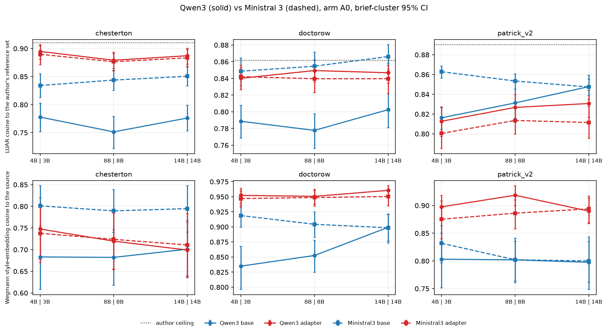
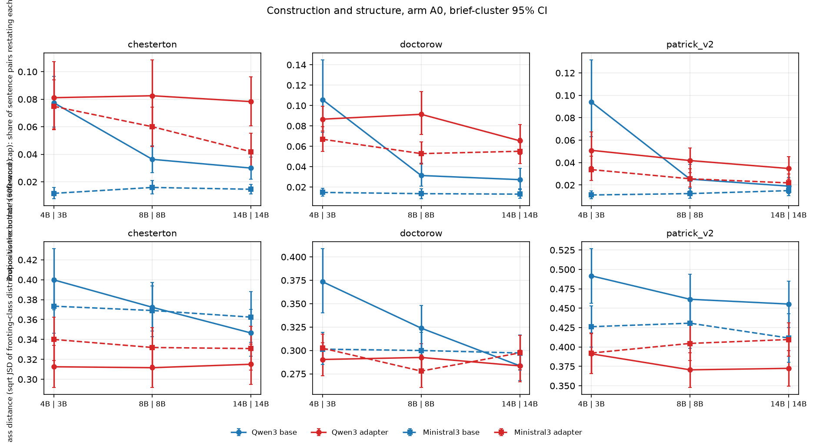
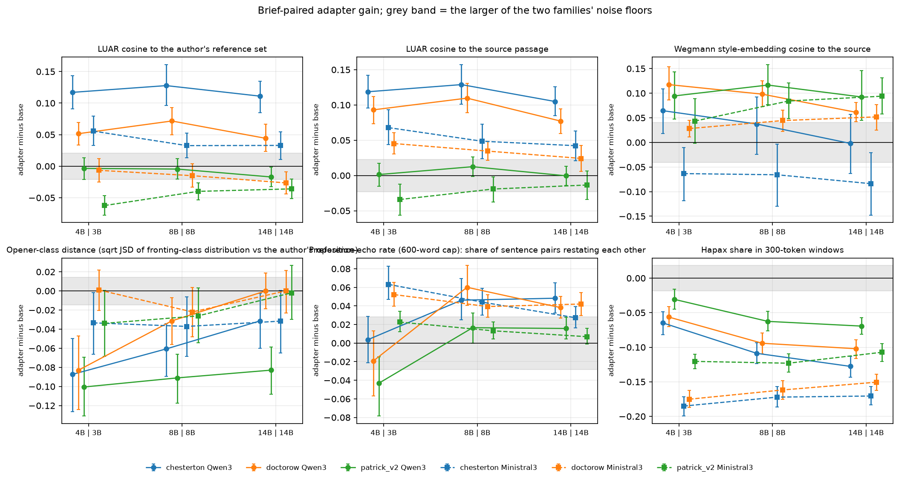
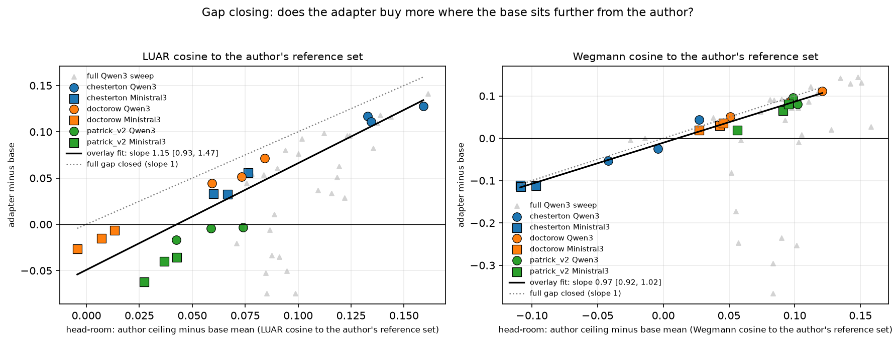
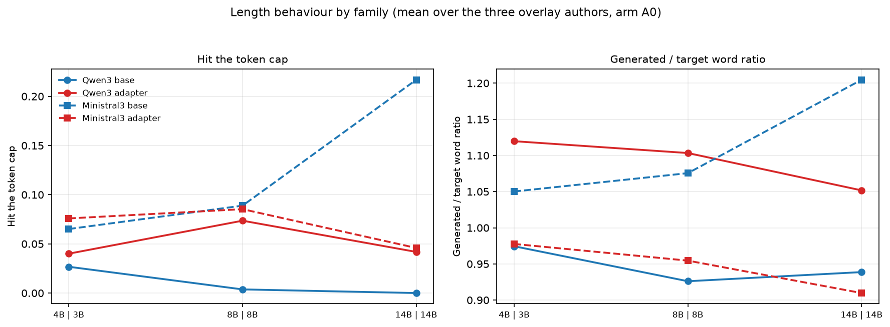
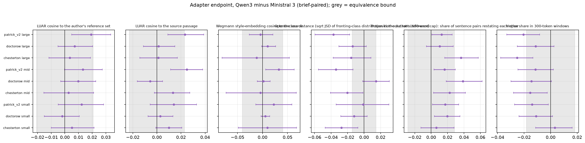
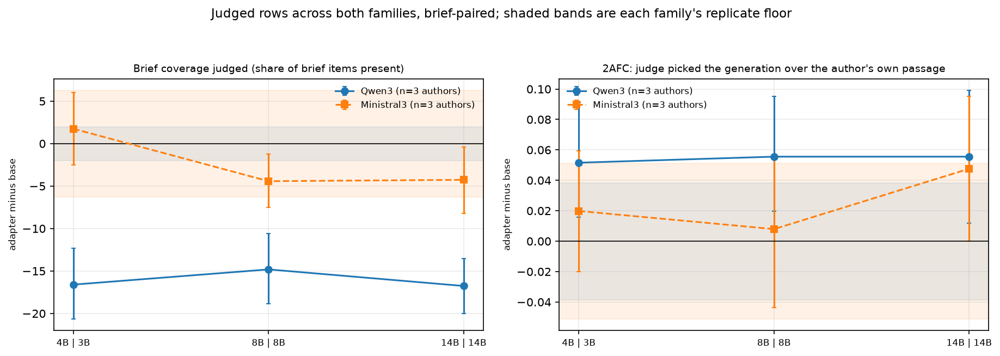

# 18_cross_family - Qwen3 against Ministral 3

## What this does

Overlays the Ministral 3 replication on the Qwen3 sweep for the three authors that were run in
both families (chesterton, doctorow, patrick_v2) at three matched size rungs (Qwen3 4B against Ministral 3B, then
8B against 8B, 14B against 14B). It reports, on arm A0 (brief only): the base level and the
adapter level in each family, the brief-paired adapter gain, the difference between the two
families at both the base level and the adapter endpoint, an equivalence test on the adapter
endpoints, the regression of gain on the head-room left to the author's own held-out ceiling,
a family x size interaction on gain, and the run-level record of each family (probe delta,
evaluation loss, truncation, length ratio).

The two LLM-judged rows are in the overlay on the same footing as the automatic ones. Judged
brief coverage and the 2AFC fool rate exist for both families now: 22
of the 22 Ministral 3 runs on these authors carry 2AFC verdicts and
22 carry coverage, produced on 2026-09-10 and 2026-09-11 by the same
two judges on the same prompts and the same sample-0 protocol as the Qwen3 records. That gives
755 judged coverage cells and 756 judged fool cells
on Ministral 3 in this A0 set, against 751 and 756
on Qwen3. judged_adapter_minus_base.csv holds the adapter-minus-base contrast on both rows, per
author and pooled over the three shared authors, in both families, each against its own family's
replicate floor.

270 adapter-vs-base contrasts (15 measures x 18
author x rung x family cells) and 135 cross-family endpoint tests were computed. These
3 authors are the whole Ministral 3 sample in the study, so every statement about a family
in this folder is a statement about 3 authors. The Qwen3 1.7B run on patrick_v2 has no
Ministral counterpart and is reported off the ladder in offladder_qwen17b.csv, not in the paired
tables.

## How it does it

Data: data/master/cells.parquet, arm A0, non-replicate rows, both samples; brief means are taken
first (the two samples of a cell are averaged) so that the brief is the unit inside an author.
Base and adapter runs share the same brief set in every cell here:
chesterton 39, doctorow 42, patrick_v2 45
briefs. Coverage and fool_vs_source are the exception: they are LLM-judged, present on sample 0
only, so the brief mean of a judged cell is that single sample rather than an average of two.
Both are present in both families (751 and 755
judged coverage cells, 756 and 756 judged fool cells,
Qwen3 and Ministral 3 respectively).

Unit and interval. Every contrast is brief-paired inside one author x rung x family and its 95%
interval is a cluster bootstrap over briefs (lib.cluster_bootstrap, 2000 resamples, seed 0).
Cohen's d and Cliff's delta are computed on the raw cell distributions of the two conditions.
p-values are Wilcoxon signed-rank on the per-brief differences and are BH-FDR adjusted inside the
script's two families of tests (adapter gain: 270 tests; base-level family difference:
135 tests). A q below 0.05 means survival inside one of those
two families of tests in this one script, not across the programme. The unit for any claim about a
family is the author, and there are 3 of them here.

Noise floors. Both families' floors are in floors.csv, each with the number of pairs or runs behind
it, and every pair behind them is listed in floor_pairs.csv with the rung it sits at. The
regeneration floor is what lib.replicate_floor computes from a family's twice-generated base
configurations: 5 pairs on Qwen3 at 4B, 8B, 14B and 4 pairs on Ministral 3 at
3B, 8B, 14B for the automatic measures. The judged rows have fewer, because a replicate run has to
have been judged as well as scored: coverage has 3 Qwen3 pairs at 4B, 8B, 14B and
4 Ministral 3 pairs at 3B, 8B, 14B, fool_vs_source 3 at
4B, 8B, 14B and 4 at 3B, 8B, 14B. No floor is borrowed across rungs any more:
the 2026-09-11 overnight added a chesterton replicate pair at 8B and at 14B in both families, so
each rung in the overlay has a same-size pair behind its family's floor. The seed-split floor is
the second floor: inside one base run,
the mean over sample 0 against the mean over sample 1, maximised over that family's base runs. It
is computed for both families over the same 3 authors (10 Qwen base runs
against 9 Ministral ones) so that the two families are not judged against
maxima taken over different numbers of runs; the floor over every Qwen base run in the study is
carried in the same table as floor_seed_all_runs and is larger. The floor quoted for a family is
the larger of the two floors available to it, and a contrast smaller than its floor is marked
within_noise whatever its q. On Ministral the regeneration floor sits below the seed-split floor on
some but not all measures that carry both,
so the seed-split floor is the one in force there; on Qwen the two alternate, and floor_used names
which one applies to each row. A gens.jsonl length-only fallback for the Ministral replicates is
still in the script for words, len_ratio and truncated, and it did not fire
(0 fallback rows used): those measures now have 4 scored Ministral pairs
of their own. The judged rows have no seed-split floor at all, because they exist on sample 0
only, so their floor is the regeneration floor and nothing else.

Gap-closing diagnostic. Gain (adapter minus base) and head-room (ceiling minus base) both contain
the base term, so a slope near 1 arises whenever the adapter endpoint is insensitive to where the
base started. gap_closing_diagnostics.csv therefore regresses the adapter endpoint on the base
level directly: its slope a, and 1 - a, is the mechanical part of the gap-closing slope when the
ceiling varies little across points, and the table reports the standard deviations of ceiling,
base and adapter so the reader can see which term is doing the work.

Gap closing. The ceiling for an author is the mean of that author's own held-out passages
(references.parquet, group = source, 50 passages per author per run)
on the same measure; it is identical across runs, so it is one number per author. Head-room is
ceiling minus the base mean; gain is the brief-paired adapter minus base. The fit is OLS over the
18 author x rung x family points with a point bootstrap CI, an author-cluster bootstrap
CI (3 clusters, so it is wide), and a leave-one-author-out range. The same fit over the full
Qwen3 sweep (39 points, 13 authors x 3 sizes) is reported as a
supplement.

Equivalence. For each author x rung x measure the two families' adapter endpoints are paired by
brief; TOST bounds are +/- the larger of the two families' floors, and the standard error is the
paired standard deviation over briefs divided by the root of the brief count.

Mixed models. lib.mixed_model (statsmodels MixedLM), gain ~ rung * fam_m with a random intercept
per author. There are 3 authors, so the random-effect variance is descriptive only.

### Adapter gain, brief-paired, by author x rung x family (voice anchor luar_cos_ref)

| author | family | params_b | gain | ci_low | ci_high | cohens_d | cliffs_delta | q_bh | floor | within_noise | n_briefs |
|---|---|---|---|---|---|---|---|---|---|---|---|
| chesterton | Ministral3 | 3.000 | 0.056 | 0.033 | 0.079 | 0.827 | 0.498 | 0.000 | 0.007 | False | 39 |
| chesterton | Ministral3 | 8.000 | 0.033 | 0.013 | 0.052 | 0.507 | 0.356 | 0.005 | 0.007 | False | 39 |
| chesterton | Ministral3 | 14.000 | 0.033 | 0.011 | 0.054 | 0.565 | 0.337 | 0.008 | 0.007 | False | 39 |
| chesterton | Qwen3 | 4.000 | 0.117 | 0.091 | 0.144 | 1.541 | 0.755 | 0.000 | 0.021 | False | 39 |
| chesterton | Qwen3 | 8.000 | 0.128 | 0.097 | 0.161 | 1.533 | 0.713 | 0.000 | 0.021 | False | 39 |
| chesterton | Qwen3 | 14.000 | 0.111 | 0.085 | 0.134 | 1.458 | 0.702 | 0.000 | 0.021 | False | 39 |
| doctorow | Ministral3 | 3.000 | -0.007 | -0.025 | 0.012 | -0.109 | -0.094 | 0.677 | 0.007 | True | 42 |
| doctorow | Ministral3 | 8.000 | -0.015 | -0.033 | 0.004 | -0.245 | -0.180 | 0.157 | 0.007 | False | 42 |
| doctorow | Ministral3 | 14.000 | -0.027 | -0.044 | -0.009 | -0.455 | -0.274 | 0.011 | 0.007 | False | 42 |
| doctorow | Qwen3 | 4.000 | 0.051 | 0.034 | 0.070 | 0.813 | 0.451 | 0.000 | 0.021 | False | 42 |
| doctorow | Qwen3 | 8.000 | 0.072 | 0.050 | 0.093 | 1.084 | 0.555 | 0.000 | 0.021 | False | 42 |
| doctorow | Qwen3 | 14.000 | 0.044 | 0.023 | 0.067 | 0.672 | 0.327 | 0.001 | 0.021 | False | 42 |
| patrick_v2 | Ministral3 | 3.000 | -0.062 | -0.077 | -0.046 | -1.159 | -0.609 | 0.000 | 0.007 | False | 45 |
| patrick_v2 | Ministral3 | 8.000 | -0.040 | -0.053 | -0.026 | -0.784 | -0.392 | 0.000 | 0.007 | False | 45 |
| patrick_v2 | Ministral3 | 14.000 | -0.036 | -0.052 | -0.020 | -0.639 | -0.267 | 0.000 | 0.007 | False | 45 |
| patrick_v2 | Qwen3 | 4.000 | -0.003 | -0.021 | 0.013 | -0.061 | 0.016 | 0.900 | 0.021 | True | 45 |
| patrick_v2 | Qwen3 | 8.000 | -0.005 | -0.020 | 0.012 | -0.076 | -0.078 | 0.641 | 0.021 | True | 45 |
| patrick_v2 | Qwen3 | 14.000 | -0.017 | -0.033 | -0.001 | -0.316 | -0.183 | 0.075 | 0.021 | True | 45 |

### Adapter gain on the construction row (per, 600-word cap; lower is better)

| author | family | params_b | gain | ci_low | ci_high | cohens_d | q_bh | floor | within_noise | n_briefs |
|---|---|---|---|---|---|---|---|---|---|---|
| chesterton | Ministral3 | 3.000 | 0.063 | 0.047 | 0.083 | 1.125 | 0.000 | 0.005 | False | 39 |
| chesterton | Ministral3 | 8.000 | 0.044 | 0.030 | 0.059 | 1.052 | 0.000 | 0.005 | False | 39 |
| chesterton | Ministral3 | 14.000 | 0.027 | 0.016 | 0.039 | 0.746 | 0.000 | 0.005 | False | 39 |
| chesterton | Qwen3 | 4.000 | 0.004 | -0.021 | 0.029 | 0.045 | 0.969 | 0.028 | True | 39 |
| chesterton | Qwen3 | 8.000 | 0.046 | 0.025 | 0.070 | 0.684 | 0.001 | 0.028 | False | 39 |
| chesterton | Qwen3 | 14.000 | 0.048 | 0.032 | 0.065 | 0.967 | 0.000 | 0.028 | False | 39 |
| doctorow | Ministral3 | 3.000 | 0.052 | 0.040 | 0.065 | 1.217 | 0.000 | 0.005 | False | 42 |
| doctorow | Ministral3 | 8.000 | 0.039 | 0.028 | 0.052 | 1.161 | 0.000 | 0.005 | False | 42 |
| doctorow | Ministral3 | 14.000 | 0.042 | 0.030 | 0.054 | 1.083 | 0.000 | 0.005 | False | 42 |
| doctorow | Qwen3 | 4.000 | -0.019 | -0.057 | 0.013 | -0.186 | 0.939 | 0.028 | True | 42 |
| doctorow | Qwen3 | 8.000 | 0.060 | 0.040 | 0.084 | 0.828 | 0.000 | 0.028 | False | 42 |
| doctorow | Qwen3 | 14.000 | 0.038 | 0.027 | 0.050 | 0.750 | 0.000 | 0.028 | False | 42 |
| patrick_v2 | Ministral3 | 3.000 | 0.023 | 0.012 | 0.034 | 0.619 | 0.000 | 0.005 | False | 45 |
| patrick_v2 | Ministral3 | 8.000 | 0.013 | 0.004 | 0.023 | 0.450 | 0.021 | 0.005 | False | 45 |
| patrick_v2 | Ministral3 | 14.000 | 0.007 | -0.001 | 0.016 | 0.242 | 0.295 | 0.005 | False | 45 |
| patrick_v2 | Qwen3 | 4.000 | -0.043 | -0.078 | -0.015 | -0.410 | 0.033 | 0.028 | False | 45 |
| patrick_v2 | Qwen3 | 8.000 | 0.017 | -0.000 | 0.033 | 0.355 | 0.020 | 0.028 | True | 45 |
| patrick_v2 | Qwen3 | 14.000 | 0.016 | 0.005 | 0.028 | 0.432 | 0.014 | 0.028 | True | 45 |

### Gap-closing fits

| measure | scope | n_points | slope | slope_lo | slope_hi | slope_lo_authorclust | slope_hi_authorclust | intercept | r2 | loo_slope_min | loo_slope_max |
|---|---|---|---|---|---|---|---|---|---|---|---|
| luar_cos_ref | overlay | 18 | 1.152 | 0.927 | 1.473 | 0.937 | 1.489 | -0.049 | 0.797 | 0.942 | 1.448 |
| luar_cos_ref | overlay:Qwen3 | 9 | 1.253 | 0.913 | 1.618 | 0.436 | 1.774 | -0.059 | 0.840 | 0.886 | 1.719 |
| luar_cos_ref | overlay:Ministral3 | 9 | 0.956 | 0.204 | 2.485 | -0.551 | 2.535 | -0.042 | 0.456 | -0.588 | 2.540 |
| wegmann_cos_ref | overlay | 18 | 0.971 | 0.919 | 1.015 | 0.952 | 1.502 | -0.010 | 0.977 | 0.954 | 1.011 |
| wegmann_cos_ref | overlay:Qwen3 | 9 | 0.976 | 0.642 | 1.087 | -3.904 | 1.383 | -0.007 | 0.955 | 0.815 | 1.023 |
| wegmann_cos_ref | overlay:Ministral3 | 9 | 0.932 | 0.861 | 0.994 | 0.016 | 1.468 | -0.014 | 0.987 | 0.836 | 0.983 |
| luar_cos_ref | full_qwen_sweep | 39 | 1.373 | 1.054 | 1.764 | 0.704 | 2.089 | -0.095 | 0.435 | 1.267 | 1.554 |
| wegmann_cos_ref | full_qwen_sweep | 39 | 0.780 | 0.323 | 1.462 | 0.097 | 2.226 | -0.056 | 0.082 | 0.562 | 0.994 |

### Family x size interaction on gain (MixedLM, groups = author, 3 groups)

| measure | model | estimate | se | ci_low | ci_high | p | n_obs | n_groups |
|---|---|---|---|---|---|---|---|---|
| luar_cos_ref | gain ~ rung * fam_m + (1|author) | 0.002 | 0.006 | -0.009 | 0.014 | 0.686 | 756 | 3 |
| luar_cos_ref | base level ~ rung * fam_m + (1|author) | -0.005 | 0.005 | -0.015 | 0.005 | 0.344 | 756 | 3 |
| luar_cos_source | gain ~ rung * fam_m + (1|author) | 0.001 | 0.006 | -0.010 | 0.013 | 0.824 | 756 | 3 |
| luar_cos_source | base level ~ rung * fam_m + (1|author) | -0.001 | 0.006 | -0.012 | 0.010 | 0.806 | 756 | 3 |
| wegmann_cos_source | gain ~ rung * fam_m + (1|author) | 0.030 | 0.013 | 0.004 | 0.055 | 0.022 | 756 | 3 |
| wegmann_cos_source | base level ~ rung * fam_m + (1|author) | -0.023 | 0.013 | -0.048 | 0.003 | 0.083 | 756 | 3 |
| otd_js | gain ~ rung * fam_m + (1|author) | -0.020 | 0.009 | -0.037 | -0.003 | 0.023 | 756 | 3 |
| otd_js | base level ~ rung * fam_m + (1|author) | 0.025 | 0.008 | 0.009 | 0.041 | 0.003 | 756 | 3 |
| per | gain ~ rung * fam_m + (1|author) | -0.037 | 0.005 | -0.048 | -0.026 | 0.000 | 756 | 3 |
| per | base level ~ rung * fam_m + (1|author) | 0.035 | 0.004 | 0.026 | 0.043 | 0.000 | 756 | 3 |
| hapax_w300 | gain ~ rung * fam_m + (1|author) | 0.033 | 0.004 | 0.025 | 0.041 | 0.000 | 756 | 3 |
| hapax_w300 | base level ~ rung * fam_m + (1|author) | -0.027 | 0.004 | -0.035 | -0.020 | 0.000 | 756 | 3 |
| len_ratio | gain ~ rung * fam_m + (1|author) | -0.098 | 0.024 | -0.144 | -0.051 | 0.000 | 756 | 3 |
| len_ratio | base level ~ rung * fam_m + (1|author) | 0.097 | 0.015 | 0.068 | 0.127 | 0.000 | 756 | 3 |
| truncated | gain ~ rung * fam_m + (1|author) | -0.105 | 0.022 | -0.148 | -0.062 | 0.000 | 756 | 3 |
| truncated | base level ~ rung * fam_m + (1|author) | 0.089 | 0.016 | 0.057 | 0.121 | 0.000 | 756 | 3 |

### Gap-closing diagnostics: the adapter endpoint regressed on the base level

| measure | scope | n_points | slope_adapter_on_base | ci_low | ci_high | intercept_adapter_on_base | r2_adapter_on_base | implied_gap_slope_1_minus | sd_ceiling | sd_base | sd_adapter | sd_headroom | corr_headroom_minus_base |
|---|---|---|---|---|---|---|---|---|---|---|---|---|---|
| luar_cos_ref | overlay | 18 | -0.411 | -0.695 | -0.055 | 1.186 | 0.235 | 1.411 | 0.021 | 0.036 | 0.030 | 0.044 | 0.888 |
| wegmann_cos_ref | overlay | 18 | 0.011 | -0.685 | 0.713 | 0.892 | 0.000 | 0.989 | 0.061 | 0.045 | 0.060 | 0.076 | 0.591 |
| luar_cos_ref | full_qwen_sweep | 39 | -1.214 | -1.733 | -0.789 | 1.817 | 0.383 | 2.214 | 0.018 | 0.022 | 0.043 | 0.028 | 0.762 |
| wegmann_cos_ref | full_qwen_sweep | 39 | 0.219 | -0.672 | 0.760 | 0.663 | 0.007 | 0.781 | 0.061 | 0.049 | 0.124 | 0.048 | 0.221 |

### Equivalence of the two families' adapter endpoints (TOST, bound = larger floor)

| author | rung_name | measure | adapter_qwen_minus_ministral | ci_low | ci_high | equiv_bound | p_equivalence | equivalent | diff_exceeds_bound |
|---|---|---|---|---|---|---|---|---|---|
| chesterton | small | luar_cos_source | 0.010 | -0.001 | 0.021 | 0.023 | 0.011 | True | False |
| chesterton | small | luar_cos_ref | 0.005 | -0.010 | 0.021 | 0.021 | 0.026 | True | False |
| chesterton | small | wegmann_cos_source | 0.010 | -0.048 | 0.068 | 0.041 | 0.160 | False | False |
| chesterton | small | otd_js | -0.027 | -0.047 | -0.007 | 0.014 | 0.893 | False | True |
| chesterton | small | hapax_w300 | 0.003 | -0.011 | 0.016 | 0.018 | 0.018 | True | False |
| chesterton | small | per | 0.006 | -0.012 | 0.028 | 0.028 | 0.016 | True | False |
| chesterton | mid | luar_cos_source | 0.013 | -0.002 | 0.027 | 0.023 | 0.114 | False | False |
| chesterton | mid | luar_cos_ref | 0.003 | -0.015 | 0.021 | 0.021 | 0.029 | True | False |
| chesterton | mid | wegmann_cos_source | -0.004 | -0.073 | 0.067 | 0.041 | 0.153 | False | False |
| chesterton | mid | otd_js | -0.020 | -0.041 | -0.001 | 0.014 | 0.723 | False | True |
| chesterton | mid | hapax_w300 | -0.015 | -0.028 | -0.003 | 0.018 | 0.328 | False | False |
| chesterton | mid | per | 0.022 | 0.003 | 0.042 | 0.028 | 0.277 | False | False |
| chesterton | large | luar_cos_source | 0.001 | -0.014 | 0.017 | 0.023 | 0.004 | True | False |
| chesterton | large | luar_cos_ref | 0.004 | -0.012 | 0.019 | 0.021 | 0.019 | True | False |
| chesterton | large | wegmann_cos_source | -0.012 | -0.081 | 0.054 | 0.041 | 0.205 | False | False |
| chesterton | large | otd_js | -0.016 | -0.037 | 0.008 | 0.014 | 0.546 | False | True |
| chesterton | large | hapax_w300 | -0.025 | -0.038 | -0.013 | 0.018 | 0.855 | False | True |
| chesterton | large | per | 0.036 | 0.016 | 0.057 | 0.028 | 0.782 | False | True |
| doctorow | small | luar_cos_source | 0.003 | -0.007 | 0.013 | 0.023 | 0.000 | True | False |
| doctorow | small | luar_cos_ref | -0.002 | -0.015 | 0.011 | 0.021 | 0.003 | True | False |
| doctorow | small | wegmann_cos_source | 0.005 | -0.003 | 0.014 | 0.041 | 0.000 | True | False |
| doctorow | small | otd_js | -0.012 | -0.028 | 0.004 | 0.014 | 0.388 | False | False |
| doctorow | small | hapax_w300 | -0.011 | -0.024 | 0.002 | 0.018 | 0.136 | False | False |
| doctorow | small | per | 0.020 | 0.004 | 0.035 | 0.028 | 0.144 | False | False |
| doctorow | mid | luar_cos_source | -0.006 | -0.016 | 0.005 | 0.023 | 0.001 | True | False |
| doctorow | mid | luar_cos_ref | 0.010 | -0.003 | 0.023 | 0.021 | 0.046 | True | False |
| doctorow | mid | wegmann_cos_source | 0.002 | -0.010 | 0.015 | 0.041 | 0.000 | True | False |
| doctorow | mid | otd_js | 0.015 | -0.002 | 0.031 | 0.014 | 0.506 | False | True |
| doctorow | mid | hapax_w300 | -0.014 | -0.030 | 0.001 | 0.018 | 0.311 | False | False |
| doctorow | mid | per | 0.039 | 0.018 | 0.062 | 0.028 | 0.816 | False | True |
| doctorow | large | luar_cos_source | 0.001 | -0.011 | 0.015 | 0.023 | 0.000 | True | False |
| doctorow | large | luar_cos_ref | 0.007 | -0.005 | 0.020 | 0.021 | 0.023 | True | False |
| doctorow | large | wegmann_cos_source | 0.010 | -0.002 | 0.026 | 0.041 | 0.000 | True | False |
| doctorow | large | otd_js | -0.014 | -0.031 | 0.003 | 0.014 | 0.474 | False | False |
| doctorow | large | hapax_w300 | -0.011 | -0.025 | 0.003 | 0.018 | 0.153 | False | False |
| doctorow | large | per | 0.010 | -0.006 | 0.027 | 0.028 | 0.015 | True | False |
| patrick_v2 | small | luar_cos_source | 0.014 | -0.006 | 0.033 | 0.023 | 0.182 | False | False |
| patrick_v2 | small | luar_cos_ref | 0.012 | -0.005 | 0.028 | 0.021 | 0.156 | False | False |
| patrick_v2 | small | wegmann_cos_source | 0.022 | -0.013 | 0.059 | 0.041 | 0.158 | False | False |
| patrick_v2 | small | otd_js | -0.001 | -0.034 | 0.030 | 0.014 | 0.201 | False | False |
| patrick_v2 | small | hapax_w300 | -0.014 | -0.027 | -0.002 | 0.018 | 0.259 | False | False |
| patrick_v2 | small | per | 0.017 | 0.002 | 0.034 | 0.028 | 0.087 | False | False |
| patrick_v2 | mid | luar_cos_source | 0.025 | 0.011 | 0.038 | 0.023 | 0.616 | False | True |
| patrick_v2 | mid | luar_cos_ref | 0.013 | -0.000 | 0.027 | 0.021 | 0.150 | False | False |
| patrick_v2 | mid | wegmann_cos_source | 0.032 | 0.006 | 0.063 | 0.041 | 0.281 | False | False |
| patrick_v2 | mid | otd_js | -0.034 | -0.055 | -0.013 | 0.014 | 0.965 | False | True |
| patrick_v2 | mid | hapax_w300 | -0.011 | -0.025 | 0.002 | 0.018 | 0.167 | False | False |
| patrick_v2 | mid | per | 0.016 | 0.004 | 0.029 | 0.028 | 0.028 | True | False |
| patrick_v2 | large | luar_cos_source | 0.023 | 0.009 | 0.039 | 0.023 | 0.526 | False | True |
| patrick_v2 | large | luar_cos_ref | 0.019 | 0.005 | 0.034 | 0.021 | 0.418 | False | False |
| patrick_v2 | large | wegmann_cos_source | -0.004 | -0.026 | 0.021 | 0.041 | 0.001 | True | False |
| patrick_v2 | large | otd_js | -0.037 | -0.059 | -0.017 | 0.014 | 0.982 | False | True |
| patrick_v2 | large | hapax_w300 | -0.021 | -0.033 | -0.008 | 0.018 | 0.633 | False | True |
| patrick_v2 | large | per | 0.013 | 0.001 | 0.025 | 0.028 | 0.006 | True | False |

### The judged rows, adapter minus base, both families, pooled over the three shared authors

| measure | family | params_b | rung_name | n_authors | n_briefs | base_mean | adapter_mean | adapter_minus_base | ci_low | ci_high | q_bh | floor | within_noise |
|---|---|---|---|---|---|---|---|---|---|---|---|---|---|
| coverage | Ministral3 | 3.000 | small | 3 | 126 | 61.198 | 62.944 | 1.746 | -2.541 | 6.001 | 0.400 | 6.282 | True |
| coverage | Ministral3 | 8.000 | mid | 3 | 125 | 83.920 | 79.496 | -4.424 | -7.488 | -1.256 | 0.033 | 6.282 | True |
| coverage | Ministral3 | 14.000 | large | 3 | 126 | 86.302 | 82.040 | -4.262 | -8.238 | -0.420 | 0.026 | 6.282 | True |
| coverage | Qwen3 | 4.000 | small | 3 | 125 | 82.160 | 65.560 | -16.600 | -20.673 | -12.335 | 0.000 | 1.974 | False |
| coverage | Qwen3 | 8.000 | mid | 3 | 122 | 87.041 | 72.230 | -14.811 | -18.870 | -10.606 | 0.000 | 1.974 | False |
| coverage | Qwen3 | 14.000 | large | 3 | 126 | 92.683 | 75.921 | -16.762 | -20.000 | -13.523 | 0.000 | 1.974 | False |
| fool_vs_source | Ministral3 | 3.000 | small | 3 | 126 | 0.079 | 0.099 | 0.020 | -0.020 | 0.060 | 0.424 | 0.051 | True |
| fool_vs_source | Ministral3 | 8.000 | mid | 3 | 126 | 0.116 | 0.124 | 0.008 | -0.044 | 0.057 | 0.504 | 0.051 | True |
| fool_vs_source | Ministral3 | 14.000 | large | 3 | 126 | 0.111 | 0.159 | 0.048 | 0.000 | 0.095 | 0.118 | 0.051 | True |
| fool_vs_source | Qwen3 | 4.000 | small | 3 | 126 | 0.040 | 0.091 | 0.052 | 0.016 | 0.091 | 0.065 | 0.038 | False |
| fool_vs_source | Qwen3 | 8.000 | mid | 3 | 126 | 0.056 | 0.111 | 0.056 | 0.020 | 0.095 | 0.065 | 0.038 | False |
| fool_vs_source | Qwen3 | 14.000 | large | 3 | 126 | 0.079 | 0.135 | 0.056 | 0.012 | 0.099 | 0.065 | 0.038 | False |

### The same judged contrasts per author

| measure | author | family | params_b | base_mean | adapter_mean | adapter_minus_base | ci_low | ci_high | q_bh | floor | within_noise | n_briefs |
|---|---|---|---|---|---|---|---|---|---|---|---|---|
| coverage | chesterton | Ministral3 | 3.000 | 60.615 | 69.564 | 8.949 | 0.561 | 17.233 | 0.066 | 6.282 | False | 39 |
| coverage | doctorow | Ministral3 | 3.000 | 57.500 | 56.905 | -0.595 | -5.810 | 4.929 | 0.790 | 6.282 | True | 42 |
| coverage | patrick_v2 | Ministral3 | 3.000 | 65.156 | 62.844 | -2.311 | -10.201 | 5.356 | 0.733 | 6.282 | True | 45 |
| coverage | chesterton | Ministral3 | 8.000 | 85.872 | 80.282 | -5.590 | -12.078 | -0.205 | 0.258 | 6.282 | True | 39 |
| coverage | doctorow | Ministral3 | 8.000 | 80.048 | 70.976 | -9.317 | -14.537 | -4.097 | 0.004 | 6.282 | False | 41 |
| coverage | patrick_v2 | Ministral3 | 8.000 | 85.533 | 86.578 | 1.044 | -3.512 | 5.644 | 0.558 | 6.282 | True | 45 |
| coverage | chesterton | Ministral3 | 14.000 | 85.692 | 82.436 | -3.256 | -11.156 | 4.668 | 0.385 | 6.282 | True | 39 |
| coverage | doctorow | Ministral3 | 14.000 | 87.571 | 76.690 | -10.881 | -15.646 | -5.929 | 0.001 | 6.282 | False | 42 |
| coverage | patrick_v2 | Ministral3 | 14.000 | 85.644 | 86.689 | 1.044 | -5.623 | 7.689 | 0.733 | 6.282 | True | 45 |
| coverage | chesterton | Qwen3 | 4.000 | 83.872 | 72.564 | -11.308 | -19.692 | -3.281 | 0.030 | 1.974 | False | 39 |
| coverage | doctorow | Qwen3 | 4.000 | 78.357 | 61.049 | -17.268 | -24.171 | -10.755 | 0.000 | 1.974 | False | 41 |
| coverage | patrick_v2 | Qwen3 | 4.000 | 84.178 | 63.600 | -20.578 | -26.867 | -14.333 | 0.000 | 1.974 | False | 45 |
| coverage | chesterton | Qwen3 | 8.000 | 89.590 | 77.538 | -12.051 | -19.231 | -3.949 | 0.001 | 1.974 | False | 39 |
| coverage | doctorow | Qwen3 | 8.000 | 82.098 | 65.200 | -17.205 | -25.026 | -9.359 | 0.000 | 1.974 | False | 39 |
| coverage | patrick_v2 | Qwen3 | 8.000 | 89.133 | 74.091 | -15.136 | -21.251 | -9.318 | 0.000 | 1.974 | False | 44 |
| coverage | chesterton | Qwen3 | 14.000 | 93.590 | 77.692 | -15.897 | -21.129 | -10.589 | 0.000 | 1.974 | False | 39 |
| coverage | doctorow | Qwen3 | 14.000 | 91.333 | 73.667 | -17.667 | -22.072 | -13.261 | 0.000 | 1.974 | False | 42 |
| coverage | patrick_v2 | Qwen3 | 14.000 | 93.156 | 76.489 | -16.667 | -23.311 | -10.133 | 0.000 | 1.974 | False | 45 |
| fool_vs_source | chesterton | Ministral3 | 3.000 | 0.013 | 0.051 | 0.038 | -0.013 | 0.090 | 0.288 | 0.051 | True | 39 |
| fool_vs_source | doctorow | Ministral3 | 3.000 | 0.024 | 0.095 | 0.071 | 0.024 | 0.131 | 0.065 | 0.051 | False | 42 |
| fool_vs_source | patrick_v2 | Ministral3 | 3.000 | 0.189 | 0.144 | -0.044 | -0.133 | 0.044 | 0.423 | 0.051 | True | 45 |
| fool_vs_source | chesterton | Ministral3 | 8.000 | 0.051 | 0.154 | 0.103 | 0.026 | 0.179 | 0.065 | 0.051 | False | 39 |
| fool_vs_source | doctorow | Ministral3 | 8.000 | 0.095 | 0.071 | -0.024 | -0.119 | 0.071 | 0.614 | 0.051 | True | 42 |
| fool_vs_source | patrick_v2 | Ministral3 | 8.000 | 0.193 | 0.148 | -0.044 | -0.133 | 0.030 | 0.461 | 0.051 | True | 45 |
| fool_vs_source | chesterton | Ministral3 | 14.000 | 0.026 | 0.179 | 0.154 | 0.090 | 0.231 | 0.013 | 0.051 | False | 39 |
| fool_vs_source | doctorow | Ministral3 | 14.000 | 0.083 | 0.179 | 0.095 | 0.000 | 0.179 | 0.099 | 0.051 | False | 42 |
| fool_vs_source | patrick_v2 | Ministral3 | 14.000 | 0.211 | 0.122 | -0.089 | -0.167 | -0.011 | 0.081 | 0.051 | False | 45 |
| fool_vs_source | chesterton | Qwen3 | 4.000 | 0.013 | 0.090 | 0.077 | 0.013 | 0.141 | 0.081 | 0.038 | False | 39 |
| fool_vs_source | doctorow | Qwen3 | 4.000 | 0.000 | 0.060 | 0.060 | 0.012 | 0.107 | 0.076 | 0.038 | False | 42 |
| fool_vs_source | patrick_v2 | Qwen3 | 4.000 | 0.100 | 0.122 | 0.022 | -0.044 | 0.100 | 0.550 | 0.038 | True | 45 |
| fool_vs_source | chesterton | Qwen3 | 8.000 | 0.026 | 0.090 | 0.064 | -0.013 | 0.141 | 0.164 | 0.038 | False | 39 |
| fool_vs_source | doctorow | Qwen3 | 8.000 | 0.012 | 0.071 | 0.060 | 0.012 | 0.131 | 0.118 | 0.038 | False | 42 |
| fool_vs_source | patrick_v2 | Qwen3 | 8.000 | 0.122 | 0.167 | 0.044 | -0.033 | 0.122 | 0.350 | 0.038 | False | 45 |
| fool_vs_source | chesterton | Qwen3 | 14.000 | 0.038 | 0.128 | 0.090 | 0.026 | 0.154 | 0.067 | 0.038 | False | 39 |
| fool_vs_source | doctorow | Qwen3 | 14.000 | 0.048 | 0.095 | 0.048 | -0.024 | 0.119 | 0.309 | 0.038 | False | 42 |
| fool_vs_source | patrick_v2 | Qwen3 | 14.000 | 0.144 | 0.178 | 0.033 | -0.044 | 0.111 | 0.501 | 0.038 | True | 45 |

### Noise floors used

| measure | family | floor_regen | n_regen_pairs | floor_seed_overlay | n_seed_runs_overlay | floor_seed_all_runs | n_seed_runs_all | floor_used |
|---|---|---|---|---|---|---|---|---|
| luar_cos_source | Qwen3 | 0.023 | 5 | 0.015 | 10 | 0.033 | 41 | 0.023 |
| luar_cos_source | Ministral3 | 0.011 | 4 | 0.010 | 9 | 0.010 | 9 | 0.011 |
| luar_cos_ref | Qwen3 | 0.021 | 5 | 0.019 | 10 | 0.027 | 41 | 0.021 |
| luar_cos_ref | Ministral3 | 0.006 | 4 | 0.007 | 9 | 0.007 | 9 | 0.007 |
| wegmann_cos_source | Qwen3 | 0.041 | 5 | 0.037 | 10 | 0.097 | 41 | 0.041 |
| wegmann_cos_source | Ministral3 | 0.030 | 4 | 0.035 | 9 | 0.035 | 9 | 0.035 |
| wegmann_cos_ref | Qwen3 | 0.043 | 5 | 0.052 | 10 | 0.090 | 41 | 0.052 |
| wegmann_cos_ref | Ministral3 | 0.004 | 4 | 0.034 | 9 | 0.034 | 9 | 0.034 |
| styledist_cos_source | Qwen3 | 0.011 | 5 | 0.012 | 10 | 0.012 | 41 | 0.012 |
| styledist_cos_source | Ministral3 | 0.003 | 4 | 0.009 | 9 | 0.009 | 9 | 0.009 |
| geo_index | Qwen3 | 0.064 | 5 | 0.134 | 10 | 0.200 | 41 | 0.134 |
| geo_index | Ministral3 | 0.028 | 4 | 0.115 | 9 | 0.115 | 9 | 0.115 |
| otd_js | Qwen3 | 0.005 | 5 | 0.014 | 10 | 0.045 | 41 | 0.014 |
| otd_js | Ministral3 | 0.006 | 4 | 0.013 | 9 | 0.013 | 9 | 0.013 |
| hapax_w300 | Qwen3 | 0.015 | 5 | 0.018 | 10 | 0.019 | 41 | 0.018 |
| hapax_w300 | Ministral3 | 0.006 | 4 | 0.008 | 9 | 0.008 | 9 | 0.008 |
| per | Qwen3 | 0.010 | 5 | 0.028 | 10 | 0.035 | 41 | 0.028 |
| per | Ministral3 | 0.004 | 4 | 0.005 | 9 | 0.005 | 9 | 0.005 |
| per_uncapped | Qwen3 | 0.025 | 5 | 0.043 | 10 | 0.043 | 41 | 0.043 |
| per_uncapped | Ministral3 | 0.004 | 4 | 0.008 | 9 | 0.008 | 9 | 0.008 |
| coverage | Qwen3 | 1.974 | 3 |  | 0 |  | 1 | 1.974 |
| coverage | Ministral3 | 6.282 | 4 |  | 0 |  | 0 | 6.282 |
| fool_vs_source | Qwen3 | 0.038 | 3 |  | 0 |  | 1 | 0.038 |
| fool_vs_source | Ministral3 | 0.051 | 4 |  | 0 |  | 0 | 0.051 |
| len_ratio | Qwen3 | 0.062 | 5 | 0.122 | 10 | 0.122 | 41 | 0.122 |
| len_ratio | Ministral3 | 0.055 | 4 | 0.075 | 9 | 0.075 | 9 | 0.075 |
| truncated | Qwen3 | 0.012 | 5 | 0.111 | 10 | 0.111 | 41 | 0.111 |
| truncated | Ministral3 | 0.038 | 4 | 0.167 | 9 | 0.167 | 9 | 0.167 |
| words | Qwen3 | 47.634 | 5 | 84.956 | 10 | 84.956 | 41 | 84.956 |
| words | Ministral3 | 36.795 | 4 | 47.689 | 9 | 47.689 | 9 | 47.689 |

### Replicate pairs behind the regeneration floors, with the rung each sits at

| measure | family | pair | params_b | n_briefs | abs_mean_diff |
|---|---|---|---|---|---|
| luar_cos_ref | Qwen3 | base4b vs base4b_r2 | 4.000 | 88 | 0.009 |
| luar_cos_ref | Qwen3 | chesterton_base4b vs chesterton_base4bc | 4.000 | 78 | 0.021 |
| luar_cos_ref | Qwen3 | mansfield_base4b vs mansfield_base4b_r2 | 4.000 | 82 | 0.020 |
| luar_cos_ref | Ministral3 | chesterton_basem3b vs chesterton_basem3b_r2 | 3.000 | 78 | 0.002 |
| luar_cos_ref | Ministral3 | patrick_v2_basem3b vs patrick_v2_basem3b_r2 | 3.000 | 90 | 0.001 |
| luar_cos_ref | Qwen3 | chesterton_base8b vs chesterton_base8b_r2 | 8.000 | 78 | 0.017 |
| luar_cos_ref | Qwen3 | chesterton_base14b vs chesterton_base14b_r2 | 14.000 | 78 | 0.010 |
| luar_cos_ref | Ministral3 | chesterton_basem8b vs chesterton_basem8b_r2 | 8.000 | 78 | 0.006 |
| luar_cos_ref | Ministral3 | chesterton_basem14b vs chesterton_basem14b_r2 | 14.000 | 78 | 0.003 |
| coverage | Qwen3 | chesterton_base4b vs chesterton_base4bc | 4.000 | 39 | 1.974 |
| coverage | Ministral3 | chesterton_basem3b vs chesterton_basem3b_r2 | 3.000 | 39 | 5.538 |
| coverage | Ministral3 | patrick_v2_basem3b vs patrick_v2_basem3b_r2 | 3.000 | 45 | 3.422 |
| coverage | Qwen3 | chesterton_base8b vs chesterton_base8b_r2 | 8.000 | 39 | 0.154 |
| coverage | Qwen3 | chesterton_base14b vs chesterton_base14b_r2 | 14.000 | 39 | 0.333 |
| coverage | Ministral3 | chesterton_basem8b vs chesterton_basem8b_r2 | 8.000 | 39 | 3.615 |
| coverage | Ministral3 | chesterton_basem14b vs chesterton_basem14b_r2 | 14.000 | 39 | 6.282 |
| fool_vs_source | Qwen3 | chesterton_base4b vs chesterton_base4bc | 4.000 | 39 | 0.013 |
| fool_vs_source | Ministral3 | chesterton_basem3b vs chesterton_basem3b_r2 | 3.000 | 39 | 0.013 |
| fool_vs_source | Ministral3 | patrick_v2_basem3b vs patrick_v2_basem3b_r2 | 3.000 | 45 | 0.022 |
| fool_vs_source | Qwen3 | chesterton_base8b vs chesterton_base8b_r2 | 8.000 | 39 | 0.026 |
| fool_vs_source | Qwen3 | chesterton_base14b vs chesterton_base14b_r2 | 14.000 | 39 | 0.038 |
| fool_vs_source | Ministral3 | chesterton_basem8b vs chesterton_basem8b_r2 | 8.000 | 39 | 0.051 |
| fool_vs_source | Ministral3 | chesterton_basem14b vs chesterton_basem14b_r2 | 14.000 | 39 | 0.026 |

### Family summary from the run records

| field | Qwen3 | Ministral3 |
|---|---|---|
| family | Qwen3 | Ministral3 |
| n_adapter_runs | 10 | 9 |
| n_base_runs | 10 | 9 |
| probe_delta_mean | -0.5937 | -0.1385 |
| probe_delta_min | -1.1123 | -0.2393 |
| probe_delta_max | -0.2198 | 0.0008 |
| eval_improvement_mean | 0.0642 | 0.0067 |
| train_steps_mean | 124.0 | 97.1111 |
| truncated_pct_base_mean | 2.2222 | 15.3619 |
| truncated_pct_adapter_mean | 6.9178 | 7.4386 |
| trunc_rate_A0_base | 0.0106 | 0.1217 |
| trunc_rate_A0_adapter | 0.0503 | 0.0675 |
| len_ratio_A0_base | 0.9478 | 1.1104 |
| len_ratio_A0_adapter | 1.0876 | 0.942 |
| adapter_served | lora | merged |
| n_authors | 3 | 3 |
| n_runs_judged_2afc | 24 | 22 |
| n_runs_with_coverage | 24 | 22 |
| n_runs_total | 24 | 22 |
| coverage_cells_A0 | 751 | 755 |
| fool_cells_A0 | 756 | 756 |
| rubric_cells_A0 | 672 | 756 |
| coverage_A0_base | 87.2653 | 77.1032 |
| coverage_A0_adapter | 71.2647 | 74.8143 |
| fool_A0_base | 0.0582 | 0.1023 |
| fool_A0_adapter | 0.1124 | 0.1274 |

### Base and adapter across the two families

### Construction and structure across the two families

### Adapter gain by rung, with the noise band

### Gap closing

### Length and truncation by family

### Adapter endpoints, family difference with equivalence bounds

### The judged rows in both families, against each family's floor

Runtime 163.5 s. Rows in cells.parquet used: 3024 (arm A0, non-replicate, three overlay authors, matched rungs).

## How to read the result, conservatively

Unit of replication. 3 authors, which is the whole Ministral 3 sample. Every cross-family
statement in this folder rests on chesterton, doctorow, patrick_v2, and the brief-level intervals are much narrower
than the author-level uncertainty they sit inside. The adapters were fitted on chesterton 1290, doctorow 1290, patrick_v2 624
examples respectively (train_examples in run_level_family.csv), so the corpus-size axis is not
crossed with family here.

What the numbers say, conservatively.

1. The voice gain is not a family-level effect in these 3 authors. On luar_cos_ref, of the 9
Qwen3 author x rung cells 6 move toward the author beyond the floor at q < 0.05
(chesterton, doctorow), 0 move away
(none) and 3 sit inside the floor; of the 9
Ministral cells 3 move toward the author (chesterton),
4 move away (doctorow, patrick_v2) and 1 sit
inside the floor. Cells that clear the floor without clearing BH-FDR fall into none of those
counts. Qwen3 gains run
-0.017 to 0.128 (floor 0.021)
and Ministral gains -0.062 to 0.056
(floor 0.007, and that floor is the smaller of the
two, so a Ministral cell clears its floor more easily than a Qwen one of the same size). The sign
tracks the author rather than the family: with 3 authors that is a description of
3 cases, not a rate.

1b. Scale. The rung term in the mixed model on luar_cos_ref gain is
-0.0046
[-0.0129, 0.0038]
per rung and the rung x family interaction is
0.0024
[-0.0094, 0.0142],
both against a floor of 0.021 for one whole rung's worth of
movement. Read that as no size trend large enough to see at this floor, not as evidence that the
size effect is zero. The random intercept is estimated from 3 groups (n_groups and
re_var_author in mixed_models.csv), so the interaction p-values are descriptive.

2. 80 of the 270 adapter-vs-base contrasts are smaller than their own noise floor and are
reported as within noise regardless of q; 165 clear the floor and survive BH-FDR at q < 0.05
within this script's family of 270 gain tests. The remainder clear the floor without
clearing the correction. Read the floor column before the q column, and note that q here is
corrected within one script, not across the programme (see 22_multiple_comparisons_and_sensitivity).

3. The gap-closing slope on luar_cos_ref is 1.152 [0.927, 1.473]
(author-cluster interval [0.937, 1.489], leave-one-author-out
range 0.942 to 1.448), and on wegmann_cos_ref it is
0.971 [0.919, 1.015], against a slope of 1 for a mechanism that
closes the whole distance to the author. Read this with the diagnostic, not on its own: gain and
head-room share the base term, so the slope is close to 1 exactly when the adapter lands in the
same place whatever the base did. Regressing the adapter endpoint on the base level gives a slope
of -0.411 [-0.695, -0.055] on luar_cos_ref and
0.011 [-0.685, 0.713] on wegmann_cos_ref, with the
adapter endpoint varying by 0.030 (SD) against 0.036 for the base and
0.021 for the ceiling. The honest statement is about where the adapter arrives, not
about a distance it travels: the endpoint is largely independent of the starting point, and the
intercept -0.049 [-0.078, -0.029] is what the adapter
buys once there is no head-room left. With 18 points and three authors this is a
descriptive slope, not an estimate of a population parameter.

4. Equivalence is not established by a wide interval. 47 of 135 endpoint comparisons pass TOST
at the floor-width bound and 37 have a difference larger than the bound; the rest are simply
undecided at this sample size. Do not read a failed TOST as a family difference or a passed TOST
as identity.

5. The construction cost is the part that appears in both families. On per (proposition echo, lower
is better) 4 of 9 Qwen cells and 8 of 9 Ministral cells get worse
beyond the floor while 1 and 0 get better; on hapax_w300 the adapter narrows
vocabulary in 9 of 9 Qwen cells and 9 of 9 Ministral cells, and the
Ministral mean is the larger of the two (Qwen -0.080
mean against Ministral -0.152,
Cohen's d down to -4.23). Those are counts of
author x rung cells over 3 authors, not a rate over authors, and the two families' floors
differ, so read this as the narrowing and the echo cost being present in both families rather than
as a measured family difference. Proposition echo is close to permutation-invariant, so per
registers restatement between sentences and not the order they arrive in.

6. The judged rows now exist in both families, and they say different things. On judged brief
coverage, pooled over the three shared authors and brief-paired, the adapter costs
4B -16.600 [-20.673, -12.335]; 8B -14.811 [-18.870, -10.606]; 14B -16.762 [-20.000, -13.523] on Qwen3 and 3B +1.746 [-2.541, +6.001]; 8B -4.424 [-7.488, -1.256]; 14B -4.262 [-8.238, -0.420] on Ministral 3
(judged_adapter_minus_base.csv), against coverage floors of
1.97 and 6.28
points. 0 of the 3 pooled Qwen3 rungs sit inside the Qwen3 floor and
3 of the 3 Ministral 3 rungs sit inside the larger Ministral 3 floor. The
Qwen3 contrast is larger in absolute size than the Ministral 3 one at
every matched rung. That is a
description of these 3 authors and two recipes, not a family law: the two families were
tuned differently and their floors differ by a factor of
3.2.
On the 2AFC fool rate the adapter moves it
4B +0.052 [+0.016, +0.091]; 8B +0.056 [+0.020, +0.095]; 14B +0.056 [+0.012, +0.099] on Qwen3 and 3B +0.020 [-0.020, +0.060]; 8B +0.008 [-0.044, +0.057]; 14B +0.048 [+0.000, +0.095] on
Ministral 3, against floors of 0.038 and
0.051; 0 of 3 Qwen3
rungs and 3 of 3 Ministral 3 rungs sit inside their own family's floor.
Both are readings from one pair of judges whose own levels differ by a factor of about three
(16_judges, afc_rates_by_judge.csv), and cells.parquet averages the two judges into one
fool_vs_source value, so the per-judge split lives in 16_judges and not here. The sign and the
ordering across rungs are what this supports, not the level. 12 of the
36 per-author judged contrasts sit inside their own family's floor.

What would overturn this. A fourth and fifth author in the second family would move the
author-level uncertainty more than any additional brief could: every cross-family number here
rests on 3 authors. A second judge pair, or a human 2AFC panel, would settle whether the
judged rows are measuring anything a reader would call adherence or voice; the fool rate in
particular is a judge endpoint, not a human one. The Ministral adapters are served as merged F16
weights rather than runtime LoRA, so a difference between families is a difference between two
whole serving paths, not between two adapters.

What this does not show. It does not show that one family emulates authors better than the other:
the second family was deliberately not tuned, its judge rows come from a later batch than the
Qwen3 ones even though the judges, prompts and protocol are the same, and its truncation gate was
report-only. It says nothing about arms other than A0.

## Caveats

- The gap-closing regression is partly mechanical: gain and head-room share the base term. With the ceiling varying by 0.021 (SD) against 0.036 for the base on luar_cos_ref, a slope near 1 is what an adapter endpoint that ignores its starting point produces. gap_closing_diagnostics.csv gives the adapter-on-base regression that says so directly; quote that, or quote the slope only alongside it.
- 0 of the 16 mixed models have a singular author random-effect variance (singular_re in mixed_models.csv). Whatever that count, the random intercept is fitted over 3 groups, so its variance is descriptive rather than an estimate of between-author spread, and the p-values on the interaction terms should be read the same way.
- The regeneration floors now rest on same-size pairs in both families: 4 Ministral 3 pairs at 3B, 8B, 14B and 5 Qwen3 pairs at 4B, 8B, 14B on the automatic measures, 4 and 3 on coverage, 4 and 3 on fool_vs_source (floor_pairs.csv lists every pair and its rung). No floor is borrowed across rungs. Each rung's floor is still one pair per family per size, and every 8B and 14B pair is chesterton, so a floor is an estimate from one author at that rung.
- Both families are judged, but on 3 authors only, and the Ministral 3 judge records come from a later batch (2026-09-10 and 2026-09-11) than the Qwen3 ones. The judges, prompts, item orders and sample-0 protocol are identical, so this is one instrument read twice, but nothing here measures judge drift between batches.
- Coverage and fool_vs_source are LLM-judged relative instruments, not ground truth. Coverage is not a check that the brief was covered and the fool rate is not a measurement of how often a reader would be fooled; the two judges differ by a factor of about three on the fool rate (16_judges). Ten runs' coverage and 2AFC rows were error rows from the 2026-09-09 credit outage and are being regenerated; until that rerun lands, a missing judged cell here is a missing judge call, not a run that scored zero.
- The judged rows exist on sample 0 only, so they have no seed-split floor and no within-cell test-retest of their own. Their floor is the regeneration floor alone: 1.97 and 6.28 coverage points, 0.038 and 0.051 on the fool rate. The Ministral floors are the larger of the two on both rows, so a Ministral judged contrast has to be bigger to clear its own noise.
- Two of the three overlay authors are not period authors (doctorow contemporary, patrick_v2 private) and the pipeline anchors every author against the same fourteen-author period stranger pool, so their position relative to other authors, and geo_index with it, is measured against a different century. The ceilings and the *_cos_ref anchors used here come from each author's own held-out passages and do not depend on that pool; 23_register_matched_pool holds the register-matched comparison, where contemporary and private authors move down by more than the adapter gain.
- Ministral adapters are served as merged F16 weights (adapter_served = merged) while Qwen adapters are runtime LoRA (adapter_served = lora); the Ministral checkpoints are FP8 and were dequantised for training and for serving. A family contrast therefore contains a serving-path contrast.
- The Ministral training probe is far weaker than the Qwen one (probe delta mean -0.138, range -0.239 to 0.001, against -0.594 and -1.112 to -0.220 on Qwen), and 1 adapter (chesterton_paire6_m8b) has a positive probe delta, meaning its training probe moved the wrong way and the fit changed nothing the probe could measure. The recipe was not tuned for the family; that is the design, not a defect, but it caps how much of a null result can be attributed to the family rather than to the recipe.
- Truncation was gated on Qwen and report-only on Ministral. 3 runs in run_level_family.csv sit above the 20 percent truncation criterion (doctorow_basem8b 26.6%, doctorow_basem14b 23.6%, patrick_v2_paire6_17b 20.4%), 1 of them still carrying gate_generation_ok = True, so the stored gate verdict and the recorded percentage do not agree on every run. truncated_pct pools all arms while the cells analysed here are A0 only; the A0 rates are trunc_rate_A0_base and trunc_rate_A0_adapter in family_summary.csv. Truncation is not balanced across families, so any measure that moves with length is confounded with it here (see 17_length_truncation).
- Size rungs are matched by position on the ladder, not by parameter count: the Ministral 3B run stands opposite the Qwen 4B run. The mixed models use the rung index; a fit on log parameters would put those two points 0.4 log units apart.
- The Qwen3 1.7B run on patrick_v2 has no Ministral counterpart and is excluded from every paired table.
- Ceilings come from the authors' own held-out passages scored inside each run; the ref-group passages score higher than the source-group passages on the same anchor (self-inclusion), so the source group is used and the ceiling is the conservative choice of the two.
