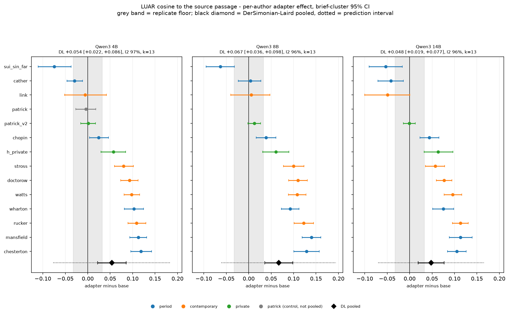
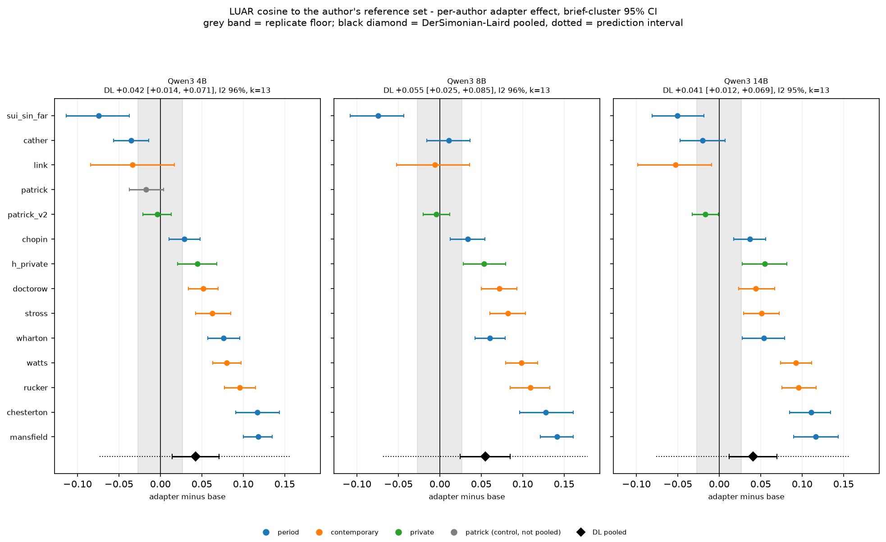
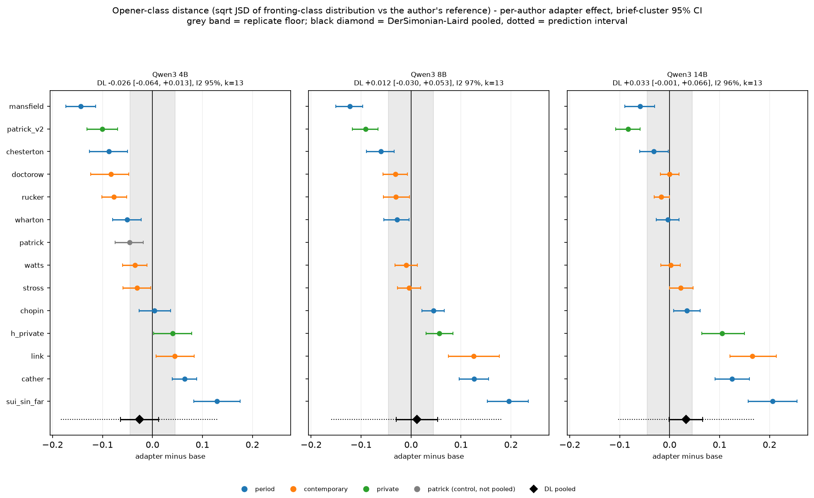
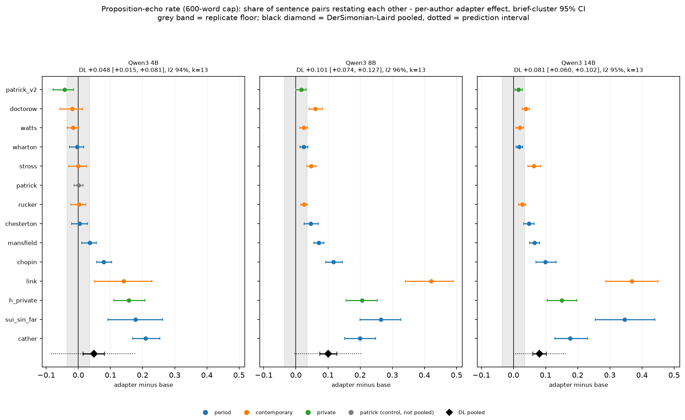
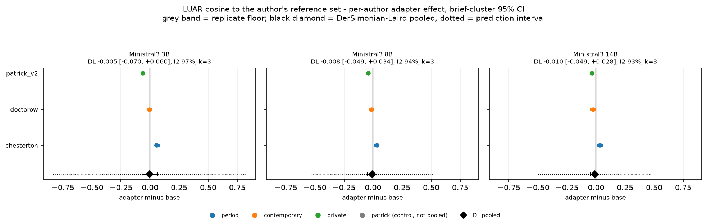
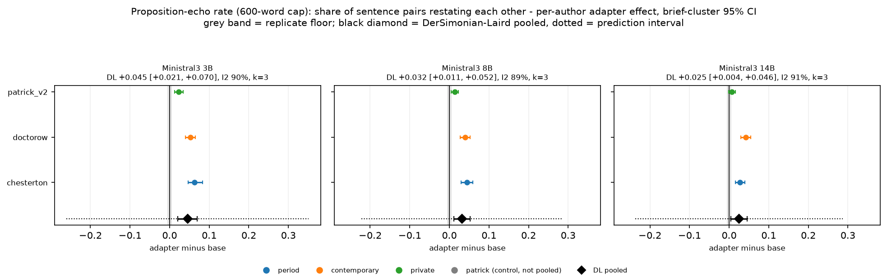
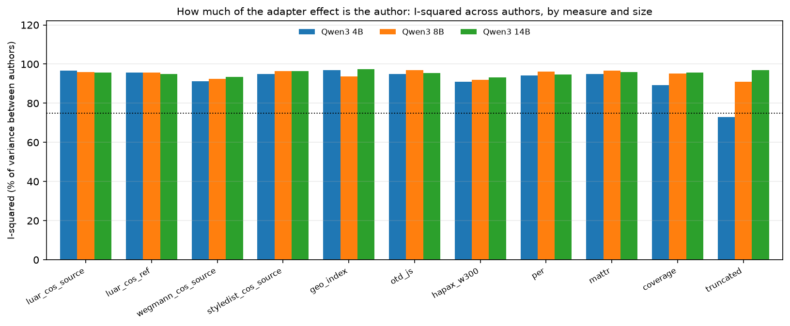
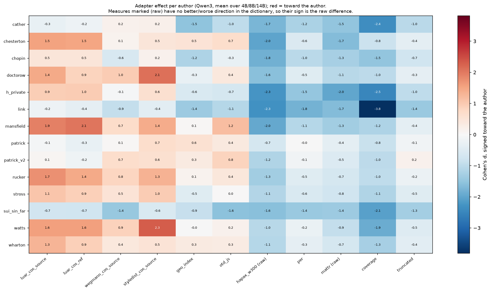
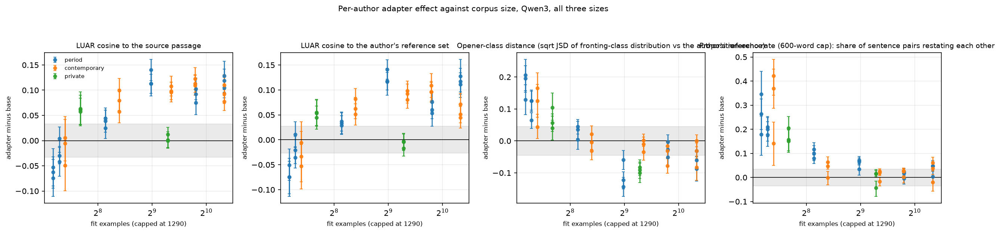

# 19_author_heterogeneity - the adapter effect author by author

## What this does

Takes the adapter-versus-base contrast apart by author. For every author x family x size cell it
computes the brief-paired effect on 11 measures with a cluster-bootstrap interval, Cohen's d
and Cliff's delta (550 contrasts in all), then pools those per-author effects with a
DerSimonian-Laird random-effects model per measure, family and size, reporting tau, I-squared, the
between-author Q test and a prediction interval. It then asks what predicts an author's effect
(author class, log fit examples, family, size), how much the pooled number depends on any single
author (leave-one-out), and whether the same authors are helped at every size (rank stability).

13 authors enter the pools. patrick (the v1 chunking control) is computed and kept in
author_effects.csv but excluded from every pooled estimate, since its runs differ from
patrick_v2 only in how the corpus was chunked.

## How it does it

Data: data/master/cells.parquet, arm A0, non-replicate rows, both samples. The two samples of a
cell are averaged first so the brief is the unit inside an author, then base and adapter are paired
on the brief.

Effect and interval. The per-author effect is the brief-paired mean difference (adapter minus
base). Its interval is a cluster bootstrap over briefs (lib.cluster_bootstrap, 2000 resamples,
seed 0) and its variance for the meta-analysis is the squared bootstrap standard error, taken as
the interval width divided by 2 x 1.96. Cohen's d and Cliff's delta come from the raw cell
distributions. p-values are Wilcoxon signed-rank on the per-brief differences.

Pooling. DerSimonian-Laird is implemented in the script: Q from the fixed-effect weights, tau2 =
max(0, (Q - df) / C) with C = sum(w) - sum(w^2)/sum(w), random-effects weights 1/(v + tau2), and
I-squared = max(0, (Q - df)/Q). The prediction interval uses t on df - 1 and sqrt(tau2 + se^2); it
is the interval to quote for "what would the next author do", and it is much wider than the
confidence interval whenever tau is non-zero.

Moderators. Three passes, all weighted by 1/(v + tau2): author class as a subgroup with a
between-class Q test inside each measure x family x size; log2 fit examples as a continuous
moderator inside each measure x family x size (authors with a recorded cap only); and one model per
measure over every author x size x family point with log2 fit examples, log2 parameters, family and
two author-class dummies. With 13 authors these are descriptive fits, and the multi-moderator
model reuses each author three times, so its standard errors are optimistic.

Correction and floors. BH-FDR is applied inside each family of tests separately and the family is
named in the fdr_family column: per-author contrasts (550 tests), pooled DL
effects (66 tests), between-class Q (33 tests), the corpus-size slope
(33 tests), the multi-moderator terms and the rank-stability correlations. A q below
0.05 means survival inside that one family of tests in this one script, not across the programme.

Every effect is printed beside the replicate floor of its measure in its family. Two floors are
computed per measure and family and the larger of the two is the one used (floor_used in
floors.csv): a regeneration floor from lib.replicate_floor over the twice-generated base
configurations (5 pairs on Qwen3, 4 on Ministral 3, and both Ministral pairs
sit at the 3B rung and were scored on 2026-09-10, so the 8B and 14B Ministral rows are read against
a floor measured at 3B); and a seed-split floor, the mean over sample 0 against the mean over
sample 1 inside one base run, maximised over that family's base runs (41 Qwen runs,
9 Ministral runs). The seed-split floor is the larger on 19 of the
22 measure x family rows that carry a floor at all, so it is usually the one in force;
coverage has no seed-split floor and falls back to its single regeneration pair.

### DerSimonian-Laird pooled adapter effect by measure, family and size

| measure | family | params_b | k | pooled | ci_low | ci_high | tau | I2 | p_Q | q_bh | pred_low | pred_high | floor | within_noise |
|---|---|---|---|---|---|---|---|---|---|---|---|---|---|---|
| coverage | Ministral3 | 3.000 | 3 | 1.597 | -4.549 | 7.743 | 4.058 | 55.817 | 0.104 | 0.665 | -63.565 | 66.759 | 6.282 | True |
| coverage | Ministral3 | 8.000 | 3 | -4.497 | -10.867 | 1.873 | 4.952 | 77.592 | 0.012 | 0.239 | -79.757 | 70.762 | 6.282 | True |
| coverage | Ministral3 | 14.000 | 3 | -4.678 | -12.356 | 2.999 | 5.923 | 76.855 | 0.013 | 0.313 | -94.907 | 85.550 | 6.282 | True |
| coverage | Qwen3 | 4.000 | 13 | -27.897 | -34.662 | -21.133 | 11.546 | 89.133 | 0.000 | 0.000 | -54.421 | -1.374 | 1.974 | False |
| coverage | Qwen3 | 8.000 | 13 | -32.921 | -42.304 | -23.538 | 16.749 | 95.181 | 0.000 | 0.000 | -71.261 | 5.419 | 1.974 | False |
| coverage | Qwen3 | 14.000 | 13 | -33.445 | -42.616 | -24.273 | 16.321 | 95.646 | 0.000 | 0.000 | -70.813 | 3.924 | 1.974 | False |
| geo_index | Ministral3 | 3.000 | 3 | 0.236 | -0.316 | 0.789 | 0.486 | 98.995 | 0.000 | 0.482 | -6.900 | 7.372 | 0.115 | False |
| geo_index | Ministral3 | 8.000 | 3 | 0.479 | 0.043 | 0.916 | 0.383 | 98.592 | 0.000 | 0.049 | -5.153 | 6.112 | 0.115 | False |
| geo_index | Ministral3 | 14.000 | 3 | 0.573 | 0.326 | 0.820 | 0.212 | 94.789 | 0.000 | 0.000 | -2.565 | 3.711 | 0.115 | False |
| geo_index | Qwen3 | 4.000 | 13 | 0.029 | -0.136 | 0.193 | 0.295 | 96.886 | 0.000 | 0.769 | -0.647 | 0.704 | 0.200 | True |
| geo_index | Qwen3 | 8.000 | 13 | -0.250 | -0.376 | -0.125 | 0.222 | 93.634 | 0.000 | 0.000 | -0.759 | 0.259 | 0.200 | False |
| geo_index | Qwen3 | 14.000 | 13 | -0.251 | -0.446 | -0.055 | 0.353 | 97.451 | 0.000 | 0.021 | -1.058 | 0.557 | 0.200 | False |
| hapax_w300 | Ministral3 | 3.000 | 3 | -0.160 | -0.201 | -0.119 | 0.036 | 97.114 | 0.000 | 0.000 | -0.690 | 0.370 | 0.008 | False |
| hapax_w300 | Ministral3 | 8.000 | 3 | -0.152 | -0.182 | -0.123 | 0.025 | 92.674 | 0.000 | 0.000 | -0.526 | 0.221 | 0.008 | False |
| hapax_w300 | Ministral3 | 14.000 | 3 | -0.143 | -0.179 | -0.107 | 0.031 | 95.793 | 0.000 | 0.000 | -0.598 | 0.313 | 0.008 | False |
| hapax_w300 | Qwen3 | 4.000 | 13 | -0.055 | -0.070 | -0.040 | 0.026 | 90.860 | 0.000 | 0.000 | -0.114 | 0.004 | 0.019 | False |
| hapax_w300 | Qwen3 | 8.000 | 13 | -0.094 | -0.109 | -0.079 | 0.026 | 91.937 | 0.000 | 0.000 | -0.154 | -0.035 | 0.019 | False |
| hapax_w300 | Qwen3 | 14.000 | 13 | -0.106 | -0.123 | -0.090 | 0.028 | 93.202 | 0.000 | 0.000 | -0.171 | -0.041 | 0.019 | False |
| luar_cos_ref | Ministral3 | 3.000 | 3 | -0.005 | -0.070 | 0.060 | 0.056 | 97.195 | 0.000 | 0.896 | -0.835 | 0.825 | 0.007 | True |
| luar_cos_ref | Ministral3 | 8.000 | 3 | -0.008 | -0.049 | 0.034 | 0.036 | 94.442 | 0.000 | 0.757 | -0.536 | 0.520 | 0.007 | False |
| luar_cos_ref | Ministral3 | 14.000 | 3 | -0.010 | -0.049 | 0.028 | 0.033 | 92.595 | 0.000 | 0.663 | -0.495 | 0.474 | 0.007 | False |
| luar_cos_ref | Qwen3 | 4.000 | 13 | 0.042 | 0.014 | 0.071 | 0.050 | 95.729 | 0.000 | 0.006 | -0.073 | 0.158 | 0.027 | False |
| luar_cos_ref | Qwen3 | 8.000 | 13 | 0.055 | 0.025 | 0.085 | 0.054 | 95.657 | 0.000 | 0.001 | -0.069 | 0.178 | 0.027 | False |
| luar_cos_ref | Qwen3 | 14.000 | 13 | 0.041 | 0.012 | 0.069 | 0.051 | 94.991 | 0.000 | 0.010 | -0.076 | 0.158 | 0.027 | False |
| luar_cos_source | Ministral3 | 3.000 | 3 | 0.026 | -0.029 | 0.082 | 0.048 | 95.624 | 0.000 | 0.451 | -0.685 | 0.738 | 0.011 | False |
| luar_cos_source | Ministral3 | 8.000 | 3 | 0.021 | -0.018 | 0.060 | 0.033 | 93.013 | 0.000 | 0.382 | -0.473 | 0.515 | 0.011 | False |
| luar_cos_source | Ministral3 | 14.000 | 3 | 0.018 | -0.014 | 0.049 | 0.026 | 86.507 | 0.001 | 0.358 | -0.367 | 0.402 | 0.011 | False |
| luar_cos_source | Qwen3 | 4.000 | 13 | 0.054 | 0.022 | 0.086 | 0.057 | 96.555 | 0.000 | 0.002 | -0.077 | 0.185 | 0.033 | False |
| luar_cos_source | Qwen3 | 8.000 | 13 | 0.067 | 0.036 | 0.098 | 0.056 | 95.980 | 0.000 | 0.000 | -0.061 | 0.195 | 0.033 | False |
| luar_cos_source | Qwen3 | 14.000 | 13 | 0.048 | 0.019 | 0.077 | 0.052 | 95.570 | 0.000 | 0.002 | -0.070 | 0.166 | 0.033 | False |
| mattr | Ministral3 | 3.000 | 3 | -0.086 | -0.104 | -0.068 | 0.015 | 91.844 | 0.000 | 0.000 | -0.314 | 0.142 | 0.006 | False |
| mattr | Ministral3 | 8.000 | 3 | -0.084 | -0.097 | -0.071 | 0.011 | 87.054 | 0.000 | 0.000 | -0.245 | 0.077 | 0.006 | False |
| mattr | Ministral3 | 14.000 | 3 | -0.076 | -0.099 | -0.053 | 0.020 | 96.460 | 0.000 | 0.000 | -0.369 | 0.217 | 0.006 | False |
| mattr | Qwen3 | 4.000 | 13 | -0.029 | -0.053 | -0.006 | 0.041 | 94.897 | 0.000 | 0.023 | -0.124 | 0.065 | 0.047 | True |
| mattr | Qwen3 | 8.000 | 13 | -0.092 | -0.114 | -0.070 | 0.039 | 96.773 | 0.000 | 0.000 | -0.181 | -0.003 | 0.047 | False |
| mattr | Qwen3 | 14.000 | 13 | -0.083 | -0.098 | -0.069 | 0.024 | 95.941 | 0.000 | 0.000 | -0.138 | -0.029 | 0.047 | False |
| otd_js | Ministral3 | 3.000 | 3 | -0.019 | -0.045 | 0.006 | 0.017 | 56.526 | 0.100 | 0.206 | -0.289 | 0.250 | 0.013 | False |
| otd_js | Ministral3 | 8.000 | 3 | -0.027 | -0.044 | -0.011 | 0.000 | 0.000 | 0.759 | 0.002 | -0.133 | 0.078 | 0.013 | False |
| otd_js | Ministral3 | 14.000 | 3 | -0.008 | -0.027 | 0.010 | 0.008 | 24.955 | 0.264 | 0.453 | -0.165 | 0.148 | 0.013 | True |
| otd_js | Qwen3 | 4.000 | 13 | -0.026 | -0.064 | 0.013 | 0.069 | 95.047 | 0.000 | 0.264 | -0.183 | 0.132 | 0.045 | True |
| otd_js | Qwen3 | 8.000 | 13 | 0.012 | -0.030 | 0.053 | 0.075 | 96.794 | 0.000 | 0.663 | -0.160 | 0.183 | 0.045 | True |
| otd_js | Qwen3 | 14.000 | 13 | 0.033 | -0.001 | 0.066 | 0.059 | 95.510 | 0.000 | 0.084 | -0.103 | 0.169 | 0.045 | True |
| per | Ministral3 | 3.000 | 3 | 0.045 | 0.021 | 0.070 | 0.021 | 89.864 | 0.000 | 0.001 | -0.260 | 0.351 | 0.005 | False |
| per | Ministral3 | 8.000 | 3 | 0.032 | 0.011 | 0.052 | 0.017 | 89.000 | 0.000 | 0.005 | -0.222 | 0.285 | 0.005 | False |
| per | Ministral3 | 14.000 | 3 | 0.025 | 0.004 | 0.046 | 0.018 | 91.323 | 0.000 | 0.032 | -0.237 | 0.287 | 0.005 | False |
| per | Qwen3 | 4.000 | 13 | 0.048 | 0.015 | 0.081 | 0.058 | 94.059 | 0.000 | 0.009 | -0.084 | 0.180 | 0.035 | False |
| per | Qwen3 | 8.000 | 13 | 0.101 | 0.074 | 0.127 | 0.046 | 96.193 | 0.000 | 0.000 | -0.005 | 0.206 | 0.035 | False |
| per | Qwen3 | 14.000 | 13 | 0.081 | 0.060 | 0.102 | 0.036 | 94.800 | 0.000 | 0.000 | -0.001 | 0.163 | 0.035 | False |
| styledist_cos_source | Ministral3 | 3.000 | 3 | 0.009 | 0.001 | 0.018 | 0.006 | 67.061 | 0.048 | 0.038 | -0.082 | 0.101 | 0.009 | False |
| styledist_cos_source | Ministral3 | 8.000 | 3 | 0.013 | 0.009 | 0.017 | 0.000 | 0.000 | 0.459 | 0.000 | -0.012 | 0.038 | 0.009 | False |
| styledist_cos_source | Ministral3 | 14.000 | 3 | 0.015 | 0.010 | 0.019 | 0.000 | 0.000 | 0.438 | 0.000 | -0.015 | 0.044 | 0.009 | False |
| styledist_cos_source | Qwen3 | 4.000 | 13 | 0.030 | 0.018 | 0.042 | 0.021 | 94.879 | 0.000 | 0.000 | -0.019 | 0.079 | 0.012 | False |
| styledist_cos_source | Qwen3 | 8.000 | 13 | 0.028 | 0.014 | 0.041 | 0.024 | 96.472 | 0.000 | 0.000 | -0.028 | 0.083 | 0.012 | False |
| styledist_cos_source | Qwen3 | 14.000 | 13 | 0.018 | 0.004 | 0.032 | 0.025 | 96.357 | 0.000 | 0.023 | -0.040 | 0.075 | 0.012 | False |
| truncated | Ministral3 | 3.000 | 3 | 0.011 | -0.031 | 0.053 | 0.000 | 0.000 | 0.523 | 0.665 | -0.263 | 0.284 | 0.167 | True |
| truncated | Ministral3 | 8.000 | 3 | 0.003 | -0.055 | 0.060 | 0.034 | 41.081 | 0.183 | 0.930 | -0.565 | 0.570 | 0.167 | True |
| truncated | Ministral3 | 14.000 | 3 | -0.166 | -0.261 | -0.070 | 0.067 | 64.061 | 0.062 | 0.002 | -1.223 | 0.891 | 0.167 | True |
| truncated | Qwen3 | 4.000 | 13 | 0.083 | 0.045 | 0.121 | 0.057 | 72.972 | 0.000 | 0.000 | -0.050 | 0.216 | 0.111 | True |
| truncated | Qwen3 | 8.000 | 13 | 0.118 | 0.073 | 0.162 | 0.073 | 91.026 | 0.000 | 0.000 | -0.050 | 0.285 | 0.111 | False |
| truncated | Qwen3 | 14.000 | 12 | 0.292 | 0.178 | 0.407 | 0.196 | 96.801 | 0.000 | 0.000 | -0.163 | 0.747 | 0.111 | False |

(6 more rows in the csv)

### Per-author effects on the content-free voice anchor (luar_cos_ref)

| author | author_class | family | params_b | effect | ci_low | ci_high | cohens_d | cliffs_delta | q_bh | floor | within_noise |
|---|---|---|---|---|---|---|---|---|---|---|---|
| cather | period | Qwen3 | 4.000 | -0.035 | -0.056 | -0.014 | -0.445 | -0.266 | 0.002 | 0.027 | False |
| cather | period | Qwen3 | 8.000 | 0.011 | -0.016 | 0.036 | 0.142 | 0.069 | 0.322 | 0.027 | True |
| cather | period | Qwen3 | 14.000 | -0.020 | -0.048 | 0.007 | -0.247 | -0.140 | 0.261 | 0.027 | True |
| chesterton | period | Ministral3 | 3.000 | 0.056 | 0.033 | 0.079 | 0.827 | 0.498 | 0.000 | 0.007 | False |
| chesterton | period | Ministral3 | 8.000 | 0.033 | 0.013 | 0.052 | 0.507 | 0.356 | 0.004 | 0.007 | False |
| chesterton | period | Ministral3 | 14.000 | 0.033 | 0.011 | 0.054 | 0.565 | 0.337 | 0.006 | 0.007 | False |
| chesterton | period | Qwen3 | 4.000 | 0.117 | 0.091 | 0.144 | 1.541 | 0.755 | 0.000 | 0.027 | False |
| chesterton | period | Qwen3 | 8.000 | 0.128 | 0.097 | 0.161 | 1.533 | 0.713 | 0.000 | 0.027 | False |
| chesterton | period | Qwen3 | 14.000 | 0.111 | 0.085 | 0.134 | 1.458 | 0.702 | 0.000 | 0.027 | False |
| chopin | period | Qwen3 | 4.000 | 0.029 | 0.010 | 0.048 | 0.382 | 0.239 | 0.017 | 0.027 | False |
| chopin | period | Qwen3 | 8.000 | 0.034 | 0.013 | 0.054 | 0.481 | 0.266 | 0.003 | 0.027 | False |
| chopin | period | Qwen3 | 14.000 | 0.037 | 0.018 | 0.056 | 0.550 | 0.357 | 0.001 | 0.027 | False |
| doctorow | contemporary | Ministral3 | 3.000 | -0.007 | -0.025 | 0.012 | -0.109 | -0.094 | 0.667 | 0.007 | True |
| doctorow | contemporary | Ministral3 | 8.000 | -0.015 | -0.033 | 0.004 | -0.245 | -0.180 | 0.144 | 0.007 | False |
| doctorow | contemporary | Ministral3 | 14.000 | -0.027 | -0.044 | -0.009 | -0.455 | -0.274 | 0.009 | 0.007 | False |
| doctorow | contemporary | Qwen3 | 4.000 | 0.051 | 0.034 | 0.070 | 0.813 | 0.451 | 0.000 | 0.027 | False |
| doctorow | contemporary | Qwen3 | 8.000 | 0.072 | 0.050 | 0.093 | 1.084 | 0.555 | 0.000 | 0.027 | False |
| doctorow | contemporary | Qwen3 | 14.000 | 0.044 | 0.023 | 0.067 | 0.672 | 0.327 | 0.001 | 0.027 | False |
| h_private | private | Qwen3 | 4.000 | 0.045 | 0.021 | 0.068 | 0.977 | 0.503 | 0.004 | 0.027 | False |
| h_private | private | Qwen3 | 8.000 | 0.053 | 0.029 | 0.080 | 0.950 | 0.526 | 0.001 | 0.027 | False |
| h_private | private | Qwen3 | 14.000 | 0.055 | 0.028 | 0.081 | 0.962 | 0.528 | 0.002 | 0.027 | False |
| link | contemporary | Qwen3 | 4.000 | -0.034 | -0.084 | 0.017 | -0.402 | -0.145 | 0.307 | 0.027 | False |
| link | contemporary | Qwen3 | 8.000 | -0.006 | -0.052 | 0.036 | -0.072 | -0.010 | 0.918 | 0.027 | True |
| link | contemporary | Qwen3 | 14.000 | -0.053 | -0.098 | -0.009 | -0.598 | -0.357 | 0.063 | 0.027 | False |
| mansfield | period | Qwen3 | 4.000 | 0.118 | 0.100 | 0.135 | 2.190 | 0.872 | 0.000 | 0.027 | False |
| mansfield | period | Qwen3 | 8.000 | 0.141 | 0.121 | 0.161 | 2.349 | 0.929 | 0.000 | 0.027 | False |
| mansfield | period | Qwen3 | 14.000 | 0.116 | 0.090 | 0.143 | 1.631 | 0.809 | 0.000 | 0.027 | False |
| patrick | private | Qwen3 | 4.000 | -0.017 | -0.037 | 0.004 | -0.271 | -0.110 | 0.115 | 0.027 | True |
| patrick_v2 | private | Ministral3 | 3.000 | -0.062 | -0.077 | -0.046 | -1.159 | -0.609 | 0.000 | 0.007 | False |
| patrick_v2 | private | Ministral3 | 8.000 | -0.040 | -0.053 | -0.026 | -0.784 | -0.392 | 0.000 | 0.007 | False |
| patrick_v2 | private | Ministral3 | 14.000 | -0.036 | -0.052 | -0.020 | -0.639 | -0.267 | 0.000 | 0.007 | False |
| patrick_v2 | private | Qwen3 | 1.700 | -0.037 | -0.061 | -0.013 | -0.528 | -0.217 | 0.011 | 0.027 | False |
| patrick_v2 | private | Qwen3 | 4.000 | -0.003 | -0.021 | 0.013 | -0.061 | 0.016 | 0.887 | 0.027 | True |
| patrick_v2 | private | Qwen3 | 8.000 | -0.005 | -0.020 | 0.012 | -0.076 | -0.078 | 0.630 | 0.027 | True |
| patrick_v2 | private | Qwen3 | 14.000 | -0.017 | -0.033 | -0.001 | -0.316 | -0.183 | 0.067 | 0.027 | True |
| rucker | contemporary | Qwen3 | 4.000 | 0.096 | 0.077 | 0.115 | 1.424 | 0.716 | 0.000 | 0.027 | False |
| rucker | contemporary | Qwen3 | 8.000 | 0.109 | 0.085 | 0.133 | 1.608 | 0.757 | 0.000 | 0.027 | False |
| rucker | contemporary | Qwen3 | 14.000 | 0.096 | 0.076 | 0.117 | 1.300 | 0.651 | 0.000 | 0.027 | False |
| stross | contemporary | Qwen3 | 4.000 | 0.063 | 0.043 | 0.085 | 0.882 | 0.469 | 0.000 | 0.027 | False |
| stross | contemporary | Qwen3 | 8.000 | 0.082 | 0.060 | 0.103 | 1.110 | 0.602 | 0.000 | 0.027 | False |
| stross | contemporary | Qwen3 | 14.000 | 0.051 | 0.029 | 0.072 | 0.693 | 0.416 | 0.000 | 0.027 | False |
| sui_sin_far | period | Qwen3 | 4.000 | -0.074 | -0.113 | -0.037 | -0.788 | -0.368 | 0.003 | 0.027 | False |
| sui_sin_far | period | Qwen3 | 8.000 | -0.074 | -0.108 | -0.043 | -0.864 | -0.431 | 0.000 | 0.027 | False |
| sui_sin_far | period | Qwen3 | 14.000 | -0.050 | -0.081 | -0.019 | -0.597 | -0.286 | 0.011 | 0.027 | False |
| watts | contemporary | Qwen3 | 4.000 | 0.080 | 0.063 | 0.097 | 1.402 | 0.734 | 0.000 | 0.027 | False |
| watts | contemporary | Qwen3 | 8.000 | 0.099 | 0.079 | 0.118 | 1.758 | 0.809 | 0.000 | 0.027 | False |
| watts | contemporary | Qwen3 | 14.000 | 0.092 | 0.074 | 0.112 | 1.496 | 0.739 | 0.000 | 0.027 | False |
| wharton | period | Qwen3 | 4.000 | 0.076 | 0.057 | 0.096 | 1.069 | 0.562 | 0.000 | 0.027 | False |
| wharton | period | Qwen3 | 8.000 | 0.060 | 0.043 | 0.079 | 0.870 | 0.454 | 0.000 | 0.027 | False |
| wharton | period | Qwen3 | 14.000 | 0.054 | 0.028 | 0.079 | 0.769 | 0.429 | 0.000 | 0.027 | False |

### Author class as a subgroup, with the between-class Q test

| measure | family | params_b | author_class | k | pooled | ci_low | ci_high | I2 | Q_between | df_between | p_between | q_bh |
|---|---|---|---|---|---|---|---|---|---|---|---|---|
| coverage | Qwen3 | 4.000 | contemporary | 5 | -21.433 | -26.248 | -16.618 | 43.464 |  |  |  |  |
| coverage | Qwen3 | 4.000 | period | 6 | -28.094 | -37.592 | -18.596 | 86.955 |  |  |  |  |
| coverage | Qwen3 | 4.000 | private | 2 | -39.694 | -77.431 | -1.957 | 97.902 |  |  |  |  |
| coverage | Qwen3 | 4.000 | _between_ | 13 |  |  |  |  | 17.362 | 2.000 | 0.000 | 0.000 |
| coverage | Qwen3 | 8.000 | contemporary | 5 | -32.799 | -51.212 | -14.386 | 96.959 |  |  |  |  |
| coverage | Qwen3 | 8.000 | period | 6 | -33.826 | -46.891 | -20.762 | 94.262 |  |  |  |  |
| coverage | Qwen3 | 8.000 | private | 2 | -30.734 | -62.202 | 0.735 | 95.309 |  |  |  |  |
| coverage | Qwen3 | 8.000 | _between_ | 13 |  |  |  |  | 8.998 | 2.000 | 0.011 | 0.014 |
| coverage | Qwen3 | 14.000 | contemporary | 5 | -30.793 | -43.495 | -18.091 | 95.109 |  |  |  |  |
| coverage | Qwen3 | 14.000 | period | 6 | -36.673 | -54.218 | -19.129 | 97.062 |  |  |  |  |
| coverage | Qwen3 | 14.000 | private | 2 | -30.929 | -59.911 | -1.946 | 93.803 |  |  |  |  |
| coverage | Qwen3 | 14.000 | _between_ | 13 |  |  |  |  | 7.462 | 2.000 | 0.024 | 0.026 |
| geo_index | Qwen3 | 4.000 | contemporary | 5 | 0.157 | 0.031 | 0.283 | 87.430 |  |  |  |  |
| geo_index | Qwen3 | 4.000 | period | 6 | -0.017 | -0.316 | 0.283 | 97.664 |  |  |  |  |
| geo_index | Qwen3 | 4.000 | private | 2 | -0.102 | -0.996 | 0.792 | 98.617 |  |  |  |  |
| geo_index | Qwen3 | 4.000 | _between_ | 13 |  |  |  |  | 67.210 | 2.000 | 0.000 | 0.000 |
| geo_index | Qwen3 | 8.000 | contemporary | 5 | -0.287 | -0.470 | -0.104 | 91.435 |  |  |  |  |
| geo_index | Qwen3 | 8.000 | period | 6 | -0.269 | -0.490 | -0.047 | 95.665 |  |  |  |  |
| geo_index | Qwen3 | 8.000 | private | 2 | -0.097 | -0.377 | 0.184 | 90.652 |  |  |  |  |
| geo_index | Qwen3 | 8.000 | _between_ | 13 |  |  |  |  | 15.764 | 2.000 | 0.000 | 0.001 |
| geo_index | Qwen3 | 14.000 | contemporary | 5 | -0.361 | -0.529 | -0.192 | 89.780 |  |  |  |  |
| geo_index | Qwen3 | 14.000 | period | 6 | -0.238 | -0.643 | 0.167 | 98.709 |  |  |  |  |
| geo_index | Qwen3 | 14.000 | private | 2 | 0.025 | -0.170 | 0.220 | 83.112 |  |  |  |  |
| geo_index | Qwen3 | 14.000 | _between_ | 13 |  |  |  |  | 38.497 | 2.000 | 0.000 | 0.000 |
| hapax_w300 | Qwen3 | 4.000 | contemporary | 5 | -0.043 | -0.060 | -0.025 | 80.283 |  |  |  |  |
| hapax_w300 | Qwen3 | 4.000 | period | 6 | -0.061 | -0.084 | -0.037 | 92.477 |  |  |  |  |
| hapax_w300 | Qwen3 | 4.000 | private | 2 | -0.067 | -0.138 | 0.005 | 96.955 |  |  |  |  |
| hapax_w300 | Qwen3 | 4.000 | _between_ | 13 |  |  |  |  | 11.705 | 2.000 | 0.003 | 0.004 |
| hapax_w300 | Qwen3 | 8.000 | contemporary | 5 | -0.090 | -0.117 | -0.063 | 93.547 |  |  |  |  |
| hapax_w300 | Qwen3 | 8.000 | period | 6 | -0.097 | -0.115 | -0.080 | 86.689 |  |  |  |  |
| hapax_w300 | Qwen3 | 8.000 | private | 2 | -0.097 | -0.166 | -0.028 | 96.742 |  |  |  |  |
| hapax_w300 | Qwen3 | 8.000 | _between_ | 13 |  |  |  |  | 18.575 | 2.000 | 0.000 | 0.000 |
| hapax_w300 | Qwen3 | 14.000 | contemporary | 5 | -0.101 | -0.128 | -0.073 | 94.696 |  |  |  |  |
| hapax_w300 | Qwen3 | 14.000 | period | 6 | -0.110 | -0.130 | -0.090 | 87.931 |  |  |  |  |
| hapax_w300 | Qwen3 | 14.000 | private | 2 | -0.108 | -0.186 | -0.031 | 97.248 |  |  |  |  |
| hapax_w300 | Qwen3 | 14.000 | _between_ | 13 |  |  |  |  | 23.333 | 2.000 | 0.000 | 0.000 |
| luar_cos_ref | Qwen3 | 4.000 | contemporary | 5 | 0.059 | 0.033 | 0.085 | 86.324 |  |  |  |  |
| luar_cos_ref | Qwen3 | 4.000 | period | 6 | 0.039 | -0.017 | 0.095 | 97.476 |  |  |  |  |
| luar_cos_ref | Qwen3 | 4.000 | private | 2 | 0.020 | -0.027 | 0.067 | 90.373 |  |  |  |  |
| luar_cos_ref | Qwen3 | 4.000 | _between_ | 13 |  |  |  |  | 43.263 | 2.000 | 0.000 | 0.000 |
| luar_cos_ref | Qwen3 | 8.000 | contemporary | 5 | 0.076 | 0.050 | 0.102 | 83.168 |  |  |  |  |
| luar_cos_ref | Qwen3 | 8.000 | period | 6 | 0.050 | -0.005 | 0.106 | 97.019 |  |  |  |  |
| luar_cos_ref | Qwen3 | 8.000 | private | 2 | 0.024 | -0.033 | 0.080 | 92.962 |  |  |  |  |
| luar_cos_ref | Qwen3 | 8.000 | _between_ | 13 |  |  |  |  | 70.591 | 2.000 | 0.000 | 0.000 |
| luar_cos_ref | Qwen3 | 14.000 | contemporary | 5 | 0.050 | 0.014 | 0.087 | 91.770 |  |  |  |  |
| luar_cos_ref | Qwen3 | 14.000 | period | 6 | 0.042 | -0.007 | 0.091 | 95.572 |  |  |  |  |
| luar_cos_ref | Qwen3 | 14.000 | private | 2 | 0.018 | -0.052 | 0.088 | 95.091 |  |  |  |  |
| luar_cos_ref | Qwen3 | 14.000 | _between_ | 13 |  |  |  |  | 57.682 | 2.000 | 0.000 | 0.000 |
| luar_cos_source | Qwen3 | 4.000 | contemporary | 5 | 0.082 | 0.059 | 0.105 | 81.289 |  |  |  |  |
| luar_cos_source | Qwen3 | 4.000 | period | 6 | 0.043 | -0.017 | 0.103 | 97.832 |  |  |  |  |
| luar_cos_source | Qwen3 | 4.000 | private | 2 | 0.028 | -0.026 | 0.083 | 91.463 |  |  |  |  |
| luar_cos_source | Qwen3 | 4.000 | _between_ | 13 |  |  |  |  | 84.534 | 2.000 | 0.000 | 0.000 |
| luar_cos_source | Qwen3 | 8.000 | contemporary | 5 | 0.095 | 0.070 | 0.120 | 82.415 |  |  |  |  |
| luar_cos_source | Qwen3 | 8.000 | period | 6 | 0.057 | 0.001 | 0.114 | 97.014 |  |  |  |  |
| luar_cos_source | Qwen3 | 8.000 | private | 2 | 0.035 | -0.012 | 0.082 | 88.421 |  |  |  |  |
| luar_cos_source | Qwen3 | 8.000 | _between_ | 13 |  |  |  |  | 99.722 | 2.000 | 0.000 | 0.000 |
| luar_cos_source | Qwen3 | 14.000 | contemporary | 5 | 0.066 | 0.033 | 0.099 | 91.169 |  |  |  |  |
| luar_cos_source | Qwen3 | 14.000 | period | 6 | 0.041 | -0.009 | 0.092 | 95.977 |  |  |  |  |
| luar_cos_source | Qwen3 | 14.000 | private | 2 | 0.030 | -0.033 | 0.092 | 92.206 |  |  |  |  |
| luar_cos_source | Qwen3 | 14.000 | _between_ | 13 |  |  |  |  | 88.494 | 2.000 | 0.000 | 0.000 |

(72 more rows in the csv)

### Corpus size as a moderator (meta-regression slope per doubling of fit examples)

| measure | family | params_b | n_authors | estimate | se | ci_low | ci_high | p | q_bh |
|---|---|---|---|---|---|---|---|---|---|
| coverage | Qwen3 | 4.000 | 13 | 8.648 | 3.181 | 2.413 | 14.883 | 0.007 | 0.009 |
| coverage | Qwen3 | 8.000 | 13 | 14.967 | 4.333 | 6.474 | 23.461 | 0.001 | 0.002 |
| coverage | Qwen3 | 14.000 | 13 | 16.740 | 4.235 | 8.439 | 25.040 | 0.000 | 0.000 |
| geo_index | Qwen3 | 4.000 | 13 | 0.254 | 0.076 | 0.106 | 0.403 | 0.001 | 0.002 |
| geo_index | Qwen3 | 8.000 | 13 | 0.134 | 0.058 | 0.019 | 0.248 | 0.022 | 0.024 |
| geo_index | Qwen3 | 14.000 | 13 | 0.162 | 0.090 | -0.014 | 0.339 | 0.072 | 0.072 |
| hapax_w300 | Qwen3 | 4.000 | 13 | 0.016 | 0.007 | 0.002 | 0.030 | 0.021 | 0.023 |
| hapax_w300 | Qwen3 | 8.000 | 13 | 0.018 | 0.007 | 0.004 | 0.032 | 0.010 | 0.012 |
| hapax_w300 | Qwen3 | 14.000 | 13 | 0.020 | 0.008 | 0.005 | 0.035 | 0.008 | 0.011 |
| luar_cos_ref | Qwen3 | 4.000 | 13 | 0.039 | 0.013 | 0.013 | 0.065 | 0.003 | 0.005 |
| luar_cos_ref | Qwen3 | 8.000 | 13 | 0.035 | 0.014 | 0.008 | 0.063 | 0.012 | 0.014 |
| luar_cos_ref | Qwen3 | 14.000 | 13 | 0.034 | 0.013 | 0.008 | 0.060 | 0.011 | 0.014 |
| luar_cos_source | Qwen3 | 4.000 | 13 | 0.043 | 0.015 | 0.014 | 0.072 | 0.003 | 0.006 |
| luar_cos_source | Qwen3 | 8.000 | 13 | 0.040 | 0.014 | 0.012 | 0.069 | 0.005 | 0.008 |
| luar_cos_source | Qwen3 | 14.000 | 13 | 0.040 | 0.013 | 0.014 | 0.066 | 0.003 | 0.005 |
| mattr | Qwen3 | 4.000 | 13 | 0.037 | 0.011 | 0.015 | 0.059 | 0.001 | 0.002 |
| mattr | Qwen3 | 8.000 | 13 | 0.050 | 0.010 | 0.029 | 0.070 | 0.000 | 0.000 |
| mattr | Qwen3 | 14.000 | 13 | 0.049 | 0.007 | 0.034 | 0.063 | 0.000 | 0.000 |
| otd_js | Qwen3 | 4.000 | 13 | -0.056 | 0.018 | -0.091 | -0.021 | 0.002 | 0.004 |
| otd_js | Qwen3 | 8.000 | 13 | -0.064 | 0.019 | -0.102 | -0.027 | 0.001 | 0.002 |
| otd_js | Qwen3 | 14.000 | 13 | -0.061 | 0.015 | -0.092 | -0.031 | 0.000 | 0.000 |
| per | Qwen3 | 4.000 | 13 | -0.065 | 0.016 | -0.096 | -0.034 | 0.000 | 0.000 |
| per | Qwen3 | 8.000 | 13 | -0.077 | 0.013 | -0.102 | -0.052 | 0.000 | 0.000 |
| per | Qwen3 | 14.000 | 13 | -0.068 | 0.011 | -0.089 | -0.048 | 0.000 | 0.000 |
| styledist_cos_source | Qwen3 | 4.000 | 13 | 0.015 | 0.006 | 0.004 | 0.026 | 0.006 | 0.008 |
| styledist_cos_source | Qwen3 | 8.000 | 13 | 0.015 | 0.006 | 0.002 | 0.027 | 0.019 | 0.021 |
| styledist_cos_source | Qwen3 | 14.000 | 13 | 0.018 | 0.006 | 0.005 | 0.031 | 0.005 | 0.008 |
| truncated | Qwen3 | 4.000 | 13 | -0.040 | 0.018 | -0.076 | -0.005 | 0.025 | 0.026 |
| truncated | Qwen3 | 8.000 | 13 | -0.067 | 0.022 | -0.110 | -0.025 | 0.002 | 0.004 |
| truncated | Qwen3 | 14.000 | 12 | -0.215 | 0.051 | -0.314 | -0.115 | 0.000 | 0.000 |
| wegmann_cos_source | Qwen3 | 4.000 | 13 | 0.077 | 0.021 | 0.035 | 0.119 | 0.000 | 0.001 |
| wegmann_cos_source | Qwen3 | 8.000 | 13 | 0.067 | 0.022 | 0.023 | 0.110 | 0.003 | 0.005 |
| wegmann_cos_source | Qwen3 | 14.000 | 13 | 0.081 | 0.023 | 0.036 | 0.126 | 0.000 | 0.001 |

### All moderators in one model per measure

| measure | term | estimate | ci_low | ci_high | p | q_bh | n_points |
|---|---|---|---|---|---|---|---|
| coverage | intercept | -28.460 | -36.053 | -20.867 | 0.000 |  | 49 |
| coverage | log2_train_examples_centred | 13.228 | 8.374 | 18.083 | 0.000 | 0.000 | 49 |
| coverage | log2_params_centred | -2.283 | -8.067 | 3.502 | 0.439 | 0.562 | 49 |
| coverage | family_Ministral3 | 12.568 | -1.063 | 26.199 | 0.071 | 0.130 | 49 |
| coverage | class_contemporary | -2.901 | -13.690 | 7.889 | 0.598 | 0.688 | 49 |
| coverage | class_private | 3.955 | -9.106 | 17.017 | 0.553 | 0.676 | 49 |
| geo_index | intercept | -0.048 | -0.228 | 0.132 | 0.600 |  | 49 |
| geo_index | log2_train_examples_centred | 0.216 | 0.102 | 0.330 | 0.000 | 0.001 | 49 |
| geo_index | log2_params_centred | -0.080 | -0.217 | 0.057 | 0.251 | 0.363 | 49 |
| geo_index | family_Ministral3 | 0.315 | -0.010 | 0.641 | 0.057 | 0.109 | 49 |
| geo_index | class_contemporary | -0.136 | -0.392 | 0.121 | 0.299 | 0.422 | 49 |
| geo_index | class_private | -0.033 | -0.341 | 0.275 | 0.832 | 0.832 | 49 |
| hapax_w300 | intercept | -0.087 | -0.108 | -0.066 | 0.000 |  | 49 |
| hapax_w300 | log2_train_examples_centred | 0.017 | 0.004 | 0.030 | 0.011 | 0.028 | 49 |
| hapax_w300 | log2_params_centred | -0.020 | -0.035 | -0.004 | 0.014 | 0.036 | 49 |
| hapax_w300 | family_Ministral3 | -0.092 | -0.129 | -0.055 | 0.000 | 0.000 | 49 |
| hapax_w300 | class_contemporary | 0.004 | -0.025 | 0.033 | 0.785 | 0.815 | 49 |
| hapax_w300 | class_private | 0.023 | -0.012 | 0.058 | 0.200 | 0.320 | 49 |
| luar_cos_ref | intercept | 0.060 | 0.034 | 0.086 | 0.000 |  | 49 |
| luar_cos_ref | log2_train_examples_centred | 0.035 | 0.018 | 0.052 | 0.000 | 0.000 | 49 |
| luar_cos_ref | log2_params_centred | 0.004 | -0.015 | 0.024 | 0.668 | 0.721 | 49 |
| luar_cos_ref | family_Ministral3 | -0.088 | -0.134 | -0.041 | 0.000 | 0.001 | 49 |
| luar_cos_ref | class_contemporary | -0.011 | -0.048 | 0.026 | 0.575 | 0.688 | 49 |
| luar_cos_ref | class_private | -0.031 | -0.076 | 0.013 | 0.163 | 0.271 | 49 |
| luar_cos_source | intercept | 0.064 | 0.040 | 0.088 | 0.000 |  | 49 |
| luar_cos_source | log2_train_examples_centred | 0.039 | 0.023 | 0.054 | 0.000 | 0.000 | 49 |
| luar_cos_source | log2_params_centred | 0.002 | -0.016 | 0.020 | 0.815 | 0.830 | 49 |
| luar_cos_source | family_Ministral3 | -0.074 | -0.117 | -0.031 | 0.001 | 0.002 | 49 |
| luar_cos_source | class_contemporary | 0.006 | -0.028 | 0.041 | 0.716 | 0.757 | 49 |
| luar_cos_source | class_private | -0.024 | -0.065 | 0.017 | 0.247 | 0.363 | 49 |
| mattr | intercept | -0.068 | -0.083 | -0.053 | 0.000 |  | 49 |
| mattr | log2_train_examples_centred | 0.043 | 0.033 | 0.053 | 0.000 | 0.000 | 49 |
| mattr | log2_params_centred | -0.025 | -0.037 | -0.013 | 0.000 | 0.000 | 49 |
| mattr | family_Ministral3 | -0.065 | -0.093 | -0.038 | 0.000 | 0.000 | 49 |
| mattr | class_contemporary | 0.005 | -0.017 | 0.027 | 0.658 | 0.721 | 49 |
| mattr | class_private | 0.017 | -0.010 | 0.044 | 0.213 | 0.325 | 49 |
| otd_js | intercept | -0.007 | -0.036 | 0.021 | 0.613 |  | 49 |
| otd_js | log2_train_examples_centred | -0.062 | -0.080 | -0.044 | 0.000 | 0.000 | 49 |
| otd_js | log2_params_centred | 0.024 | 0.002 | 0.045 | 0.030 | 0.062 | 49 |
| otd_js | family_Ministral3 | 0.059 | 0.008 | 0.110 | 0.024 | 0.051 | 49 |
| otd_js | class_contemporary | 0.014 | -0.026 | 0.054 | 0.495 | 0.618 | 49 |
| otd_js | class_private | -0.041 | -0.089 | 0.008 | 0.098 | 0.168 | 49 |
| per | intercept | 0.080 | 0.063 | 0.098 | 0.000 |  | 49 |
| per | log2_train_examples_centred | -0.068 | -0.080 | -0.056 | 0.000 | 0.000 | 49 |
| per | log2_params_centred | 0.015 | 0.002 | 0.028 | 0.024 | 0.051 | 49 |
| per | family_Ministral3 | 0.043 | 0.014 | 0.073 | 0.004 | 0.012 | 49 |
| per | class_contemporary | -0.007 | -0.031 | 0.018 | 0.600 | 0.688 | 49 |
| per | class_private | -0.057 | -0.087 | -0.028 | 0.000 | 0.001 | 49 |
| styledist_cos_source | intercept | 0.020 | 0.010 | 0.029 | 0.000 |  | 49 |
| styledist_cos_source | log2_train_examples_centred | 0.014 | 0.007 | 0.020 | 0.000 | 0.000 | 49 |
| styledist_cos_source | log2_params_centred | -0.003 | -0.011 | 0.004 | 0.427 | 0.562 | 49 |
| styledist_cos_source | family_Ministral3 | -0.032 | -0.050 | -0.014 | 0.000 | 0.001 | 49 |
| styledist_cos_source | class_contemporary | 0.017 | 0.003 | 0.031 | 0.016 | 0.039 | 49 |
| styledist_cos_source | class_private | 0.011 | -0.006 | 0.028 | 0.204 | 0.320 | 49 |
| truncated | intercept | 0.157 | 0.106 | 0.208 | 0.000 |  | 48 |
| truncated | log2_train_examples_centred | -0.103 | -0.137 | -0.069 | 0.000 | 0.000 | 48 |
| truncated | log2_params_centred | 0.042 | 0.001 | 0.082 | 0.044 | 0.087 | 48 |
| truncated | family_Ministral3 | -0.086 | -0.181 | 0.009 | 0.075 | 0.133 | 48 |
| truncated | class_contemporary | -0.018 | -0.092 | 0.056 | 0.635 | 0.712 | 48 |
| truncated | class_private | -0.037 | -0.132 | 0.057 | 0.437 | 0.562 | 48 |

(6 more rows in the csv)

### Leave-one-author-out sensitivity of the pooled effect

| measure | family | params_b | pooled_full | loo_min | loo_max | max_abs_shift | max_shift_author | max_shift_over_floor | sign_flips |
|---|---|---|---|---|---|---|---|---|---|
| coverage | Ministral3 | 3.000 | 1.597 | -1.149 | 3.622 | 2.746 | chesterton | 0.437 | 1 |
| coverage | Ministral3 | 8.000 | -4.497 | -7.692 | -1.992 | 3.194 | patrick_v2 | 0.509 | 0 |
| coverage | Ministral3 | 14.000 | -4.678 | -7.734 | -0.738 | 3.941 | doctorow | 0.627 | 0 |
| coverage | Qwen3 | 4.000 | -27.897 | -29.302 | -25.037 | 2.860 | h_private | 1.449 | 0 |
| coverage | Qwen3 | 8.000 | -32.921 | -34.677 | -29.461 | 3.460 | link | 1.753 | 0 |
| coverage | Qwen3 | 14.000 | -33.445 | -35.157 | -29.796 | 3.648 | cather | 1.848 | 0 |
| geo_index | Ministral3 | 3.000 | 0.236 | -0.046 | 0.518 | 0.283 | chesterton | 2.450 | 1 |
| geo_index | Ministral3 | 8.000 | 0.479 | 0.322 | 0.697 | 0.217 | patrick_v2 | 1.884 | 0 |
| geo_index | Ministral3 | 14.000 | 0.573 | 0.467 | 0.705 | 0.132 | patrick_v2 | 1.146 | 0 |
| geo_index | Qwen3 | 4.000 | 0.029 | -0.005 | 0.081 | 0.053 | cather | 0.263 | 1 |
| geo_index | Qwen3 | 8.000 | -0.250 | -0.275 | -0.212 | 0.038 | link | 0.191 | 0 |
| geo_index | Qwen3 | 14.000 | -0.251 | -0.306 | -0.212 | 0.056 | chesterton | 0.278 | 0 |
| hapax_w300 | Ministral3 | 3.000 | -0.160 | -0.180 | -0.148 | 0.020 | patrick_v2 | 2.385 | 0 |
| hapax_w300 | Ministral3 | 8.000 | -0.152 | -0.166 | -0.142 | 0.014 | patrick_v2 | 1.739 | 0 |
| hapax_w300 | Ministral3 | 14.000 | -0.143 | -0.160 | -0.129 | 0.018 | patrick_v2 | 2.140 | 0 |
| hapax_w300 | Qwen3 | 4.000 | -0.055 | -0.059 | -0.051 | 0.004 | h_private | 0.219 | 0 |
| hapax_w300 | Qwen3 | 8.000 | -0.094 | -0.098 | -0.088 | 0.006 | link | 0.320 | 0 |
| hapax_w300 | Qwen3 | 14.000 | -0.106 | -0.110 | -0.099 | 0.008 | link | 0.393 | 0 |
| luar_cos_ref | Ministral3 | 3.000 | -0.005 | -0.035 | 0.024 | 0.030 | chesterton | 4.258 | 1 |
| luar_cos_ref | Ministral3 | 8.000 | -0.008 | -0.028 | 0.009 | 0.020 | chesterton | 2.919 | 1 |
| luar_cos_ref | Ministral3 | 14.000 | -0.010 | -0.032 | 0.003 | 0.021 | chesterton | 3.048 | 1 |
| luar_cos_ref | Qwen3 | 4.000 | 0.042 | 0.036 | 0.052 | 0.009 | sui_sin_far | 0.339 | 0 |
| luar_cos_ref | Qwen3 | 8.000 | 0.055 | 0.048 | 0.065 | 0.010 | sui_sin_far | 0.390 | 0 |
| luar_cos_ref | Qwen3 | 14.000 | 0.041 | 0.035 | 0.048 | 0.007 | sui_sin_far | 0.277 | 0 |
| luar_cos_source | Ministral3 | 3.000 | 0.026 | 0.006 | 0.054 | 0.028 | patrick_v2 | 2.561 | 0 |
| luar_cos_source | Ministral3 | 8.000 | 0.021 | 0.008 | 0.038 | 0.017 | patrick_v2 | 1.546 | 0 |
| luar_cos_source | Ministral3 | 14.000 | 0.018 | 0.006 | 0.032 | 0.015 | patrick_v2 | 1.355 | 0 |
| luar_cos_source | Qwen3 | 4.000 | 0.054 | 0.049 | 0.064 | 0.010 | sui_sin_far | 0.311 | 0 |
| luar_cos_source | Qwen3 | 8.000 | 0.067 | 0.061 | 0.078 | 0.011 | sui_sin_far | 0.326 | 0 |
| luar_cos_source | Qwen3 | 14.000 | 0.048 | 0.042 | 0.056 | 0.008 | sui_sin_far | 0.247 | 0 |
| mattr | Ministral3 | 3.000 | -0.086 | -0.095 | -0.079 | 0.009 | patrick_v2 | 1.463 | 0 |
| mattr | Ministral3 | 8.000 | -0.084 | -0.090 | -0.078 | 0.006 | patrick_v2 | 1.059 | 0 |
| mattr | Ministral3 | 14.000 | -0.076 | -0.088 | -0.066 | 0.011 | patrick_v2 | 1.959 | 0 |
| mattr | Qwen3 | 4.000 | -0.029 | -0.034 | -0.020 | 0.010 | cather | 0.207 | 0 |
| mattr | Qwen3 | 8.000 | -0.092 | -0.099 | -0.078 | 0.013 | h_private | 0.285 | 0 |
| mattr | Qwen3 | 14.000 | -0.083 | -0.090 | -0.074 | 0.010 | h_private | 0.202 | 0 |
| otd_js | Ministral3 | 3.000 | -0.019 | -0.034 | -0.014 | 0.014 | doctorow | 1.138 | 0 |
| otd_js | Ministral3 | 8.000 | -0.027 | -0.031 | -0.024 | 0.004 | doctorow | 0.290 | 0 |
| otd_js | Ministral3 | 14.000 | -0.008 | -0.016 | -0.001 | 0.008 | chesterton | 0.607 | 0 |
| otd_js | Qwen3 | 4.000 | -0.026 | -0.038 | -0.016 | 0.012 | sui_sin_far | 0.270 | 0 |
| otd_js | Qwen3 | 8.000 | 0.012 | -0.003 | 0.023 | 0.015 | sui_sin_far | 0.331 | 1 |
| otd_js | Qwen3 | 14.000 | 0.033 | 0.019 | 0.042 | 0.014 | sui_sin_far | 0.300 | 0 |
| per | Ministral3 | 3.000 | 0.045 | 0.037 | 0.056 | 0.011 | patrick_v2 | 2.320 | 0 |
| per | Ministral3 | 8.000 | 0.032 | 0.026 | 0.041 | 0.010 | patrick_v2 | 2.103 | 0 |
| per | Ministral3 | 14.000 | 0.025 | 0.017 | 0.035 | 0.009 | patrick_v2 | 2.070 | 0 |
| per | Qwen3 | 4.000 | 0.048 | 0.032 | 0.056 | 0.016 | cather | 0.467 | 0 |
| per | Qwen3 | 8.000 | 0.101 | 0.080 | 0.110 | 0.021 | link | 0.587 | 0 |
| per | Qwen3 | 14.000 | 0.081 | 0.066 | 0.090 | 0.015 | link | 0.437 | 0 |
| styledist_cos_source | Ministral3 | 3.000 | 0.009 | 0.005 | 0.012 | 0.004 | doctorow | 0.486 | 0 |
| styledist_cos_source | Ministral3 | 8.000 | 0.013 | 0.011 | 0.014 | 0.002 | doctorow | 0.239 | 0 |
| styledist_cos_source | Ministral3 | 14.000 | 0.015 | 0.013 | 0.016 | 0.002 | doctorow | 0.227 | 0 |
| styledist_cos_source | Qwen3 | 4.000 | 0.030 | 0.027 | 0.034 | 0.004 | sui_sin_far | 0.312 | 0 |
| styledist_cos_source | Qwen3 | 8.000 | 0.028 | 0.024 | 0.032 | 0.004 | sui_sin_far | 0.329 | 0 |
| styledist_cos_source | Qwen3 | 14.000 | 0.018 | 0.014 | 0.022 | 0.005 | sui_sin_far | 0.393 | 0 |
| truncated | Ministral3 | 3.000 | 0.011 | 0.001 | 0.027 | 0.016 | chesterton | 0.094 | 0 |
| truncated | Ministral3 | 8.000 | 0.003 | -0.018 | 0.025 | 0.022 | doctorow | 0.133 | 2 |
| truncated | Ministral3 | 14.000 | -0.166 | -0.199 | -0.118 | 0.048 | doctorow | 0.287 | 0 |
| truncated | Qwen3 | 4.000 | 0.083 | 0.074 | 0.093 | 0.010 | patrick_v2 | 0.093 | 0 |
| truncated | Qwen3 | 8.000 | 0.118 | 0.099 | 0.131 | 0.018 | h_private | 0.166 | 0 |
| truncated | Qwen3 | 14.000 | 0.292 | 0.243 | 0.319 | 0.049 | link | 0.444 | 0 |

(6 more rows in the csv)

### Is the same author helped at every size? Rank stability of the per-author effect

| measure | family | size_a | size_b | spearman | ci_low | ci_high | p | n_authors | q_bh | fdr_family |
|---|---|---|---|---|---|---|---|---|---|---|
| luar_cos_source | Qwen3 | 4.000 | 8.000 | 0.956 | 0.759 | 1.000 | 0.000 | 13 | 0.000 | rank_stability_across_sizes |
| luar_cos_source | Qwen3 | 4.000 | 14.000 | 0.956 | 0.810 | 1.000 | 0.000 | 13 | 0.000 | rank_stability_across_sizes |
| luar_cos_source | Qwen3 | 8.000 | 14.000 | 0.967 | 0.832 | 1.000 | 0.000 | 13 | 0.000 | rank_stability_across_sizes |
| luar_cos_ref | Qwen3 | 4.000 | 8.000 | 0.967 | 0.815 | 1.000 | 0.000 | 13 | 0.000 | rank_stability_across_sizes |
| luar_cos_ref | Qwen3 | 4.000 | 14.000 | 0.951 | 0.761 | 1.000 | 0.000 | 13 | 0.000 | rank_stability_across_sizes |
| luar_cos_ref | Qwen3 | 8.000 | 14.000 | 0.940 | 0.719 | 1.000 | 0.000 | 13 | 0.000 | rank_stability_across_sizes |
| wegmann_cos_source | Qwen3 | 4.000 | 8.000 | 0.769 | 0.248 | 0.978 | 0.002 | 13 | 0.002 | rank_stability_across_sizes |
| wegmann_cos_source | Qwen3 | 4.000 | 14.000 | 0.791 | 0.335 | 0.989 | 0.001 | 13 | 0.002 | rank_stability_across_sizes |
| wegmann_cos_source | Qwen3 | 8.000 | 14.000 | 0.918 | 0.648 | 0.994 | 0.000 | 13 | 0.000 | rank_stability_across_sizes |
| styledist_cos_source | Qwen3 | 4.000 | 8.000 | 0.995 | 0.916 | 1.000 | 0.000 | 13 | 0.000 | rank_stability_across_sizes |
| styledist_cos_source | Qwen3 | 4.000 | 14.000 | 0.962 | 0.831 | 0.994 | 0.000 | 13 | 0.000 | rank_stability_across_sizes |
| styledist_cos_source | Qwen3 | 8.000 | 14.000 | 0.967 | 0.832 | 1.000 | 0.000 | 13 | 0.000 | rank_stability_across_sizes |
| geo_index | Qwen3 | 4.000 | 8.000 | 0.775 | 0.394 | 0.947 | 0.002 | 13 | 0.002 | rank_stability_across_sizes |
| geo_index | Qwen3 | 4.000 | 14.000 | 0.374 | -0.244 | 0.894 | 0.209 | 13 | 0.209 | rank_stability_across_sizes |
| geo_index | Qwen3 | 8.000 | 14.000 | 0.654 | 0.081 | 0.944 | 0.015 | 13 | 0.017 | rank_stability_across_sizes |
| otd_js | Qwen3 | 4.000 | 8.000 | 1.000 | 1.000 | 1.000 | 0.000 | 13 | 0.000 | rank_stability_across_sizes |
| otd_js | Qwen3 | 4.000 | 14.000 | 0.973 | 0.848 | 1.000 | 0.000 | 13 | 0.000 | rank_stability_across_sizes |
| otd_js | Qwen3 | 8.000 | 14.000 | 0.973 | 0.848 | 1.000 | 0.000 | 13 | 0.000 | rank_stability_across_sizes |
| hapax_w300 | Qwen3 | 4.000 | 8.000 | 0.923 | 0.724 | 0.983 | 0.000 | 13 | 0.000 | rank_stability_across_sizes |
| hapax_w300 | Qwen3 | 4.000 | 14.000 | 0.868 | 0.629 | 0.955 | 0.000 | 13 | 0.000 | rank_stability_across_sizes |
| hapax_w300 | Qwen3 | 8.000 | 14.000 | 0.973 | 0.858 | 1.000 | 0.000 | 13 | 0.000 | rank_stability_across_sizes |
| per | Qwen3 | 4.000 | 8.000 | 0.846 | 0.464 | 0.978 | 0.000 | 13 | 0.000 | rank_stability_across_sizes |
| per | Qwen3 | 4.000 | 14.000 | 0.901 | 0.630 | 0.989 | 0.000 | 13 | 0.000 | rank_stability_across_sizes |
| per | Qwen3 | 8.000 | 14.000 | 0.978 | 0.848 | 1.000 | 0.000 | 13 | 0.000 | rank_stability_across_sizes |
| mattr | Qwen3 | 4.000 | 8.000 | 0.940 | 0.710 | 1.000 | 0.000 | 13 | 0.000 | rank_stability_across_sizes |
| mattr | Qwen3 | 4.000 | 14.000 | 0.929 | 0.589 | 1.000 | 0.000 | 13 | 0.000 | rank_stability_across_sizes |
| mattr | Qwen3 | 8.000 | 14.000 | 0.934 | 0.747 | 1.000 | 0.000 | 13 | 0.000 | rank_stability_across_sizes |
| coverage | Qwen3 | 4.000 | 8.000 | 0.819 | 0.501 | 0.943 | 0.001 | 13 | 0.001 | rank_stability_across_sizes |
| coverage | Qwen3 | 4.000 | 14.000 | 0.819 | 0.487 | 0.944 | 0.001 | 13 | 0.001 | rank_stability_across_sizes |
| coverage | Qwen3 | 8.000 | 14.000 | 0.978 | 0.864 | 1.000 | 0.000 | 13 | 0.000 | rank_stability_across_sizes |
| truncated | Qwen3 | 4.000 | 8.000 | 0.544 | -0.044 | 0.895 | 0.055 | 13 | 0.058 | rank_stability_across_sizes |
| truncated | Qwen3 | 4.000 | 14.000 | 0.559 | -0.121 | 0.971 | 0.059 | 12 | 0.060 | rank_stability_across_sizes |
| truncated | Qwen3 | 8.000 | 14.000 | 0.748 | 0.219 | 0.965 | 0.005 | 12 | 0.006 | rank_stability_across_sizes |

### Noise floors used

| measure | family | floor_regen | n_regen_pairs | floor_seed | n_seed_runs | floor_used |
|---|---|---|---|---|---|---|
| luar_cos_source | Qwen3 | 0.023 | 5 | 0.033 | 41 | 0.033 |
| luar_cos_source | Ministral3 | 0.011 | 4 | 0.010 | 9 | 0.011 |
| luar_cos_ref | Qwen3 | 0.021 | 5 | 0.027 | 41 | 0.027 |
| luar_cos_ref | Ministral3 | 0.006 | 4 | 0.007 | 9 | 0.007 |
| wegmann_cos_source | Qwen3 | 0.041 | 5 | 0.097 | 41 | 0.097 |
| wegmann_cos_source | Ministral3 | 0.030 | 4 | 0.035 | 9 | 0.035 |
| styledist_cos_source | Qwen3 | 0.011 | 5 | 0.012 | 41 | 0.012 |
| styledist_cos_source | Ministral3 | 0.003 | 4 | 0.009 | 9 | 0.009 |
| geo_index | Qwen3 | 0.064 | 5 | 0.200 | 41 | 0.200 |
| geo_index | Ministral3 | 0.028 | 4 | 0.115 | 9 | 0.115 |
| otd_js | Qwen3 | 0.005 | 5 | 0.045 | 41 | 0.045 |
| otd_js | Ministral3 | 0.006 | 4 | 0.013 | 9 | 0.013 |
| hapax_w300 | Qwen3 | 0.015 | 5 | 0.019 | 41 | 0.019 |
| hapax_w300 | Ministral3 | 0.006 | 4 | 0.008 | 9 | 0.008 |
| per | Qwen3 | 0.010 | 5 | 0.035 | 41 | 0.035 |
| per | Ministral3 | 0.004 | 4 | 0.005 | 9 | 0.005 |
| mattr | Qwen3 | 0.008 | 5 | 0.047 | 41 | 0.047 |
| mattr | Ministral3 | 0.003 | 4 | 0.006 | 9 | 0.006 |
| coverage | Qwen3 | 1.974 | 3 |  | 1 | 1.974 |
| coverage | Ministral3 | 6.282 | 4 |  | 0 | 6.282 |
| truncated | Qwen3 | 0.012 | 5 | 0.111 | 41 | 0.111 |
| truncated | Ministral3 | 0.038 | 4 | 0.167 | 9 | 0.167 |

### Forest, Qwen3, LUAR cosine to the source passage

### Forest, Qwen3, LUAR cosine to the author's reference set

### Forest, Qwen3, Opener-class distance (sqrt JSD of fronting-class distribution vs the author's reference)

### Forest, Qwen3, Proposition-echo rate (600-word cap): share of sentence pairs restating each other

### Forest, Ministral 3, LUAR cosine to the author's reference set

### Forest, Ministral 3, Proposition-echo rate (600-word cap): share of sentence pairs restating each other

### Between-author heterogeneity by measure

### Author profile of the adapter effect

### Effect against corpus size

Runtime 66.7 s. 550 per-author contrasts, 66 pooled estimates, 13 authors in the pools.

## How to read the result, conservatively

Unit of replication. The author. There are 13 of them in the Qwen3 pools and
3 in the Ministral pools, so a pooled number is an average over 13 cases at
best, and the prediction interval, not the confidence interval, is what applies to an author who
is not one of them.

1. Between-author heterogeneity dominates every pooled estimate here. I-squared over authors is above 75% in
32 of the 33 Qwen3 measure x size pools. The measures with the most between-author variance are
luar_cos_source (96%), geo_index (96%), styledist_cos_source (96%); the least are
wegmann_cos_source (92%), hapax_w300 (92%), truncated (87%). Where I-squared is that high the pooled mean
describes no author in particular: read the forest plot and the prediction interval instead.

2. The pooled voice effect at Qwen3 8B is 0.0549
[0.0247, 0.0851]
on luar_cos_ref with tau 0.0540 and a prediction interval of
[-0.0686, 0.1784]
against a floor of 0.0269. The prediction interval spanning zero is
the honest statement: the next author might gain, and might not.

3. What survives. 375 of the 550 per-author contrasts clear both their floor and BH-FDR at q < 0.05
inside the 550-test per-author family; 156 sit inside the floor.
Among the pooled estimates, 39 of 66 clear both.

4. Of the moderators tested here, corpus size is the one with the widest support. The
meta-regression slope per doubling of fit examples is fitted on Qwen3 only and survives BH-FDR in
32 of 33 measure x size fits, with the same sign at all three sizes on every measure:
at Qwen3 8B, luar_cos_ref
0.0353 [0.0079, 0.0626]
per doubling (more data, more voice), per -0.0773
[-0.1022, -0.0524]
(more data, less echo damage), coverage 14.97
[6.47, 23.46]
points (more data, less coverage lost) and, at 14B, truncation
-0.2145
[-0.3142, -0.1148].
Corpus size was not assigned, it is capped at 1290 fit examples for 2 of the
authors, and there are 13 authors carrying the whole slope, so this is an observed
association across 13 corpora, consistent with more data buying more voice and less
echo, and it is not a dose-response curve. Coverage is an LLM-judged adherence measure, so the
coverage row is a judge reading rather than a count of covered events. 13_corpus_data_effects is
where the corpus question belongs; this script only locates where the between-author variance sits.

4b. Author class is a much weaker descriptor than its Q test suggests. The between-class Q rejects
in 30 of 33 fits, but that test uses fixed-effect weights and at I-squared near 95% it is
anti-conservative; the class pools themselves overlap heavily (luar_cos_ref at Qwen3 8B:
contemporary +0.076 [+0.050, +0.102] (k=5); period +0.050 [-0.005, +0.106] (k=6); private +0.024 [-0.033, +0.080] (k=2)). In the random-effects multi-moderator model the class terms survive correction in
3 of 22 tests. Where the two disagree, believe the weaker claim. Author class is also
confounded with the reference pool: every author is anchored against the same period stranger pool,
so the contemporary and private classes are positioned against a different century from their own.
The family term in that same model survives correction in 7 of
11 measures: on luar_cos_ref it is
-0.0877
[-0.1344, -0.0411]
for Ministral 3 against Qwen3. That term rests on the 3 authors run in both families, so
it is the cross-family result of script 18 arriving by another route on 3 authors, not an
independent replication of it.

5. The author effect is more stable across model size than across measure. The per-author effect at
one Qwen size correlates with the same author's effect at another at a median Spearman of
0.93 over 33 measure x size-pair fits (range 0.37 to 1.00,
13 authors per fit), which is consistent with the authors the adapter suits being the
same ones at every scale. The author profile figure shows the same author moving toward their
reference on one instrument and away on another.

6. Single authors move the pool. The largest leave-one-out shift is chesterton on luar_cos_ref at Ministral3 3B, which moves the pooled effect by 0.0298, or 4.3 floors.
Check loo_summary.csv before quoting any pooled number.

What would overturn this. More authors. Nothing in this folder is limited by briefs: the per-author intervals are already narrow relative to the spread between authors. A
pooled effect whose I-squared is above 75% could change sign or size with a different set of
13 authors, and the sign_flips column in loo_summary.csv counts 15 pooled estimates that
change sign when a single author is dropped.

What this does not show. It does not show that corpus size causes the difference: the 2 authors
at the top of the corpus axis are also the ones whose fit examples were capped at 1290,
and no author was assigned a corpus. It does not compare adapters with prompting arms (12_arm_effects), and it says
nothing about arms other than A0, or about judged quality except through the coverage rows, which
exist on Qwen only and on a subset of its cells. It does not separate the adapter from the
generation length it produces.

## Caveats

- 1 non-control cell has a bootstrap interval of zero width (the per-brief difference is constant, which happens when neither condition ever truncates) and cannot carry an inverse-variance weight, so they are dropped from the pools. That is why k is below the author count in some rows of pooled_dl.csv; pooled_dl_authors.csv lists the authors actually pooled.
- The between-class Q test decomposes the fixed-effect Q (Q total minus the sum of the within-class Q), so it ignores tau2. At the I-squared levels seen here it rejects easily and should not be read as evidence that class matters; the random-effects class terms in metareg_multi.csv are the test to quote.
- The bootstrap standard error is taken as the interval width over 2 x 1.96. Where a per-brief difference distribution is very skewed (truncation and coverage in particular) that overstates the symmetry of the interval, and the DL weights inherit it.
- Coverage is an LLM-judged adherence measure, not a ground-truth count of covered events, and it is judged on a subset of cells and on no Ministral cell at all, so its pools rest on fewer authors than the other measures (13 at most) and its floor comes from a single Qwen replicate pair. Ten runs' coverage rows were error rows from the 2026-09-09 credit outage and are being regenerated, so the coverage pools will move when that rerun lands.
- The Ministral regeneration floor rests on 4 replicate pairs (chesterton_basem3b_r2, patrick_v2_basem3b_r2), both at the 3B rung and scored on 2026-09-10, and the truncated row counts those pairs a second time from a gens.jsonl recomputation. There is no Ministral replicate at 8B or 14B, so a 3B floor is what the larger Ministral rows are read against.
- Ministral pools have k = 3 authors. tau2, I-squared and the prediction interval are barely identified at that k and are reported for completeness, not for quotation. Ministral runs carry no judge data at all.
- Every author is anchored against the same fourteen-author period stranger pool, so contemporary and private authors are positioned against a different century from their own. Author class is a moderator here, which puts that confound directly inside the class comparison; 23_register_matched_pool holds the register-matched version, where contemporary and private authors move down by more than the adapter gain.
- Proposition echo is close to permutation-invariant, so the per rows measure restatement between sentences and not the order those sentences arrive in. The eval-cache measures (per, otd_js, hapax_w300) exist for arm A0 only, which is the arm this script uses.
- patrick is the v1 chunking control and shares an underlying corpus with patrick_v2; it is excluded from every pool but kept in author_effects.csv, and it exists at 4B only.
- The multi-moderator model uses each author once per size and per family, so its points are not independent; its p-values are optimistic and are reported as descriptive.
- Qwen3 1.7B exists for one author only, so it never enters a pool; its per-author rows are in author_effects.csv.
- Cohen's d is computed on the raw cell distributions of the two conditions, not on the paired differences, so it is a between-condition standardised difference and is not the standardisation implied by the paired interval.
- Truncation rates differ by family and by kind; any measure that moves with length carries that confound into its per-author effect here (see 17_length_truncation).
