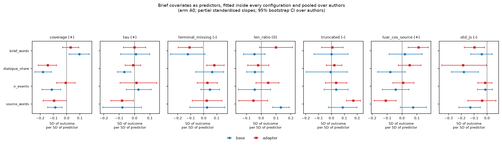
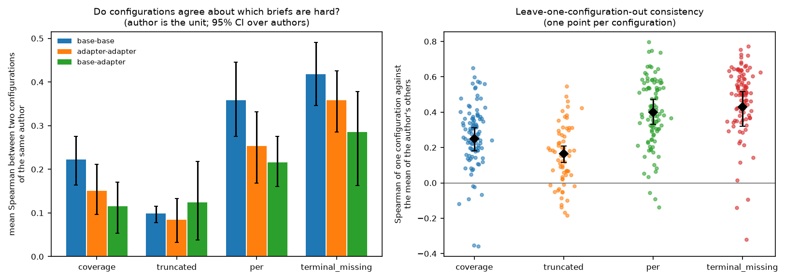
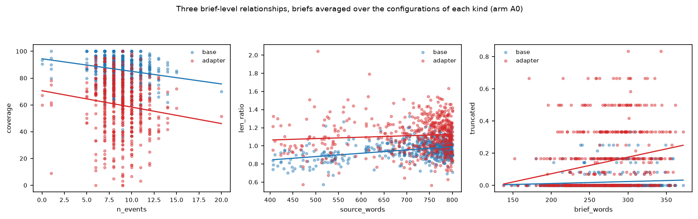

# 20 Brief covariates: what makes a brief hard, and for whom

## What this does

Asks what makes a brief hard: whether the length of the source passage, the number of events,
the share of dialogue or the length of the brief itself predict how well a configuration
covers the brief, keeps its event order, hits the target length, avoids the token cap or
lands the author's voice; whether those relationships differ between base and adapter and
across parameter counts; and whether the briefs that are hard for one configuration are the
same ones that are hard for all the others.

2656 within-configuration regressions across 100 configurations and
14 authors, pooled to 56 author-level statements. 4
of those clear BH-FDR with an interval clear of zero.

## How it does it

Data: `data/master/cells.parquet`, arm A0 and non-replicate cells only, averaged over the two
samples to one row per (configuration, brief). Arm A0 matters here: tau, terminal_missing,
otd_js and per are eval-cache measures that exist for arm A0 alone, so nothing in this folder
can be read as an A1-A5 effect. Coverage is an LLM-judged adherence measure (share of brief
items the judge found), scored on sample 0 only; it is a judge reading, not a count.

Unit and model. The primary estimate is not a single regression over all cells. Each of the
100 configurations gets its own regression of the outcome on all four predictors, each
predictor standardised within that configuration so an author with a narrow spread of briefs
is not compared on a different scale to one with a wide spread. Those slopes are averaged
within an author (so the author, not the brief and not the run, is the unit of replication)
and pooled with a bootstrap over authors, Wilcoxon signed-rank over authors for the p-value,
BH-FDR across the pooled table.

This matters because each brief appears in up to 14
configurations of its author, so a cell-level regression treats one brief as dozens of
independent observations. `mixed_models.csv` fits the cell-level models anyway, once with an
author random intercept alone and once with a variance component for the brief, and
`se_inflation_from_repeated_briefs.csv` shows the difference: acknowledging the repeated brief
multiplies the standard errors by a median of 1.4 and up to 2.2.

work_key is added as a variance component for the 12 of 14
authors whose test briefs come from more than one work; watts, rucker draw all their test
briefs from a single work, so a work effect is not identified for them at all.

Floors. The pooled estimates here are standardised slopes and rank correlations, not level
differences, so the replicate floors in 10_inventory_integrity/replicate_floors.csv do not
convert to them directly and none is quoted. The comparison that does apply to the difficulty
agreement is the within-run test-retest correlation between the two samples of one
configuration (10_inventory_integrity/test_retest.csv): two configurations cannot agree about
brief difficulty more than one configuration agrees with itself, so read every agreement number
below against that ceiling.

Interactions. Two routes: a mixed model of the per-author slope on kind, log2(params) and
family (`slope_moderators.csv`, `slope_kind_contrast.csv`), and cell-level models carrying
the interaction terms directly (`mixed_models.csv`, specs "kind interaction" and "size
interaction"). 0 of 35 cell-level model fits failed outright and
0 sit at the zero boundary for the author variance. These are supplementary:
the per-configuration route above is the primary estimate because it keeps the author as the
unit of replication.

Difficulty. Within each configuration, each outcome is z-scored across that configuration's
briefs and signed so that a higher value means a harder brief. Agreement is the Spearman
between two configurations of the same author over their shared briefs, summarised first
within an author and then bootstrapped over authors; the leave-one-out version correlates each
configuration with the mean of the author's remaining configurations.

### Brief covariates pooled over authors (partial standardised slopes; author is the unit)

| outcome | predictor | kind | n_authors | slope_std | ci_low | ci_high | n_authors_positive | q_bh | consistent |
|---|---|---|---|---|---|---|---|---|---|
| coverage | brief_words | adapter | 14 | 0.030 | -0.031 | 0.097 | 8 | 0.702 | False |
| coverage | brief_words | base | 14 | 0.097 | 0.018 | 0.169 | 11 | 0.191 | False |
| coverage | dialogue_share | adapter | 14 | -0.143 | -0.220 | -0.079 | 3 | 0.032 | True |
| coverage | dialogue_share | base | 14 | -0.180 | -0.241 | -0.115 | 1 | 0.007 | True |
| coverage | n_events | adapter | 14 | -0.008 | -0.075 | 0.064 | 5 | 0.798 | False |
| coverage | n_events | base | 14 | -0.114 | -0.188 | -0.047 | 3 | 0.059 | False |
| coverage | source_words | adapter | 14 | -0.095 | -0.184 | -0.002 | 2 | 0.191 | False |
| coverage | source_words | base | 14 | -0.086 | -0.145 | -0.031 | 4 | 0.067 | False |
| len_ratio | brief_words | adapter | 14 | 0.100 | -0.015 | 0.209 | 9 | 0.390 | False |
| len_ratio | brief_words | base | 14 | -0.046 | -0.119 | 0.031 | 6 | 0.644 | False |
| len_ratio | dialogue_share | adapter | 14 | -0.021 | -0.087 | 0.060 | 6 | 0.663 | False |
| len_ratio | dialogue_share | base | 14 | -0.044 | -0.103 | 0.014 | 5 | 0.434 | False |
| len_ratio | n_events | adapter | 14 | 0.047 | -0.042 | 0.118 | 10 | 0.482 | False |
| len_ratio | n_events | base | 14 | -0.045 | -0.150 | 0.064 | 6 | 0.702 | False |
| len_ratio | source_words | adapter | 14 | -0.052 | -0.162 | 0.043 | 6 | 0.644 | False |
| len_ratio | source_words | base | 14 | 0.132 | 0.078 | 0.191 | 14 | 0.003 | True |
| luar_cos_source | brief_words | adapter | 14 | 0.111 | 0.041 | 0.175 | 10 | 0.067 | False |
| luar_cos_source | brief_words | base | 14 | 0.018 | -0.090 | 0.142 | 6 | 0.952 | False |
| luar_cos_source | dialogue_share | adapter | 14 | 0.051 | -0.020 | 0.125 | 10 | 0.466 | False |
| luar_cos_source | dialogue_share | base | 14 | -0.079 | -0.163 | 0.023 | 4 | 0.210 | False |
| luar_cos_source | n_events | adapter | 14 | 0.008 | -0.062 | 0.083 | 6 | 0.952 | False |
| luar_cos_source | n_events | base | 14 | -0.043 | -0.133 | 0.049 | 4 | 0.608 | False |
| luar_cos_source | source_words | adapter | 14 | -0.110 | -0.185 | -0.040 | 3 | 0.067 | False |
| luar_cos_source | source_words | base | 14 | 0.073 | -0.016 | 0.157 | 10 | 0.434 | False |
| otd_js | brief_words | adapter | 14 | -0.098 | -0.177 | -0.016 | 5 | 0.191 | False |
| otd_js | brief_words | base | 14 | -0.042 | -0.129 | 0.039 | 6 | 0.644 | False |
| otd_js | dialogue_share | adapter | 14 | -0.186 | -0.351 | -0.016 | 3 | 0.220 | False |
| otd_js | dialogue_share | base | 14 | -0.180 | -0.280 | -0.065 | 2 | 0.067 | False |
| otd_js | n_events | adapter | 14 | -0.013 | -0.065 | 0.039 | 7 | 0.834 | False |
| otd_js | n_events | base | 14 | -0.014 | -0.072 | 0.042 | 5 | 0.798 | False |
| otd_js | source_words | adapter | 14 | -0.038 | -0.137 | 0.074 | 5 | 0.796 | False |
| otd_js | source_words | base | 14 | -0.131 | -0.219 | -0.048 | 4 | 0.093 | False |
| tau | brief_words | adapter | 14 | 0.000 | -0.072 | 0.076 | 5 | 0.901 | False |
| tau | brief_words | base | 14 | 0.009 | -0.088 | 0.100 | 8 | 0.901 | False |
| tau | dialogue_share | adapter | 14 | -0.009 | -0.062 | 0.048 | 6 | 0.798 | False |
| tau | dialogue_share | base | 14 | -0.066 | -0.113 | -0.022 | 3 | 0.103 | False |
| tau | n_events | adapter | 14 | 0.014 | -0.090 | 0.139 | 6 | 0.937 | False |
| tau | n_events | base | 14 | 0.025 | -0.058 | 0.107 | 7 | 0.777 | False |
| tau | source_words | adapter | 14 | -0.082 | -0.150 | -0.008 | 4 | 0.191 | False |
| tau | source_words | base | 14 | -0.081 | -0.206 | 0.037 | 4 | 0.482 | False |
| terminal_missing | brief_words | adapter | 14 | -0.108 | -0.197 | -0.010 | 4 | 0.191 | False |
| terminal_missing | brief_words | base | 14 | -0.123 | -0.258 | 0.012 | 5 | 0.390 | False |
| terminal_missing | dialogue_share | adapter | 14 | 0.083 | 0.022 | 0.150 | 10 | 0.220 | False |
| terminal_missing | dialogue_share | base | 14 | 0.064 | -0.066 | 0.158 | 10 | 0.191 | False |
| terminal_missing | n_events | adapter | 14 | 0.028 | -0.051 | 0.114 | 9 | 0.702 | False |
| terminal_missing | n_events | base | 14 | 0.048 | -0.016 | 0.126 | 9 | 0.701 | False |
| terminal_missing | source_words | adapter | 14 | 0.023 | -0.093 | 0.142 | 6 | 0.921 | False |
| terminal_missing | source_words | base | 14 | 0.025 | -0.107 | 0.159 | 8 | 0.796 | False |
| truncated | brief_words | adapter | 14 | 0.007 | -0.082 | 0.095 | 7 | 0.937 | False |
| truncated | brief_words | base | 9 | 0.000 | -0.136 | 0.128 | 6 | 0.901 | False |
| truncated | dialogue_share | adapter | 14 | 0.023 | -0.041 | 0.080 | 9 | 0.517 | False |
| truncated | dialogue_share | base | 9 | -0.007 | -0.188 | 0.122 | 7 | 0.663 | False |
| truncated | n_events | adapter | 14 | 0.037 | -0.045 | 0.122 | 8 | 0.644 | False |
| truncated | n_events | base | 9 | 0.036 | -0.059 | 0.126 | 6 | 0.777 | False |
| truncated | source_words | adapter | 14 | 0.170 | 0.119 | 0.227 | 14 | 0.003 | True |
| truncated | source_words | base | 9 | 0.086 | -0.021 | 0.194 | 6 | 0.399 | False |

### The predictors themselves

| predictor | count | mean | std | min | 25% | 50% | 75% | max | within_author_sd_over_total_sd |
|---|---|---|---|---|---|---|---|---|---|
| source_words | 546.000 | 713.621 | 99.787 | 406.000 | 688.750 | 755.000 | 784.000 | 800.000 | 0.647 |
| n_events | 546.000 | 8.753 | 2.121 | 0.000 | 7.000 | 9.000 | 10.000 | 20.000 | 0.928 |
| dialogue_share | 546.000 | 0.201 | 0.154 | 0.000 | 0.065 | 0.188 | 0.318 | 0.741 | 0.759 |
| brief_words | 546.000 | 269.639 | 44.362 | 138.000 | 237.250 | 271.000 | 301.000 | 372.000 | 0.897 |

### How correlated the predictors are with one another (Spearman, one row per brief)

| predictor | source_words | n_events | dialogue_share | brief_words |
|---|---|---|---|---|
| source_words | 1.000 | 0.250 | 0.375 | 0.523 |
| n_events | 0.250 | 1.000 | 0.256 | 0.422 |
| dialogue_share | 0.375 | 0.256 | 1.000 | 0.225 |
| brief_words | 0.523 | 0.422 | 0.225 | 1.000 |

### Does the slope change between base and adapter? (mixed model on the per-author slopes)

| outcome | predictor | term | estimate | se | ci_low | ci_high | p | q_bh | n_groups |
|---|---|---|---|---|---|---|---|---|---|
| coverage | brief_words | C(kind)[T.base] | 0.070 | 0.042 | -0.011 | 0.151 | 0.092 | 0.259 | 14 |
| coverage | dialogue_share | C(kind)[T.base] | -0.043 | 0.034 | -0.109 | 0.023 | 0.202 | 0.408 | 14 |
| coverage | n_events | C(kind)[T.base] | -0.082 | 0.043 | -0.167 | 0.002 | 0.056 | 0.225 | 14 |
| coverage | source_words | C(kind)[T.base] | 0.028 | 0.038 | -0.045 | 0.102 | 0.453 | 0.747 | 14 |
| len_ratio | brief_words | C(kind)[T.base] | -0.193 | 0.044 | -0.279 | -0.107 | 0.000 | 0.000 | 14 |
| len_ratio | dialogue_share | C(kind)[T.base] | 0.012 | 0.034 | -0.054 | 0.079 | 0.720 | 0.839 | 14 |
| len_ratio | n_events | C(kind)[T.base] | -0.067 | 0.040 | -0.144 | 0.011 | 0.093 | 0.259 | 14 |
| len_ratio | source_words | C(kind)[T.base] | 0.165 | 0.042 | 0.084 | 0.247 | 0.000 | 0.001 | 14 |
| luar_cos_source | brief_words | C(kind)[T.base] | -0.117 | 0.039 | -0.193 | -0.041 | 0.002 | 0.014 | 14 |
| luar_cos_source | dialogue_share | C(kind)[T.base] | -0.142 | 0.029 | -0.198 | -0.086 | 0.000 | 0.000 | 14 |
| luar_cos_source | n_events | C(kind)[T.base] | -0.029 | 0.034 | -0.096 | 0.038 | 0.394 | 0.689 | 14 |
| luar_cos_source | source_words | C(kind)[T.base] | 0.173 | 0.034 | 0.106 | 0.239 | 0.000 | 0.000 | 14 |
| otd_js | brief_words | C(kind)[T.base] | 0.055 | 0.034 | -0.012 | 0.121 | 0.106 | 0.269 | 14 |
| otd_js | dialogue_share | C(kind)[T.base] | 0.011 | 0.033 | -0.055 | 0.076 | 0.749 | 0.839 | 14 |
| otd_js | n_events | C(kind)[T.base] | 0.017 | 0.031 | -0.044 | 0.078 | 0.588 | 0.800 | 14 |
| otd_js | source_words | C(kind)[T.base] | -0.037 | 0.036 | -0.108 | 0.034 | 0.305 | 0.570 | 14 |
| tau | brief_words | C(kind)[T.base] | 0.017 | 0.038 | -0.057 | 0.090 | 0.656 | 0.800 | 14 |
| tau | dialogue_share | C(kind)[T.base] | -0.053 | 0.027 | -0.106 | -0.000 | 0.049 | 0.225 | 14 |
| tau | n_events | C(kind)[T.base] | 0.034 | 0.027 | -0.019 | 0.087 | 0.203 | 0.408 | 14 |
| tau | source_words | C(kind)[T.base] | 0.014 | 0.032 | -0.048 | 0.077 | 0.657 | 0.800 | 14 |
| terminal_missing | brief_words | C(kind)[T.base] | -0.048 | 0.038 | -0.123 | 0.026 | 0.204 | 0.408 | 14 |
| terminal_missing | dialogue_share | C(kind)[T.base] | -0.000 | 0.032 | -0.062 | 0.062 | 0.991 | 0.991 | 14 |
| terminal_missing | n_events | C(kind)[T.base] | 0.019 | 0.036 | -0.050 | 0.089 | 0.587 | 0.800 | 14 |
| terminal_missing | source_words | C(kind)[T.base] | -0.008 | 0.036 | -0.078 | 0.062 | 0.822 | 0.885 | 14 |
| truncated | brief_words | C(kind)[T.base] | -0.113 | 0.061 | -0.233 | 0.007 | 0.064 | 0.225 | 14 |
| truncated | dialogue_share | C(kind)[T.base] | 0.023 | 0.048 | -0.071 | 0.117 | 0.631 | 0.800 | 14 |
| truncated | n_events | C(kind)[T.base] | 0.027 | 0.054 | -0.078 | 0.132 | 0.613 | 0.800 | 14 |
| truncated | source_words | C(kind)[T.base] | 0.008 | 0.050 | -0.090 | 0.105 | 0.878 | 0.910 | 14 |

### What acknowledging the repeated brief does to the standard errors

| outcome | predictor | estimate_author_re | se_author_re | estimate_with_brief_vc | se_with_brief_vc | se_ratio |
|---|---|---|---|---|---|---|
| coverage | source_words | -2.394 | 0.538 | -2.874 | 0.579 | 1.077 |
| coverage | n_events | -1.071 | 0.466 | -1.599 | 0.562 | 1.206 |
| coverage | dialogue_share | -2.710 | 0.532 | -1.111 | 0.531 | 0.999 |
| coverage | brief_words | 1.594 | 0.501 | 1.104 | 0.621 | 1.241 |
| tau | source_words | -0.024 | 0.006 | -0.012 | 0.009 | 1.548 |
| tau | n_events | 0.008 | 0.005 | 0.013 | 0.010 | 1.860 |
| tau | dialogue_share | -0.011 | 0.006 | -0.010 | 0.009 | 1.549 |
| tau | brief_words | -0.002 | 0.006 | -0.013 | 0.011 | 1.886 |
| terminal_missing | source_words | 0.006 | 0.008 | 0.029 | 0.012 | 1.494 |
| terminal_missing | n_events | 0.024 | 0.007 | 0.032 | 0.013 | 1.784 |
| terminal_missing | dialogue_share | 0.039 | 0.008 | 0.030 | 0.012 | 1.496 |
| terminal_missing | brief_words | -0.066 | 0.008 | -0.061 | 0.014 | 1.811 |
| len_ratio | source_words | 0.002 | 0.005 | 0.007 | 0.006 | 1.101 |
| len_ratio | n_events | 0.001 | 0.004 | -0.000 | 0.005 | 1.233 |
| len_ratio | dialogue_share | -0.008 | 0.005 | -0.004 | 0.005 | 1.031 |
| len_ratio | brief_words | 0.016 | 0.005 | 0.017 | 0.006 | 1.263 |
| truncated | source_words | 0.025 | 0.005 | 0.021 | 0.005 | 1.000 |
| truncated | n_events | 0.001 | 0.004 | 0.003 | 0.004 | 1.100 |
| truncated | dialogue_share | 0.007 | 0.005 | 0.003 | 0.004 | 0.916 |
| truncated | brief_words | 0.007 | 0.004 | 0.010 | 0.005 | 1.139 |
| luar_cos_source | source_words | 0.001 | 0.002 | 0.005 | 0.002 | 1.349 |
| luar_cos_source | n_events | 0.000 | 0.001 | -0.000 | 0.002 | 1.593 |
| luar_cos_source | dialogue_share | -0.002 | 0.001 | 0.003 | 0.002 | 1.316 |
| luar_cos_source | brief_words | 0.005 | 0.001 | 0.004 | 0.002 | 1.617 |
| otd_js | source_words | -0.010 | 0.002 | -0.025 | 0.003 | 1.768 |
| otd_js | n_events | -0.000 | 0.002 | -0.007 | 0.004 | 2.167 |
| otd_js | dialogue_share | -0.021 | 0.002 | -0.023 | 0.003 | 1.783 |
| otd_js | brief_words | -0.006 | 0.002 | 0.002 | 0.004 | 2.194 |

### Do configurations agree about which briefs are hard?

| measure | pair_kind | n_authors | n_pairs | mean_spearman | ci_low | ci_high | median_pair_spearman |
|---|---|---|---|---|---|---|---|
| coverage | adapter-adapter | 13 | 81 | 0.151 | 0.099 | 0.209 | 0.137 |
| coverage | base-adapter | 14 | 212 | 0.115 | 0.054 | 0.170 | 0.141 |
| coverage | base-base | 13 | 81 | 0.222 | 0.162 | 0.280 | 0.247 |
| per | adapter-adapter | 13 | 81 | 0.253 | 0.169 | 0.341 | 0.245 |
| per | base-adapter | 14 | 212 | 0.216 | 0.157 | 0.283 | 0.187 |
| per | base-base | 13 | 81 | 0.358 | 0.276 | 0.448 | 0.273 |
| terminal_missing | adapter-adapter | 13 | 81 | 0.359 | 0.288 | 0.426 | 0.442 |
| terminal_missing | base-adapter | 14 | 203 | 0.286 | 0.177 | 0.383 | 0.390 |
| terminal_missing | base-base | 12 | 76 | 0.418 | 0.348 | 0.489 | 0.478 |
| truncated | adapter-adapter | 13 | 70 | 0.084 | 0.032 | 0.133 | 0.113 |
| truncated | base-adapter | 9 | 90 | 0.125 | 0.041 | 0.222 | -0.023 |
| truncated | base-base | 3 | 24 | 0.099 | 0.078 | 0.115 | -0.009 |

### Leave-one-configuration-out consistency

| measure | n_authors | n_configs | mean_spearman_vs_rest | ci_low | ci_high |
|---|---|---|---|---|---|
| coverage | 13 | 98 | 0.250 | 0.177 | 0.316 |
| per | 13 | 98 | 0.400 | 0.333 | 0.472 |
| terminal_missing | 13 | 95 | 0.429 | 0.325 | 0.521 |
| truncated | 13 | 66 | 0.164 | 0.111 | 0.213 |

### Does difficulty follow the brief covariates? (within-author Spearman, author is the unit)

| difficulty_measure | predictor | n_authors | mean_within_author_spearman | ci_low | ci_high | p | q_bh |
|---|---|---|---|---|---|---|---|
| coverage | source_words | 14 | 0.173 | 0.100 | 0.242 | 0.001 | 0.010 |
| coverage | n_events | 14 | 0.131 | 0.048 | 0.211 | 0.009 | 0.027 |
| coverage | dialogue_share | 14 | 0.268 | 0.151 | 0.375 | 0.003 | 0.012 |
| coverage | brief_words | 14 | 0.010 | -0.068 | 0.098 | 0.903 | 0.910 |
| truncated | source_words | 14 | 0.315 | 0.221 | 0.412 | 0.000 | 0.002 |
| truncated | n_events | 14 | 0.095 | -0.037 | 0.213 | 0.173 | 0.251 |
| truncated | dialogue_share | 14 | 0.082 | -0.045 | 0.179 | 0.030 | 0.059 |
| truncated | brief_words | 14 | 0.213 | 0.112 | 0.317 | 0.003 | 0.012 |
| per | source_words | 14 | 0.098 | 0.038 | 0.155 | 0.013 | 0.031 |
| per | n_events | 14 | 0.065 | -0.034 | 0.154 | 0.153 | 0.245 |
| per | dialogue_share | 14 | 0.321 | 0.160 | 0.455 | 0.011 | 0.029 |
| per | brief_words | 14 | -0.011 | -0.066 | 0.045 | 0.753 | 0.861 |
| terminal_missing | source_words | 9 | 0.082 | -0.034 | 0.192 | 0.301 | 0.401 |
| terminal_missing | n_events | 9 | 0.055 | -0.038 | 0.159 | 0.652 | 0.803 |
| terminal_missing | dialogue_share | 9 | -0.002 | -0.128 | 0.101 | 0.910 | 0.910 |
| terminal_missing | brief_words | 9 | -0.107 | -0.199 | -0.014 | 0.074 | 0.132 |

### The two hardest briefs per author on coverage

| author | id | mean_difficulty_z | n_configs | source_words | n_events | dialogue_share | brief_words |
|---|---|---|---|---|---|---|---|
| cather | cather__24_00_0001 | 2.049 | 6 | 797.000 | 9.000 | 0.266 | 277.000 |
| cather | cather__346_05_0003 | 1.254 | 6 | 787.000 | 6.000 | 0.267 | 237.000 |
| chesterton | chesterton__223_08_0002 | 1.432 | 12 | 666.000 | 9.000 | 0.333 | 250.000 |
| chesterton | chesterton__223_08_0005 | 1.024 | 12 | 777.000 | 10.000 | 0.420 | 287.000 |
| chopin | chopin__46650_01_0001 | 2.048 | 6 | 783.000 | 10.000 | 0.302 | 296.000 |
| chopin | chopin__46650_01_0003 | 1.219 | 6 | 794.000 | 11.000 | 0.197 | 362.000 |
| doctorow | doctorow__5_00_0087 | 1.514 | 12 | 787.000 | 7.000 | 0.178 | 138.000 |
| doctorow | doctorow__5_00_0071 | 1.326 | 12 | 799.000 | 11.000 | 0.465 | 238.000 |
| h_private | h_private__1_00_0007 | 0.837 | 6 | 783.000 | 8.000 | 0.000 | 279.000 |
| h_private | h_private__1_17_0000 | 0.740 | 6 | 781.000 | 8.000 | 0.115 | 289.000 |
| link | link__106_00_0001 | 0.569 | 6 | 785.000 | 8.000 | 0.287 | 325.000 |
| link | link__110_00_0011 | 0.441 | 6 | 753.000 | 13.000 | 0.200 | 211.000 |
| mansfield | mansfield__66871_14_0000 | 3.090 | 6 | 788.000 | 9.000 | 0.359 | 332.000 |
| mansfield | mansfield__66871_11_0001 | 0.834 | 6 | 406.000 | 7.000 | 0.219 | 168.000 |
| patrick | patrick__137_00_0000 | 1.955 | 2 | 542.000 | 10.000 | 0.162 | 211.000 |
| patrick | patrick__127_00_0002 | 1.290 | 2 | 432.000 | 5.000 | 0.056 | 223.000 |
| patrick_v2 | patrick_v2__124_00_0001 | 1.232 | 14 | 561.000 | 11.000 | 0.217 | 228.000 |
| patrick_v2 | patrick_v2__110_00_0001 | 1.016 | 14 | 759.000 | 10.000 | 0.078 | 256.000 |
| rucker | rucker__2_00_0025 | 2.049 | 6 | 758.000 | 10.000 | 0.195 | 198.000 |
| rucker | rucker__2_00_0050 | 1.546 | 6 | 740.000 | 13.000 | 0.291 | 180.000 |
| stross | stross__109_00_0015 | 1.303 | 6 | 761.000 | 10.000 | 0.431 | 311.000 |
| stross | stross__101_00_0008 | 1.186 | 6 | 732.000 | 8.000 | 0.208 | 248.000 |
| sui_sin_far | sui_sin_far__62940_02_0003 | 0.944 | 6 | 771.000 | 9.000 | 0.211 | 278.000 |
| sui_sin_far | sui_sin_far__62940_02_0005 | 0.900 | 6 | 787.000 | 9.000 | 0.423 | 291.000 |
| watts | watts__3_00_0127 | 0.999 | 6 | 800.000 | 10.000 | 0.300 | 240.000 |
| watts | watts__3_00_0169 | 0.659 | 6 | 800.000 | 9.000 | 0.270 | 248.000 |
| wharton | wharton__4519_01_0004 | 1.971 | 6 | 790.000 | 10.000 | 0.308 | 362.000 |
| wharton | wharton__9190_04_0003 | 1.478 | 6 | 755.000 | 11.000 | 0.043 | 252.000 |

### Brief covariate slopes

### Difficulty consistency

### Brief-level relationships

### Headline numbers

- The brief covariates predict the adherence and length outcomes and not the voice ones.
  4 of 56 pooled outcome x predictor x kind slopes clear
  BH-FDR inside this table's family of 56 tests with an interval clear of zero, and all
  of them sit in the adherence and length outcomes:
  coverage, len_ratio, truncated. Each rests on at most 14 authors.
- Ranked by size, the ones that survive are: dialogue_share on coverage (base) -0.18 SD [-0.24, -0.12], 1 of 14 authors with a positive slope, q = 0.007; source_words on truncated (adapter) +0.17 SD [+0.12, +0.23], 14 of 14 authors with a positive slope, q = 0.003; dialogue_share on coverage (adapter) -0.14 SD [-0.22, -0.08], 3 of 14 authors with a positive slope, q = 0.032; source_words on len_ratio (base) +0.13 SD [+0.08, +0.19], 14 of 14 authors with a positive slope, q = 0.003.
- Dialogue share is the only predictor whose coverage slope clears correction under both
  mechanisms, at almost the same size: -0.18 SD of coverage per SD of
  dialogue share on base runs
  [-0.24, -0.12]
  and -0.14
  [-0.22, -0.08]
  on adapter runs, with only
  1 and
  3 of
  14 authors going the
  other way. This is consistent with dialogue-heavy briefs scoring lower on the judged coverage
  measure whether or not the model has been fine-tuned on the author. Coverage is an LLM judge's
  reading, the predictors were not assigned, and the slope is partial, so it does not establish
  what the model does with dialogue.
- The brief covariates carry little of the voice measures. The pooled standardised slopes on
  luar_cos_source run from -0.110 to
  +0.111 and on otd_js from
  -0.186 to
  -0.013, none of them consistent across
  authors.
- Configurations agree about which briefs are hard, but only weakly, and the agreement varies
  more across measures than across pair kinds. Across the four difficulty measures the
  mean within-author Spearman between two configurations runs from
  +0.08 [+0.03, +0.13]
  (truncated, adapter-adapter) to
  +0.42 [+0.35, +0.49]
  (terminal_missing, base-base). Every one of the 12 agreement cells is
  positive with an interval clear of zero, so the ordering of briefs is not noise, but at these
  correlations most of what makes a passage hard is not the brief. Read them against the
  within-run test-retest correlation in 10_inventory_integrity/test_retest.csv, and note that
  2 of the 12 cells rest on fewer than ten authors.
- Two runs of the same kind agree about difficulty more than a base run and an adapter run do.
  base-base is the highest of the three pair kinds on 3 of the 4 difficulty
  measures and base-adapter is the lowest on 3. On coverage difficulty:
  adapter-adapter +0.15 [+0.10, +0.21], base-adapter +0.12 [+0.05, +0.17], base-base +0.22 [+0.16, +0.28].
  Part of the shared ordering therefore belongs to the mechanism and not only to the brief.
  Leave-one-configuration-out: coverage +0.25 [+0.18, +0.32] (n = 13 authors); per +0.40 [+0.33, +0.47] (n = 13 authors); terminal_missing +0.43 [+0.32, +0.52] (n = 13 authors); truncated +0.16 [+0.11, +0.21] (n = 13 authors).
- Difficulty is only weakly explained by the covariates that are supposed to describe it:
  7 of 16 within-author difficulty-covariate correlations clear BH-FDR
  (coverage vs source_words +0.17 [+0.10, +0.24]; coverage vs n_events +0.13 [+0.05, +0.21]; coverage vs dialogue_share +0.27 [+0.15, +0.38]; truncated vs source_words +0.31 [+0.22, +0.41]; truncated vs brief_words +0.21 [+0.11, +0.32]; per vs source_words +0.10 [+0.04, +0.16]; per vs dialogue_share +0.32 [+0.16, +0.46]).
- Ignoring that briefs repeat across configurations would shrink the standard errors by a median
  factor of 1.4 (up to 2.2). A cell-level p-value computed without a brief term
  in this folder is optimistic by about that much.

## How to read the result, conservatively

The unit is the author: 14 of them, so every pooled interval here is a bootstrap over
at most 14 values and is wide. Two of those 14 are patrick and patrick_v2, which are
the same corpus chunked two ways, so the effective number of independent corpora is one lower
than the count in n_authors. `n_authors_positive` in the pooled table says how many authors
had a slope of the reported sign, and it is a better guide to consistency than the p-value.

Two of the relationships are partly definitional and must not be read as findings.
target_words equals source_words for every cell, so len_ratio is generated words divided by
source_words and its slope on source_words (+0.04 standardised) is
largely arithmetic. And source_words is capped: 2% of briefs sit at the
800-word ceiling, so its upper tail is censored and any slope on it is attenuated.

The four predictors are correlated with each other (source_words with brief_words at Spearman
0.52, brief_words with
n_events at 0.42), so these
are partial slopes and none of them isolates a mechanism. A brief with more events is also a
longer brief.

What would overturn this. The pooled slopes average an author's configurations before
pooling, which hides any configuration where the relationship reverses;
`slopes_by_configuration.csv` is the unaggregated version. If the difficulty agreement is
driven by a handful of degenerate briefs (a brief every configuration truncates, say), the
rank correlations would stay high while meaning much less; `brief_difficulty_ranked.csv` lists
every brief's mean difficulty so that can be checked.

What this does not show. It says nothing about which briefs a reader would find hard: every
outcome here is either an automatic measure or an LLM judge's count of brief items, and the
judge is a relative instrument with its own failure modes. It says nothing about arms other
than A0, and nothing about the eval-cache measures on any other arm, because they do not exist
there. And a consistent difficulty ordering is not evidence that the brief caused the
difficulty: briefs from the same work share a source text, and work_key is only separable for
12 of the 14 authors.

## Caveats

- target_words equals source_words exactly in every cell, so len_ratio regressed on source_words is close to an identity and is reported for completeness only.
- source_words is censored at 800 words for 2% of briefs.
- The four predictors are mutually correlated; the slopes are partial and do not separate length from event count.
- Every brief appears in up to 14 configurations of its author. The pooled estimates handle this by making the author the unit; the cell-level mixed models are reported with and without a brief variance component precisely because the naive version understates the standard errors.
- work_key is not identified for watts, rucker (one work each) and is thin for doctorow (2), link (3), stross (3); the work variance component uses the 12 authors with more than one work.
- truncated and terminal_missing are rates in {0, 0.5, 1} at the brief level; the regressions on them are linear probability models, not logistic.
- coverage exists on sample 0 only and is missing for several adapter runs, so its configuration count is lower than the other outcomes'. Ten runs' coverage rows were error rows from the 2026-09-09 credit outage and are being regenerated; a missing coverage cell is a judge call that never returned, not a run that covered nothing, and the coverage slopes will move when that rerun lands.
- Base truncation has no variance at all in most base configurations (the 8B and 14B base runs almost never hit the cap), so the truncated-on-base rows rest on 9 authors rather than 14; configurations with a constant outcome are dropped before fitting rather than contributing a zero slope.
- The difficulty-agreement cells do not all rest on the same number of authors: 2 of 12 are bootstrapped over fewer than ten authors (truncated base-adapter (n = 9 authors), truncated base-base (n = 3 authors)). On 2 of those the median_pair_spearman column in the same table is negative while the author mean is positive, so the mean is carried by a minority of pairs.
- per (proposition echo) is close to permutation-invariant, so as a difficulty measure it registers restatement between sentences and not the order the sentences arrive in.
- Difficulty is defined per configuration by z-scoring within that configuration, which removes every level difference between configurations by construction; this analysis is about the ordering of briefs, never about which configuration is better.
