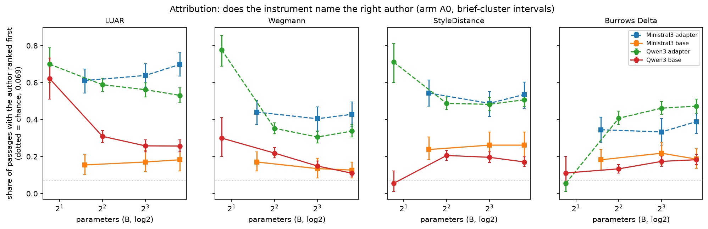
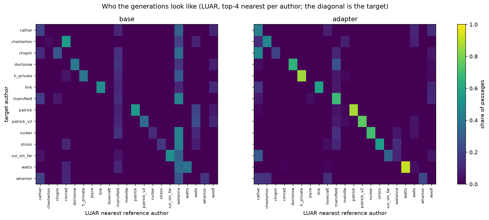
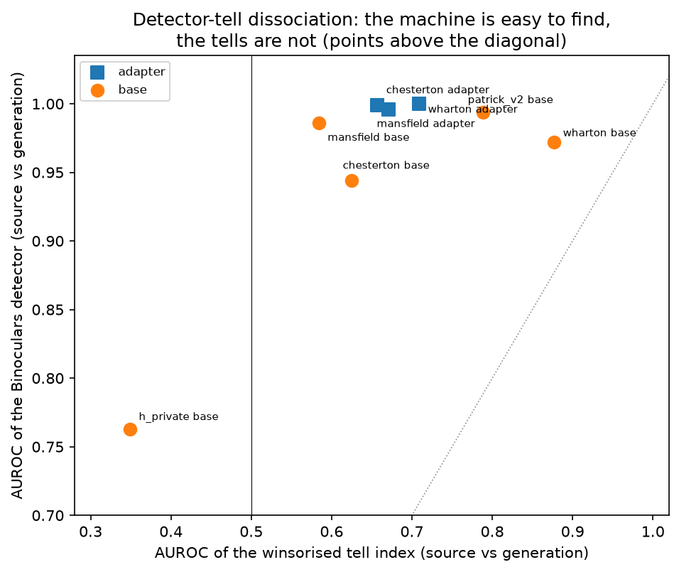
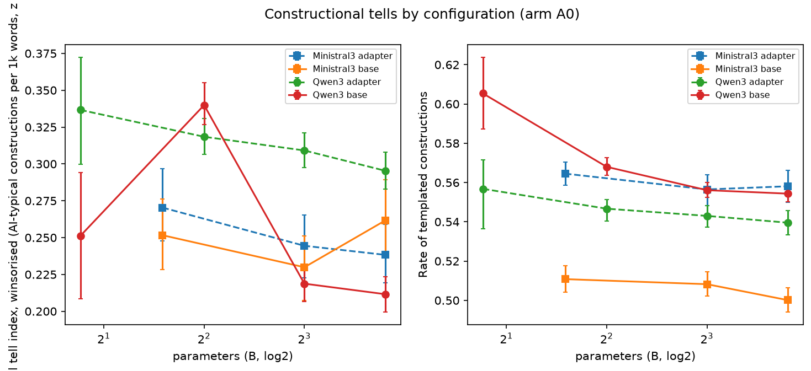

# 21_attribution_detection: closed-set attribution and machine-text detection

## What this does

Two separate questions. Can an authorship instrument put the target author first among the
14-15 candidates scored in its own run, and does the adapter move that. Can a
machine-text detector tell the generation from the author's own prose, and does the constructional
tell index see the same thing the detector sees.

Attribution is measured four ways (LUAR, Wegmann, StyleDistance, Burrows Delta rank 1) by
family x size x kind, per author, and as a brief-paired adapter-versus-base contrast against
each measure's replicate floor. Copying is measured three ways (memorisation flag, 8-gram
overlap with the training text, longest common substring). Detection comes from the study's own
detector-tell dissociation table, re-parsed from `data/eval_results/dtd.md` and joined to the
tell index, the hard-tell index, the template rate and the LUAR numbers for the same runs.

The short answer on attribution: the adapter cell is above the base cell in
24 of the 24 pooled family x size x instrument cells that hold more
than one author, and the author-bootstrapped interval excludes zero in 17 of
them. Excluding the single-author 1.7B cell, LUAR's author-mean rate runs
0.153-0.333 on the base
and 0.533-0.690 on the
adapter, against a chance rate of 0.069. The Ministral cells hold 3 authors
each, so their intervals are wide and the direction there is a description of 3
cases. The short answer on copying: 1 of 7876 cells trip the memorisation flag, which
is an n-gram overlap check against the training text rather than a provenance test, so what it
rules out is verbatim reuse at that n-gram length.

The confusion table says which candidate the instruments pick when they are not picking the
target. Under LUAR, the single most common nearest author for a base generation is
`watanna`
(0.251 of base passages, and the top answer for
6 of the 14 target authors),
against a self-rate of 0.263. For adapter generations the most common
answer is `mansfield` (0.128) and the self-rate is
0.582. So the adapter passages are ranked to the target more often and are
spread more evenly over the rest of the pool. Both numbers are the attribution model's own ranks
over a fixed candidate list, not a finding about who wrote the passage.

Each instrument has a different attractor, which is the reason to distrust the level rather than
the gain: on base generations the most common answer is
`chopin` for Burrows Delta (0.434), `sui_sin_far` for Wegmann (0.314), `cather` for StyleDistance (0.277), `watanna` for LUAR (0.251).
Four instruments scoring the same passages name four different authors, which is consistent with
part of the base rate being the instrument's own prior over the reference pool rather than
anything in the passage. Every one of those attractors is a period author, and so is every
candidate in the pool.

## How it does it

Data. `data/master/cells.parquet` at arm A0, non-replicate, both kinds (7876 cells,
14 authors, 100 runs); `data/eval_results/dtd.md` parsed as a
table (8 rows). `delta_top1` is derived here as `delta_rank <= 1`, matching the plan's
definition; the three `*_attrib` columns come from the scoring pass.

Unit. Rates are given three ways: a Wilson interval over cells (optimistic, since two samples of
one brief are not independent), a bootstrap over briefs, and an author-mean rate bootstrapped
over authors, which is the one to quote for any claim about a model or a family. Every
adapter-versus-base contrast is brief-paired inside one author x family x size block, then
pooled over authors with a bootstrap over authors. Cohen's d and Cliff's delta accompany each
paired contrast.

Statistics. Bootstrap intervals throughout, 800 to 2000 replicates; Spearman with BH-FDR across
the 24 attribution-versus-tell tests, which is the family that q is corrected within.
Each contrast is printed beside its replicate floor and the floor's origin is named in the
floor_source column. Both families now have a floor of their own; the Ministral one comes from the
two 3B replicate pairs scored on 2026-09-10 and is applied at 8B and 14B as well, and on a rate
measure a floor built from that few pairs can come out at or near zero, in which case clearing it
means nothing.

The dissociation table is taken as given, not recomputed: it reports the AUROC of a same-family
Binoculars observer and of the winsorised tell index at separating the author's own passages
from that run's generations, with a paired passage bootstrap. This script adds the tell-side
context - the mean tell index, hard-tell index and template rate for the same runs - so the
AUROC can be read against the level of the measure it was computed from.

### Attribution rate by configuration

| family | params_b | kind | instrument | n_cells | n_correct | rate | wilson_low | wilson_high | brief_ci_low | brief_ci_high | n_authors | author_mean_rate | author_ci_low | author_ci_high | chance | pool_size_min | pool_size_max |
|---|---|---|---|---|---|---|---|---|---|---|---|---|---|---|---|---|---|
| Ministral3 | 3.000 | adapter | Burrows Delta | 252 | 87 | 0.345 | 0.289 | 0.406 | 0.278 | 0.413 | 3 | 0.352 | 0.078 | 0.607 | 0.068 | 14 | 15 |
| Ministral3 | 3.000 | base | Burrows Delta | 252 | 46 | 0.183 | 0.140 | 0.235 | 0.127 | 0.238 | 3 | 0.177 | 0.000 | 0.310 | 0.068 | 14 | 15 |
| Ministral3 | 8.000 | adapter | Burrows Delta | 252 | 84 | 0.333 | 0.278 | 0.394 | 0.262 | 0.405 | 3 | 0.342 | 0.056 | 0.560 | 0.068 | 14 | 15 |
| Ministral3 | 8.000 | base | Burrows Delta | 252 | 55 | 0.218 | 0.172 | 0.273 | 0.159 | 0.278 | 3 | 0.215 | 0.013 | 0.476 | 0.068 | 14 | 15 |
| Ministral3 | 14.000 | adapter | Burrows Delta | 252 | 98 | 0.389 | 0.331 | 0.450 | 0.325 | 0.460 | 3 | 0.400 | 0.111 | 0.590 | 0.068 | 14 | 15 |
| Ministral3 | 14.000 | base | Burrows Delta | 252 | 47 | 0.187 | 0.143 | 0.239 | 0.135 | 0.242 | 3 | 0.183 | 0.013 | 0.357 | 0.068 | 14 | 15 |
| Qwen3 | 1.700 | adapter | Burrows Delta | 90 | 5 | 0.056 | 0.024 | 0.124 | 0.011 | 0.100 | 1 | 0.056 |  |  | 0.067 | 15 | 15 |
| Qwen3 | 1.700 | base | Burrows Delta | 90 | 10 | 0.111 | 0.061 | 0.193 | 0.044 | 0.200 | 1 | 0.111 |  |  | 0.067 | 15 | 15 |
| Qwen3 | 4.000 | adapter | Burrows Delta | 1092 | 445 | 0.408 | 0.379 | 0.437 | 0.374 | 0.445 | 14 | 0.405 | 0.261 | 0.552 | 0.069 | 14 | 15 |
| Qwen3 | 4.000 | base | Burrows Delta | 1092 | 146 | 0.134 | 0.115 | 0.155 | 0.111 | 0.158 | 14 | 0.131 | 0.059 | 0.224 | 0.069 | 14 | 15 |
| Qwen3 | 8.000 | adapter | Burrows Delta | 1000 | 462 | 0.462 | 0.431 | 0.493 | 0.428 | 0.498 | 13 | 0.447 | 0.309 | 0.586 | 0.069 | 14 | 15 |
| Qwen3 | 8.000 | base | Burrows Delta | 1000 | 174 | 0.174 | 0.152 | 0.199 | 0.147 | 0.203 | 13 | 0.157 | 0.068 | 0.258 | 0.069 | 14 | 15 |
| Qwen3 | 14.000 | adapter | Burrows Delta | 1000 | 473 | 0.473 | 0.442 | 0.504 | 0.435 | 0.511 | 13 | 0.463 | 0.316 | 0.614 | 0.069 | 14 | 15 |
| Qwen3 | 14.000 | base | Burrows Delta | 1000 | 183 | 0.183 | 0.160 | 0.208 | 0.157 | 0.213 | 13 | 0.168 | 0.085 | 0.256 | 0.069 | 14 | 15 |
| Ministral3 | 3.000 | adapter | LUAR | 252 | 154 | 0.611 | 0.550 | 0.669 | 0.544 | 0.675 | 3 | 0.607 | 0.538 | 0.700 | 0.068 | 14 | 15 |
| Ministral3 | 3.000 | base | LUAR | 252 | 39 | 0.155 | 0.115 | 0.205 | 0.103 | 0.210 | 3 | 0.153 | 0.038 | 0.321 | 0.068 | 14 | 15 |
| Ministral3 | 8.000 | adapter | LUAR | 252 | 161 | 0.639 | 0.578 | 0.696 | 0.575 | 0.702 | 3 | 0.632 | 0.474 | 0.767 | 0.068 | 14 | 15 |
| Ministral3 | 8.000 | base | LUAR | 252 | 43 | 0.171 | 0.129 | 0.222 | 0.119 | 0.234 | 3 | 0.170 | 0.026 | 0.440 | 0.068 | 14 | 15 |
| Ministral3 | 14.000 | adapter | LUAR | 252 | 176 | 0.698 | 0.639 | 0.752 | 0.635 | 0.762 | 3 | 0.690 | 0.500 | 0.833 | 0.068 | 14 | 15 |
| Ministral3 | 14.000 | base | LUAR | 252 | 46 | 0.183 | 0.140 | 0.235 | 0.123 | 0.246 | 3 | 0.181 | 0.026 | 0.417 | 0.068 | 14 | 15 |
| Qwen3 | 1.700 | adapter | LUAR | 90 | 63 | 0.700 | 0.599 | 0.785 | 0.600 | 0.789 | 1 | 0.700 |  |  | 0.067 | 15 | 15 |
| Qwen3 | 1.700 | base | LUAR | 90 | 56 | 0.622 | 0.519 | 0.715 | 0.511 | 0.733 | 1 | 0.622 |  |  | 0.067 | 15 | 15 |
| Qwen3 | 4.000 | adapter | LUAR | 1092 | 643 | 0.589 | 0.559 | 0.618 | 0.553 | 0.624 | 14 | 0.597 | 0.470 | 0.718 | 0.069 | 14 | 15 |
| Qwen3 | 4.000 | base | LUAR | 1092 | 338 | 0.310 | 0.283 | 0.338 | 0.275 | 0.341 | 14 | 0.333 | 0.244 | 0.421 | 0.069 | 14 | 15 |
| Qwen3 | 8.000 | adapter | LUAR | 1000 | 562 | 0.562 | 0.531 | 0.592 | 0.522 | 0.599 | 13 | 0.564 | 0.438 | 0.674 | 0.069 | 14 | 15 |
| Qwen3 | 8.000 | base | LUAR | 1000 | 258 | 0.258 | 0.232 | 0.286 | 0.226 | 0.291 | 13 | 0.278 | 0.189 | 0.368 | 0.069 | 14 | 15 |
| Qwen3 | 14.000 | adapter | LUAR | 1000 | 531 | 0.531 | 0.500 | 0.562 | 0.493 | 0.572 | 13 | 0.533 | 0.406 | 0.652 | 0.069 | 14 | 15 |
| Qwen3 | 14.000 | base | LUAR | 1000 | 257 | 0.257 | 0.231 | 0.285 | 0.225 | 0.291 | 13 | 0.269 | 0.188 | 0.352 | 0.069 | 14 | 15 |
| Ministral3 | 3.000 | adapter | StyleDistance | 252 | 137 | 0.544 | 0.482 | 0.604 | 0.472 | 0.615 | 3 | 0.531 | 0.038 | 0.964 | 0.068 | 14 | 15 |
| Ministral3 | 3.000 | base | StyleDistance | 252 | 60 | 0.238 | 0.190 | 0.294 | 0.183 | 0.306 | 3 | 0.237 | 0.000 | 0.667 | 0.068 | 14 | 15 |
| Ministral3 | 8.000 | adapter | StyleDistance | 252 | 123 | 0.488 | 0.427 | 0.550 | 0.417 | 0.552 | 3 | 0.479 | 0.051 | 0.940 | 0.068 | 14 | 15 |
| Ministral3 | 8.000 | base | StyleDistance | 252 | 66 | 0.262 | 0.211 | 0.319 | 0.194 | 0.333 | 3 | 0.262 | 0.000 | 0.774 | 0.068 | 14 | 15 |
| Ministral3 | 14.000 | adapter | StyleDistance | 252 | 135 | 0.536 | 0.474 | 0.596 | 0.460 | 0.603 | 3 | 0.525 | 0.077 | 0.988 | 0.068 | 14 | 15 |
| Ministral3 | 14.000 | base | StyleDistance | 252 | 66 | 0.262 | 0.211 | 0.319 | 0.198 | 0.333 | 3 | 0.262 | 0.000 | 0.786 | 0.068 | 14 | 15 |
| Qwen3 | 1.700 | adapter | StyleDistance | 90 | 64 | 0.711 | 0.610 | 0.795 | 0.600 | 0.811 | 1 | 0.711 |  |  | 0.067 | 15 | 15 |
| Qwen3 | 1.700 | base | StyleDistance | 90 | 5 | 0.056 | 0.024 | 0.124 | 0.011 | 0.122 | 1 | 0.056 |  |  | 0.067 | 15 | 15 |
| Qwen3 | 4.000 | adapter | StyleDistance | 1092 | 532 | 0.487 | 0.458 | 0.517 | 0.453 | 0.522 | 14 | 0.469 | 0.297 | 0.629 | 0.069 | 14 | 15 |
| Qwen3 | 4.000 | base | StyleDistance | 1092 | 225 | 0.206 | 0.183 | 0.231 | 0.179 | 0.234 | 14 | 0.230 | 0.135 | 0.326 | 0.069 | 14 | 15 |
| Qwen3 | 8.000 | adapter | StyleDistance | 1000 | 483 | 0.483 | 0.452 | 0.514 | 0.447 | 0.521 | 13 | 0.464 | 0.310 | 0.616 | 0.069 | 14 | 15 |
| Qwen3 | 8.000 | base | StyleDistance | 1000 | 196 | 0.196 | 0.173 | 0.222 | 0.169 | 0.226 | 13 | 0.226 | 0.122 | 0.351 | 0.069 | 14 | 15 |
| Qwen3 | 14.000 | adapter | StyleDistance | 1000 | 507 | 0.507 | 0.476 | 0.538 | 0.471 | 0.544 | 13 | 0.478 | 0.307 | 0.640 | 0.069 | 14 | 15 |
| Qwen3 | 14.000 | base | StyleDistance | 1000 | 171 | 0.171 | 0.149 | 0.196 | 0.145 | 0.199 | 13 | 0.192 | 0.098 | 0.299 | 0.069 | 14 | 15 |
| Ministral3 | 3.000 | adapter | Wegmann | 252 | 111 | 0.440 | 0.381 | 0.502 | 0.373 | 0.504 | 3 | 0.425 | 0.000 | 0.667 | 0.068 | 14 | 15 |
| Ministral3 | 3.000 | base | Wegmann | 252 | 43 | 0.171 | 0.129 | 0.222 | 0.123 | 0.226 | 3 | 0.173 | 0.022 | 0.381 | 0.068 | 14 | 15 |
| Ministral3 | 8.000 | adapter | Wegmann | 252 | 102 | 0.405 | 0.346 | 0.466 | 0.337 | 0.468 | 3 | 0.391 | 0.026 | 0.600 | 0.068 | 14 | 15 |
| Ministral3 | 8.000 | base | Wegmann | 252 | 34 | 0.135 | 0.098 | 0.183 | 0.083 | 0.190 | 3 | 0.135 | 0.000 | 0.393 | 0.068 | 14 | 15 |
| Ministral3 | 14.000 | adapter | Wegmann | 252 | 108 | 0.429 | 0.369 | 0.490 | 0.361 | 0.496 | 3 | 0.414 | 0.038 | 0.644 | 0.068 | 14 | 15 |
| Ministral3 | 14.000 | base | Wegmann | 252 | 32 | 0.127 | 0.091 | 0.174 | 0.083 | 0.171 | 3 | 0.129 | 0.022 | 0.274 | 0.068 | 14 | 15 |
| Qwen3 | 1.700 | adapter | Wegmann | 90 | 70 | 0.778 | 0.682 | 0.851 | 0.689 | 0.856 | 1 | 0.778 |  |  | 0.067 | 15 | 15 |
| Qwen3 | 1.700 | base | Wegmann | 90 | 27 | 0.300 | 0.215 | 0.401 | 0.200 | 0.411 | 1 | 0.300 |  |  | 0.067 | 15 | 15 |
| Qwen3 | 4.000 | adapter | Wegmann | 1092 | 385 | 0.353 | 0.325 | 0.381 | 0.322 | 0.383 | 14 | 0.347 | 0.214 | 0.470 | 0.069 | 14 | 15 |
| Qwen3 | 4.000 | base | Wegmann | 1092 | 239 | 0.219 | 0.195 | 0.244 | 0.192 | 0.248 | 14 | 0.240 | 0.120 | 0.366 | 0.069 | 14 | 15 |
| Qwen3 | 8.000 | adapter | Wegmann | 1000 | 306 | 0.306 | 0.278 | 0.335 | 0.274 | 0.339 | 13 | 0.294 | 0.166 | 0.410 | 0.069 | 14 | 15 |
| Qwen3 | 8.000 | base | Wegmann | 1000 | 149 | 0.149 | 0.128 | 0.172 | 0.126 | 0.176 | 13 | 0.177 | 0.076 | 0.292 | 0.069 | 14 | 15 |
| Qwen3 | 14.000 | adapter | Wegmann | 1000 | 338 | 0.338 | 0.309 | 0.368 | 0.306 | 0.374 | 13 | 0.325 | 0.185 | 0.447 | 0.069 | 14 | 15 |
| Qwen3 | 14.000 | base | Wegmann | 1000 | 110 | 0.110 | 0.092 | 0.131 | 0.089 | 0.133 | 13 | 0.129 | 0.056 | 0.214 | 0.069 | 14 | 15 |

### Adapter minus base, pooled over authors

| instrument | family | params_b | n_authors | mean_gain | ci_low | ci_high | n_authors_positive | n_above_floor | replicate_floor |
|---|---|---|---|---|---|---|---|---|---|
| Burrows Delta | Ministral3 | 3.000 | 3 | 0.175 | -0.144 | 0.372 | 2 | 3 | 0.067 |
| Burrows Delta | Ministral3 | 8.000 | 3 | 0.127 | -0.100 | 0.397 | 2 | 3 | 0.067 |
| Burrows Delta | Ministral3 | 14.000 | 3 | 0.218 | -0.067 | 0.577 | 2 | 3 | 0.067 |
| Burrows Delta | Qwen3 | 1.700 | 1 | -0.056 |  |  | 0 | 1 | 0.051 |
| Burrows Delta | Qwen3 | 4.000 | 14 | 0.274 | 0.162 | 0.400 | 12 | 10 | 0.051 |
| Burrows Delta | Qwen3 | 8.000 | 13 | 0.290 | 0.180 | 0.407 | 12 | 11 | 0.051 |
| Burrows Delta | Qwen3 | 14.000 | 13 | 0.295 | 0.165 | 0.430 | 11 | 10 | 0.051 |
| LUAR | Ministral3 | 3.000 | 3 | 0.454 | 0.262 | 0.600 | 3 | 3 | 0.026 |
| LUAR | Ministral3 | 8.000 | 3 | 0.462 | 0.214 | 0.722 | 3 | 3 | 0.026 |
| LUAR | Ministral3 | 14.000 | 3 | 0.510 | 0.321 | 0.733 | 3 | 3 | 0.026 |
| LUAR | Qwen3 | 1.700 | 1 | 0.078 |  |  | 1 | 1 | 0.057 |
| LUAR | Qwen3 | 4.000 | 14 | 0.264 | 0.158 | 0.362 | 13 | 12 | 0.057 |
| LUAR | Qwen3 | 8.000 | 13 | 0.286 | 0.146 | 0.424 | 11 | 12 | 0.057 |
| LUAR | Qwen3 | 14.000 | 13 | 0.264 | 0.106 | 0.409 | 11 | 13 | 0.057 |
| StyleDistance | Ministral3 | 3.000 | 3 | 0.294 | 0.038 | 0.544 | 3 | 3 | 0.033 |
| StyleDistance | Ministral3 | 8.000 | 3 | 0.217 | 0.051 | 0.433 | 3 | 3 | 0.033 |
| StyleDistance | Ministral3 | 14.000 | 3 | 0.263 | 0.077 | 0.511 | 3 | 3 | 0.033 |
| StyleDistance | Qwen3 | 1.700 | 1 | 0.656 |  |  | 1 | 1 | 0.024 |
| StyleDistance | Qwen3 | 4.000 | 14 | 0.240 | 0.092 | 0.373 | 12 | 14 | 0.024 |
| StyleDistance | Qwen3 | 8.000 | 13 | 0.237 | 0.048 | 0.413 | 11 | 13 | 0.024 |
| StyleDistance | Qwen3 | 14.000 | 13 | 0.286 | 0.084 | 0.472 | 11 | 13 | 0.024 |
| Wegmann | Ministral3 | 3.000 | 3 | 0.252 | -0.115 | 0.644 | 2 | 3 | 0.064 |
| Wegmann | Ministral3 | 8.000 | 3 | 0.256 | 0.013 | 0.600 | 3 | 2 | 0.064 |
| Wegmann | Ministral3 | 14.000 | 3 | 0.286 | -0.051 | 0.622 | 2 | 2 | 0.064 |
| Wegmann | Qwen3 | 1.700 | 1 | 0.478 |  |  | 1 | 1 | 0.026 |
| Wegmann | Qwen3 | 4.000 | 14 | 0.108 | -0.009 | 0.214 | 12 | 12 | 0.026 |
| Wegmann | Qwen3 | 8.000 | 13 | 0.117 | -0.044 | 0.263 | 9 | 11 | 0.026 |
| Wegmann | Qwen3 | 14.000 | 13 | 0.196 | 0.041 | 0.343 | 9 | 10 | 0.026 |

### Most common wrong nearest author per instrument

| instrument | nearest | count |
|---|---|---|
| Burrows Delta | chopin | 2147 |
| Wegmann | sui_sin_far | 1715 |
| StyleDistance | cather | 1476 |
| Burrows Delta | joyce | 1287 |
| StyleDistance | sui_sin_far | 1076 |
| LUAR | watanna | 1013 |
| StyleDistance | mansfield | 864 |
| LUAR | mansfield | 606 |
| Wegmann | joyce | 588 |
| Wegmann | conrad | 557 |
| LUAR | cather | 465 |
| Burrows Delta | mansfield | 245 |

### Where the prose sits: the nearest-author attractor by kind

| instrument | kind | n_cells | self_rate | top_target | top_target_share | top_non_study_target | top_non_study_share | n_authors_whose_top_is_this |
|---|---|---|---|---|---|---|---|---|
| LUAR | adapter | 3938 | 0.582 | mansfield | 0.128 | wells | 0.046 | 1 |
| LUAR | base | 3938 | 0.263 | watanna | 0.251 | watanna | 0.251 | 6 |
| Wegmann | adapter | 3938 | 0.361 | sui_sin_far | 0.148 | joyce | 0.140 | 1 |
| Wegmann | base | 3938 | 0.161 | sui_sin_far | 0.314 | conrad | 0.143 | 8 |
| StyleDistance | adapter | 3938 | 0.503 | cather | 0.166 | wells | 0.069 | 4 |
| StyleDistance | base | 3938 | 0.200 | cather | 0.277 | joyce | 0.036 | 6 |
| Burrows Delta | adapter | 3938 | 0.420 | chopin | 0.215 | joyce | 0.153 | 7 |
| Burrows Delta | base | 3938 | 0.168 | chopin | 0.434 | joyce | 0.176 | 11 |

### Copying

| family | params_b | kind | n_cells | memo_flag_count | memo_flag_rate | wilson_low | wilson_high | memo_8gram_mean | memo_8gram_lo | memo_8gram_hi | memo_8gram_max | memo_lcs_mean | memo_lcs_lo | memo_lcs_hi | memo_lcs_max |
|---|---|---|---|---|---|---|---|---|---|---|---|---|---|---|---|
| Ministral3 | 3.000 | adapter | 252 | 0 | 0.000 | 0.000 | 0.015 | 0.000 | 0.000 | 0.000 | 0.002 | 4.329 | 4.194 | 4.484 | 8.000 |
| Ministral3 | 3.000 | base | 252 | 0 | 0.000 | 0.000 | 0.015 | 0.000 | 0.000 | 0.000 | 0.002 | 3.663 | 3.544 | 3.786 | 9.000 |
| Ministral3 | 8.000 | adapter | 252 | 0 | 0.000 | 0.000 | 0.015 | 0.000 | 0.000 | 0.000 | 0.006 | 4.595 | 4.405 | 4.794 | 9.000 |
| Ministral3 | 8.000 | base | 252 | 0 | 0.000 | 0.000 | 0.015 | 0.000 | 0.000 | 0.000 | 0.002 | 3.853 | 3.710 | 3.992 | 9.000 |
| Ministral3 | 14.000 | adapter | 252 | 0 | 0.000 | 0.000 | 0.015 | 0.000 | 0.000 | 0.000 | 0.004 | 4.762 | 4.603 | 4.917 | 9.000 |
| Ministral3 | 14.000 | base | 252 | 0 | 0.000 | 0.000 | 0.015 | 0.000 | 0.000 | 0.000 | 0.002 | 3.909 | 3.742 | 4.052 | 9.000 |
| Qwen3 | 1.700 | adapter | 90 | 0 | 0.000 | 0.000 | 0.041 | 0.000 | 0.000 | 0.000 | 0.001 | 4.078 | 3.889 | 4.333 | 8.000 |
| Qwen3 | 1.700 | base | 90 | 0 | 0.000 | 0.000 | 0.041 | 0.000 | 0.000 | 0.000 | 0.003 | 4.300 | 4.033 | 4.589 | 10.000 |
| Qwen3 | 4.000 | adapter | 1092 | 0 | 0.000 | 0.000 | 0.004 | 0.000 | 0.000 | 0.000 | 0.010 | 4.297 | 4.217 | 4.374 | 11.000 |
| Qwen3 | 4.000 | base | 1092 | 0 | 0.000 | 0.000 | 0.004 | 0.000 | 0.000 | 0.000 | 0.009 | 4.486 | 4.395 | 4.567 | 10.000 |
| Qwen3 | 8.000 | adapter | 1000 | 0 | 0.000 | 0.000 | 0.004 | 0.000 | 0.000 | 0.000 | 0.006 | 4.431 | 4.348 | 4.523 | 11.000 |
| Qwen3 | 8.000 | base | 1000 | 0 | 0.000 | 0.000 | 0.004 | 0.000 | 0.000 | 0.000 | 0.005 | 4.461 | 4.372 | 4.560 | 10.000 |
| Qwen3 | 14.000 | adapter | 1000 | 1 | 0.001 | 0.000 | 0.006 | 0.000 | 0.000 | 0.000 | 0.011 | 4.484 | 4.400 | 4.577 | 15.000 |
| Qwen3 | 14.000 | base | 1000 | 0 | 0.000 | 0.000 | 0.004 | 0.000 | 0.000 | 0.000 | 0.008 | 4.599 | 4.501 | 4.706 | 10.000 |

### Constructional tells by configuration

| family | params_b | kind | n_cells | arti_w | arti_hard_w | template_rate | staccato_anaphora | rfpd_w |
|---|---|---|---|---|---|---|---|---|
| Ministral3 | 3.000 | adapter | 252 | 0.270 | 0.236 | 0.565 | 0.018 | 0.436 |
| Ministral3 | 3.000 | base | 252 | 0.252 | 0.372 | 0.511 | 0.021 | 0.456 |
| Ministral3 | 8.000 | adapter | 252 | 0.244 | 0.277 | 0.556 | 0.015 | 0.413 |
| Ministral3 | 8.000 | base | 252 | 0.230 | 0.246 | 0.508 | 0.024 | 0.434 |
| Ministral3 | 14.000 | adapter | 252 | 0.238 | 0.206 | 0.558 | 0.014 | 0.405 |
| Ministral3 | 14.000 | base | 252 | 0.262 | 0.288 | 0.500 | 0.023 | 0.458 |
| Qwen3 | 1.700 | adapter | 90 | 0.337 | 0.320 | 0.557 | 0.036 | 0.476 |
| Qwen3 | 1.700 | base | 90 | 0.251 | 0.312 | 0.605 | 0.032 | 0.417 |
| Qwen3 | 4.000 | adapter | 1092 | 0.318 | 0.322 | 0.547 | 0.042 | 0.488 |
| Qwen3 | 4.000 | base | 1092 | 0.340 | 0.496 | 0.568 | 0.049 | 0.539 |
| Qwen3 | 8.000 | adapter | 1000 | 0.309 | 0.287 | 0.543 | 0.044 | 0.484 |
| Qwen3 | 8.000 | base | 1000 | 0.219 | 0.260 | 0.556 | 0.017 | 0.441 |
| Qwen3 | 14.000 | adapter | 1000 | 0.295 | 0.266 | 0.540 | 0.040 | 0.470 |
| Qwen3 | 14.000 | base | 1000 | 0.212 | 0.185 | 0.554 | 0.015 | 0.423 |

### Tell contrasts pooled over authors

| measure | family | params_b | n_authors | mean_gain | ci_low | ci_high | n_above_floor | replicate_floor |
|---|---|---|---|---|---|---|---|---|
| arti_hard_w | Ministral3 | 3.000 | 3 | -0.128 | -0.286 | 0.059 | 1 | 0.232 |
| arti_hard_w | Ministral3 | 8.000 | 3 | 0.037 | -0.086 | 0.121 | 0 | 0.232 |
| arti_hard_w | Ministral3 | 14.000 | 3 | -0.077 | -0.241 | 0.023 | 1 | 0.232 |
| arti_hard_w | Qwen3 | 1.700 | 1 | 0.008 |  |  | 0 | 0.242 |
| arti_hard_w | Qwen3 | 4.000 | 14 | -0.177 | -0.272 | -0.101 | 5 | 0.242 |
| arti_hard_w | Qwen3 | 8.000 | 13 | 0.029 | -0.024 | 0.085 | 0 | 0.242 |
| arti_hard_w | Qwen3 | 14.000 | 13 | 0.076 | -0.002 | 0.154 | 2 | 0.242 |
| arti_w | Ministral3 | 3.000 | 3 | 0.021 | -0.030 | 0.047 | 0 | 0.047 |
| arti_w | Ministral3 | 8.000 | 3 | 0.016 | -0.031 | 0.067 | 1 | 0.047 |
| arti_w | Ministral3 | 14.000 | 3 | -0.021 | -0.096 | 0.034 | 1 | 0.047 |
| arti_w | Qwen3 | 1.700 | 1 | 0.085 |  |  | 1 | 0.048 |
| arti_w | Qwen3 | 4.000 | 14 | -0.011 | -0.058 | 0.034 | 8 | 0.048 |
| arti_w | Qwen3 | 8.000 | 13 | 0.097 | 0.059 | 0.134 | 9 | 0.048 |
| arti_w | Qwen3 | 14.000 | 13 | 0.087 | 0.046 | 0.127 | 8 | 0.048 |
| rfpd_w | Ministral3 | 3.000 | 3 | -0.020 | -0.040 | -0.002 | 0 | 0.047 |
| rfpd_w | Ministral3 | 8.000 | 3 | -0.021 | -0.042 | 0.011 | 0 | 0.047 |
| rfpd_w | Ministral3 | 14.000 | 3 | -0.052 | -0.093 | -0.009 | 2 | 0.047 |
| rfpd_w | Qwen3 | 1.700 | 1 | 0.059 |  |  | 1 | 0.042 |
| rfpd_w | Qwen3 | 4.000 | 14 | -0.040 | -0.085 | 0.004 | 9 | 0.042 |
| rfpd_w | Qwen3 | 8.000 | 13 | 0.052 | 0.017 | 0.086 | 8 | 0.042 |
| rfpd_w | Qwen3 | 14.000 | 13 | 0.052 | 0.020 | 0.082 | 9 | 0.042 |
| staccato_anaphora | Ministral3 | 3.000 | 3 | -0.002 | -0.013 | 0.010 | 2 | 0.005 |
| staccato_anaphora | Ministral3 | 8.000 | 3 | -0.009 | -0.026 | 0.002 | 1 | 0.005 |
| staccato_anaphora | Ministral3 | 14.000 | 3 | -0.008 | -0.024 | 0.004 | 2 | 0.005 |
| staccato_anaphora | Qwen3 | 1.700 | 1 | 0.003 |  |  | 0 | 0.010 |
| staccato_anaphora | Qwen3 | 4.000 | 14 | -0.002 | -0.020 | 0.014 | 12 | 0.010 |
| staccato_anaphora | Qwen3 | 8.000 | 13 | 0.035 | 0.012 | 0.062 | 9 | 0.010 |
| staccato_anaphora | Qwen3 | 14.000 | 13 | 0.035 | 0.013 | 0.061 | 8 | 0.010 |
| template_rate | Ministral3 | 3.000 | 3 | 0.055 | 0.039 | 0.081 | 3 | 0.005 |
| template_rate | Ministral3 | 8.000 | 3 | 0.049 | 0.034 | 0.073 | 3 | 0.005 |
| template_rate | Ministral3 | 14.000 | 3 | 0.059 | 0.045 | 0.083 | 3 | 0.005 |
| template_rate | Qwen3 | 1.700 | 1 | -0.049 |  |  | 1 | 0.005 |
| template_rate | Qwen3 | 4.000 | 14 | -0.020 | -0.034 | -0.005 | 12 | 0.005 |
| template_rate | Qwen3 | 8.000 | 13 | -0.009 | -0.022 | 0.004 | 10 | 0.005 |
| template_rate | Qwen3 | 14.000 | 13 | -0.013 | -0.023 | -0.002 | 12 | 0.005 |

### Detector-tell dissociation with the tell levels behind it

| run | author | size | kind | n_gen | auroc_detector | auroc_tell | dtd | dtd_ci_low | dtd_ci_high | family | params_b | n_cells | arti_w | arti_hard_w | template_rate | staccato_anaphora | luar_cos_ref | luar_attrib | words |
|---|---|---|---|---|---|---|---|---|---|---|---|---|---|---|---|---|---|---|---|
| base4b | wharton | 4b | base | 88 | 0.972 | 0.877 | 0.095 | 0.029 | 0.169 | Qwen3 | 4.000 | 88 | 0.421 | 0.785 | 0.579 | 0.021 | 0.784 | 0.159 | 700.398 |
| chesterton_base4b | chesterton | 4b | base | 78 | 0.944 | 0.625 | 0.319 | 0.216 | 0.421 | Qwen3 | 4.000 | 78 | 0.295 | 0.390 | 0.557 | 0.032 | 0.778 | 0.051 | 631.449 |
| chesterton_paire6_4b | chesterton | 4b | adapter | 78 | 0.999 | 0.657 | 0.343 | 0.242 | 0.432 | Qwen3 | 4.000 | 78 | 0.310 | 0.359 | 0.581 | 0.012 | 0.895 | 0.449 | 797.538 |
| h_private_base4b | h_private | 4b | base | 46 | 0.763 | 0.349 | 0.414 | 0.230 | 0.566 | Qwen3 | 4.000 | 46 | 0.162 | 0.199 | 0.570 | 0.053 | 0.815 | 0.522 | 702.261 |
| mansfield_base4b | mansfield | 4b | base | 82 | 0.986 | 0.584 | 0.402 | 0.306 | 0.496 | Qwen3 | 4.000 | 82 | 0.243 | 0.447 | 0.559 | 0.026 | 0.790 | 0.159 | 729.537 |
| mansfield_paire6_4b | mansfield | 4b | adapter | 82 | 0.996 | 0.671 | 0.325 | 0.240 | 0.413 | Qwen3 | 4.000 | 82 | 0.302 | 0.297 | 0.548 | 0.043 | 0.908 | 0.683 | 801.451 |
| pair_e6_4b | wharton | 4b | adapter | 88 | 1.000 | 0.709 | 0.291 | 0.209 | 0.389 | Qwen3 | 4.000 | 88 | 0.253 | 0.196 | 0.553 | 0.007 | 0.861 | 0.182 | 905.182 |
| patrick_v2_base4b | patrick_v2 | 4b | base | 90 | 0.994 | 0.788 | 0.206 | 0.128 | 0.274 | Qwen3 | 4.000 | 90 | 0.396 | 0.593 | 0.589 | 0.080 | 0.816 | 0.433 | 699.811 |

### Attribution rate by configuration

### LUAR nearest-author confusion, base and adapter

### Detector-tell dissociation

### Tells by configuration

## How to read the result, conservatively

Unit of replication. The pooled attribution rate is a mean over authors, and the author counts
are the constraint: 14 for Qwen3 and
3 for Ministral 3, which is the whole Ministral sample. The Ministral column is
3 authors, so its interval is wide by construction and its point estimate should not be
compared with the Qwen3 one as if both were estimates of the same precision. The n_authors column
in each table gives the count behind that row and it is not the same in every row. Within an
author, the cluster is the brief.

Interval width and floor. Of 200 author x size x instrument contrasts,
168 are positive, 179 exceed their own replicate floor and
149 have an interval excluding zero. The floors are small
relative to these contrasts, so the floor is rarely what decides them. Read the floor column
before the comparison: 0 of the 200 contrasts are measured
against a replicate floor of zero, where clearing the floor carries no information at all.

Chance is not 0.5. Each run scores a generation against 14 to 15 candidates
(the target plus that run's reference authors; the largest Burrows Delta rank observed anywhere
is 15, which confirms the pool size), so chance is 0.069. The base model
already sits well above it for LUAR
(0.155 to 0.622). A base rate above chance is consistent with
the instrument picking up something the brief and the source passage share, and it is not evidence
that the bare model has the author's voice, so the number that carries the claim is the paired
gain, not the level.

What attribution does not mean. Ranking the author first among 15 candidates is a
closed-set task with a small and unusual candidate list: every candidate is a period author, so
the contemporary and private targets are ranked against a list drawn from a different century
(see the caveats). It is not evidence that a passage would be attributed to the author in the open
world, it is not evidence a reader would recognise the voice, and it is the attribution model's
own ranking rather than a statement about provenance. The instruments also disagree with each
other: pooled over adapters they run from
0.352 (Burrows Delta) to 0.619
(LUAR), on the same passages.

What would overturn this. An open-set attribution test, or the same closed-set test with a
larger and better-matched candidate pool. If the confusions are driven by the candidate pool
rather than by style, adding authors near the target would collapse the rates; the single most
frequent wrong answer across all instruments is currently
`chopin` (2147 passages), which is a candidate-pool fact
as much as a style fact.

Detection. Every one of the 8 dissociation rows has a detector AUROC above its tell
AUROC and 8 of 8 have an interval excluding zero, so on these rows a
machine-text detector separates the passages from the author's prose better than the
constructional tell index does. That is a statement about two instruments, not about how
detectable the prose would be to a person, and the dissociation table covers
8 runs over 5 authors at one size (4b) in one family, so it does not
speak to 8B, to 14B or to Ministral 3 at all. One row is worth naming:
on h_private (base) the tell index runs backwards, AUROC
0.349, meaning that author's own passages carry more of the AI-typical
constructions than the model's do. A tell index that inverts on one author out of
5 is not a detector; it is a per-author profile, and it should be read as
distance from that author rather than as a machine-text score.

## Caveats

- The candidate pool for attribution is 14 to 15 candidates per run (the target plus that run's reference authors); 22 distinct names appear as a nearest answer across all runs, but no single run offers that many. Chance is 0.069 and the task is closed-set; nothing here transfers to open-set attribution.
- The `*_attrib` flags and `delta_rank` were computed in the scoring pass; this script re-derives only `delta_top1` and takes the rest as given.
- The detector-tell dissociation table covers 8 runs over 5 authors, all at size 4b, 3 of them adapters. It is quoted, not recomputed, and it does not cover Ministral 3 or any larger size.
- Memorisation is measured as n-gram overlap and a flag derived from it, not as a provenance or licensing check (1 flagged cells of 7876; max 8-gram overlap 0.0113). The copying tables are a null result at that n-gram length and cannot support a contrast between kinds, and they say nothing about paraphrased reuse.
- The Ministral floors come from the two 3B replicate pairs scored on 2026-09-10 and are applied at 8B and 14B as well; floor_source records which family each floor came from. Because these are rate measures estimated from few pairs, 0 of the 200 contrasts sit against a floor of zero, where above_floor is true by construction.
- Every attribution candidate pool is the same period stranger pool plus the target, so the 8 non-period targets (5 contemporary, 6 period, 3 private) are ranked against candidates from a different century, and every nearest-author attractor reported here is a period author. The base rates, the attractors and the confusion table are therefore partly a fact about the pool. 23_register_matched_pool holds the register-matched comparison.
- The nearest-author confusion table keeps the top four nearest authors per author x kind, so the shares in it do not sum to one and the heatmap is not a complete confusion matrix.
- Attribution and tell measures here are arm A0 only; the eval-cache tell measures (arti_w, rfpd_w) do not exist for the other arms.
- 1 of the 8 dissociation rows has a tell AUROC below 0.5 (h_private base, 0.349), i.e. the tell index scores that author's own prose as more AI-typical than the model's. The aggregate index should not be used as a standalone detector.
- The Qwen3 1.7B cells rest on a single author (patrick_v2), so their pooled intervals are empty by construction; the tables show `n_authors = 1` rather than an interval.
