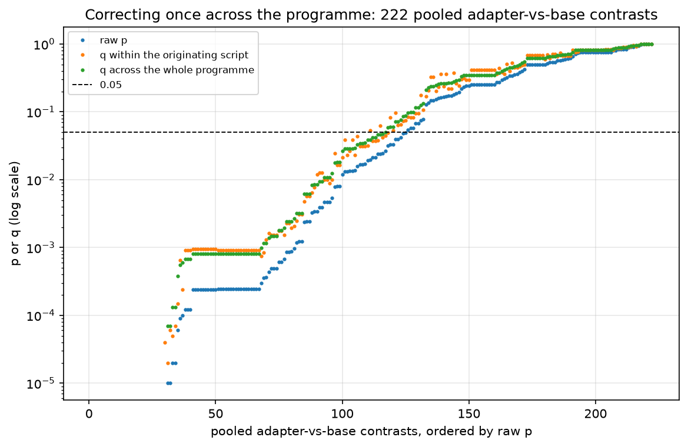
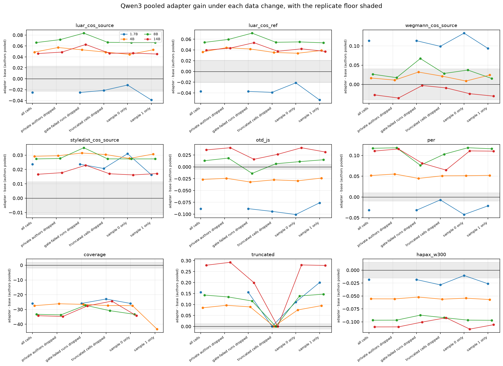
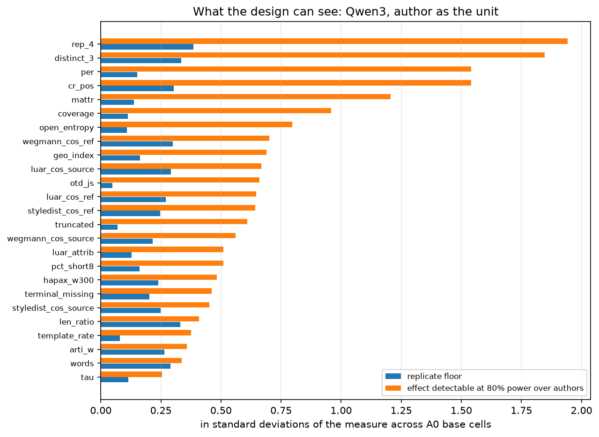

# 22 -- One correction across the programme, and what survives changing the data

## What this does

This script does the arithmetic that each individual analysis cannot do for itself: it
corrects every primary contrast in the programme once, together, and then asks whether the
surviving contrasts still hold when the data underneath them is changed.

It computed 175 pooled adapter-versus-base contrasts of its own from
`cells.parquet` (25 measures over
7 family-and-size combinations, author as the
unit, wherever the measure exists in that cell). 75 of those carry a Wilcoxon
test at all, because a test is computed only where at least five authors are available and
their means are not all identical; 45 of them reach q < 0.05 within this script's
own family of 75 tests. The rest are estimates with an interval and no test.

It then looked for 14 sibling contrast tables and found 12.
Missing when it ran: 20_brief_covariates/brief_predictors.csv, 21_attribution_detection/attribution_by_config.csv.

The headline family is the one the plan asks for: pooled adapter-versus-base contrasts per
measure x size x family, from every source. There are 222 of them carrying a p-value.
116 clear q < 0.05 under their originating script's own correction; 116
still clear it once that whole family is corrected together, and 110 of those are
also larger than their measure's replicate floor.

Two wider families are corrected alongside it and reported separately. All pooled primary
contrasts, which adds the prompting-arm contrasts: 496 of 1599 survive,
428 above the floor. All author-level contrasts, a much larger family:
1939 of 2580 survive, 1828 of them above the floor.

Under the 5 data changes, the variant that moves the most verdicts is
'sample 0 only' (12 of 175 contrasts change sign or cross a verdict boundary, counting only contrasts where at least one of the two estimates clears the replicate floor and the variant still has three authors).

## How it does it

Own contrasts. Arm A0, non-replicate cells. Base and adapter cells are matched on
(author, family, size, brief, sample); the per-brief differences are averaged within an
author, and the author is then the observation. The pooled estimate is the mean over
authors with a bootstrap over authors (4000 draws) and a Wilcoxon signed-rank test over the
author means, computed only where at least five authors are available. `estimate_toward_author`
flips the sign for measures whose dictionary direction is `-`, so that positive always means
closer to the author; measures marked `0` in the dictionary have no such orientation and the
column is left empty for them.

Harvest. `inputs_present.csv` lists every sibling table this script looked for, whether it
existed, how many rows it contributed and whether those rows carry p-values. Each table is
mapped onto one schema (source, scope, contrast, measure, family, params_b, author,
estimate, interval, p, the script's own q, floor, n). Two tables contribute estimates with
no p-value at all and are carried in `harvested_contrasts.csv` but excluded from every FDR
family. Nothing is read outside `data/` and the siblings' own csv outputs, and nothing
outside this folder is written.

Correction. Two layers, and every survival count in this folder names the layer it belongs
to. The first layer is each originating script's own BH-FDR inside its own smaller family;
that is the `q_own` column, and each script's README states its own family size. The second
layer is this script's programme-wide BH-FDR, the `q_programme` column, run over three
families kept apart because mixing them would let the larger ones swamp the smaller: pooled
adapter-versus-base only (222 tests, the headline), all pooled primary contrasts
(1599 tests) and author-level contrasts (2580 tests). "Survives" without a
qualifier in the tables below always means q_programme < 0.05 inside the family named in the
row, which is the stricter of the two.

Judge and adherence measures. `coverage` is scored by an LLM judge, and the rubric and 2AFC
columns that arrive from sibling tables are judge instruments with known failure modes
(order effects, a preference for the base model over an author's own prose). None of them is
a measure of absolute quality here, and none of them is cross-family: Ministral3 runs carry
no judge data anywhere in the programme, so every judged row in these families is Qwen3 only.
The judge-derived primary measures corrected here are: coverage.

Floors. `lib.replicate_floor` on arm A0, from the twice-generated base runs. Measured
floors now exist for Ministral3, Qwen3 (Ministral3 4 replicate pairs; Qwen3 5 replicate pairs), and
0 floor rows are borrowed from another family; the `floor_source` column on
every contrast records which. A contrast is counted in `survives_and_above_floor` only if it
clears q < 0.05 across the programme and also exceeds its floor.

Sensitivity. Every own contrast is recomputed 6 ways: all cells; private authors
(h_private, patrick, patrick_v2) dropped; runs failing the generation gate dropped; pairs where
either the base or the adapter passage hit the token cap dropped; sample 0 alone; sample 1
alone. `sensitivity_flips.csv` records sign changes and crossings of the floor and zero-interval
verdicts against the all-cells baseline.

Minimum detectable effect. Per measure and family, `mde.csv` reports the replicate floor,
the median half-width of the pooled interval, and the effect a paired test over authors
would detect at 80% power given the observed between-author standard error. `binding_limit`
is the largest of the three; anything smaller than that cannot be seen by this design,
regardless of the p-value.

Runtime 42 s.

### Sibling inputs this script looked for

| input | file_present | scope | contrast | n_rows | n_with_p | note |
|---|---|---|---|---|---|---|
| 11_scale_curves/gain.csv | True | author | adapter vs base | 600 | 599 |  |
| 12_arm_effects/arm_contrasts_pooled.csv | True | pooled | arm vs A0 (base runs) | 782 | 618 |  |
| 12_arm_effects/prompt_vs_adapter_pooled.csv | True | pooled | best prompt vs adapter | 943 | 759 |  |
| 13_corpus_data_effects/adapter_gain_by_author.csv | True | author | adapter vs base | 600 | 599 |  |
| 14_style_construction_tradeoff/author_level_tests.csv | True | pooled | adapter vs base (voice/construction axis) | 90 | 81 |  |
| 14_style_construction_tradeoff/paired_deltas_by_configuration.csv | True | author | adapter vs base (voice/construction axis) | 427 | 427 |  |
| 16_judges/coverage_adapter_minus_base.csv | True | author | adapter vs base | 50 | 0 | no p-values; estimates and intervals only |
| 17_length_truncation/words_adapter_minus_base.csv | True | author | adapter vs base | 50 | 0 | no p-values; estimates and intervals only |
| 18_cross_family/adapter_gain_paired.csv | True | author | adapter vs base | 270 | 270 |  |
| 18_cross_family/base_family_diff.csv | True | author | Qwen3 base vs Ministral3 base | 135 | 135 |  |
| 19_author_heterogeneity/author_effects.csv | True | author | adapter vs base | 550 | 550 |  |
| 19_author_heterogeneity/pooled_dl.csv | True | pooled | adapter vs base (DerSimonian-Laird) | 66 | 66 |  |
| 20_brief_covariates/brief_predictors.csv | False | pooled | brief covariate effect | 0 | 0 | not written when this script ran |
| 21_attribution_detection/attribution_by_config.csv | False | pooled | attribution / detection rate | 0 | 0 | not written when this script ran |

### How many survive, by source

| level | source | n_tests | n_p_below_05 | n_own_q_below_05 | n_programme_q_below_05 | n_programme_q_and_above_floor | n_no_floor |
|---|---|---|---|---|---|---|---|
| author-level | 11_scale_curves/gain.csv | 599 | 474 | 460 | 460 | 459 | 0 |
| author-level | 13_corpus_data_effects/adapter_gain_by_author.csv | 599 | 477 | 467 | 465 | 463 | 0 |
| author-level | 14_style_construction_tradeoff/paired_deltas_by_configuration.csv | 427 | 322 | 315 | 315 | 296 | 18 |
| author-level | 18_cross_family/adapter_gain_paired.csv | 270 | 193 | 185 | 188 | 167 | 0 |
| author-level | 18_cross_family/base_family_diff.csv | 135 | 84 | 82 | 84 | 70 | 0 |
| author-level | 19_author_heterogeneity/author_effects.csv | 550 | 440 | 429 | 427 | 373 | 0 |
| pooled, adapter-vs-base only | 14_style_construction_tradeoff/author_level_tests.csv | 81 | 33 | 29 | 31 | 28 | 4 |
| pooled, adapter-vs-base only | 19_author_heterogeneity/pooled_dl.csv | 66 | 42 | 42 | 41 | 38 | 0 |
| pooled, adapter-vs-base only | 22 (own, computed from cells.parquet) | 75 | 50 | 45 | 44 | 44 | 0 |
| pooled, all primary contrasts | 12_arm_effects/arm_contrasts_pooled.csv | 618 | 227 | 202 | 201 | 138 | 0 |
| pooled, all primary contrasts | 12_arm_effects/prompt_vs_adapter_pooled.csv | 759 | 245 | 184 | 190 | 190 | 0 |
| pooled, all primary contrasts | 14_style_construction_tradeoff/author_level_tests.csv | 81 | 33 | 29 | 28 | 26 | 4 |
| pooled, all primary contrasts | 19_author_heterogeneity/pooled_dl.csv | 66 | 42 | 42 | 39 | 36 | 0 |
| pooled, all primary contrasts | 22 (own, computed from cells.parquet) | 75 | 50 | 45 | 38 | 38 | 0 |

### How many survive, by measure (pooled adapter-vs-base only)

| measure | n_tests | n_survive | n_survive_above_floor | min_q |
|---|---|---|---|---|
| constr_axis | 9 | 5 | 5 | 0.000 |
| cov_frac | 9 | 5 | 5 | 0.000 |
| coverage | 9 | 6 | 6 | 0.000 |
| hapax_w300 | 9 | 9 | 9 | 0.000 |
| mattr | 9 | 8 | 7 | 0.000 |
| styledist_cos_source | 9 | 8 | 8 | 0.000 |
| per_inv | 9 | 5 | 5 | 0.000 |
| per | 9 | 8 | 8 | 0.000 |
| rubric_C10 | 9 | 5 | 2 | 0.000 |
| truncated | 9 | 7 | 5 | 0.000 |
| term_ok | 9 | 5 | 5 | 0.000 |
| geo_index | 9 | 5 | 5 | 0.000 |
| luar_cos_source | 9 | 6 | 6 | 0.000 |
| luar_cos_ref | 18 | 7 | 7 | 0.001 |
| terminal_missing | 3 | 3 | 3 | 0.001 |
| distinct_3 | 3 | 2 | 2 | 0.001 |
| words | 3 | 3 | 3 | 0.001 |
| rep_4 | 3 | 2 | 2 | 0.001 |
| len_ratio | 3 | 3 | 3 | 0.001 |
| styledist_cos_ref | 3 | 2 | 2 | 0.002 |
| luar_attrib | 3 | 3 | 3 | 0.002 |
| otd_js | 9 | 1 | 1 | 0.003 |
| arti_w | 3 | 2 | 2 | 0.003 |
| voice_axis | 9 | 2 | 2 | 0.029 |
| open_entropy | 3 | 1 | 1 | 0.034 |
| template_rate | 3 | 1 | 1 | 0.034 |
| otd_inv | 9 | 1 | 1 | 0.039 |
| cr_pos | 3 | 1 | 1 | 0.042 |
| pct_short8 | 3 | 0 | 0 | 0.072 |
| tau | 3 | 0 | 0 | 0.076 |
| wegmann_cos_source | 18 | 0 | 0 | 0.256 |
| wegmann_cos_ref | 3 | 0 | 0 | 0.268 |

### Own pooled adapter-vs-base contrasts, core measures

| measure | family | params_b | n_authors | estimate | ci_low | ci_high | floor | abs_over_floor | p_wilcoxon_authors | q_own_family |
|---|---|---|---|---|---|---|---|---|---|---|
| coverage | Ministral3 | 3.000 | 3 | 2.014 | -2.311 | 8.949 | 6.282 | 0.321 |  |  |
| coverage | Ministral3 | 8.000 | 3 | -4.621 | -9.317 | 1.044 | 6.282 | 0.736 |  |  |
| coverage | Ministral3 | 14.000 | 3 | -4.364 | -10.881 | 1.044 | 6.282 | 0.695 |  |  |
| coverage | Qwen3 | 1.700 | 1 | -25.911 |  |  | 1.974 | 13.124 |  |  |
| coverage | Qwen3 | 4.000 | 14 | -27.438 | -34.363 | -21.397 | 1.974 | 13.897 | 0.000 | 0.001 |
| coverage | Qwen3 | 8.000 | 13 | -33.309 | -44.404 | -23.369 | 1.974 | 16.871 | 0.000 | 0.001 |
| coverage | Qwen3 | 14.000 | 13 | -34.260 | -46.673 | -23.701 | 1.974 | 17.352 | 0.000 | 0.001 |
| hapax_w300 | Ministral3 | 3.000 | 3 | -0.160 | -0.185 | -0.120 | 0.006 | 24.738 |  |  |
| hapax_w300 | Ministral3 | 8.000 | 3 | -0.152 | -0.172 | -0.121 | 0.006 | 23.383 |  |  |
| hapax_w300 | Ministral3 | 14.000 | 3 | -0.143 | -0.171 | -0.107 | 0.006 | 22.069 |  |  |
| hapax_w300 | Qwen3 | 1.700 | 1 | -0.018 |  |  | 0.015 | 1.209 |  |  |
| hapax_w300 | Qwen3 | 4.000 | 14 | -0.056 | -0.071 | -0.041 | 0.015 | 3.665 | 0.000 | 0.001 |
| hapax_w300 | Qwen3 | 8.000 | 13 | -0.097 | -0.118 | -0.079 | 0.015 | 6.397 | 0.000 | 0.001 |
| hapax_w300 | Qwen3 | 14.000 | 13 | -0.110 | -0.134 | -0.089 | 0.015 | 7.252 | 0.000 | 0.001 |
| luar_cos_ref | Ministral3 | 3.000 | 3 | -0.004 | -0.062 | 0.056 | 0.006 | 0.730 |  |  |
| luar_cos_ref | Ministral3 | 8.000 | 3 | -0.007 | -0.040 | 0.033 | 0.006 | 1.226 |  |  |
| luar_cos_ref | Ministral3 | 14.000 | 3 | -0.010 | -0.036 | 0.033 | 0.006 | 1.624 |  |  |
| luar_cos_ref | Qwen3 | 1.700 | 1 | -0.037 |  |  | 0.021 | 1.791 |  |  |
| luar_cos_ref | Qwen3 | 4.000 | 14 | 0.036 | 0.005 | 0.066 | 0.021 | 1.759 | 0.049 | 0.074 |
| luar_cos_ref | Qwen3 | 8.000 | 13 | 0.054 | 0.020 | 0.086 | 0.021 | 2.612 | 0.013 | 0.027 |
| luar_cos_ref | Qwen3 | 14.000 | 13 | 0.040 | 0.008 | 0.070 | 0.021 | 1.914 | 0.033 | 0.053 |
| luar_cos_source | Ministral3 | 3.000 | 3 | 0.026 | -0.034 | 0.068 | 0.011 | 2.409 |  |  |
| luar_cos_source | Ministral3 | 8.000 | 3 | 0.021 | -0.019 | 0.049 | 0.011 | 1.949 |  |  |
| luar_cos_source | Ministral3 | 14.000 | 3 | 0.018 | -0.014 | 0.042 | 0.011 | 1.612 |  |  |
| luar_cos_source | Qwen3 | 1.700 | 1 | -0.025 |  |  | 0.023 | 1.102 |  |  |
| luar_cos_source | Qwen3 | 4.000 | 14 | 0.049 | 0.016 | 0.079 | 0.023 | 2.133 | 0.025 | 0.042 |
| luar_cos_source | Qwen3 | 8.000 | 13 | 0.066 | 0.032 | 0.097 | 0.023 | 2.896 | 0.003 | 0.008 |
| luar_cos_source | Qwen3 | 14.000 | 13 | 0.046 | 0.012 | 0.077 | 0.023 | 2.017 | 0.017 | 0.031 |
| otd_js | Ministral3 | 3.000 | 3 | -0.022 | -0.034 | 0.001 | 0.006 | 3.727 |  |  |
| otd_js | Ministral3 | 8.000 | 3 | -0.028 | -0.037 | -0.022 | 0.006 | 4.790 |  |  |
| otd_js | Ministral3 | 14.000 | 3 | -0.011 | -0.032 | 0.000 | 0.006 | 1.879 |  |  |
| otd_js | Qwen3 | 1.700 | 1 | -0.088 |  |  | 0.005 | 16.465 |  |  |
| otd_js | Qwen3 | 4.000 | 14 | -0.027 | -0.064 | 0.013 | 0.005 | 4.950 | 0.194 | 0.242 |
| otd_js | Qwen3 | 8.000 | 13 | 0.013 | -0.033 | 0.065 | 0.005 | 2.424 | 0.839 | 0.874 |
| otd_js | Qwen3 | 14.000 | 13 | 0.036 | -0.007 | 0.085 | 0.005 | 6.687 | 0.340 | 0.398 |
| per | Ministral3 | 3.000 | 3 | 0.046 | 0.023 | 0.063 | 0.004 | 12.369 |  |  |
| per | Ministral3 | 8.000 | 3 | 0.032 | 0.013 | 0.044 | 0.004 | 8.661 |  |  |
| per | Ministral3 | 14.000 | 3 | 0.025 | 0.007 | 0.042 | 0.004 | 6.833 |  |  |
| per | Qwen3 | 1.700 | 1 | -0.032 |  |  | 0.010 | 3.192 |  |  |
| per | Qwen3 | 4.000 | 14 | 0.052 | 0.011 | 0.099 | 0.010 | 5.168 | 0.153 | 0.201 |
| per | Qwen3 | 8.000 | 13 | 0.117 | 0.060 | 0.187 | 0.010 | 11.743 | 0.000 | 0.001 |
| per | Qwen3 | 14.000 | 13 | 0.111 | 0.053 | 0.179 | 0.010 | 11.077 | 0.000 | 0.001 |
| styledist_cos_source | Ministral3 | 3.000 | 3 | 0.009 | 0.004 | 0.016 | 0.003 | 3.408 |  |  |
| styledist_cos_source | Ministral3 | 8.000 | 3 | 0.010 | 0.004 | 0.014 | 0.003 | 3.932 |  |  |
| styledist_cos_source | Ministral3 | 14.000 | 3 | 0.013 | 0.007 | 0.016 | 0.003 | 4.851 |  |  |
| styledist_cos_source | Qwen3 | 1.700 | 1 | 0.024 |  |  | 0.011 | 2.073 |  |  |
| styledist_cos_source | Qwen3 | 4.000 | 14 | 0.029 | 0.018 | 0.041 | 0.011 | 2.560 | 0.001 | 0.002 |
| styledist_cos_source | Qwen3 | 8.000 | 13 | 0.027 | 0.014 | 0.040 | 0.011 | 2.398 | 0.002 | 0.006 |
| styledist_cos_source | Qwen3 | 14.000 | 13 | 0.017 | 0.001 | 0.032 | 0.011 | 1.461 | 0.057 | 0.083 |
| truncated | Ministral3 | 3.000 | 3 | 0.011 | -0.026 | 0.036 | 0.038 | 0.280 |  |  |
| truncated | Ministral3 | 8.000 | 3 | -0.004 | -0.071 | 0.038 | 0.038 | 0.093 |  |  |
| truncated | Ministral3 | 14.000 | 3 | -0.171 | -0.274 | -0.111 | 0.038 | 4.447 |  |  |
| truncated | Qwen3 | 1.700 | 1 | 0.156 |  |  | 0.012 | 12.756 |  |  |
| truncated | Qwen3 | 4.000 | 14 | 0.085 | 0.047 | 0.124 | 0.012 | 6.963 | 0.001 | 0.003 |
| truncated | Qwen3 | 8.000 | 13 | 0.143 | 0.082 | 0.211 | 0.012 | 11.719 | 0.000 | 0.002 |
| truncated | Qwen3 | 14.000 | 13 | 0.279 | 0.140 | 0.441 | 0.012 | 22.882 | 0.000 | 0.002 |
| wegmann_cos_source | Ministral3 | 3.000 | 3 | 0.003 | -0.063 | 0.043 | 0.030 | 0.091 |  |  |
| wegmann_cos_source | Ministral3 | 8.000 | 3 | 0.021 | -0.066 | 0.084 | 0.030 | 0.699 |  |  |
| wegmann_cos_source | Ministral3 | 14.000 | 3 | 0.021 | -0.084 | 0.094 | 0.030 | 0.691 |  |  |
| wegmann_cos_source | Qwen3 | 1.700 | 1 | 0.113 |  |  | 0.041 | 2.798 |  |  |

(3 more rows in the csv)

### Verdict flips under each data change

| variant | n_contrasts | n_sign_flip | n_floor_flip | n_ci_flip | n_any_flip | n_degenerate | n_underpowered | n_flip_matters | median_rel_change |
|---|---|---|---|---|---|---|---|---|---|
| gate-failed runs dropped | 175 | 6 | 8 | 7 | 16 | 0 | 50 | 10 | 0.050 |
| private authors dropped | 150 | 14 | 16 | 15 | 33 | 0 | 75 | 5 | 0.141 |
| sample 0 only | 175 | 3 | 10 | 4 | 15 | 0 | 25 | 12 | 0.085 |
| sample 1 only | 169 | 5 | 9 | 6 | 17 | 0 | 25 | 11 | 0.092 |
| truncated cells dropped | 175 | 5 | 15 | 11 | 25 | 7 | 25 | 12 | 0.128 |

### Flips that matter: at least one estimate above the floor, three or more authors left

| measure | family | params_b | variant | estimate_all | estimate_variant | floor | n_authors_variant | sign_flip | floor_verdict_flip | ci_verdict_flip |
|---|---|---|---|---|---|---|---|---|---|---|
| template_rate | Qwen3 | 4.000 | private authors dropped | -0.020 | -0.016 | 0.005 | 11 | False | False | True |
| open_entropy | Qwen3 | 8.000 | private authors dropped | -0.012 | -0.015 | 0.015 | 11 | False | True | False |
| styledist_cos_source | Qwen3 | 14.000 | private authors dropped | 0.017 | 0.018 | 0.011 | 11 | False | False | True |
| open_entropy | Qwen3 | 14.000 | private authors dropped | -0.070 | -0.074 | 0.015 | 11 | False | False | True |
| template_rate | Qwen3 | 14.000 | private authors dropped | -0.013 | -0.012 | 0.005 | 11 | False | False | True |
| geo_index | Qwen3 | 4.000 | gate-failed runs dropped | 0.036 | 0.065 | 0.064 | 13 | False | True | False |
| wegmann_cos_source | Qwen3 | 8.000 | gate-failed runs dropped | 0.026 | 0.067 | 0.041 | 11 | False | True | True |
| wegmann_cos_ref | Qwen3 | 8.000 | gate-failed runs dropped | 0.026 | 0.069 | 0.043 | 11 | False | True | True |
| open_entropy | Qwen3 | 8.000 | gate-failed runs dropped | -0.012 | 0.016 | 0.015 | 11 | True | True | False |
| otd_js | Qwen3 | 8.000 | gate-failed runs dropped | 0.013 | -0.014 | 0.005 | 11 | True | False | False |
| tau | Qwen3 | 8.000 | gate-failed runs dropped | -0.092 | -0.059 | 0.038 | 11 | False | False | True |
| template_rate | Qwen3 | 8.000 | gate-failed runs dropped | -0.009 | -0.013 | 0.005 | 11 | False | False | True |
| styledist_cos_ref | Qwen3 | 14.000 | gate-failed runs dropped | 0.013 | 0.019 | 0.008 | 11 | False | False | True |
| geo_index | Qwen3 | 14.000 | gate-failed runs dropped | -0.256 | -0.171 | 0.064 | 11 | False | False | True |
| tau | Qwen3 | 14.000 | gate-failed runs dropped | -0.039 | -0.026 | 0.038 | 11 | False | True | False |
| otd_js | Ministral3 | 3.000 | truncated cells dropped | -0.022 | -0.025 | 0.006 | 3 | False | False | True |
| terminal_missing | Ministral3 | 8.000 | truncated cells dropped | -0.131 | -0.170 | 0.064 | 3 | False | False | True |
| len_ratio | Ministral3 | 8.000 | truncated cells dropped | -0.121 | -0.144 | 0.055 | 3 | False | False | True |
| words | Ministral3 | 8.000 | truncated cells dropped | -87.127 | -104.169 | 36.795 | 3 | False | False | True |
| wegmann_cos_source | Ministral3 | 14.000 | truncated cells dropped | 0.021 | 0.031 | 0.030 | 3 | False | True | False |
| wegmann_cos_ref | Ministral3 | 14.000 | truncated cells dropped | 0.000 | -0.005 | 0.004 | 3 | True | True | False |
| open_entropy | Ministral3 | 14.000 | truncated cells dropped | 0.014 | 0.017 | 0.017 | 3 | False | True | False |
| otd_js | Ministral3 | 14.000 | truncated cells dropped | -0.011 | -0.014 | 0.006 | 3 | False | False | True |
| template_rate | Qwen3 | 8.000 | truncated cells dropped | -0.009 | -0.012 | 0.005 | 13 | False | False | True |
| styledist_cos_source | Qwen3 | 14.000 | truncated cells dropped | 0.017 | 0.017 | 0.011 | 13 | False | False | True |
| cr_pos | Qwen3 | 14.000 | truncated cells dropped | 2.314 | 0.218 | 0.373 | 13 | False | True | False |
| tau | Qwen3 | 14.000 | truncated cells dropped | -0.039 | -0.035 | 0.038 | 13 | False | True | False |
| otd_js | Ministral3 | 3.000 | sample 0 only | -0.022 | -0.025 | 0.006 | 3 | False | False | True |
| luar_cos_ref | Ministral3 | 8.000 | sample 0 only | -0.007 | -0.002 | 0.006 | 3 | False | True | False |
| wegmann_cos_source | Ministral3 | 8.000 | sample 0 only | 0.021 | 0.035 | 0.030 | 3 | False | True | False |
| wegmann_cos_ref | Ministral3 | 8.000 | sample 0 only | -0.006 | 0.013 | 0.004 | 3 | True | False | False |
| styledist_cos_ref | Ministral3 | 8.000 | sample 0 only | 0.000 | 0.003 | 0.001 | 3 | False | True | False |
| open_entropy | Ministral3 | 8.000 | sample 0 only | 0.011 | 0.017 | 0.017 | 3 | False | True | False |
| cr_pos | Ministral3 | 8.000 | sample 0 only | -0.198 | -0.168 | 0.099 | 3 | False | False | True |
| truncated | Ministral3 | 8.000 | sample 0 only | -0.004 | 0.040 | 0.038 | 3 | True | True | False |
| wegmann_cos_ref | Ministral3 | 14.000 | sample 0 only | 0.000 | -0.009 | 0.004 | 3 | True | True | False |
| terminal_missing | Ministral3 | 14.000 | sample 0 only | -0.137 | -0.093 | 0.064 | 3 | False | False | True |
| styledist_cos_source | Qwen3 | 14.000 | sample 0 only | 0.017 | 0.016 | 0.011 | 13 | False | False | True |
| tau | Qwen3 | 14.000 | sample 0 only | -0.039 | -0.030 | 0.038 | 13 | False | True | False |
| luar_cos_ref | Ministral3 | 3.000 | sample 1 only | -0.004 | -0.007 | 0.006 | 3 | False | True | False |
| styledist_cos_source | Ministral3 | 3.000 | sample 1 only | 0.009 | 0.006 | 0.003 | 3 | False | False | True |
| styledist_cos_ref | Ministral3 | 3.000 | sample 1 only | -0.002 | -0.003 | 0.001 | 3 | False | False | True |
| open_entropy | Ministral3 | 3.000 | sample 1 only | 0.021 | 0.016 | 0.017 | 3 | False | True | False |
| styledist_cos_ref | Ministral3 | 8.000 | sample 1 only | 0.000 | -0.003 | 0.001 | 3 | True | True | False |
| truncated | Ministral3 | 8.000 | sample 1 only | -0.004 | -0.048 | 0.038 | 3 | False | True | False |
| len_ratio | Ministral3 | 8.000 | sample 1 only | -0.121 | -0.166 | 0.055 | 3 | False | False | True |
| words | Ministral3 | 8.000 | sample 1 only | -87.127 | -120.301 | 36.795 | 3 | False | False | True |
| wegmann_cos_source | Ministral3 | 14.000 | sample 1 only | 0.021 | 0.035 | 0.030 | 3 | False | True | False |
| wegmann_cos_ref | Ministral3 | 14.000 | sample 1 only | 0.000 | 0.010 | 0.004 | 3 | False | True | False |
| tau | Qwen3 | 14.000 | sample 1 only | -0.039 | -0.048 | 0.038 | 13 | False | False | True |

### Minimum detectable effects, Qwen3

| measure | median_n_authors | replicate_floor | median_ci_half_width | mde_80pct_power | binding_limit_in_sd |
|---|---|---|---|---|---|
| rep_4 | 13 | 0.032 | 0.102 | 0.163 | 1.942 |
| distinct_3 | 13 | 0.026 | 0.089 | 0.142 | 1.846 |
| per | 13 | 0.010 | 0.063 | 0.102 | 1.541 |
| cr_pos | 13 | 0.373 | 1.181 | 1.897 | 1.540 |
| mattr | 13 | 0.008 | 0.043 | 0.070 | 1.207 |
| coverage | 13 | 1.974 | 10.517 | 16.774 | 0.959 |
| open_entropy | 13 | 0.015 | 0.067 | 0.108 | 0.797 |
| wegmann_cos_ref | 13 | 0.043 | 0.062 | 0.099 | 0.701 |
| geo_index | 13 | 0.064 | 0.170 | 0.273 | 0.689 |
| luar_cos_source | 13 | 0.023 | 0.032 | 0.052 | 0.669 |
| otd_js | 13 | 0.005 | 0.046 | 0.074 | 0.661 |
| luar_cos_ref | 13 | 0.021 | 0.031 | 0.050 | 0.646 |
| styledist_cos_ref | 13 | 0.008 | 0.012 | 0.020 | 0.642 |
| truncated | 13 | 0.012 | 0.065 | 0.105 | 0.610 |
| wegmann_cos_source | 13 | 0.041 | 0.064 | 0.105 | 0.560 |
| luar_attrib | 13 | 0.057 | 0.138 | 0.225 | 0.510 |
| pct_short8 | 13 | 0.033 | 0.064 | 0.103 | 0.509 |
| hapax_w300 | 13 | 0.015 | 0.019 | 0.031 | 0.483 |
| terminal_missing | 13 | 0.081 | 0.115 | 0.185 | 0.461 |
| styledist_cos_source | 13 | 0.011 | 0.013 | 0.021 | 0.452 |
| len_ratio | 13 | 0.062 | 0.048 | 0.077 | 0.409 |
| template_rate | 13 | 0.005 | 0.014 | 0.022 | 0.376 |
| arti_w | 13 | 0.048 | 0.040 | 0.066 | 0.357 |
| words | 13 | 47.634 | 34.802 | 55.343 | 0.337 |
| tau | 13 | 0.038 | 0.051 | 0.083 | 0.254 |

### Raw p against within-script and programme-wide q

### Pooled gain under each sensitivity variant

### Minimum detectable effects

## How to read the result, conservatively

Unit of replication. Every pooled row here is an average over authors, and the number of
authors is small: 14 at most for Qwen3 and 3 for Ministral3. Those are rows
of `authors.csv` rather than distinct writers. `patrick` and `patrick_v2` are the same
private corpus under two chunkings, so a 14-author row rests on
13 independent corpora and two of its observations are not independent of
each other; read the pooled interval as the wider of what it prints and what
13 corpora would give. A Wilcoxon signed-rank test over 3 authors
cannot reach q < 0.05 at any effect size, so a Ministral3 row that does not clear the
threshold is a statement about the design and not about Ministral3.

Interval width and the floor. Read `mde.csv` before reading any q. The median binding limit
across the 25 primary measures on Qwen3 is
0.64 standard deviations of
the measure; a gain smaller than that is outside this design's reach whatever its p-value.
On 0
of the 25 the binding limit is the replicate floor; on the
rest it is the number of authors and the spread between them. The limit on this design is
therefore 13 corpora rather than the machine's jitter, the number of
briefs or the multiplicity correction, and generating more passages per author would not
move it. Every contrast in the tables also carries `floor` and `within_noise`: a contrast
marked within noise is inside the twice-generated replicate difference of its measure and is
reported as such whatever its q.

What would overturn this. The programme-wide correction is applied over the contrasts that
happened to exist when this script ran. Adding the missing scripts adds tests to the family
and can only make the q values larger, never smaller, so the surviving count reported here
is an upper bound on what will survive once the programme is complete. Re-running this
script after the remaining folders exist is the honest final number.

What this does not show. It does not adjudicate between scripts that measured the same
contrast differently; where two sources test the same measure at the same size, both rows
are kept and both are counted as tests, which makes the correction more conservative rather
than less. It says nothing about whether a surviving effect matters to a reader, and the
sensitivity variants are re-analyses of one dataset, not replications.

## Caveats

- 2 of the 14 expected sibling tables did not exist when this ran (20_brief_covariates/brief_predictors.csv, 21_attribution_detection/attribution_by_config.csv), so the programme-wide family is incomplete and every q here will rise when they are added.
- 2 harvested tables carry estimates without p-values (coverage and words adapter-minus-base) and are excluded from the FDR families while remaining in harvested_contrasts.csv.
- Where several scripts report the same contrast, the duplicate rows are all kept in the FDR family; that is deliberately conservative and inflates the test count relative to the number of distinct questions asked.
- Ministral3 has at most 3 authors, below the five-author minimum this script requires before it will compute a Wilcoxon p, so every Ministral3 row is an estimate with an interval and no test.
- Ministral3 floors are measured from its own replicate pairs and are smaller than the Qwen3 floors on most measures, so the same absolute difference clears the floor more easily on Ministral3 than on Qwen3. Read `floor` and `floor_source` together with every above-floor verdict, and remember that Ministral3 rows rest on 3 authors with no test attached.
- The `sample 0 only` and `sample 1 only` variants halve the data, so their intervals are wider by construction; a verdict flip there is weaker evidence of instability than one under `truncated cells dropped`, which removed 631 of 3938 pairs.
- `private authors dropped` leaves Ministral3 with two authors, so all 75 Ministral3 rows under that variant are marked `underpowered_variant` and excluded from the flip count that matters; they are still in sensitivity_flips.csv.
- Dropping truncated cells makes the truncation rate identically zero, so those rows are marked `degenerate_by_construction` rather than counted as instability.
- `gate-failed runs dropped` only removes the 6 runs explicitly marked failed. 43 runs carry no gate verdict at all, and 7 of those exceed the stated 20% truncation threshold on arm A0 (worst 75%), so that variant is weaker than it sounds; `truncated cells dropped` is the more honest robustness check of the two.
- `coverage` is judged on sample 0 only, so its `sample 1 only` row rests on the handful of runs that scored coverage on both samples and should not be compared with the others.
- Coverage and 2AFC rows for a set of Qwen3 runs were error rows from the 2026-09-09 credit outage and are being rerun (LOG.md); those runs currently drop out of the coverage contrasts, which is why the coverage rows show fewer authors than the structural rows at the same size. Every coverage and judge number in these families is provisional until the rerun lands.
- The eval-cache and rubric columns in cells.parquet are merged on arm and carry values for arm A0 only; arms A1 to A5 are NaN. Only arm A0 is used here, and no A1-A5 effect on per, otd_js, psd, cpd, lexdiv, event order, the constructional features or any rubric subscore can be claimed from this table or any other.
- Proposition echo is close to permutation-invariant, so the shuffled-author floor fails its own manipulation check (script 24). `per` enters these families as a raw brief-paired difference against its replicate floor; no F value for it may be quoted from anywhere in the programme.
- 15 runs exceed the 20 per cent truncation gate on the data-derived `truncation_gate_ok` column of runs.csv and are flagged and kept, not excluded: cather_pair4b, cather_paire6_14b, chesterton_basem14b_r2, chopin_paire6_14b, doctorow_basem14b, doctorow_basem8b, h_private_paire6_14b, h_private_paire6_8b, link_paire6_14b, link_paire6_4b, link_paire6_8b, patrick_v2_paire6_17b, sui_sin_far_paire6_14b, sui_sin_far_paire6_4b, sui_sin_far_paire6_8b. Only the 6 runs with an explicit failed pod verdict are dropped by the `gate-failed runs dropped` variant.
