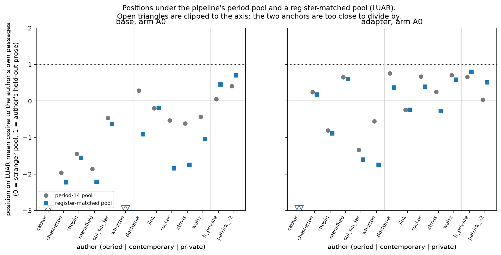
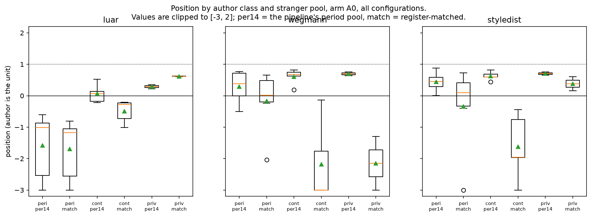
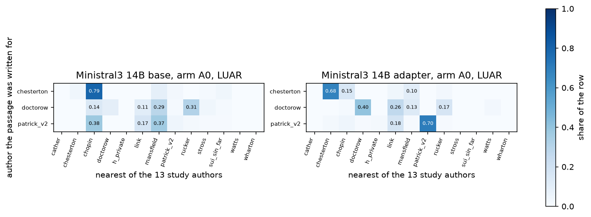
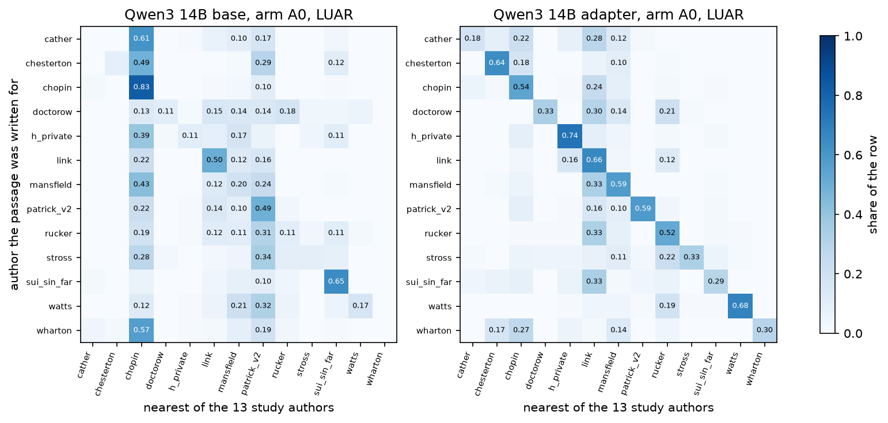

# 23 - A register-matched stranger pool

## What this does

The study's stranger pool was fixed: 14 period authors, the same pool for a Cory
Doctorow generation as for a Wharton one. Any position or fidelity number computed against
it mixes "not this author" with "not of this century" for the
5 contemporary and the 2
private corpora. This script rebuilds the pool from the stored embedding matrices so that
each author can be anchored against authors of its own register, and reports what changes.

It covers 15296 generated passages (arms A0, A5, non-replicate) over
98 runs and 13 study authors, on all three style embeddings.
`patrick` (the v1 chunking control) is excluded: it is the same person as `patrick_v2` on a
different chunking, so it cannot be a stranger to anyone and it is not one of the thirteen.
The private class therefore contains two authors, `patrick_v2` and `h_private`, and a
register-matched pool for one of them is the single other one; that is the weakest pool in
the table and every private row should be read with it in mind.

## How it does it

**Alignment (the first thing that had to be fixed).** `emb_*.npy` is *not* row-aligned with
`scores.jsonl` in most runs. `dr/s5_score.py` appends the anchor run's A0 generations to the
row list before the source, ref and other-author rows, embeds all of them, and then drops
the anchor rows when it writes `scores.jsonl`. The npy therefore carries an extra block of
`len(npy) - len(scores)` rows sitting between the run's own generations and its source rows.
53 of the 103 run directories read here carry such a block. The repair is
to take npy rows `[0, n_gens)` and `[n_gens + extra, end)`, where `n_gens` is the line count
of `gens.jsonl`. The repair is verified per run by recomputing the stored
`luar/wegmann/styledist_cos_source` (cosine to the passage's own source row) and `*_cos_ref`
(cosine to the unit-normalised mean of the unit reference vectors) from the embeddings:
103 of 103 runs reproduce every stored value to better than 1e-4
(`alignment_check.csv`). Without the repair the reference and other-author rows are
mislabelled in those runs and every cross-author cosine is wrong.

**Embedding identity across runs.** After the repair, a given passage's embedding is
bit-identical in every run that scored it: 0 of 408078 repeated passage
embeddings differ by more than 1e-6 on any component, across source, ref and other-author
rows and all three embeddings (`embedding_identity_across_runs.csv`). That is what makes one
bank per author legitimate. Running the same check against the unrepaired index is how the
anchor block was found: in a run that carries a block, row-for-row indexing hands every
source, ref and other-author row the vector of a different passage, and the same passage
then appears to have a different embedding in different runs.

**Banks.** Per author, the group `source` rows (its held-out test passages) and the group
`ref` rows (`embedding_bank.csv`); plus the 14-author period pool from the
`other:*` rows. That pool is fixed in its *authors* but not in its *passages*:
`others.jsonl` drew its own sample for each study author, with a per-run median of
56 to 100 chunks per pool author, while the union over every run runs from
56 to 327 chunks for the same authors (`period_pool_composition.csv`).
A union that much larger than any single run's sample is what says the pool passages differ
from run to run. The bank here is that union, deduplicated by id:
2139 passages over 14 pool authors,
so P_period14 does not depend on which run happened to be read first.

**The instrument.** For author *a* and passage *x*, s_a(x) = the mean cosine of *x* to *a*'s
source passages, excluding any source passage whose id equals *x*'s brief id. For a
generation that removes the one passage its brief was written from, which is the content
inflation `FIDELITY_SYNTHESIS` fact 5 names; for one of *a*'s own passages it is
leave-one-out. This is a mean cosine, not a cosine to a centroid, so it differs by
construction from the pipeline's `*_cos_ref` column.

- **G** = the configuration's generations, **H** = *a*'s own source passages leave-one-out.
- **P_class** = the same-class study authors' source passages (contemporary: 5 authors, period: 6 authors, private: 2 authors).
- **P_13** = all 12 other study authors.
- **P_period14** = the pipeline's fixed period pool, recomputed on this same instrument, so
  the register-matched and period-anchored numbers differ only in who is in the pool.

The scalar floor P is the mean over the pool's authors of each author's mean (so authors are
weighted equally); the distribution used for W1 is the pooled per-passage values.

**Positions and fidelity.** pos = (mean G - P) / (mean H - P);
F = 1 - W1(G, H) / W1(P, H) with `scipy.stats.wasserstein_distance`. Intervals are a
400-resample bootstrap over brief clusters within the configuration; the anchors H and P
are held fixed, so the intervals describe the generation sample, not the anchors.

**Floors.** `replicate_floors_instrument.csv` recomputes the replicate floor for this
instrument on the twice-generated base pairs: luar 0.0220, wegmann 0.0424, styledist 0.0064
(largest absolute mean difference over the pairs, both families pooled).

**Region rate.** R is the share of generated passages inside the central 90% interval of H
on *both* register-matched embedding instruments at once (LUAR and Wegmann); R@2 is the share
of briefs with at least one of the two samples inside. The author's own passages give the
ceiling (0.90 on one instrument, less on two) and the register-matched strangers give the
floor, both in the same table.

**Attribution.** The predicted author is the argmax over the 13 study authors of
s_b(g), with the same-brief exclusion applied to the true author's bank so the content of the
brief cannot carry the attribution. Chance is 1/13 = 0.077. Wilson intervals
on the rate; one-sided binomial against chance, BH-FDR across the
585 configuration-by-embedding tests in `attribution_accuracy.csv`.

**Correction.** BH-FDR is applied within each family of tests separately and each README
number says which family it belongs to: 585 attribution tests in
`attribution_accuracy.csv`, and 9 pool-effect tests in `pool_effect_tests.csv`.
A q below 0.05 means survival inside that one family. The programme-wide correction in script
22 is a second and stricter layer, and nothing in this folder has been through it.

### Alignment repair, by run (first rows; full table in alignment_check.csv)

| run | n_scores | n_gens_file | n_npy | extra_anchor_rows | aligned |
|---|---|---|---|---|---|
| base4b | 1823 | 528 | 1823 | 0 | True |
| base4b_r2 | 1823 | 528 | 1911 | 88 | True |
| cather_base14b | 1821 | 528 | 1821 | 0 | True |
| cather_base4b | 1821 | 528 | 1821 | 0 | True |
| cather_base8b | 1821 | 528 | 1821 | 0 | True |
| cather_pair4b | 1557 | 264 | 1645 | 88 | True |
| cather_paire6_14b | 1557 | 264 | 1645 | 88 | True |
| cather_paire6_8b | 1557 | 264 | 1645 | 88 | True |
| chesterton_base14b | 1761 | 468 | 1761 | 0 | True |
| chesterton_base4b | 1761 | 468 | 1761 | 0 | True |
| chesterton_base4bc | 1761 | 468 | 1761 | 0 | True |
| chesterton_base8b | 1761 | 468 | 1761 | 0 | True |

### Median position by author class and pool, arm A0

| embedding | pool | author_class | kind | n | share_anchor_usable | median_separation_over_floor | median_pos | median_pos_usable_only |
|---|---|---|---|---|---|---|---|---|
| luar | P_13 | contemporary | adapter | 18 | 1.000 | 2.909 | 0.618 | 0.618 |
| luar | P_class | contemporary | adapter | 18 | 0.333 | 1.899 | 0.381 | 0.288 |
| luar | P_period14 | contemporary | adapter | 18 | 1.000 | 3.250 | 0.678 | 0.678 |
| luar | P_13 | period | adapter | 21 | 0.714 | 2.747 | 0.390 | 0.571 |
| luar | P_class | period | adapter | 21 | 0.286 | 1.288 | -0.867 | -1.252 |
| luar | P_period14 | period | adapter | 21 | 0.429 | 1.405 | -0.598 | -0.789 |
| luar | P_13 | private | adapter | 10 | 1.000 | 3.833 | 0.274 | 0.274 |
| luar | P_class | private | adapter | 10 | 1.000 | 6.208 | 0.552 | 0.552 |
| luar | P_period14 | private | adapter | 10 | 1.000 | 3.136 | 0.113 | 0.113 |
| luar | P_13 | contemporary | base | 18 | 1.000 | 2.909 | -0.527 | -0.527 |
| luar | P_class | contemporary | base | 18 | 0.333 | 1.899 | -1.408 | -0.586 |
| luar | P_period14 | contemporary | base | 18 | 1.000 | 3.250 | -0.373 | -0.373 |
| luar | P_13 | period | base | 21 | 0.714 | 2.747 | -0.891 | -0.492 |
| luar | P_class | period | base | 21 | 0.286 | 1.288 | -2.167 | -1.106 |
| luar | P_period14 | period | base | 21 | 0.429 | 1.405 | -1.818 | -1.451 |
| luar | P_13 | private | base | 10 | 1.000 | 3.833 | 0.438 | 0.438 |
| luar | P_class | private | base | 10 | 1.000 | 6.208 | 0.653 | 0.653 |
| luar | P_period14 | private | base | 10 | 1.000 | 3.136 | 0.313 | 0.313 |

### Median distributional fidelity F by author class and pool, arm A0

| embedding | pool | author_class | kind | n | share_anchor_usable | median_F | median_F_usable_only |
|---|---|---|---|---|---|---|---|
| luar | P_13 | contemporary | adapter | 18 | 1.000 | 0.616 | 0.616 |
| luar | P_class | contemporary | adapter | 18 | 0.333 | 0.389 | 0.279 |
| luar | P_period14 | contemporary | adapter | 18 | 1.000 | 0.667 | 0.667 |
| luar | P_13 | period | adapter | 21 | 0.714 | 0.373 | 0.563 |
| luar | P_class | period | adapter | 21 | 0.286 | -0.892 | -1.266 |
| luar | P_period14 | period | adapter | 21 | 0.429 | -0.622 | -0.814 |
| luar | P_13 | private | adapter | 10 | 1.000 | 0.265 | 0.265 |
| luar | P_class | private | adapter | 10 | 1.000 | 0.552 | 0.552 |
| luar | P_period14 | private | adapter | 10 | 1.000 | 0.095 | 0.095 |
| luar | P_13 | contemporary | base | 18 | 1.000 | -0.549 | -0.549 |
| luar | P_class | contemporary | base | 18 | 0.333 | -1.406 | -0.619 |
| luar | P_period14 | contemporary | base | 18 | 1.000 | -0.430 | -0.430 |
| luar | P_13 | period | base | 21 | 0.714 | -0.862 | -0.495 |
| luar | P_class | period | base | 21 | 0.286 | -2.183 | -1.123 |
| luar | P_period14 | period | base | 21 | 0.429 | -1.802 | -1.486 |
| luar | P_13 | private | base | 10 | 1.000 | 0.431 | 0.431 |
| luar | P_class | private | base | 10 | 1.000 | 0.653 | 0.653 |
| luar | P_period14 | private | base | 10 | 1.000 | 0.300 | 0.300 |

### Does the pool change the position (author is the unit)

| embedding | author_class | n_authors | mean_pos_register_matched | mean_pos_period_pool | mean_difference | ci_low | ci_high | p | q |
|---|---|---|---|---|---|---|---|---|---|
| luar | period | 6 | -5.001 | -2.146 | -2.856 | -7.263 | -0.162 | 0.031 | 0.075 |
| luar | contemporary | 5 | -0.490 | 0.067 | -0.558 | -0.810 | -0.237 | 0.125 | 0.125 |
| luar | private | 2 | 0.617 | 0.288 | 0.329 | 0.274 | 0.385 |  |  |
| wegmann | period | 6 | -0.163 | 0.288 | -0.452 | -0.926 | -0.079 | 0.062 | 0.075 |
| wegmann | contemporary | 5 | -3.905 | 0.609 | -4.515 | -6.752 | -2.215 | 0.062 | 0.075 |
| wegmann | private | 2 | -2.567 | 0.694 | -3.262 | -4.595 | -1.928 |  |  |
| styledist | period | 6 | -0.370 | 0.445 | -0.815 | -1.788 | -0.202 | 0.031 | 0.075 |
| styledist | contemporary | 5 | -2.084 | 0.629 | -2.713 | -4.355 | -1.495 | 0.062 | 0.075 |
| styledist | private | 2 | 0.383 | 0.707 | -0.324 | -0.601 | -0.046 |  |  |

### Author-region rate on the two register-matched instruments

| family | params_b | kind | arm | n_configs | n_authors | mean_R | median_R | mean_R_at_2 | mean_ceiling | mean_stranger_floor |
|---|---|---|---|---|---|---|---|---|---|---|
| Ministral3 | 8.000 | adapter | A5 | 3 | 3 | 0.676 | 0.718 | 0.862 | 0.773 | 0.472 |
| Ministral3 | 14.000 | adapter | A5 | 3 | 3 | 0.661 | 0.731 | 0.848 | 0.773 | 0.472 |
| Ministral3 | 3.000 | adapter | A0 | 3 | 3 | 0.659 | 0.705 | 0.821 | 0.773 | 0.472 |
| Ministral3 | 3.000 | adapter | A5 | 3 | 3 | 0.655 | 0.667 | 0.798 | 0.773 | 0.472 |
| Ministral3 | 14.000 | adapter | A0 | 3 | 3 | 0.626 | 0.641 | 0.805 | 0.773 | 0.472 |
| Ministral3 | 8.000 | adapter | A0 | 3 | 3 | 0.614 | 0.590 | 0.813 | 0.773 | 0.472 |
| Qwen3 | 8.000 | adapter | A5 | 13 | 13 | 0.550 | 0.609 | 0.750 | 0.770 | 0.490 |
| Qwen3 | 8.000 | adapter | A0 | 13 | 13 | 0.546 | 0.641 | 0.728 | 0.770 | 0.490 |
| Qwen3 | 14.000 | adapter | A5 | 13 | 13 | 0.543 | 0.610 | 0.722 | 0.770 | 0.490 |
| Ministral3 | 3.000 | base | A5 | 3 | 3 | 0.541 | 0.513 | 0.756 | 0.773 | 0.472 |
| Qwen3 | 1.700 | adapter | A5 | 1 | 1 | 0.533 | 0.533 | 0.756 | 0.780 | 0.100 |
| Qwen3 | 14.000 | adapter | A0 | 13 | 13 | 0.523 | 0.600 | 0.696 | 0.770 | 0.490 |
| Qwen3 | 1.700 | base | A0 | 1 | 1 | 0.522 | 0.522 | 0.756 | 0.780 | 0.100 |
| Qwen3 | 1.700 | adapter | A0 | 1 | 1 | 0.522 | 0.522 | 0.689 | 0.780 | 0.100 |
| Qwen3 | 4.000 | adapter | A5 | 12 | 12 | 0.517 | 0.515 | 0.718 | 0.768 | 0.475 |
| Qwen3 | 4.000 | adapter | A0 | 13 | 13 | 0.501 | 0.556 | 0.672 | 0.770 | 0.490 |
| Ministral3 | 3.000 | base | A0 | 3 | 3 | 0.490 | 0.544 | 0.666 | 0.773 | 0.472 |
| Qwen3 | 8.000 | base | A5 | 13 | 13 | 0.449 | 0.455 | 0.631 | 0.770 | 0.490 |
| Ministral3 | 8.000 | base | A0 | 3 | 3 | 0.422 | 0.422 | 0.664 | 0.773 | 0.472 |
| Ministral3 | 14.000 | base | A5 | 3 | 3 | 0.421 | 0.410 | 0.616 | 0.773 | 0.472 |
| Ministral3 | 14.000 | base | A0 | 3 | 3 | 0.419 | 0.422 | 0.602 | 0.773 | 0.472 |
| Ministral3 | 8.000 | base | A5 | 3 | 3 | 0.419 | 0.474 | 0.658 | 0.773 | 0.472 |
| Qwen3 | 1.700 | base | A5 | 1 | 1 | 0.400 | 0.400 | 0.556 | 0.780 | 0.100 |
| Qwen3 | 4.000 | base | A5 | 13 | 13 | 0.350 | 0.321 | 0.521 | 0.770 | 0.490 |
| Qwen3 | 14.000 | base | A5 | 13 | 13 | 0.337 | 0.329 | 0.513 | 0.770 | 0.490 |
| Qwen3 | 14.000 | base | A0 | 13 | 13 | 0.284 | 0.271 | 0.422 | 0.770 | 0.490 |
| Qwen3 | 4.000 | base | A0 | 13 | 13 | 0.268 | 0.262 | 0.410 | 0.770 | 0.490 |
| Qwen3 | 8.000 | base | A0 | 13 | 13 | 0.258 | 0.292 | 0.398 | 0.770 | 0.490 |

### Thirteen-author attribution, pooled over authors

| embedding | family | params_b | kind | arm | n_authors | n_passages | pooled_accuracy | n_authors_above_chance_q05 | wilson_low | wilson_high |
|---|---|---|---|---|---|---|---|---|---|---|
| luar | Qwen3 | 1.700 | adapter | A5 | 1.000 | 90.000 | 0.744 | 1.000 | 0.646 | 0.823 |
| luar | Ministral3 | 14.000 | adapter | A5 | 3.000 | 252.000 | 0.607 | 3.000 | 0.546 | 0.665 |
| luar | Qwen3 | 1.700 | base | A5 | 1.000 | 90.000 | 0.600 | 1.000 | 0.497 | 0.695 |
| luar | Ministral3 | 14.000 | adapter | A0 | 3.000 | 252.000 | 0.595 | 3.000 | 0.534 | 0.654 |
| luar | Ministral3 | 3.000 | adapter | A5 | 3.000 | 252.000 | 0.571 | 3.000 | 0.510 | 0.631 |
| luar | Ministral3 | 8.000 | adapter | A5 | 3.000 | 252.000 | 0.548 | 3.000 | 0.486 | 0.608 |
| luar | Qwen3 | 1.700 | base | A0 | 1.000 | 90.000 | 0.544 | 1.000 | 0.442 | 0.643 |
| luar | Qwen3 | 14.000 | adapter | A5 | 13.000 | 1000.000 | 0.524 | 13.000 | 0.493 | 0.555 |
| luar | Qwen3 | 1.700 | adapter | A0 | 1.000 | 90.000 | 0.522 | 1.000 | 0.420 | 0.622 |
| luar | Qwen3 | 8.000 | adapter | A5 | 13.000 | 1000.000 | 0.522 | 12.000 | 0.491 | 0.553 |
| luar | Ministral3 | 8.000 | adapter | A0 | 3.000 | 252.000 | 0.520 | 3.000 | 0.458 | 0.581 |
| luar | Qwen3 | 4.000 | adapter | A5 | 12.000 | 912.000 | 0.514 | 11.000 | 0.482 | 0.547 |
| luar | Ministral3 | 3.000 | adapter | A0 | 3.000 | 252.000 | 0.488 | 3.000 | 0.427 | 0.550 |
| luar | Qwen3 | 8.000 | adapter | A0 | 13.000 | 1000.000 | 0.482 | 12.000 | 0.451 | 0.513 |
| luar | Qwen3 | 14.000 | adapter | A0 | 13.000 | 1000.000 | 0.480 | 13.000 | 0.449 | 0.511 |
| luar | Qwen3 | 4.000 | adapter | A0 | 13.000 | 1000.000 | 0.472 | 12.000 | 0.441 | 0.503 |
| wegmann | Qwen3 | 1.700 | adapter | A5 | 1.000 | 90.000 | 0.467 | 1.000 | 0.367 | 0.569 |
| wegmann | Ministral3 | 3.000 | adapter | A5 | 3.000 | 252.000 | 0.401 | 2.000 | 0.342 | 0.462 |
| wegmann | Ministral3 | 3.000 | adapter | A0 | 3.000 | 252.000 | 0.373 | 2.000 | 0.316 | 0.434 |
| wegmann | Ministral3 | 14.000 | adapter | A5 | 3.000 | 252.000 | 0.345 | 2.000 | 0.289 | 0.406 |
| wegmann | Ministral3 | 8.000 | adapter | A5 | 3.000 | 252.000 | 0.341 | 2.000 | 0.286 | 0.402 |
| luar | Qwen3 | 14.000 | base | A5 | 13.000 | 1000.000 | 0.330 | 10.000 | 0.302 | 0.360 |
| wegmann | Ministral3 | 3.000 | base | A5 | 3.000 | 252.000 | 0.306 | 1.000 | 0.252 | 0.365 |
| wegmann | Ministral3 | 14.000 | adapter | A0 | 3.000 | 252.000 | 0.298 | 2.000 | 0.245 | 0.357 |
| styledist | Ministral3 | 8.000 | base | A5 | 3.000 | 252.000 | 0.298 | 1.000 | 0.245 | 0.357 |
| wegmann | Ministral3 | 3.000 | base | A0 | 3.000 | 252.000 | 0.294 | 1.000 | 0.241 | 0.353 |
| styledist | Ministral3 | 14.000 | base | A5 | 3.000 | 252.000 | 0.290 | 1.000 | 0.237 | 0.349 |
| wegmann | Qwen3 | 1.700 | adapter | A0 | 1.000 | 90.000 | 0.289 | 1.000 | 0.205 | 0.390 |
| luar | Qwen3 | 4.000 | base | A5 | 13.000 | 1000.000 | 0.286 | 10.000 | 0.259 | 0.315 |
| wegmann | Ministral3 | 8.000 | adapter | A0 | 3.000 | 252.000 | 0.286 | 1.000 | 0.233 | 0.344 |
| wegmann | Ministral3 | 14.000 | base | A5 | 3.000 | 252.000 | 0.286 | 1.000 | 0.233 | 0.344 |
| styledist | Qwen3 | 14.000 | adapter | A5 | 13.000 | 1000.000 | 0.285 | 7.000 | 0.258 | 0.314 |
| wegmann | Ministral3 | 8.000 | base | A0 | 3.000 | 252.000 | 0.278 | 1.000 | 0.226 | 0.336 |
| styledist | Ministral3 | 3.000 | base | A5 | 3.000 | 252.000 | 0.278 | 1.000 | 0.226 | 0.336 |
| wegmann | Ministral3 | 8.000 | base | A5 | 3.000 | 252.000 | 0.278 | 1.000 | 0.226 | 0.336 |
| wegmann | Ministral3 | 14.000 | base | A0 | 3.000 | 252.000 | 0.274 | 1.000 | 0.222 | 0.332 |
| wegmann | Qwen3 | 14.000 | adapter | A5 | 13.000 | 1000.000 | 0.268 | 6.000 | 0.241 | 0.296 |
| styledist | Qwen3 | 1.700 | adapter | A5 | 1.000 | 90.000 | 0.267 | 1.000 | 0.186 | 0.366 |
| styledist | Ministral3 | 14.000 | adapter | A5 | 3.000 | 252.000 | 0.266 | 1.000 | 0.215 | 0.324 |
| styledist | Qwen3 | 4.000 | adapter | A5 | 12.000 | 912.000 | 0.264 | 7.000 | 0.237 | 0.294 |
| luar | Qwen3 | 8.000 | base | A5 | 13.000 | 1000.000 | 0.256 | 8.000 | 0.230 | 0.284 |
| wegmann | Qwen3 | 8.000 | adapter | A5 | 13.000 | 1000.000 | 0.248 | 8.000 | 0.222 | 0.276 |
| luar | Qwen3 | 4.000 | base | A0 | 13.000 | 1000.000 | 0.243 | 8.000 | 0.217 | 0.271 |
| luar | Qwen3 | 14.000 | base | A0 | 13.000 | 1000.000 | 0.242 | 6.000 | 0.216 | 0.270 |
| wegmann | Qwen3 | 4.000 | adapter | A5 | 12.000 | 912.000 | 0.236 | 5.000 | 0.209 | 0.264 |
| styledist | Ministral3 | 3.000 | adapter | A0 | 3.000 | 252.000 | 0.234 | 2.000 | 0.186 | 0.290 |
| styledist | Qwen3 | 8.000 | adapter | A5 | 13.000 | 1000.000 | 0.232 | 7.000 | 0.207 | 0.259 |
| styledist | Ministral3 | 3.000 | adapter | A5 | 3.000 | 252.000 | 0.230 | 2.000 | 0.182 | 0.286 |
| styledist | Ministral3 | 8.000 | adapter | A5 | 3.000 | 252.000 | 0.222 | 2.000 | 0.175 | 0.278 |
| luar | Qwen3 | 8.000 | base | A0 | 13.000 | 1000.000 | 0.221 | 5.000 | 0.196 | 0.248 |
| styledist | Ministral3 | 14.000 | adapter | A0 | 3.000 | 252.000 | 0.218 | 1.000 | 0.172 | 0.273 |
| wegmann | Qwen3 | 14.000 | adapter | A0 | 13.000 | 1000.000 | 0.217 | 5.000 | 0.193 | 0.244 |
| styledist | Qwen3 | 14.000 | adapter | A0 | 13.000 | 1000.000 | 0.212 | 5.000 | 0.188 | 0.238 |
| wegmann | Qwen3 | 8.000 | adapter | A0 | 13.000 | 1000.000 | 0.200 | 5.000 | 0.176 | 0.226 |
| styledist | Ministral3 | 8.000 | base | A0 | 3.000 | 252.000 | 0.194 | 1.000 | 0.150 | 0.248 |
| wegmann | Qwen3 | 4.000 | adapter | A0 | 13.000 | 1000.000 | 0.190 | 5.000 | 0.167 | 0.215 |
| styledist | Qwen3 | 8.000 | adapter | A0 | 13.000 | 1000.000 | 0.176 | 5.000 | 0.154 | 0.201 |
| styledist | Ministral3 | 8.000 | adapter | A0 | 3.000 | 252.000 | 0.171 | 1.000 | 0.129 | 0.222 |
| styledist | Qwen3 | 4.000 | adapter | A0 | 13.000 | 1000.000 | 0.162 | 4.000 | 0.140 | 0.186 |
| styledist | Ministral3 | 14.000 | base | A0 | 3.000 | 252.000 | 0.159 | 1.000 | 0.119 | 0.209 |

(24 more rows in the csv)

### Which authors the LUAR instrument reaches for, arm A0 (flat would be 0.077)

| embedding | predicted_author | mean_share | mean_within_author_cosine_H | n_bank_passages |
|---|---|---|---|---|
| luar | chopin | 0.213 | 0.874 | 50 |
| luar | patrick_v2 | 0.195 | 0.805 | 50 |
| luar | link | 0.155 | 0.866 | 25 |
| luar | mansfield | 0.147 | 0.865 | 50 |
| luar | rucker | 0.077 | 0.845 | 50 |
| luar | chesterton | 0.067 | 0.840 | 50 |
| luar | doctorow | 0.042 | 0.792 | 50 |
| luar | sui_sin_far | 0.030 | 0.854 | 30 |
| luar | h_private | 0.030 | 0.806 | 30 |
| luar | watts | 0.017 | 0.829 | 50 |
| luar | stross | 0.015 | 0.831 | 50 |
| luar | cather | 0.008 | 0.807 | 50 |
| luar | wharton | 0.004 | 0.808 | 50 |

### Positions by author class under the two pools

### Position by class and pool, three embeddings

### Confusion matrix, Ministral3 14B, arm A0

### Confusion matrix, Qwen3 14B, arm A0

Runtime 43s. 1755 position rows, 1755 fidelity rows, 195 region rows, 585 attribution rows.

## How to read the result, conservatively

The unit for any claim about a pool is the author: `pool_effect_tests.csv` aggregates each
author to one number before testing, and with 5
contemporary and 2 private authors those intervals are wide by
construction. Nothing here is a claim about a model.

What the pool change does is arithmetic. Where a register-matched pool sits closer to the
author than a pool from another century, the denominator (mean H - P) shrinks and the same
generation moves further from 1. The median position shift from the period pool to the
register-matched pool is -0.744 over the contemporary and private rows together and
-0.265 over the period rows. The direction is not uniform, and the class-by-
embedding medians are the ones to read rather than the pooled figure: contemporary -0.946; private -0.180 (over
all three embeddings; `pool_comparison_nonperiod.csv` carries every row). Where the shift is
negative, a position that looked close to the author's own prose against period strangers is
consistent with register rather than with voice, and the size of that share is the difference
between the two position columns of that table. Where it is positive the period pool was the
harsher anchor, and the register-matched number is the smaller claim.

Matching the register costs anchor separation, which is the reason to read the separation
column before the position column. Moving the pool closer to the author shrinks the gap
between the two anchors, and a position is a ratio with that gap in the denominator. On the
usability rule script 15 used (the anchors must be at least twice the instrument's replicate
floor apart), 64 per cent of the register-matched rows fail against
16 per cent of the period-pool rows. The failures are not confined to
one class: over all three embeddings the register-matched usable share is
contemporary 17 per cent usable; period 39 per cent usable; private 67 per cent usable. The period same-class pool is 6 writers and
the contemporary one 5, and both are small enough to sit
close to the author on these instruments. `median_position_by_class_pool.csv` therefore
carries the median over all rows and over the usable rows separately, and a large negative
median under P_class, such as the LUAR period base row at
-2.17,
is a small numerator over a smaller denominator rather than a measurement of how far the base
model is from that author.

Read F rather than pos wherever the two disagree. pos is a ratio of two means and blows up
whenever the anchors are close together (`anchor_separation_by_pool.csv` carries the
separation for every row); F compares whole distributions and is bounded above by 1. On these
data the two agree closely, which is itself informative: it means G, P and H are almost
collinear on each embedding, so W1(G, H) is nearly |mean G - mean H| and F carries little
information the mean did not already carry.

The region rate is the number that assumes least. It cannot be inflated by collapse, it is
zero for a generator that is right on one instrument and wrong on the other, and it comes with
its own ceiling: the author's own held-out passages score
0.77 on the same two-instrument rule, so R is read as a
fraction of that and not as a fraction of 1. Every region and position row names its
`n_authors`, and rows built on one or three authors carry no claim about a model or a family.

Read every difference against the instrument's replicate floor in
`replicate_floors_instrument.csv` (luar 0.0220, wegmann 0.0424, styledist 0.0064), which is
also the `instrument_floor` column of `positions_register_matched.csv`. A difference between
two configurations, or between two pools, that is smaller than that floor is inside the
twice-generated replicate noise of the instrument and is reported as within the floor. The
class-level pool shifts above are larger than these floors; many of the configuration-to-
configuration differences in the same tables are not.

Attribution here is stricter than the pipeline's `*_attrib` column: it removes the passage
the brief came from, so a correct attribution cannot be bought with content. Read the
confusion matrix by row. Off-diagonal mass that lands consistently on authors of a different
class is consistent with the generation carrying register rather than the individual writer,
and `attribution_attractors_summary.csv` is the check on that reading, since a tight bank
attracts predictions on its own.

## Caveats

- The instrument is a mean cosine to the author's held-out *test* passages, not the pipeline's cosine to the reference centroid; the two are correlated but not the same number, so a position here is not directly comparable with a position in script 15 even when the pool is the same. The like-for-like contrast is P_class against P_period14 inside this script, both computed on this instrument.
- The private class has two authors. A register-matched pool for `patrick_v2` is `h_private` alone and the reverse; those rows are a single-author floor and are reported as such. `patrick` is excluded entirely as the v1 chunking control of the same person.
- The period-14 pool passages come from `others.jsonl`, which excludes the run's own author when that author is in the pool. A period study author is therefore anchored against thirteen period authors and a contemporary or private author against fourteen; the per-author means in `pool_pairwise_cosine.csv` show the difference is small next to the class difference, but it is not zero.
- P_period14 here uses the union of every chunk any run drew from each pool author, which is a larger sample than the roughly 100 chunks the pipeline actually scored any one author against. It estimates the same population more precisely; it does not reproduce a particular run's pool passage for passage.
- A mean cosine to a set favours authors whose own passages sit close together: the tighter the bank, the easier it is for anything to be nearest to it. `attribution_attractors_summary.csv` prints, beside each author's share of all predictions, the mean within-author cosine of its own bank and the bank's size, so a column of the confusion matrix that fills up can be checked against the geometry of that author's cloud rather than read as a claim about the generations.
- Bank sizes are uneven, so anchor precision is not constant down the table: source banks run from 25 to 50 passages and reference banks from 20 to 125 (`embedding_bank.csv`), with `link` the thinnest source bank at 25.
- Bootstrap intervals resample briefs within a configuration and hold the anchors fixed. Anchor uncertainty (H has 25 to 50 passages per author) is not in the intervals.
- Generated passages from runs that exceed the 20 per cent truncation gate are included and flagged, not excluded. Among the runs read here that is: cather_pair4b, cather_paire6_14b, chopin_paire6_14b, doctorow_basem14b, doctorow_basem8b, h_private_paire6_14b, h_private_paire6_8b, link_paire6_14b, link_paire6_4b, link_paire6_8b, patrick_v2_paire6_17b, sui_sin_far_paire6_14b, sui_sin_far_paire6_4b, sui_sin_far_paire6_8b. A truncated passage is shorter than the author's own, and these instruments are not length-invariant.
- The pool-effect tests correct within their own family in `pool_effect_tests.csv` and the attribution tests within theirs; neither has been through the programme-wide correction in script 22, which is a second and stricter layer.
- Arm A5 shows the model the author's own statistics, so its structure numbers are compliance rather than fidelity (FIDELITY_SYNTHESIS section 4). The embedding instruments used here are not shown to the model, but A5 rows should still be read as a different question from A0 rows.
- The alignment repair is inferred from the s5_score row order and verified by reproducing stored cosines; it is not a documented format. Any run whose stored cosines could not be reproduced was dropped rather than guessed at, and is listed in alignment_check.csv with the reason.
