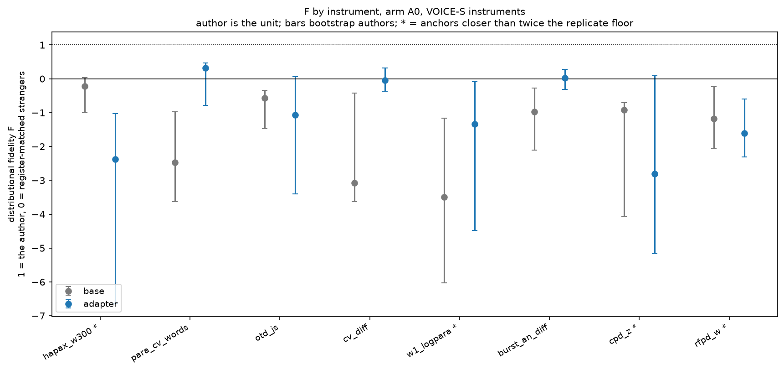
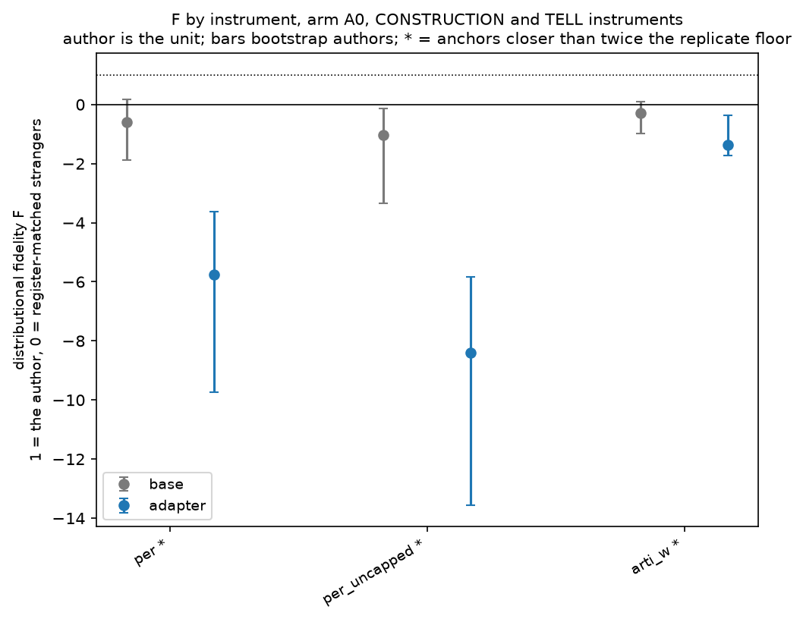
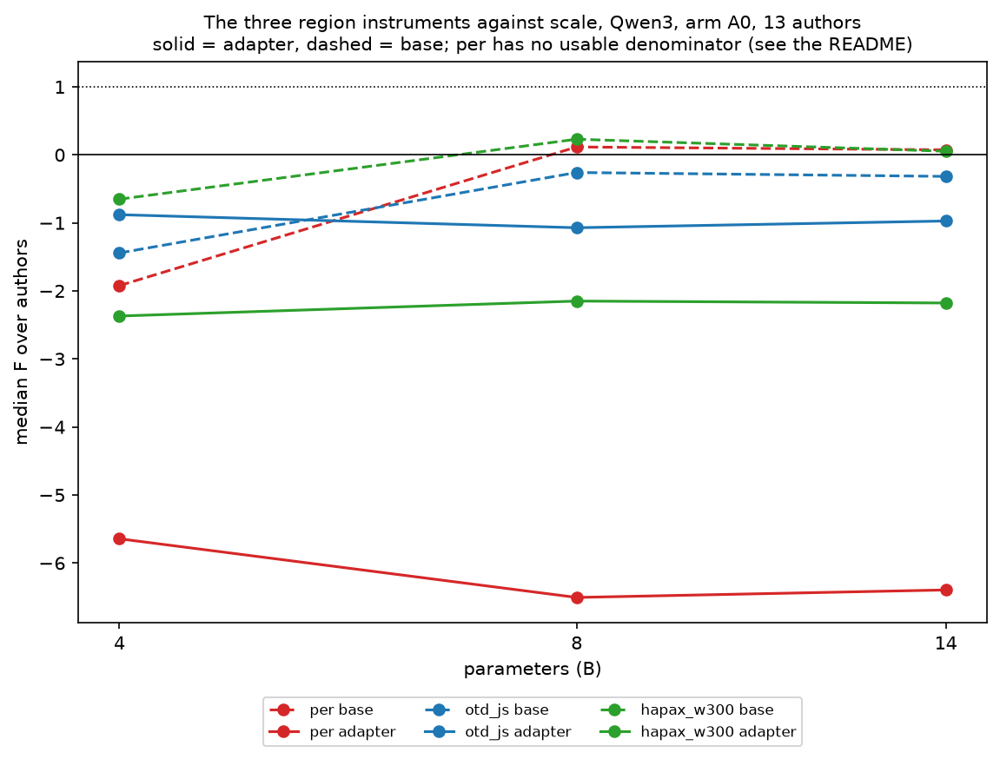

# 24 - The eval-cache measures on the authors' own passages

## What this does

The eval caches store per-cell values for generations only, so script 15 could not put these
instruments on the author-calibrated scale at all. This script computes them on the authors'
own passages -- 585 held-out test passages and
678 reference passages over 13 authors --
with the pipeline's own measure code, and then calibrates the generations against them.
11 instruments end with an H, a P and calibrated rows (arti_w, burst_an_diff, cpd_z, cv_diff, hapax_w300, otd_js, para_cv_words, per, per_uncapped, rfpd_w, w1_logpara).
Measured on the author passages but left uncalibrated because the generation side is not in the master cell table: mattr50_w300, mtld_w300.

`reference_measures.csv` is the artefact the rest of the programme was missing: one row per
author passage with every measure on it. `cross_author_measures.csv` is the same measures
computed for each passage against every other author's anchor, which is what a stranger pool
needs. On top of them the script reports positions, distributional fidelity F, and an
author-region rate that now has structure and construction in it, not only embeddings.

## How it does it

**Measure code.** The pure functions of `scripts/legacy/methods/per.py`, `otd.py`, `psd.py`,
`cpd.py`, `lexdiv.py`, `event_order.py` and `constructional.py`, plus `sentences`,
`paragraphs` and `normalise_punct` from `scripts/legacy/dr/core.py`, are copied into this
script verbatim with a comment naming the source file on each. Nothing in `scripts/legacy`
is imported or modified: `methods/common.py` points at the original pipeline directories and
`dr/core.py` creates directories when it is imported. The one deliberate change is that the
six-token opener stubs go through a single `nlp.pipe` call instead of one `spacy` call per
sentence; the tagger and its annotations are the same. Texts are normalised exactly as the
pipeline normalises them (`normalise_punct` then the S9 glyph fold), `per` is computed on the
first 600 words and `per_uncapped` on the whole passage, `lexdiv` on the first 300 tokens.

**Anchors.** `per`, `per_uncapped`, `hapax_w300`, `mattr50_w300`, `mtld_w300` and
`para_cv_words` are properties of a passage and need no anchor. `otd_js`, `cv_diff`,
`w1_logpara`, `burst_an_diff` and `cpd_z` are distances, and the pipeline computes them
against the generation's own source passage -- which does not exist for an author's own
passage. They are therefore computed here against the author's REFERENCE set: the mean over
the author's reference passages of the paired distance, leaving the passage out of the set
when it is itself in it. A stranger's passage is measured against the same author's
reference set, so H and P are exactly comparable. The constructional z scores use the
author's REF+TRAIN calibration exactly as `constructional.py` does, with a leave-one-out
mean and standard deviation when the passage being scored is in that calibration.

**The definition gap, stated plainly.** G keeps the pipeline's definition: a single distance
to the passage's own source. H and P use a mean over the reference set. Averaging shrinks
spread, so H is narrower than a single-pair H would be, W1(G, H) is inflated and F on the
five ref-anchored measures is biased downward. `anchor_definition_sensitivity.csv` measures
the size of that: it recomputes H and P with one randomly chosen reference partner per
passage and prints the ratio of standard deviations. The absolute measures (`per`,
`hapax_w300`, the lexical triple, `para_cv_words`) have no such gap and are the ones to lean
on.

**Calibration.** H = the author's own test passages; P = the test passages of the other
authors of the same class, the register-matched pool of script 23 (contemporary 5, period 6, private 2, so a private
author's pool is one other author); G = the arm-A0, non-replicate cells of `cells.parquet`,
with `para_cv_words`, `mattr50_w300` and `mtld_w300` sought in `data/eval_results/cache/`
because they are not in the master cell table.
pos = (mean G - P) / (mean H - P) with P the author-balanced pool mean;
F = 1 - W1(G, H) / W1(P, H); 400-resample bootstrap over brief clusters inside a
configuration, anchors held fixed. Each row carries the measure's replicate floor from
`lib.replicate_floor` and is flagged unusable when the two anchors are closer together than
twice that floor.

**Event order.** `tau`, `events_present` and `terminal_missing` need the passage's own brief,
so they exist for the author's test passages and for generations, and cannot exist for a
stranger: nobody else wrote to this author's brief. They are reported as a ceiling table
(`event_order_ceiling.csv`), not as a position.

**Region rate.** R on (`per`, `otd_js`, `hapax_w300`) is the share of generated passages
inside the central 90% interval of H on all three at once; `R_all5` adds the two
register-matched embedding instruments from script 23 and is the five-instrument rate.
`region_ceiling_and_floor.csv` gives the same rule applied to the author's own passages
(the ceiling) and to the register-matched strangers (the floor).

**A second floor for construction.** FIDELITY_SYNTHESIS section 2 says a stranger pool
cannot floor a coherence measure, because strangers' prose is as coherent as the author's.
The first half of that prediction holds: on `per` the register-matched pool sits
0.0155 from
the author's own mean, against a within-author standard deviation of
0.0253, and the sign of the gap
is not even consistent across authors. So the script builds the floor that section names:
every author test passage with its sentences permuted inside its own paragraph structure,
seeded, remeasured. `shuffle_manipulation_check.csv` reports how far that moves each measure
and `fidelity_vs_shuffle_floor.csv` recomputes F against it. The second half of the
prediction does not hold, and the check is what shows it -- see the conservative reading.

### Fidelity and position by instrument

| measure | construct | definition | kind | n | n_authors | median_F | median_pos | share_anchor_usable | median_separation_over_floor |
|---|---|---|---|---|---|---|---|---|---|
| per | construction | absolute | adapter | 49 | 13 | -5.644 | -1.841 | 0.388 | 1.548 |
| per | construction | absolute | base | 49 | 13 | -0.224 | 0.363 | 0.388 | 1.548 |
| per_uncapped | construction | absolute | adapter | 49 | 13 | -7.737 | -3.827 | 0.061 | 0.624 |
| per_uncapped | construction | absolute | base | 49 | 13 | -0.116 | 0.455 | 0.061 | 0.624 |
| arti_w | tell | calibration-z | adapter | 49 | 13 | -0.777 | 0.243 | 0.204 | 1.608 |
| arti_w | tell | calibration-z | base | 49 | 13 | 0.097 | 0.575 | 0.204 | 1.608 |
| burst_an_diff | voice_structure | ref-anchored | adapter | 49 | 13 | 0.086 | 0.665 | 0.755 | 3.855 |
| burst_an_diff | voice_structure | ref-anchored | base | 49 | 13 | -0.747 | 0.549 | 0.755 | 3.855 |
| cpd_z | voice_structure | ref-anchored | adapter | 49 | 13 | -2.804 | 0.962 | 0.204 | 1.203 |
| cpd_z | voice_structure | ref-anchored | base | 49 | 13 | -1.246 | 0.592 | 0.204 | 1.203 |
| cv_diff | voice_structure | ref-anchored | adapter | 49 | 13 | 0.019 | 0.654 | 0.633 | 3.348 |
| cv_diff | voice_structure | ref-anchored | base | 49 | 13 | -2.605 | 0.694 | 0.633 | 3.348 |
| hapax_w300 | voice_structure | absolute | adapter | 49 | 13 | -2.149 | -0.464 | 0.449 | 1.220 |
| hapax_w300 | voice_structure | absolute | base | 49 | 13 | -0.092 | 0.474 | 0.449 | 1.220 |
| otd_js | voice_structure | ref-anchored | adapter | 49 | 13 | -0.287 | 1.687 | 0.816 | 5.059 |
| otd_js | voice_structure | ref-anchored | base | 49 | 13 | -0.441 | 0.806 | 0.816 | 5.059 |
| para_cv_words | voice_structure | absolute | adapter | 49 | 13 | 0.338 | 0.845 | 0.633 | 3.348 |
| para_cv_words | voice_structure | absolute | base | 49 | 13 | -2.317 | 0.896 | 0.633 | 3.348 |
| rfpd_w | voice_structure | calibration-z | adapter | 49 | 13 | -1.229 | 0.025 | 0.265 | 1.249 |
| rfpd_w | voice_structure | calibration-z | base | 49 | 13 | -0.535 | 0.227 | 0.265 | 1.249 |
| w1_logpara | voice_structure | ref-anchored | adapter | 49 | 13 | -1.059 | 1.160 | 0.265 | 0.605 |
| w1_logpara | voice_structure | ref-anchored | base | 49 | 13 | -1.953 | -1.067 | 0.265 | 0.605 |

### Event-order ceiling: the authors' own passages against their own briefs

| author | author_class | n | mean_tau | sd_tau | mean_events_present | mean_terminal_missing | mean_n_events |
|---|---|---|---|---|---|---|---|
| cather | period | 44 | 0.705 | 0.271 | 0.848 | 0.136 | 8.432 |
| chesterton | period | 39 | 0.769 | 0.215 | 0.862 | 0.154 | 8.410 |
| chopin | period | 49 | 0.713 | 0.293 | 0.845 | 0.163 | 8.592 |
| doctorow | contemporary | 42 | 0.822 | 0.206 | 0.781 | 0.262 | 10.214 |
| h_private | private | 23 | 0.727 | 0.239 | 0.893 | 0.043 | 8.739 |
| link | contemporary | 15 | 0.658 | 0.367 | 0.893 | 0.000 | 8.867 |
| mansfield | period | 41 | 0.768 | 0.241 | 0.797 | 0.293 | 8.317 |
| patrick_v2 | private | 43 | 0.802 | 0.281 | 0.815 | 0.209 | 7.837 |
| rucker | contemporary | 45 | 0.802 | 0.189 | 0.848 | 0.222 | 8.533 |
| stross | contemporary | 41 | 0.830 | 0.205 | 0.812 | 0.171 | 8.683 |
| sui_sin_far | period | 24 | 0.572 | 0.370 | 0.828 | 0.292 | 9.125 |
| watts | contemporary | 44 | 0.797 | 0.280 | 0.670 | 0.432 | 9.909 |
| wharton | period | 43 | 0.737 | 0.260 | 0.851 | 0.116 | 8.209 |

### The region rule applied to the authors and to the strangers (the ceiling and the floor)

| group | author_class | rate_inside_3_measures | rate_inside_all5 |
|---|---|---|---|
| author_own_test | contemporary | 0.700 | 0.544 |
| author_own_test | period | 0.727 | 0.554 |
| author_own_test | private | 0.733 | 0.597 |
| register_matched_strangers | contemporary | 0.390 | 0.236 |
| register_matched_strangers | period | 0.585 | 0.353 |
| register_matched_strangers | private | 0.160 | 0.000 |

### Author-region rate by configuration

| family | params_b | kind | n_configs | n_authors | mean_R_measures | median_R_measures | mean_R_measures_at_2 | mean_R_all5 | mean_R_all5_at_2 |
|---|---|---|---|---|---|---|---|---|---|
| Ministral3 | 3.000 | adapter | 3 | 3 | 0.190 | 0.200 | 0.348 | 0.123 | 0.238 |
| Ministral3 | 3.000 | base | 3 | 3 | 0.292 | 0.321 | 0.443 | 0.174 | 0.271 |
| Ministral3 | 8.000 | adapter | 3 | 3 | 0.220 | 0.205 | 0.402 | 0.114 | 0.229 |
| Ministral3 | 8.000 | base | 3 | 3 | 0.214 | 0.167 | 0.343 | 0.101 | 0.179 |
| Ministral3 | 14.000 | adapter | 3 | 3 | 0.245 | 0.244 | 0.419 | 0.139 | 0.255 |
| Ministral3 | 14.000 | base | 3 | 3 | 0.253 | 0.202 | 0.415 | 0.141 | 0.251 |
| Qwen3 | 1.700 | adapter | 1 | 1 | 0.144 | 0.144 | 0.222 | 0.044 | 0.089 |
| Qwen3 | 1.700 | base | 1 | 1 | 0.111 | 0.111 | 0.222 | 0.033 | 0.067 |
| Qwen3 | 4.000 | adapter | 13 | 13 | 0.087 | 0.089 | 0.156 | 0.056 | 0.103 |
| Qwen3 | 4.000 | base | 13 | 13 | 0.233 | 0.214 | 0.384 | 0.062 | 0.118 |
| Qwen3 | 8.000 | adapter | 13 | 13 | 0.118 | 0.122 | 0.204 | 0.072 | 0.131 |
| Qwen3 | 8.000 | base | 13 | 13 | 0.409 | 0.417 | 0.570 | 0.116 | 0.195 |
| Qwen3 | 14.000 | adapter | 13 | 13 | 0.112 | 0.110 | 0.201 | 0.063 | 0.114 |
| Qwen3 | 14.000 | base | 13 | 13 | 0.432 | 0.449 | 0.596 | 0.131 | 0.218 |

### Anchor-definition sensitivity for the ref-anchored measures

| measure | sd_H_ref_set | sd_H_single_partner | sd_ratio_single_over_set | W1_P_H_ref_set | W1_P_H_single_partner |
|---|---|---|---|---|---|
| cpd_z | 0.221 | 0.466 | 1.974 | 0.142 | 0.159 |
| otd_js | 0.048 | 0.099 | 1.812 | 0.030 | 0.031 |
| w1_logpara | 0.178 | 0.372 | 2.072 | 0.119 | 0.158 |

### Sentence-shuffle manipulation check (author vs their own shuffled passages)

| measure | mean_author | mean_shuffled | mean_shift | W1_shuffled_vs_author | W1_strangers_vs_author |
|---|---|---|---|---|---|
| hapax_w300 | 0.441 | 0.453 | 0.012 | 0.015 | 0.032 |
| per | 0.020 | 0.018 | -0.002 | 0.005 | 0.011 |
| per_uncapped | 0.022 | 0.022 | -0.001 | 0.004 | 0.014 |

### F against the shuffled-author floor, beside F against the stranger pool

| measure | kind | n | n_authors | median_F_vs_shuffled | median_F_vs_strangers |
|---|---|---|---|---|---|
| hapax_w300 | adapter | 49 | 13 | -5.363 | -2.149 |
| hapax_w300 | base | 49 | 13 | -1.324 | -0.092 |
| per | adapter | 49 | 13 | -13.420 | -5.644 |
| per | base | 49 | 13 | -2.311 | -0.224 |
| per_uncapped | adapter | 49 | 13 | -23.278 | -7.737 |
| per_uncapped | base | 49 | 13 | -3.750 | -0.116 |

### Replicate floors used, per measure and family (Ministral3, Qwen3)

| measure | family | abs_mean_diff |
|---|---|---|
| arti_w | Ministral3 | 0.047 |
| arti_w | Qwen3 | 0.048 |
| burst_an_diff | Ministral3 | 0.009 |
| burst_an_diff | Qwen3 | 0.017 |
| cpd_z | Ministral3 | 0.114 |
| cpd_z | Qwen3 | 0.064 |
| cv_diff | Ministral3 | 0.038 |
| cv_diff | Qwen3 | 0.044 |
| hapax_w300 | Ministral3 | 0.006 |
| hapax_w300 | Qwen3 | 0.015 |
| otd_js | Ministral3 | 0.006 |
| otd_js | Qwen3 | 0.005 |
| para_cv_words | Ministral3 | 0.038 |
| para_cv_words | Qwen3 | 0.044 |
| per | Ministral3 | 0.004 |
| per | Qwen3 | 0.010 |
| per_uncapped | Ministral3 | 0.004 |
| per_uncapped | Qwen3 | 0.025 |
| rfpd_w | Ministral3 | 0.047 |
| rfpd_w | Qwen3 | 0.042 |
| w1_logpara | Ministral3 | 0.127 |
| w1_logpara | Qwen3 | 0.177 |

### Fidelity by instrument, VOICE-S instruments

### Fidelity by instrument, CONSTRUCTION and TELL instruments

### The three region instruments against scale

Runtime 164s. 1263 author passages measured, 8283 passage-by-anchor rows, 1078 calibrated rows over 11 instruments.

## How to read the result, conservatively

The unit is the author. Every median in `fidelity_by_measure.csv` is taken over
configurations, and the figures resample authors, not passages; with
13 authors the intervals are wide and are meant to be.

11 instruments that script 15 had to leave uncalibrated now have an H and a P, and on
several of them the anchor is the more informative number. The event-order ceiling is the
clearest case: the authors' own passages score a mean Kendall tau of 0.75 against
their own briefs over 13 authors (author means from 0.57 to 0.83),
while the generations average 0.67. A generation scoring above 0.75 is
following the brief's event order more closely than the prose the brief was extracted from
did, which is consistent with mechanical ordering rather than with fidelity. `tau` is
therefore reported raw and is not treated as a quantity to maximise.

Read F per instrument, never averaged across constructs: `fidelity_by_measure.csv` keeps
structure, construction and tell apart, which is the whole point of the profile in
FIDELITY_SYNTHESIS section 2.

Most F values here are below zero, and that is a statement about the instruments more than
about the models. F divides by W1(P, H), and on these measures a register-matched stranger
is very close to the author: the whole usable range is compressed, so any generation that
misses lands well below zero. The column to read first is `separation_over_floor` --
42 per cent of the
configuration-by-instrument rows clear the twice-the-floor rule, and the instruments marked
with an asterisk in the figures do not clear it on their median.

Any base-versus-adapter difference read off `fidelity_by_configuration.csv` or
`positions_by_configuration.csv` is compared with the measure's replicate floor in the same
row (`replicate_floors.csv` carries the floors themselves). A difference smaller than that
floor is inside the twice-generated replicate noise of the measure and is reported as within
the floor whatever else the row says.

`per` carries the largest problem of the set, and the second floor does not fix it. The
shuffled-author floor that FIDELITY_SYNTHESIS section 2 prescribes fails its own manipulation
check on this measure: taking an author's own passage and permuting its sentences moves the median
proposition-echo rate by
-0.0020, and the Wasserstein
distance between the shuffled and unshuffled distributions,
0.0049, is
*smaller* than the distance to the register-matched strangers,
0.0106. PER is
close to permutation-invariant by construction -- whether sentence A echoes B or B echoes A,
one of the pair is counted -- so a sentence shuffle is not a manipulation it can see.
Neither pool gives `per` a usable denominator, and its F should not be quoted from this
table at all; the raw rates in `reference_measures.csv` and the region membership are what
it can support. `hapax_w300` does move under the shuffle
(+0.0117) but less far than
a different author moves it, so the stranger pool stays its floor.

For the five ref-anchored measures the direction of the bias is known and one-sided: F is too
low, because G is a single-pair distance and H is a mean over the reference set. Treat their
F values as a lower bound and quote `anchor_definition_sensitivity.csv` beside them. The
absolute measures carry no such caveat.

The region rate on three measure instruments is much harsher than the embedding rate of
script 23, and the ceiling accounts for part of it: over 13 authors the
author's own passages clear all three simultaneously
0.72 of the time, because each central-90%
interval throws away 10 per cent of them and the intervals are close to independent. Read R as
a fraction of that ceiling. The register-matched strangers clear the same three
0.44 of the time on average, which is how
little these three instruments separate an author from their own register. That stranger floor
is an average over very unlike rows: it runs from
0.02 to
0.65 by author, and the private authors'
figure rests on a pool of one other writer, so the mean is not a floor any single row can be
read against. On all five instruments the ceiling falls to
0.56 and the stranger floor to
0.25. The two embedding instruments inside the
five-instrument rate come from script 23 and therefore inherit its npy row-alignment repair;
without that repair every cross-author cosine feeding them would be mislabelled.

The three-measure rate moves in the opposite direction from the embedding rate. Adapters raise
the embedding region rate in script 23 and lower this one: on Qwen3 at 14B, over
13 authors, the base runs clear the three-instrument region
0.43 of the time and the adapter runs
0.11. That pattern is consistent with
FIDELITY_SYNTHESIS fact 3, voice and construction moving in opposite directions under LoRA,
measured on a rate rather than a mean; the design is observational across authors, so it is
consistency rather than a demonstration, and the number of authors behind each row is printed
in `n_authors`. The five-instrument rate, which needs both constructs at once, averages at
most 0.17 over any family-size-kind group, and that
best group is Ministral3 3B base over
3 authors. The best single author-and-configuration cell in the whole
table reaches 0.31 against an author ceiling of
0.56.

## Caveats

- G and the ref-anchored H and P are not the same function. G is the pipeline's distance to the generation's own source passage; H and P are means over the author's reference set, because an author's own passage has no separate source. F for otd_js, cv_diff, w1_logpara, burst_an_diff and cpd_z is therefore a lower bound, not an estimate.
- P uses the other authors' TEST passages so that it matches H. Their reference passages are measured too and are in reference_measures.csv, but they do not enter P.
- The private class has two authors, so a private author's register-matched pool is a single other author. patrick (the v1 chunking control) is excluded throughout for the reason given in script 23.
- cpd_z uses the standard deviations of the author's own test passages per cadence component, exactly as methods/common.py's source_stats does; those sds are estimated on 25 to 50 passages and are themselves noisy.
- The constructional calibration is REF+TRAIN, so it is not independent of the adapter's training data: an adapter trained on those chunks is being scored against a calibration built from them. That is the pipeline's own design and is kept here for comparability, but it means arti_w and rfpd_w are not clean held-out measures for adapter runs.
- Event-order tau, events_present and terminal_missing have a ceiling but no floor: a stranger cannot be scored against this author's brief. They are reported raw.
- Only arm A0 has eval-cache measures, so nothing here speaks to the prompting arms: no A1-A5 effect on per, otd_js, psd, cpd, lexdiv, event order or the constructional features can be claimed from this table or any other.
- Replicate floors are now measured for Ministral3, Qwen3 (`replicate_floors.csv`), the two Ministral3 replicate base runs having been scored on 2026-09-10. The Ministral3 pairs are few and their floors are smaller than the Qwen3 ones on most measures, so a Ministral3 contrast judged above its own floor is on thinner evidence than the same verdict on Qwen3.
- Generated passages from runs that exceed the 20 per cent truncation gate are included and flagged, not excluded. Among the runs read here that is: cather_pair4b, cather_paire6_14b, chopin_paire6_14b, doctorow_basem14b, doctorow_basem8b, h_private_paire6_14b, h_private_paire6_8b, link_paire6_14b, link_paire6_4b, link_paire6_8b, patrick_v2_paire6_17b, sui_sin_far_paire6_14b, sui_sin_far_paire6_4b, sui_sin_far_paire6_8b.
- Thirteen authors, not the multiplicity correction, is what limits every pooled statement here; the BH-FDR in this folder is applied within this script's own families and has not been through the programme-wide layer in script 22.
- The shuffle floor moves only the measures that read order. otd_js is computed from a distribution over opener classes and burst_an from the sentence-length distribution, so a sentence shuffle leaves them where they are by construction; that is why the shuffle floor is offered for per, per_uncapped and hapax_w300 and not for the rest.
