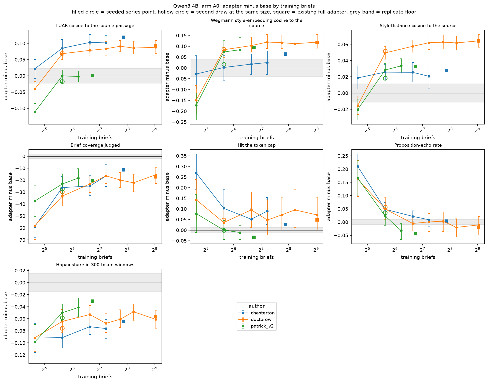
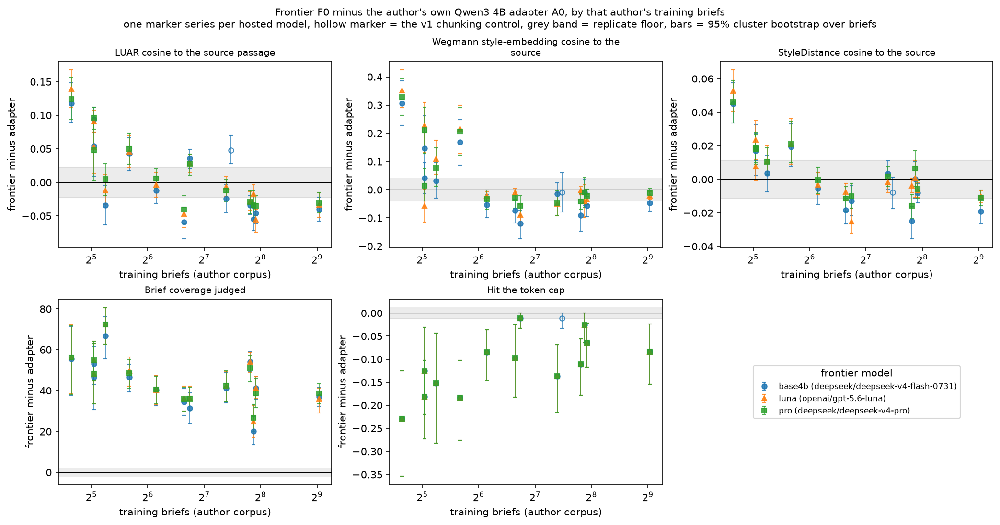

# 25 Within-author data-size series and frontier arms

## What this does

Two analyses the main tables leave out. Both rest on very few authors, and the author count
is stated with every claim.

(a) The within-author data-size series. 3 authors (chesterton, doctorow, patrick_v2) at Qwen3 4B.
Each author has adapters trained on a graded number of that author's own training briefs,
every one of them compared with that author's own Qwen3 4B base run on the same briefs.
The levels, the existing full adapter and the arms differ by author: chesterton: levels 25, 50, 100, 150, plus the existing full adapter at 235, arms A0, A1, no second draw; doctorow: levels 25, 50, 100, 150, 215, 300, 525, plus the existing full adapter at 525, arms A0, A1, second draw at 50; patrick_v2: levels 25, 50, 75, plus the existing full adapter at 107, arms A0, A5, second draw at 50. That is
14 seeded training levels across the series and 3 arms in total.
Each series is one author. The series are reported side by side and are never pooled into a
single curve, because 3 authors chosen for other reasons are not
a sample of authors.

(b) The frontier arms. 3 hosted models (`base4b` is deepseek/deepseek-v4-flash-0731; `luna` is openai/gpt-5.6-luna; `pro` is deepseek/deepseek-v4-pro) given the brief only
(F0) or the full conditioning (F5), each compared with the same authors' own Qwen3 4B base
and adapter runs on the same briefs. base4b covers 14 authors, 13 of them usable; luna covers 13 authors, 13 of them usable; pro covers 13 authors, 13 of them usable. Across both labels 14 authors
have frontier rows, 13 of them usable; `patrick` is the v1 chunking control and appears under base4b, and it is flagged by
`is_control` and held out of every pooled row. The F5 arm was run for base4b (deepseek/deepseek-v4-flash-0731) only, so the
F5 contrasts and the F5-versus-F0 contrast exist for that model alone and the label luna, pro
has F0 rows only. Every contrast is computed inside one label and the two models are never
averaged into a single frontier row. Both models are the everyday chat tier of their
provider. Neither is the strongest model that provider hosts, so these rows say what a
cheap hosted model does with these briefs and not what the best available model would do.

## How it does it

Brief-paired mean differences with a 1,000-resample cluster bootstrap over briefs, a Wilcoxon
test on the per-brief means, and the Qwen3 replicate floor of each measure printed beside
every contrast. BH-FDR is applied within each table separately and each table is its own
family: 551 tests in the series contrast table, 87 in the trend table,
58 in the seed-replicate table, 1543 in the frontier contrast table and
465 in the model-against-model table. A q below
0.05 therefore means survival inside that one table. The programme-wide correction is a
separate and stricter layer applied in script 22, and no number here has passed it.

`size_series.csv` carries one row per author, arm, training level and measure. `point_kind`
separates the seeded series points from the author's existing full adapter, which is
included as a comparison row labelled by that author's full training-brief count.
`targets_seed` is 0 for the main nested subsets and 1 for a second draw at the same size.
The size trend in `size_trend.csv` is a brief-level Spearman correlation between
log2(training briefs) and the paired delta, fitted on seed-0 points only and on at least two
levels; a full adapter that sits at the same brief count as a seeded level is dropped from
that fit so one nominal size is not counted twice. `size_seed_replicates.csv` contrasts the
seed-1 adapter with the seed-0 adapter at the same training size on the same briefs.
`size_gain_by_author.csv` puts the seed-0 adapter-minus-base delta of each author side by
side at the training sizes at least two authors reached (25, 50, 100, 150); the only pooling in it is an unweighted mean printed next to the author count, which reaches 3.

Every adapter along a series was trained for the same 5 and 6 epochs, so the training
examples scale with the brief count and the smallest point on each curve is also the least
trained point. Size and training length are not separable here.

The eval-cache measures (`per`, `otd_js`, `hapax_w300`) exist only where that cache was
computed. In the series points they are present for `hapax_w300`, `otd_js`, `per`. None of them appears on an existing full adapter either. No F value is quoted for
`per` anywhere in this folder: proposition echo is close to permutation-invariant and has no
working floor (script 24), so it appears only as a raw brief-paired difference. `coverage` is
an LLM-judged adherence reading and `fool_vs_source` is a 2AFC judge rate. Both are
instrument readings from a judge model, they are relative measures with known failures, and
neither is a measure of writing quality.

`series_platform` records where each series was generated: chesterton local, doctorow runpod, patrick_v2 runpod. The RunPod runs and
the local runs were produced by the same code verified by hash, and the platform column is
there so a platform difference can be checked rather than assumed away.

The frontier tables use the same brief-paired method, computed inside one `frontier_label` at
a time. `frontier_contrasts.csv` carries 1576 rows over 5 contrasts
(F0 vs adapter A0, F0 vs base A0, F5 vs F0, F5 vs adapter A0, F5 vs base A5), with `frontier_label` and `frontier_model` in front of `author` and
`is_control` marking the v1 chunking control. `frontier_vs_adapter_by_author.csv` holds the
F0-minus-adapter-A0 delta of each author beside that author's `train_briefs_passed`, so the
sign of the frontier-versus-local gap can be read against corpus size; it has 557
rows, of which 39 are pooled rows, one per label and measure (`coverage`, `fool_vs_source`, `geo_index`, `len_ratio`, `luar_cos_ref`, `luar_cos_source`, `open_entropy`, `pct_short8`, `sent_echo`, `styledist_cos_source`, `truncated`, `wegmann_cos_source`, `words`). A
pooled row is an unweighted mean over the 13 usable authors with a 1,000-resample
bootstrap over authors, and it counts the authors whose local adapter beats the frontier arm
by more than the floor, using the measure's direction in the variable dictionary.
`frontier_model_contrast.csv` puts the two hosted models against each other on the same
briefs and the same samples at F0: 507 rows over 13 authors, luna F0 minus base4b F0, pro F0 minus base4b F0, pro F0 minus luna F0.

Frontier floors are the same Qwen3 replicate floors used everywhere in this folder, printed
as `floor_qwen` on every row: `coverage` 1.9744, `fool_vs_source` 0.0385, `geo_index` 0.0644, `len_ratio` 0.0622, `luar_cos_ref` 0.0207, `luar_cos_source` 0.0229, `open_entropy` 0.0147, `pct_short8` 0.0327, `sent_echo` 0.0265, `styledist_cos_source` 0.0114, `truncated` 0.0122, `wegmann_cos_source` 0.0406, `words` 47.6341. Measures in the frontier tables with no usable
floor: none. Measures in the script's list that have no frontier rows at all:
`otd_js`, `per`, `hapax_w300`. The judge-scored measures present in the frontier tables are `coverage`, `fool_vs_source`.
`coverage` is an LLM judge's reading of how much of the brief is present and `fool_vs_source`
is a 2AFC rate from LLM judges. Both are instrument readings with known failure modes and
neither is a measure of writing quality.

A blank `q_bh` cell means no Wilcoxon was computed for that row, either because the paired
differences were identically zero or because fewer than six briefs were available.

### Trend of the adapter-minus-base delta with training briefs, arm A0 (brief-level Spearman against log2 briefs, seed 0 only)

| author | arm | measure | n_levels | n_cells | rho_delta_vs_log2_briefs | p | q_bh |
|---|---|---|---|---|---|---|---|
| chesterton | A0 | luar_cos_ref | 5 | 390 | 0.237 | 0.000 | 0.000 |
| chesterton | A0 | luar_cos_source | 5 | 390 | 0.248 | 0.000 | 0.000 |
| chesterton | A0 | wegmann_cos_source | 5 | 390 | 0.162 | 0.001 | 0.002 |
| chesterton | A0 | styledist_cos_source | 5 | 390 | 0.071 | 0.159 | 0.177 |
| chesterton | A0 | geo_index | 5 | 390 | 0.387 | 0.000 | 0.000 |
| chesterton | A0 | open_entropy | 5 | 389 | 0.460 | 0.000 | 0.000 |
| chesterton | A0 | pct_short8 | 5 | 390 | 0.057 | 0.260 | 0.279 |
| chesterton | A0 | otd_js | 5 | 390 | -0.366 | 0.000 | 0.000 |
| chesterton | A0 | per | 5 | 390 | -0.345 | 0.000 | 0.000 |
| chesterton | A0 | hapax_w300 | 5 | 388 | 0.120 | 0.018 | 0.023 |
| chesterton | A0 | sent_echo | 5 | 390 | -0.490 | 0.000 | 0.000 |
| chesterton | A0 | coverage | 5 | 195 | 0.447 | 0.000 | 0.000 |
| chesterton | A0 | fool_vs_source | 5 | 195 | 0.171 | 0.017 | 0.022 |
| chesterton | A0 | truncated | 5 | 390 | -0.228 | 0.000 | 0.000 |
| chesterton | A0 | len_ratio | 5 | 390 | -0.001 | 0.979 | 0.979 |
| chesterton | A0 | words | 5 | 390 | -0.008 | 0.875 | 0.886 |
| doctorow | A0 | luar_cos_ref | 7 | 588 | 0.263 | 0.000 | 0.000 |
| doctorow | A0 | luar_cos_source | 7 | 588 | 0.314 | 0.000 | 0.000 |
| doctorow | A0 | wegmann_cos_source | 7 | 588 | 0.311 | 0.000 | 0.000 |
| doctorow | A0 | styledist_cos_source | 7 | 588 | 0.367 | 0.000 | 0.000 |
| doctorow | A0 | geo_index | 7 | 588 | 0.251 | 0.000 | 0.000 |
| doctorow | A0 | open_entropy | 7 | 588 | 0.277 | 0.000 | 0.000 |
| doctorow | A0 | pct_short8 | 7 | 588 | 0.207 | 0.000 | 0.000 |
| doctorow | A0 | otd_js | 7 | 588 | -0.314 | 0.000 | 0.000 |
| doctorow | A0 | per | 7 | 588 | -0.198 | 0.000 | 0.000 |
| doctorow | A0 | hapax_w300 | 7 | 583 | 0.075 | 0.071 | 0.082 |
| doctorow | A0 | sent_echo | 7 | 588 | -0.225 | 0.000 | 0.000 |
| doctorow | A0 | coverage | 7 | 288 | 0.334 | 0.000 | 0.000 |
| doctorow | A0 | fool_vs_source | 7 | 293 | 0.110 | 0.061 | 0.072 |
| doctorow | A0 | truncated | 7 | 588 | -0.022 | 0.588 | 0.609 |
| doctorow | A0 | len_ratio | 7 | 588 | 0.304 | 0.000 | 0.000 |
| doctorow | A0 | words | 7 | 588 | 0.303 | 0.000 | 0.000 |
| patrick_v2 | A0 | luar_cos_ref | 4 | 360 | 0.378 | 0.000 | 0.000 |
| patrick_v2 | A0 | luar_cos_source | 4 | 360 | 0.348 | 0.000 | 0.000 |
| patrick_v2 | A0 | wegmann_cos_source | 4 | 360 | 0.332 | 0.000 | 0.000 |
| patrick_v2 | A0 | styledist_cos_source | 4 | 360 | 0.361 | 0.000 | 0.000 |
| patrick_v2 | A0 | geo_index | 4 | 360 | 0.348 | 0.000 | 0.000 |
| patrick_v2 | A0 | open_entropy | 4 | 360 | 0.602 | 0.000 | 0.000 |
| patrick_v2 | A0 | pct_short8 | 4 | 360 | 0.086 | 0.102 | 0.117 |
| patrick_v2 | A0 | otd_js | 4 | 360 | -0.452 | 0.000 | 0.000 |
| patrick_v2 | A0 | per | 4 | 360 | -0.328 | 0.000 | 0.000 |
| patrick_v2 | A0 | hapax_w300 | 4 | 352 | 0.227 | 0.000 | 0.000 |
| patrick_v2 | A0 | sent_echo | 4 | 360 | -0.333 | 0.000 | 0.000 |
| patrick_v2 | A0 | coverage | 4 | 180 | 0.159 | 0.034 | 0.041 |
| patrick_v2 | A0 | fool_vs_source | 4 | 179 | 0.167 | 0.025 | 0.031 |
| patrick_v2 | A0 | truncated | 4 | 360 | -0.136 | 0.010 | 0.013 |
| patrick_v2 | A0 | len_ratio | 4 | 360 | 0.383 | 0.000 | 0.000 |
| patrick_v2 | A0 | words | 4 | 360 | 0.380 | 0.000 | 0.000 |

### Training records at every point of every series

| author | train_briefs | targets_seed | point_kind | run | series_platform | train_examples | train_targets | train_steps | probe_delta | eval_best |
|---|---|---|---|---|---|---|---|---|---|---|
| chesterton | 25 | 0 | series | chesterton_size25 | local | 150.000 |  | 19.000 | -0.648 | 2.754 |
| chesterton | 50 | 0 | series | chesterton_size50 | local | 300.000 |  | 38.000 | -0.695 | 2.692 |
| chesterton | 100 | 0 | series | chesterton_size100 | local | 600.000 |  | 75.000 | -0.716 | 2.641 |
| chesterton | 150 | 0 | series | chesterton_size150 | local | 900.000 |  | 113.000 | -0.717 | 2.620 |
| chesterton | 235 | 0 | existing_adapter | chesterton_paire6_4b | unknown | 1290.000 | 215.000 | 162.000 | -0.710 | 2.610 |
| doctorow | 25 | 0 | series | doctorow_size25 | runpod | 150.000 |  | 19.000 | -1.009 | 2.534 |
| doctorow | 50 | 0 | series | doctorow_size50 | runpod | 300.000 |  | 38.000 | -1.059 | 2.477 |
| doctorow | 50 | 1 | series | doctorow_size50_s1 | runpod | 300.000 |  | 38.000 | -1.054 | 2.478 |
| doctorow | 100 | 0 | series | doctorow_size100 | runpod | 600.000 |  | 75.000 | -1.087 | 2.441 |
| doctorow | 150 | 0 | series | doctorow_size150 | runpod | 900.000 |  | 113.000 | -1.083 | 2.427 |
| doctorow | 215 | 0 | series | doctorow_size215 | runpod | 1290.000 |  | 140.000 | -1.090 | 2.419 |
| doctorow | 300 | 0 | series | doctorow_size300 | runpod | 1800.000 |  | 140.000 | -1.085 | 2.415 |
| doctorow | 525 | 0 | series | doctorow_size525 | runpod | 2430.000 |  | 160.000 | -1.112 | 2.410 |
| doctorow | 525 | 0 | existing_adapter | doctorow_paire6_4b | runpod | 1290.000 | 405.000 | 162.000 | -1.112 | 2.403 |
| patrick_v2 | 25 | 0 | series | patrick_v2_size25 | runpod | 150.000 |  | 19.000 | -0.690 | 3.416 |
| patrick_v2 | 50 | 0 | series | patrick_v2_size50 | runpod | 300.000 |  | 38.000 | -0.766 | 3.333 |
| patrick_v2 | 50 | 1 | series | patrick_v2_size50_s1 | runpod | 300.000 |  | 38.000 | -0.754 | 3.341 |
| patrick_v2 | 75 | 0 | series | patrick_v2_size75 | runpod | 450.000 |  | 57.000 | -0.796 | 3.303 |
| patrick_v2 | 107 | 0 | existing_adapter | patrick_v2_paire6_4b | unknown | 624.000 | 104.000 | 78.000 | -0.813 | 3.285 |

### Two adapters trained on different draws of the same number of briefs (seed 1 minus seed 0, brief-paired)

| author | arm | train_briefs | measure | delta | ci_low | ci_high | floor_qwen | above_floor | q_bh |
|---|---|---|---|---|---|---|---|---|---|
| doctorow | A0 | 50 | luar_cos_ref | 0.003 | -0.010 | 0.017 | 0.021 | False | 0.845 |
| doctorow | A0 | 50 | luar_cos_source | 0.001 | -0.013 | 0.015 | 0.023 | False | 1.000 |
| doctorow | A0 | 50 | wegmann_cos_source | 0.003 | -0.014 | 0.017 | 0.041 | False | 0.845 |
| doctorow | A0 | 50 | styledist_cos_source | 0.002 | -0.003 | 0.008 | 0.011 | False | 0.845 |
| doctorow | A0 | 50 | geo_index | -0.026 | -0.165 | 0.108 | 0.064 | False | 0.995 |
| doctorow | A0 | 50 | open_entropy | -0.009 | -0.046 | 0.030 | 0.015 | False | 0.845 |
| doctorow | A0 | 50 | pct_short8 | -0.011 | -0.055 | 0.033 | 0.033 | False | 0.845 |
| doctorow | A0 | 50 | otd_js | 0.004 | -0.018 | 0.024 | 0.005 | False | 0.845 |
| doctorow | A0 | 50 | per | 0.007 | -0.030 | 0.046 | 0.010 | False | 0.845 |
| doctorow | A0 | 50 | hapax_w300 | -0.011 | -0.028 | 0.005 | 0.015 | False | 0.554 |
| doctorow | A0 | 50 | sent_echo | 0.006 | -0.033 | 0.047 | 0.026 | False | 0.949 |
| doctorow | A0 | 50 | coverage | 3.707 | -6.000 | 13.245 | 1.974 | True | 0.845 |
| doctorow | A0 | 50 | fool_vs_source | -0.036 | -0.095 | 0.036 | 0.038 | False | 0.744 |
| doctorow | A0 | 50 | truncated | 0.012 | -0.060 | 0.095 | 0.012 | False | 0.949 |
| doctorow | A0 | 50 | len_ratio | 0.062 | -0.012 | 0.134 | 0.062 | False | 0.419 |
| doctorow | A0 | 50 | words | 47.583 | -9.475 | 103.731 | 47.634 | False | 0.419 |
| doctorow | A1 | 50 | luar_cos_ref | -0.004 | -0.016 | 0.009 | 0.021 | False | 0.845 |
| doctorow | A1 | 50 | luar_cos_source | 0.011 | -0.001 | 0.026 | 0.023 | False | 0.554 |
| doctorow | A1 | 50 | wegmann_cos_source | 0.021 | -0.008 | 0.057 | 0.041 | False | 0.845 |
| doctorow | A1 | 50 | styledist_cos_source | 0.007 | 0.001 | 0.013 | 0.011 | False | 0.419 |
| doctorow | A1 | 50 | geo_index | -0.031 | -0.144 | 0.094 | 0.064 | False | 0.845 |
| doctorow | A1 | 50 | open_entropy | -0.013 | -0.047 | 0.018 | 0.015 | False | 0.845 |
| doctorow | A1 | 50 | pct_short8 | 0.033 | -0.016 | 0.072 | 0.033 | True | 0.419 |
| doctorow | A1 | 50 | sent_echo | 0.019 | -0.005 | 0.042 | 0.026 | False | 0.419 |
| doctorow | A1 | 50 | coverage | -0.925 | -8.751 | 8.028 | 1.974 | False | 0.845 |
| doctorow | A1 | 50 | fool_vs_source | -0.036 | -0.083 | 0.000 | 0.038 | False | 0.419 |
| doctorow | A1 | 50 | truncated | -0.048 | -0.107 | 0.012 | 0.012 | True | 0.554 |
| doctorow | A1 | 50 | len_ratio | -0.021 | -0.093 | 0.052 | 0.062 | False | 0.995 |
| doctorow | A1 | 50 | words | -16.488 | -72.203 | 38.944 | 47.634 | False | 0.952 |
| patrick_v2 | A0 | 50 | luar_cos_ref | -0.006 | -0.021 | 0.009 | 0.021 | False | 0.744 |
| patrick_v2 | A0 | 50 | luar_cos_source | -0.018 | -0.032 | -0.002 | 0.023 | False | 0.419 |
| patrick_v2 | A0 | 50 | wegmann_cos_source | -0.058 | -0.098 | -0.013 | 0.041 | True | 0.065 |
| patrick_v2 | A0 | 50 | styledist_cos_source | -0.010 | -0.018 | -0.002 | 0.011 | False | 0.240 |
| patrick_v2 | A0 | 50 | geo_index | -0.061 | -0.176 | 0.052 | 0.064 | False | 0.419 |
| patrick_v2 | A0 | 50 | open_entropy | -0.021 | -0.064 | 0.018 | 0.015 | True | 0.845 |
| patrick_v2 | A0 | 50 | pct_short8 | -0.009 | -0.067 | 0.043 | 0.033 | False | 1.000 |
| patrick_v2 | A0 | 50 | otd_js | 0.015 | -0.002 | 0.036 | 0.005 | True | 0.554 |
| patrick_v2 | A0 | 50 | per | 0.013 | -0.023 | 0.052 | 0.010 | True | 0.744 |
| patrick_v2 | A0 | 50 | hapax_w300 | -0.009 | -0.026 | 0.008 | 0.015 | False | 0.554 |
| patrick_v2 | A0 | 50 | sent_echo | 0.013 | -0.035 | 0.059 | 0.026 | False | 0.573 |
| patrick_v2 | A0 | 50 | coverage | -2.796 | -14.114 | 7.888 | 1.974 | True | 0.845 |
| patrick_v2 | A0 | 50 | fool_vs_source | 0.000 | -0.080 | 0.091 | 0.038 | False | 1.000 |
| patrick_v2 | A0 | 50 | truncated | 0.000 | -0.067 | 0.067 | 0.012 | False | 1.000 |
| patrick_v2 | A0 | 50 | len_ratio | 0.042 | -0.033 | 0.124 | 0.062 | False | 0.744 |
| patrick_v2 | A0 | 50 | words | 26.122 | -26.920 | 82.922 | 47.634 | False | 0.744 |
| patrick_v2 | A5 | 50 | luar_cos_ref | 0.028 | 0.010 | 0.047 | 0.021 | True | 0.046 |
| patrick_v2 | A5 | 50 | luar_cos_source | 0.011 | -0.009 | 0.031 | 0.023 | False | 0.554 |
| patrick_v2 | A5 | 50 | wegmann_cos_source | 0.048 | -0.001 | 0.097 | 0.041 | True | 0.554 |
| patrick_v2 | A5 | 50 | styledist_cos_source | 0.002 | -0.007 | 0.011 | 0.011 | False | 0.744 |
| patrick_v2 | A5 | 50 | geo_index | -0.024 | -0.140 | 0.088 | 0.064 | False | 0.995 |
| patrick_v2 | A5 | 50 | open_entropy | -0.007 | -0.046 | 0.032 | 0.015 | False | 0.949 |
| patrick_v2 | A5 | 50 | pct_short8 | -0.008 | -0.061 | 0.047 | 0.033 | False | 0.997 |
| patrick_v2 | A5 | 50 | sent_echo | 0.025 | -0.032 | 0.080 | 0.026 | False | 0.554 |
| patrick_v2 | A5 | 50 | coverage | -9.884 | -18.932 | 0.398 | 1.974 | True | 0.419 |
| patrick_v2 | A5 | 50 | fool_vs_source | 0.023 | -0.045 | 0.102 | 0.038 | False | 0.845 |
| patrick_v2 | A5 | 50 | truncated | 0.000 | -0.078 | 0.078 | 0.012 | False | 1.000 |
| patrick_v2 | A5 | 50 | len_ratio | 0.038 | -0.049 | 0.137 | 0.062 | False | 0.845 |
| patrick_v2 | A5 | 50 | words | 31.322 | -31.528 | 99.723 | 47.634 | False | 0.845 |

### Adapter minus base at the training sizes at least two authors share (one column per author, no pooling beyond the mean)

| measure | arm | train_briefs | delta_chesterton | delta_doctorow | delta_patrick_v2 | n_authors | mean_delta | floor_qwen |
|---|---|---|---|---|---|---|---|---|
| coverage | A0 | 25 | -58.795 | -58.191 | -37.489 | 3 | -51.491 | 1.974 |
| coverage | A0 | 50 | -26.231 | -33.366 | -23.222 | 3 | -27.606 | 1.974 |
| coverage | A0 | 100 | -24.949 | -23.220 |  | 2 | -24.084 | 1.974 |
| coverage | A0 | 150 | -16.590 | -16.390 |  | 2 | -16.490 | 1.974 |
| luar_cos_ref | A0 | 25 | 0.027 | -0.037 | -0.114 | 3 | -0.041 | 0.021 |
| luar_cos_ref | A0 | 50 | 0.084 | 0.035 | -0.016 | 3 | 0.034 | 0.021 |
| luar_cos_ref | A0 | 100 | 0.100 | 0.036 |  | 2 | 0.068 | 0.021 |
| luar_cos_ref | A0 | 150 | 0.101 | 0.053 |  | 2 | 0.077 | 0.021 |
| luar_cos_source | A0 | 25 | 0.022 | -0.041 | -0.111 | 3 | -0.043 | 0.023 |
| luar_cos_source | A0 | 50 | 0.085 | 0.068 | -0.000 | 3 | 0.051 | 0.023 |
| luar_cos_source | A0 | 100 | 0.103 | 0.079 |  | 2 | 0.091 | 0.023 |
| luar_cos_source | A0 | 150 | 0.102 | 0.083 |  | 2 | 0.092 | 0.023 |
| styledist_cos_source | A0 | 25 | 0.019 | -0.015 | -0.020 | 3 | -0.006 | 0.011 |
| styledist_cos_source | A0 | 50 | 0.026 | 0.050 | 0.028 | 3 | 0.035 | 0.011 |
| styledist_cos_source | A0 | 100 | 0.025 | 0.058 |  | 2 | 0.042 | 0.011 |
| styledist_cos_source | A0 | 150 | 0.021 | 0.062 |  | 2 | 0.041 | 0.011 |
| truncated | A0 | 25 | 0.269 | 0.143 | 0.078 | 3 | 0.163 | 0.012 |
| truncated | A0 | 50 | 0.103 | 0.036 | 0.000 | 3 | 0.046 | 0.012 |
| truncated | A0 | 100 | 0.051 | 0.095 |  | 2 | 0.073 | 0.012 |
| truncated | A0 | 150 | 0.090 | 0.048 |  | 2 | 0.069 | 0.012 |
| wegmann_cos_source | A0 | 25 | -0.028 | -0.149 | -0.172 | 3 | -0.117 | 0.041 |
| wegmann_cos_source | A0 | 50 | 0.002 | 0.084 | 0.073 | 3 | 0.053 | 0.041 |
| wegmann_cos_source | A0 | 100 | 0.017 | 0.103 |  | 2 | 0.060 | 0.041 |
| wegmann_cos_source | A0 | 150 | 0.024 | 0.119 |  | 2 | 0.072 | 0.041 |

### Adapter minus base at A0 along each series (brief-paired, 95% cluster bootstrap)

| author | train_briefs | targets_seed | point_kind | measure | delta | ci_low | ci_high | floor_qwen | above_floor | q_bh |
|---|---|---|---|---|---|---|---|---|---|---|
| chesterton | 25 | 0 | series | luar_cos_ref | 0.027 | 0.001 | 0.054 | 0.021 | True | 0.269 |
| chesterton | 25 | 0 | series | luar_cos_source | 0.022 | -0.008 | 0.051 | 0.023 | False | 0.332 |
| chesterton | 25 | 0 | series | wegmann_cos_source | -0.028 | -0.097 | 0.056 | 0.041 | False | 0.380 |
| chesterton | 25 | 0 | series | styledist_cos_source | 0.019 | 0.005 | 0.033 | 0.011 | True | 0.103 |
| chesterton | 25 | 0 | series | coverage | -58.795 | -68.183 | -48.178 | 1.974 | True | 0.000 |
| chesterton | 25 | 0 | series | truncated | 0.269 | 0.192 | 0.359 | 0.012 | True | 0.000 |
| chesterton | 50 | 0 | series | luar_cos_ref | 0.084 | 0.058 | 0.111 | 0.021 | True | 0.000 |
| chesterton | 50 | 0 | series | luar_cos_source | 0.085 | 0.062 | 0.112 | 0.023 | True | 0.000 |
| chesterton | 50 | 0 | series | wegmann_cos_source | 0.002 | -0.057 | 0.056 | 0.041 | False | 0.699 |
| chesterton | 50 | 0 | series | styledist_cos_source | 0.026 | 0.016 | 0.035 | 0.011 | True | 0.000 |
| chesterton | 50 | 0 | series | coverage | -26.231 | -34.874 | -17.145 | 1.974 | True | 0.000 |
| chesterton | 50 | 0 | series | truncated | 0.103 | 0.038 | 0.192 | 0.012 | True | 0.019 |
| chesterton | 100 | 0 | series | luar_cos_ref | 0.100 | 0.071 | 0.128 | 0.021 | True | 0.000 |
| chesterton | 100 | 0 | series | luar_cos_source | 0.103 | 0.078 | 0.128 | 0.023 | True | 0.000 |
| chesterton | 100 | 0 | series | wegmann_cos_source | 0.017 | -0.030 | 0.064 | 0.041 | False | 0.664 |
| chesterton | 100 | 0 | series | styledist_cos_source | 0.025 | 0.014 | 0.038 | 0.011 | True | 0.001 |
| chesterton | 100 | 0 | series | coverage | -24.949 | -32.798 | -16.254 | 1.974 | True | 0.000 |
| chesterton | 100 | 0 | series | truncated | 0.051 | 0.013 | 0.103 | 0.012 | True | 0.066 |
| chesterton | 150 | 0 | series | luar_cos_ref | 0.101 | 0.075 | 0.128 | 0.021 | True | 0.000 |
| chesterton | 150 | 0 | series | luar_cos_source | 0.102 | 0.081 | 0.124 | 0.023 | True | 0.000 |
| chesterton | 150 | 0 | series | wegmann_cos_source | 0.024 | -0.031 | 0.078 | 0.041 | False | 0.252 |
| chesterton | 150 | 0 | series | styledist_cos_source | 0.021 | 0.006 | 0.033 | 0.011 | True | 0.001 |
| chesterton | 150 | 0 | series | coverage | -16.590 | -25.232 | -7.076 | 1.974 | True | 0.002 |
| chesterton | 150 | 0 | series | truncated | 0.090 | 0.026 | 0.154 | 0.012 | True | 0.031 |
| chesterton | 235 | 0 | existing_adapter | luar_cos_ref | 0.117 | 0.091 | 0.143 | 0.021 | True | 0.000 |
| chesterton | 235 | 0 | existing_adapter | luar_cos_source | 0.119 | 0.097 | 0.141 | 0.023 | True | 0.000 |
| chesterton | 235 | 0 | existing_adapter | wegmann_cos_source | 0.064 | 0.017 | 0.110 | 0.041 | True | 0.007 |
| chesterton | 235 | 0 | existing_adapter | styledist_cos_source | 0.028 | 0.016 | 0.039 | 0.011 | True | 0.000 |
| chesterton | 235 | 0 | existing_adapter | coverage | -11.308 | -19.415 | -3.615 | 1.974 | True | 0.030 |
| chesterton | 235 | 0 | existing_adapter | truncated | 0.026 | 0.000 | 0.064 | 0.012 | True | 0.203 |
| doctorow | 25 | 0 | series | luar_cos_ref | -0.037 | -0.059 | -0.014 | 0.021 | True | 0.008 |
| doctorow | 25 | 0 | series | luar_cos_source | -0.041 | -0.065 | -0.018 | 0.023 | True | 0.006 |
| doctorow | 25 | 0 | series | wegmann_cos_source | -0.149 | -0.214 | -0.081 | 0.041 | True | 0.001 |
| doctorow | 25 | 0 | series | styledist_cos_source | -0.015 | -0.026 | -0.004 | 0.011 | True | 0.015 |
| doctorow | 25 | 0 | series | coverage | -58.191 | -69.742 | -47.447 | 1.974 | True | 0.000 |
| doctorow | 25 | 0 | series | truncated | 0.143 | 0.048 | 0.238 | 0.012 | True | 0.013 |
| doctorow | 50 | 0 | series | luar_cos_ref | 0.035 | 0.017 | 0.052 | 0.021 | True | 0.003 |
| doctorow | 50 | 0 | series | luar_cos_source | 0.068 | 0.050 | 0.087 | 0.023 | True | 0.000 |
| doctorow | 50 | 0 | series | wegmann_cos_source | 0.084 | 0.049 | 0.124 | 0.041 | True | 0.000 |
| doctorow | 50 | 0 | series | styledist_cos_source | 0.050 | 0.042 | 0.058 | 0.011 | True | 0.000 |
| doctorow | 50 | 0 | series | coverage | -33.366 | -41.683 | -25.852 | 1.974 | True | 0.000 |
| doctorow | 50 | 0 | series | truncated | 0.036 | -0.024 | 0.096 | 0.012 | True | 0.307 |
| doctorow | 50 | 1 | series | luar_cos_ref | 0.038 | 0.021 | 0.055 | 0.021 | True | 0.000 |
| doctorow | 50 | 1 | series | luar_cos_source | 0.069 | 0.050 | 0.090 | 0.023 | True | 0.000 |
| doctorow | 50 | 1 | series | wegmann_cos_source | 0.086 | 0.054 | 0.124 | 0.041 | True | 0.000 |
| doctorow | 50 | 1 | series | styledist_cos_source | 0.052 | 0.044 | 0.059 | 0.011 | True | 0.000 |
| doctorow | 50 | 1 | series | coverage | -29.659 | -37.683 | -22.073 | 1.974 | True | 0.000 |
| doctorow | 50 | 1 | series | truncated | 0.048 | -0.012 | 0.131 | 0.012 | True | 0.260 |
| doctorow | 100 | 0 | series | luar_cos_ref | 0.036 | 0.019 | 0.055 | 0.021 | True | 0.002 |
| doctorow | 100 | 0 | series | luar_cos_source | 0.079 | 0.061 | 0.097 | 0.023 | True | 0.000 |
| doctorow | 100 | 0 | series | wegmann_cos_source | 0.103 | 0.072 | 0.141 | 0.041 | True | 0.000 |
| doctorow | 100 | 0 | series | styledist_cos_source | 0.058 | 0.050 | 0.065 | 0.011 | True | 0.000 |
| doctorow | 100 | 0 | series | coverage | -23.220 | -30.415 | -15.707 | 1.974 | True | 0.000 |
| doctorow | 100 | 0 | series | truncated | 0.095 | 0.012 | 0.179 | 0.012 | True | 0.066 |
| doctorow | 150 | 0 | series | luar_cos_ref | 0.053 | 0.035 | 0.072 | 0.021 | True | 0.000 |
| doctorow | 150 | 0 | series | luar_cos_source | 0.083 | 0.064 | 0.105 | 0.023 | True | 0.000 |
| doctorow | 150 | 0 | series | wegmann_cos_source | 0.119 | 0.090 | 0.155 | 0.041 | True | 0.000 |
| doctorow | 150 | 0 | series | styledist_cos_source | 0.062 | 0.053 | 0.070 | 0.011 | True | 0.000 |
| doctorow | 150 | 0 | series | coverage | -16.390 | -22.707 | -10.634 | 1.974 | True | 0.000 |
| doctorow | 150 | 0 | series | truncated | 0.048 | -0.024 | 0.143 | 0.012 | True | 0.322 |

(54 more rows in the csv)

### Frontier arms against the 4B base and adapter, per hosted model (brief-paired; positive = the frontier arm is higher)

| frontier_label | author | is_control | contrast | measure | delta | ci_low | ci_high | floor_qwen | above_floor | q_bh |
|---|---|---|---|---|---|---|---|---|---|---|
| base4b | cather | False | F0 vs base A0 | luar_cos_ref | 0.073 | 0.055 | 0.089 | 0.021 | True | 0.000 |
| base4b | cather | False | F0 vs base A0 | luar_cos_source | 0.064 | 0.047 | 0.082 | 0.023 | True | 0.000 |
| base4b | cather | False | F0 vs base A0 | wegmann_cos_source | 0.083 | 0.047 | 0.122 | 0.041 | True | 0.000 |
| base4b | cather | False | F0 vs base A0 | coverage | 10.204 | 6.227 | 14.048 | 1.974 | True | 0.000 |
| base4b | cather | False | F0 vs base A0 | truncated | 0.000 | 0.000 | 0.000 | 0.012 | False |  |
| base4b | cather | False | F0 vs adapter A0 | luar_cos_ref | 0.108 | 0.087 | 0.129 | 0.021 | True | 0.000 |
| base4b | cather | False | F0 vs adapter A0 | luar_cos_source | 0.094 | 0.075 | 0.112 | 0.023 | True | 0.000 |
| base4b | cather | False | F0 vs adapter A0 | wegmann_cos_source | 0.042 | -0.013 | 0.096 | 0.041 | True | 0.141 |
| base4b | cather | False | F0 vs adapter A0 | coverage | 53.233 | 43.023 | 63.234 | 1.974 | True | 0.000 |
| base4b | cather | False | F0 vs adapter A0 | truncated | -0.182 | -0.273 | -0.102 | 0.012 | True | 0.002 |
| base4b | chesterton | False | F0 vs base A0 | luar_cos_ref | 0.075 | 0.048 | 0.100 | 0.021 | True | 0.000 |
| base4b | chesterton | False | F0 vs base A0 | luar_cos_source | 0.064 | 0.039 | 0.091 | 0.023 | True | 0.000 |
| base4b | chesterton | False | F0 vs base A0 | wegmann_cos_source | 0.055 | 0.009 | 0.107 | 0.041 | True | 0.057 |
| base4b | chesterton | False | F0 vs base A0 | coverage | 8.923 | 1.845 | 16.103 | 1.974 | True | 0.017 |
| base4b | chesterton | False | F0 vs base A0 | truncated | 0.000 | 0.000 | 0.000 | 0.012 | False |  |
| base4b | chesterton | False | F0 vs adapter A0 | luar_cos_ref | -0.043 | -0.063 | -0.024 | 0.021 | True | 0.000 |
| base4b | chesterton | False | F0 vs adapter A0 | luar_cos_source | -0.055 | -0.072 | -0.039 | 0.023 | True | 0.000 |
| base4b | chesterton | False | F0 vs adapter A0 | wegmann_cos_source | -0.009 | -0.055 | 0.035 | 0.041 | False | 1.000 |
| base4b | chesterton | False | F0 vs adapter A0 | coverage | 20.231 | 13.637 | 27.463 | 1.974 | True | 0.000 |
| base4b | chesterton | False | F0 vs adapter A0 | truncated | -0.026 | -0.064 | 0.000 | 0.012 | True | 0.187 |
| base4b | chopin | False | F0 vs base A0 | luar_cos_ref | 0.066 | 0.047 | 0.085 | 0.021 | True | 0.000 |
| base4b | chopin | False | F0 vs base A0 | luar_cos_source | 0.067 | 0.048 | 0.087 | 0.023 | True | 0.000 |
| base4b | chopin | False | F0 vs base A0 | wegmann_cos_source | 0.009 | -0.054 | 0.061 | 0.041 | False | 0.415 |
| base4b | chopin | False | F0 vs base A0 | coverage | 12.571 | 9.141 | 16.858 | 1.974 | True | 0.000 |
| base4b | chopin | False | F0 vs base A0 | truncated | 0.000 | 0.000 | 0.000 | 0.012 | False |  |
| base4b | chopin | False | F0 vs adapter A0 | luar_cos_ref | 0.037 | 0.015 | 0.059 | 0.021 | True | 0.004 |
| base4b | chopin | False | F0 vs adapter A0 | luar_cos_source | 0.043 | 0.018 | 0.066 | 0.023 | True | 0.001 |
| base4b | chopin | False | F0 vs adapter A0 | wegmann_cos_source | 0.169 | 0.086 | 0.248 | 0.041 | True | 0.000 |
| base4b | chopin | False | F0 vs adapter A0 | coverage | 46.592 | 39.428 | 52.960 | 1.974 | True | 0.000 |
| base4b | chopin | False | F0 vs adapter A0 | truncated | -0.184 | -0.276 | -0.102 | 0.012 | True | 0.001 |
| base4b | doctorow | False | F0 vs base A0 | luar_cos_ref | 0.054 | 0.036 | 0.071 | 0.021 | True | 0.000 |
| base4b | doctorow | False | F0 vs base A0 | luar_cos_source | 0.053 | 0.032 | 0.074 | 0.023 | True | 0.000 |
| base4b | doctorow | False | F0 vs base A0 | wegmann_cos_source | 0.071 | 0.036 | 0.108 | 0.041 | True | 0.000 |
| base4b | doctorow | False | F0 vs base A0 | coverage | 19.643 | 14.048 | 25.145 | 1.974 | True | 0.000 |
| base4b | doctorow | False | F0 vs base A0 | truncated | -0.036 | -0.071 | 0.000 | 0.012 | True | 0.106 |
| base4b | doctorow | False | F0 vs adapter A0 | luar_cos_ref | 0.003 | -0.019 | 0.021 | 0.021 | False | 0.354 |
| base4b | doctorow | False | F0 vs adapter A0 | luar_cos_source | -0.040 | -0.058 | -0.022 | 0.023 | True | 0.000 |
| base4b | doctorow | False | F0 vs adapter A0 | wegmann_cos_source | -0.046 | -0.076 | -0.020 | 0.041 | True | 0.002 |
| base4b | doctorow | False | F0 vs adapter A0 | coverage | 36.902 | 32.243 | 41.440 | 1.974 | True | 0.000 |
| base4b | doctorow | False | F0 vs adapter A0 | truncated | -0.083 | -0.155 | -0.024 | 0.012 | True | 0.029 |
| base4b | h_private | False | F0 vs base A0 | luar_cos_ref | 0.026 | -0.001 | 0.050 | 0.021 | True | 0.057 |
| base4b | h_private | False | F0 vs base A0 | luar_cos_source | 0.023 | -0.002 | 0.048 | 0.023 | True | 0.075 |
| base4b | h_private | False | F0 vs base A0 | wegmann_cos_source | 0.034 | -0.024 | 0.091 | 0.041 | False | 0.384 |
| base4b | h_private | False | F0 vs base A0 | coverage | 7.696 | -0.656 | 14.790 | 1.974 | True | 0.039 |
| base4b | h_private | False | F0 vs base A0 | truncated | 0.000 | 0.000 | 0.000 | 0.012 | False |  |
| base4b | h_private | False | F0 vs adapter A0 | luar_cos_ref | -0.019 | -0.049 | 0.009 | 0.021 | False | 0.501 |
| base4b | h_private | False | F0 vs adapter A0 | luar_cos_source | -0.034 | -0.063 | -0.004 | 0.023 | True | 0.103 |
| base4b | h_private | False | F0 vs adapter A0 | wegmann_cos_source | 0.032 | -0.030 | 0.096 | 0.041 | False | 0.401 |
| base4b | h_private | False | F0 vs adapter A0 | coverage | 66.783 | 55.478 | 76.087 | 1.974 | True | 0.000 |
| base4b | h_private | False | F0 vs adapter A0 | truncated | -0.152 | -0.283 | -0.043 | 0.012 | True | 0.053 |
| base4b | link | False | F0 vs base A0 | luar_cos_ref | 0.036 | -0.006 | 0.071 | 0.021 | True | 0.068 |
| base4b | link | False | F0 vs base A0 | luar_cos_source | 0.049 | 0.011 | 0.079 | 0.023 | True | 0.020 |
| base4b | link | False | F0 vs base A0 | wegmann_cos_source | -0.038 | -0.133 | 0.065 | 0.041 | False | 0.472 |
| base4b | link | False | F0 vs base A0 | coverage | 7.500 | 3.117 | 12.189 | 1.974 | True | 0.016 |
| base4b | link | False | F0 vs base A0 | truncated | -0.094 | -0.219 | -0.031 | 0.012 | True | 0.106 |
| base4b | link | False | F0 vs adapter A0 | luar_cos_ref | 0.070 | 0.025 | 0.112 | 0.021 | True | 0.027 |
| base4b | link | False | F0 vs adapter A0 | luar_cos_source | 0.054 | 0.009 | 0.097 | 0.023 | True | 0.036 |
| base4b | link | False | F0 vs adapter A0 | wegmann_cos_source | 0.147 | 0.023 | 0.262 | 0.041 | True | 0.060 |
| base4b | link | False | F0 vs adapter A0 | coverage | 46.562 | 30.561 | 61.506 | 1.974 | True | 0.002 |
| base4b | link | False | F0 vs adapter A0 | truncated | -0.125 | -0.220 | -0.031 | 0.012 | True | 0.061 |

(338 more rows in the csv)

### Frontier F0 minus the author's own 4B adapter A0, author by author against corpus size (the pooled row is a mean over the usable authors with a bootstrap over authors, the control excluded)

| frontier_label | measure | row_kind | author | is_control | train_briefs_passed | n_authors | delta_frontier_minus_adapter | ci_low | ci_high | floor_qwen | adapter_better | n_authors_adapter_better |
|---|---|---|---|---|---|---|---|---|---|---|---|---|
| base4b | luar_cos_source | author | cather | False | 33.000 |  | 0.094 | 0.075 | 0.112 | 0.023 | False |  |
| base4b | luar_cos_source | author | chesterton | False | 235.000 |  | -0.055 | -0.072 | -0.039 | 0.023 | True |  |
| base4b | luar_cos_source | author | chopin | False | 51.000 |  | 0.043 | 0.018 | 0.066 | 0.023 | False |  |
| base4b | luar_cos_source | author | doctorow | False | 525.000 |  | -0.040 | -0.058 | -0.022 | 0.023 | True |  |
| base4b | luar_cos_source | author | h_private | False | 38.000 |  | -0.034 | -0.063 | -0.004 | 0.023 | True |  |
| base4b | luar_cos_source | author | link | False | 33.000 |  | 0.054 | 0.009 | 0.097 | 0.023 | False |  |
| base4b | luar_cos_source | author | mansfield | False | 100.000 |  | -0.059 | -0.084 | -0.037 | 0.023 | True |  |
| base4b | luar_cos_source | author | patrick | True | 178.000 |  | 0.048 | 0.028 | 0.070 | 0.023 | False |  |
| base4b | luar_cos_source | author | patrick_v2 | False | 107.000 |  | 0.036 | 0.020 | 0.050 | 0.023 | False |  |
| base4b | luar_cos_source | author | rucker | False | 242.000 |  | -0.045 | -0.061 | -0.032 | 0.023 | True |  |
| base4b | luar_cos_source | author | stross | False | 71.000 |  | -0.012 | -0.032 | 0.009 | 0.023 | False |  |
| base4b | luar_cos_source | author | sui_sin_far | False | 25.000 |  | 0.118 | 0.089 | 0.148 | 0.023 | False |  |
| base4b | luar_cos_source | author | watts | False | 225.000 |  | -0.034 | -0.048 | -0.020 | 0.023 | True |  |
| base4b | luar_cos_source | author | wharton | False | 168.000 |  | -0.024 | -0.045 | -0.003 | 0.023 | True |  |
| base4b | luar_cos_source | pooled |  | False |  | 13.000 | 0.003 | -0.024 | 0.039 | 0.023 | False | 7.000 |
| base4b | wegmann_cos_source | author | cather | False | 33.000 |  | 0.042 | -0.013 | 0.096 | 0.041 | False |  |
| base4b | wegmann_cos_source | author | chesterton | False | 235.000 |  | -0.009 | -0.055 | 0.035 | 0.041 | False |  |
| base4b | wegmann_cos_source | author | chopin | False | 51.000 |  | 0.169 | 0.086 | 0.248 | 0.041 | False |  |
| base4b | wegmann_cos_source | author | doctorow | False | 525.000 |  | -0.046 | -0.076 | -0.020 | 0.041 | True |  |
| base4b | wegmann_cos_source | author | h_private | False | 38.000 |  | 0.032 | -0.030 | 0.096 | 0.041 | False |  |
| base4b | wegmann_cos_source | author | link | False | 33.000 |  | 0.147 | 0.023 | 0.262 | 0.041 | False |  |
| base4b | wegmann_cos_source | author | mansfield | False | 100.000 |  | -0.074 | -0.118 | -0.032 | 0.041 | True |  |
| base4b | wegmann_cos_source | author | patrick | True | 178.000 |  | -0.009 | -0.079 | 0.059 | 0.041 | False |  |
| base4b | wegmann_cos_source | author | patrick_v2 | False | 107.000 |  | -0.119 | -0.174 | -0.074 | 0.041 | True |  |
| base4b | wegmann_cos_source | author | rucker | False | 242.000 |  | -0.058 | -0.097 | -0.025 | 0.041 | True |  |
| base4b | wegmann_cos_source | author | stross | False | 71.000 |  | -0.053 | -0.099 | -0.016 | 0.041 | True |  |
| base4b | wegmann_cos_source | author | sui_sin_far | False | 25.000 |  | 0.306 | 0.228 | 0.385 | 0.041 | False |  |
| base4b | wegmann_cos_source | author | watts | False | 225.000 |  | -0.091 | -0.148 | -0.041 | 0.041 | True |  |
| base4b | wegmann_cos_source | author | wharton | False | 168.000 |  | -0.014 | -0.056 | 0.025 | 0.041 | False |  |
| base4b | wegmann_cos_source | pooled |  | False |  | 13.000 | 0.018 | -0.037 | 0.087 | 0.041 | False | 6.000 |
| base4b | coverage | author | cather | False | 33.000 |  | 53.233 | 43.023 | 63.234 | 1.974 | False |  |
| base4b | coverage | author | chesterton | False | 235.000 |  | 20.231 | 13.637 | 27.463 | 1.974 | False |  |
| base4b | coverage | author | chopin | False | 51.000 |  | 46.592 | 39.428 | 52.960 | 1.974 | False |  |
| base4b | coverage | author | doctorow | False | 525.000 |  | 36.902 | 32.243 | 41.440 | 1.974 | False |  |
| base4b | coverage | author | h_private | False | 38.000 |  | 66.783 | 55.478 | 76.087 | 1.974 | False |  |
| base4b | coverage | author | link | False | 33.000 |  | 46.562 | 30.561 | 61.506 | 1.974 | False |  |
| base4b | coverage | author | mansfield | False | 100.000 |  | 34.317 | 27.779 | 40.902 | 1.974 | False |  |
| base4b | coverage | author | patrick_v2 | False | 107.000 |  | 31.400 | 23.773 | 38.806 | 1.974 | False |  |
| base4b | coverage | author | rucker | False | 242.000 |  | 41.319 | 35.829 | 46.896 | 1.974 | False |  |
| base4b | coverage | author | stross | False | 71.000 |  | 40.293 | 32.656 | 47.246 | 1.974 | False |  |
| base4b | coverage | author | sui_sin_far | False | 25.000 |  | 55.375 | 37.661 | 71.418 | 1.974 | False |  |
| base4b | coverage | author | watts | False | 225.000 |  | 54.159 | 49.227 | 59.092 | 1.974 | False |  |
| base4b | coverage | author | wharton | False | 168.000 |  | 41.233 | 33.861 | 48.769 | 1.974 | False |  |
| base4b | coverage | pooled |  | False |  | 13.000 | 43.723 | 37.314 | 50.392 | 1.974 | False | 0.000 |
| luna | luar_cos_source | author | cather | False | 33.000 |  | 0.091 | 0.075 | 0.107 | 0.023 | False |  |
| luna | luar_cos_source | author | chesterton | False | 235.000 |  | -0.017 | -0.033 | -0.003 | 0.023 | False |  |
| luna | luar_cos_source | author | chopin | False | 51.000 |  | 0.046 | 0.022 | 0.070 | 0.023 | False |  |
| luna | luar_cos_source | author | doctorow | False | 525.000 |  | -0.034 | -0.052 | -0.015 | 0.023 | True |  |
| luna | luar_cos_source | author | h_private | False | 38.000 |  | -0.012 | -0.034 | 0.011 | 0.023 | False |  |
| luna | luar_cos_source | author | link | False | 33.000 |  | 0.053 | 0.014 | 0.096 | 0.023 | False |  |
| luna | luar_cos_source | author | mansfield | False | 100.000 |  | -0.047 | -0.067 | -0.027 | 0.023 | True |  |
| luna | luar_cos_source | author | patrick_v2 | False | 107.000 |  | 0.028 | 0.015 | 0.042 | 0.023 | False |  |
| luna | luar_cos_source | author | rucker | False | 242.000 |  | -0.056 | -0.074 | -0.040 | 0.023 | True |  |
| luna | luar_cos_source | author | stross | False | 71.000 |  | -0.003 | -0.022 | 0.015 | 0.023 | False |  |
| luna | luar_cos_source | author | sui_sin_far | False | 25.000 |  | 0.139 | 0.111 | 0.168 | 0.023 | False |  |
| luna | luar_cos_source | author | watts | False | 225.000 |  | -0.029 | -0.041 | -0.013 | 0.023 | True |  |
| luna | luar_cos_source | author | wharton | False | 168.000 |  | -0.006 | -0.021 | 0.009 | 0.023 | False |  |
| luna | luar_cos_source | pooled |  | False |  | 13.000 | 0.012 | -0.015 | 0.047 | 0.023 | False | 4.000 |
| luna | wegmann_cos_source | author | cather | False | 33.000 |  | -0.056 | -0.115 | 0.003 | 0.041 | True |  |
| luna | wegmann_cos_source | author | chesterton | False | 235.000 |  | -0.041 | -0.100 | 0.018 | 0.041 | True |  |

(68 more rows in the csv)

### One hosted model against the other on the same briefs and samples, F0 only (positive = the first model is higher)

| contrast | author | measure | delta | ci_low | ci_high | floor_qwen | above_floor | q_bh |
|---|---|---|---|---|---|---|---|---|
| luna F0 minus base4b F0 | cather | luar_cos_source | -0.003 | -0.019 | 0.013 | 0.023 | False | 1.000 |
| luna F0 minus base4b F0 | cather | wegmann_cos_source | -0.098 | -0.129 | -0.068 | 0.041 | True | 0.000 |
| luna F0 minus base4b F0 | cather | styledist_cos_source | -0.011 | -0.016 | -0.007 | 0.011 | False | 0.000 |
| luna F0 minus base4b F0 | cather | coverage | 1.568 | 0.273 | 3.273 | 1.974 | False | 0.133 |
| luna F0 minus base4b F0 | cather | truncated | 0.000 | 0.000 | 0.000 | 0.012 | False |  |
| luna F0 minus base4b F0 | chesterton | luar_cos_source | 0.037 | 0.018 | 0.056 | 0.023 | True | 0.000 |
| luna F0 minus base4b F0 | chesterton | wegmann_cos_source | -0.032 | -0.078 | 0.013 | 0.041 | False | 0.225 |
| luna F0 minus base4b F0 | chesterton | styledist_cos_source | 0.001 | -0.007 | 0.008 | 0.011 | False | 0.725 |
| luna F0 minus base4b F0 | chesterton | coverage | 4.641 | -1.359 | 10.539 | 1.974 | True | 0.164 |
| luna F0 minus base4b F0 | chesterton | truncated | 0.000 | 0.000 | 0.000 | 0.012 | False |  |
| luna F0 minus base4b F0 | chopin | luar_cos_source | 0.003 | -0.011 | 0.017 | 0.023 | False | 0.755 |
| luna F0 minus base4b F0 | chopin | wegmann_cos_source | 0.046 | 0.006 | 0.094 | 0.041 | True | 0.638 |
| luna F0 minus base4b F0 | chopin | styledist_cos_source | 0.002 | -0.005 | 0.009 | 0.011 | False | 0.531 |
| luna F0 minus base4b F0 | chopin | coverage | 3.061 | 1.285 | 5.063 | 1.974 | True | 0.019 |
| luna F0 minus base4b F0 | chopin | truncated | 0.000 | 0.000 | 0.000 | 0.012 | False |  |
| luna F0 minus base4b F0 | doctorow | luar_cos_source | 0.006 | -0.011 | 0.024 | 0.023 | False | 0.942 |
| luna F0 minus base4b F0 | doctorow | wegmann_cos_source | 0.025 | 0.001 | 0.053 | 0.041 | False | 0.885 |
| luna F0 minus base4b F0 | doctorow | styledist_cos_source | 0.009 | 0.002 | 0.016 | 0.011 | False | 0.042 |
| luna F0 minus base4b F0 | doctorow | coverage | -0.809 | -5.739 | 2.646 | 1.974 | False | 0.617 |
| luna F0 minus base4b F0 | doctorow | truncated | 0.000 | 0.000 | 0.000 | 0.012 | False |  |
| luna F0 minus base4b F0 | h_private | luar_cos_source | 0.022 | -0.001 | 0.046 | 0.023 | False | 0.083 |
| luna F0 minus base4b F0 | h_private | wegmann_cos_source | 0.078 | 0.032 | 0.132 | 0.041 | True | 0.002 |
| luna F0 minus base4b F0 | h_private | styledist_cos_source | 0.007 | -0.002 | 0.017 | 0.011 | False | 0.312 |
| luna F0 minus base4b F0 | h_private | coverage | 5.609 | 0.000 | 14.783 | 1.974 | True | 0.198 |
| luna F0 minus base4b F0 | h_private | truncated | 0.000 | 0.000 | 0.000 | 0.012 | False |  |
| luna F0 minus base4b F0 | link | luar_cos_source | -0.001 | -0.027 | 0.024 | 0.023 | False | 0.992 |
| luna F0 minus base4b F0 | link | wegmann_cos_source | 0.081 | 0.002 | 0.155 | 0.041 | True | 0.177 |
| luna F0 minus base4b F0 | link | styledist_cos_source | 0.006 | -0.007 | 0.020 | 0.011 | False | 0.532 |
| luna F0 minus base4b F0 | link | coverage | 1.625 | 0.000 | 4.250 | 1.974 | False | 0.286 |
| luna F0 minus base4b F0 | link | truncated | 0.000 | 0.000 | 0.000 | 0.012 | False |  |
| luna F0 minus base4b F0 | mansfield | luar_cos_source | 0.012 | -0.007 | 0.033 | 0.023 | False | 0.416 |
| luna F0 minus base4b F0 | mansfield | wegmann_cos_source | 0.065 | 0.025 | 0.110 | 0.041 | True | 0.162 |
| luna F0 minus base4b F0 | mansfield | styledist_cos_source | 0.011 | 0.004 | 0.018 | 0.011 | False | 0.008 |
| luna F0 minus base4b F0 | mansfield | coverage | 1.976 | 0.537 | 3.610 | 1.974 | True | 0.061 |
| luna F0 minus base4b F0 | mansfield | truncated | 0.000 | 0.000 | 0.000 | 0.012 | False |  |
| luna F0 minus base4b F0 | patrick_v2 | luar_cos_source | -0.008 | -0.018 | 0.003 | 0.023 | False | 0.292 |
| luna F0 minus base4b F0 | patrick_v2 | wegmann_cos_source | 0.030 | -0.016 | 0.080 | 0.041 | False | 0.755 |
| luna F0 minus base4b F0 | patrick_v2 | styledist_cos_source | -0.012 | -0.018 | -0.006 | 0.011 | True | 0.000 |
| luna F0 minus base4b F0 | patrick_v2 | coverage | 5.000 | 1.889 | 8.444 | 1.974 | True | 0.013 |
| luna F0 minus base4b F0 | patrick_v2 | truncated | 0.000 | 0.000 | 0.000 | 0.012 | False |  |
| luna F0 minus base4b F0 | rucker | luar_cos_source | -0.011 | -0.028 | 0.006 | 0.023 | False | 0.506 |
| luna F0 minus base4b F0 | rucker | wegmann_cos_source | 0.022 | -0.005 | 0.055 | 0.041 | False | 0.984 |
| luna F0 minus base4b F0 | rucker | styledist_cos_source | 0.002 | -0.004 | 0.007 | 0.011 | False | 0.909 |
| luna F0 minus base4b F0 | rucker | coverage | -0.064 | -0.830 | 0.872 | 1.974 | False | 1.000 |
| luna F0 minus base4b F0 | rucker | truncated | 0.000 | 0.000 | 0.000 | 0.012 | False |  |
| luna F0 minus base4b F0 | stross | luar_cos_source | 0.009 | -0.007 | 0.025 | 0.023 | False | 0.479 |
| luna F0 minus base4b F0 | stross | wegmann_cos_source | 0.031 | -0.004 | 0.073 | 0.041 | False | 0.941 |
| luna F0 minus base4b F0 | stross | styledist_cos_source | 0.002 | -0.004 | 0.009 | 0.011 | False | 0.639 |
| luna F0 minus base4b F0 | stross | coverage | -0.122 | -6.223 | 4.637 | 1.974 | False | 0.635 |
| luna F0 minus base4b F0 | stross | truncated | 0.000 | 0.000 | 0.000 | 0.012 | False |  |
| luna F0 minus base4b F0 | sui_sin_far | luar_cos_source | 0.021 | 0.004 | 0.040 | 0.023 | False | 0.139 |
| luna F0 minus base4b F0 | sui_sin_far | wegmann_cos_source | 0.046 | 0.009 | 0.089 | 0.041 | True | 0.714 |
| luna F0 minus base4b F0 | sui_sin_far | styledist_cos_source | 0.008 | 0.003 | 0.012 | 0.011 | False | 0.019 |
| luna F0 minus base4b F0 | sui_sin_far | coverage | 0.833 | 0.000 | 2.083 | 1.974 | False | 0.257 |
| luna F0 minus base4b F0 | sui_sin_far | truncated | 0.000 | 0.000 | 0.000 | 0.012 | False |  |
| luna F0 minus base4b F0 | watts | luar_cos_source | 0.005 | -0.008 | 0.019 | 0.023 | False | 0.623 |
| luna F0 minus base4b F0 | watts | wegmann_cos_source | 0.089 | 0.045 | 0.139 | 0.041 | True | 0.005 |
| luna F0 minus base4b F0 | watts | styledist_cos_source | 0.021 | 0.013 | 0.030 | 0.011 | True | 0.000 |
| luna F0 minus base4b F0 | watts | coverage | -0.178 | -1.000 | 0.467 | 1.974 | False | 0.755 |
| luna F0 minus base4b F0 | watts | truncated | 0.000 | 0.000 | 0.000 | 0.012 | False |  |

(135 more rows in the csv)

### Series figure

### Frontier figure

## How to read the result, conservatively

Each series is one author. Read a series as a dose-response check inside one corpus: a delta
that grows with training briefs and stays above the replicate floor from some size onward is
consistent with the cross-author data-floor claim in script 13, and a flat line does not
refute it. Nothing in one author's curve says anything about another author's curve.
The cross-author table exists so the shape of the curves can be compared by eye at the shared sizes (25, 50, 100, 150); with at most 3 authors at any size, a shape that repeats is a reason to look again and not an estimate of anything.

Clearing the floor and surviving the correction are separate verdicts and the table prints
both. A row above its floor with q above 0.05 is an effect about the size of the measure's
own generation noise with no test behind it.

The seeded subsets at each level are nested draws from the same corpus, not independent
samples, so the curve is one path through the data rather than an average over paths. The
seed-1 rows are the only measurement of how much of a level's value is the particular draw.
There are 58 such contrasts, on doctorow, patrick_v2 at 50 briefs, and 11 of them exceed the replicate floor of their measure. A difference between two adapters trained on different draws of the same number
of briefs is a lower bound on the noise in every point of the curve above it. Any step in a
curve smaller than the matching seed contrast is not a size effect.

The frontier rows are 3 hosted models on 14 authors, read one label
and one author at a time. base4b covers 14 authors, 13 of them usable; luna covers 13 authors, 13 of them usable; pro covers 13 authors, 13 of them usable. The pooled rows in
`frontier_vs_adapter_by_author.csv` are means over 13 authors, which is a small
number of corpora chosen for other reasons, so the interval on a pooled row is wide and the
author count beside it is the number to read first. The control author is excluded from every
pooled row and keeps its own rows under `is_control`.

On the F0-minus-adapter gap the count that carries the comparison is the number of authors
whose own 4B adapter beats the hosted model by more than the replicate floor. On
`luar_cos_source` that is base4b 7 of 13; luna 4 of 13; pro 5 of 13; on `wegmann_cos_source` base4b 6 of 13; luna 4 of 13; pro 3 of 13; on
`styledist_cos_source` base4b 4 of 13; luna 1 of 13; pro 2 of 13. The pooled F0-minus-adapter delta on `luar_cos_source` is
base4b +0.0032 (95% CI -0.0244 to 0.0392); luna +0.0118 (95% CI -0.0146 to 0.0468); pro +0.0135 (95% CI -0.0110 to 0.0464). A count of authors is a count, not a rate for authors in general.

What these tables can carry is a voice, adherence and length comparison on those authors.
They cannot carry a construction comparison. The eval-cache measures (`otd_js`, `per`, `hapax_w300`) have
no frontier rows at all, `per` is the construction row among them, and `rubric_C` is not
scored for these runs either. `coverage` exists for 13 of the 14 authors.
Where coverage does exist it is adherence to the brief as scored by an LLM judge, and
`fool_vs_source` is a 2AFC rate from LLM judges. Neither is a measure of writing quality.
Both hosted models are chat-tier models rather than the strongest models their providers
host, so a local adapter beating one of them is not a statement about the frontier of hosted
models.

`frontier_model_contrast.csv` compares the two hosted models on the same briefs and samples
at F0. A difference there is a difference between two everyday models on this task, held to
the same floors as everything else in the folder.

Every difference is read against the `floor_qwen` value in its own row. A difference smaller
than that is inside the twice-generated replicate noise of the measure and is reported as
within the floor, whatever its q.

## Caveats

- The series cover 3 authors (chesterton, doctorow, patrick_v2) at Qwen3 4B only, and each one is a separate result. Nothing here is pooled across authors beyond a printed mean with the author count.
- Per author the levels and arms differ: chesterton: levels 25, 50, 100, 150, plus the existing full adapter at 235, arms A0, A1, no second draw; doctorow: levels 25, 50, 100, 150, 215, 300, 525, plus the existing full adapter at 525, arms A0, A1, second draw at 50; patrick_v2: levels 25, 50, 75, plus the existing full adapter at 107, arms A0, A5, second draw at 50. A measure missing at a level is missing from that author's trend fit, not imputed.
- Every adapter in a series was trained for the same 5 and 6 epochs at every level, so the low-brief points are also the low-step points and the two cannot be separated.
- The training subsets at each level are nested draws, so the levels of one series are not independent of each other. Only the seed-1 points measure the draw, and there are 58 such contrasts in this build.
- The eval-cache measures are stored for arm A0 only and only where the cache was computed. In the series points that is `hapax_w300`, `otd_js`, `per`.
- `coverage` and `fool_vs_source` are LLM-judge readings, not quality scores; the judge was not rerun for the series points.
- Generation platform differs across the series (chesterton local, doctorow runpod, patrick_v2 runpod). The code is the same by hash, and the column is kept so this can be checked rather than assumed away.
- Frontier arms exist for 14 authors across 3 hosted models (`base4b` is deepseek/deepseek-v4-flash-0731; `luna` is openai/gpt-5.6-luna; `pro` is deepseek/deepseek-v4-pro). base4b covers 14 authors, 13 of them usable; luna covers 13 authors, 13 of them usable; pro covers 13 authors, 13 of them usable. Coverage and 2AFC rows exist for 13 of those authors; Ministral3 runs carry no judge data anywhere in the programme, so no judge comparison in this folder is cross-family.
- Both hosted models are chat-tier models, not the strongest models their providers host, so every frontier row is a reading on that tier and not on the best available hosted model.
- The F5 arm was run for base4b (deepseek/deepseek-v4-flash-0731) only. The F5-versus-base-A5, F5-versus-adapter-A0 and F5-versus-F0 contrasts therefore exist for that model alone, and the two labels are not comparable at F5.
- The frontier authors are not a sample. 13 usable corpora are pooled in the pooled rows, the v1 chunking control is held out of them, and the per-author rows are the result.
- Briefs per author differ and are not equalised: base4b cather 44, chesterton 39, chopin 49, doctorow 42, h_private 23, link 16, mansfield 41, patrick 46, patrick_v2 45, rucker 47, stross 41, sui_sin_far 24, watts 45, wharton 44; luna cather 44, chesterton 39, chopin 49, doctorow 42, h_private 23, link 16, mansfield 41, patrick_v2 45, rucker 47, stross 41, sui_sin_far 24, watts 45, wharton 44; pro cather 44, chesterton 39, chopin 49, doctorow 42, h_private 23, link 16, mansfield 41, patrick_v2 45, rucker 47, stross 41, sui_sin_far 24, watts 45, wharton 44. An author with few briefs contributes a wide interval to its own row and one equal vote to a pooled row.
- Frontier generations were produced through an API with its own sampling defaults; only the brief and the conditioning are matched, not decoding. The model-against-model table shares briefs and samples but not decoding.
- Coverage and 2AFC rows for a set of Qwen3 runs were error rows from the 2026-09-09 credit outage and are being rerun (LOG.md); `sui_sin_far_paire6_4b`, the adapter in the sui_sin_far frontier comparison, is one of them, so every judged row that touches it is provisional until the rerun lands.
- Local 4B runs for the frontier authors that exceed the 20 per cent truncation gate in runs.csv are flagged and kept, not excluded: cather_pair4b, link_paire6_4b, sui_sin_far_paire6_4b. The frontier-minus-adapter truncation rows are partly a statement about those runs.
- Thirteen authors, not multiplicity, is what limits the programme; these two tables sit far below even that.
- frontier label base4b = deepseek/deepseek-v4-flash-0731, arms F0, F5, 14 authors; briefs per author: cather 44, chesterton 39, chopin 49, doctorow 42, h_private 23, link 16, mansfield 41, patrick 46, patrick_v2 45, rucker 47, stross 41, sui_sin_far 24, watts 45, wharton 44
- frontier label luna = openai/gpt-5.6-luna, arms F0, 13 authors; briefs per author: cather 44, chesterton 39, chopin 49, doctorow 42, h_private 23, link 16, mansfield 41, patrick_v2 45, rucker 47, stross 41, sui_sin_far 24, watts 45, wharton 44
- frontier label pro = deepseek/deepseek-v4-pro, arms F0, 13 authors; briefs per author: cather 44, chesterton 39, chopin 49, doctorow 42, h_private 23, link 16, mansfield 41, patrick_v2 45, rucker 47, stross 41, sui_sin_far 24, watts 45, wharton 44
