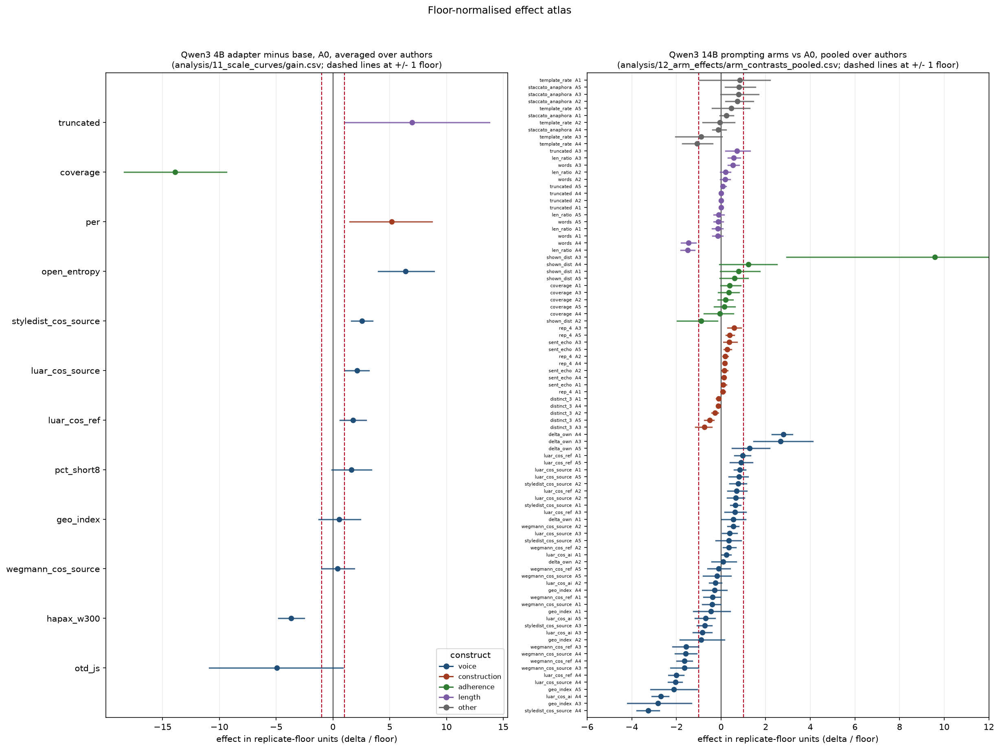

# 26 Floor-normalised effect atlas

## What this does

Every brief-paired contrast already reported by scripts 11, 12, 18 and 25, divided by the
replicate floor of its own measure on its own model family (script 10). The atlas answers one
question for the whole study at once: which reported effects are larger than the difference the
instrument can resolve when nothing changes but the sampling seed.

Nothing is recomputed from cells.parquet. A contrast whose measure and family have no measured
replicate pair carries no floor and is flagged rather than dropped.

## How it does it

effect_in_floors is delta divided by the floor, with the confidence interval divided by the same
floor. above_floor compares the absolute delta against one floor; ci_clear_of_floor is the
stricter test that the whole interval sits outside the floor band. Floors of exactly zero
(memo_flag, preface) are treated as missing. The summary counts contrasts in four bands (under
one floor, one to two, above two, above five) by construct and by contrast family, excluding the
patrick v1 chunking control rows. instrument_noise_ranking.csv ranks measures within each family
by floor over the A0 base spread, the ratio that says how much of a measure's range is noise.

### Contrast families, all constructs

| contrast_family | n_contrasts | n_with_floor | share_under_1_floor | share_1_to_2_floors | share_above_2_floors | share_above_5_floors | share_ci_clear_of_floor | median_abs_effect_in_floors | max_abs_effect_in_floors |
|---|---|---|---|---|---|---|---|---|---|
| adapter_vs_base | 870.000 | 870.000 | 0.130 | 0.141 | 0.729 | 0.407 | 0.641 | 3.916 | 69.192 |
| arm_vs_A0 | 5526.000 | 5526.000 | 0.485 | 0.225 | 0.290 | 0.072 | 0.196 | 1.037 | 192.098 |
| hosted_arm_F5_vs_F0 | 169.000 | 169.000 | 0.473 | 0.266 | 0.260 | 0.018 | 0.219 | 1.111 | 8.576 |
| hosted_vs_adapter | 676.000 | 676.000 | 0.247 | 0.228 | 0.525 | 0.320 | 0.503 | 2.210 | 36.666 |
| hosted_vs_base | 676.000 | 676.000 | 0.133 | 0.161 | 0.706 | 0.280 | 0.638 | 2.964 | 23.059 |
| hosted_vs_hosted | 507.000 | 507.000 | 0.568 | 0.134 | 0.298 | 0.045 | 0.276 | 0.823 | 7.311 |
| series_point | 551.000 | 551.000 | 0.196 | 0.192 | 0.612 | 0.260 | 0.517 | 2.726 | 33.247 |

### Atlas

## How to read the result, conservatively

A floor is a noise bound, not a smallest meaningful effect: a contrast above one floor is
resolvable, and that is all it is. The bands are shares of contrasts, not of authors or of
briefs, and the source tables contribute unequal numbers of rows, so read each contrast family
against its own source table rather than pooling them into one headline. Floors are measured on
the family named in the row, and the ranking of quiet and noisy instruments differs between
Qwen3 and Ministral3, so no measure should be called noisy without naming the generator.

## Caveats

- Promoted from an exploratory pass (scratch/R12, 2026-09-11); the inputs are frozen tables and the re-expression is arithmetic.
- Pooled arm rows bootstrap over authors and per-author rows over briefs, so their interval widths are not comparable.
- Hosted-model rows are divided by the Qwen3 floor because no hosted replicate pair exists.
- Floors at 8B, 14B and the two Ministral rungs come from single chesterton replicate pairs.
