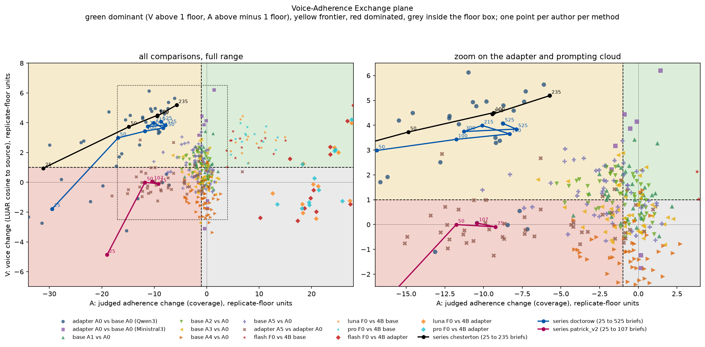

# 27 Voice-Adherence Exchange

## What this does

Each method in the study placed on one plane: V is its voice change and A its brief-adherence
change, both as brief-paired mean differences divided by the replicate floor of the measure on
that model family. Adherence is read twice, once by the coverage judge and once by the
mechanical event matcher, because the two readings price the same method differently. Where a
method buys voice above one floor and pays adherence below minus one floor, the exchange rate
E = V / |A| says how much voice a floor of adherence bought.

Methods covered: the adapter at every size on both families, the five prompting arms on the
base, full conditioning on top of the adapter, three hosted models against both the local base
and the local adapter, and the corpus-size series as a path through the plane.

## How it does it

Floors come from script 10 and are taken on the row's own family; hosted rows use the Qwen3
floor because no hosted replicate pair exists. Bootstrap is over briefs within an author (2,000
draws) and over authors for the pooled medians. Two defects in the 2026-09-11 exploratory run
are repaired: the fourth quadrant is named inside_floor_box instead of being folded into the
frontier (region_spec3 keeps the old three labels), and the disagreement flag between the two
adherence readings now requires both readings to sit outside the floor box with opposite signs
rather than firing on sign alone. The replicate twins are run through the same machinery as a
null: a pair of identical configurations must land inside the unit box.

### Adapter and hosted models, pooled over authors

| method | control | family | size_b | k_authors | med_V | med_A_j | med_A_m | med_E_j | med_E_m | region_pooled |
|---|---|---|---|---|---|---|---|---|---|---|
| adapter_A0 | base_A0 | Ministral3 | 3.000 | 3 | 4.138 | -0.095 | 4.874 |  |  | dominant |
| adapter_A0 | base_A0 | Ministral3 | 8.000 | 3 | 3.162 | -0.890 | 6.271 | 2.132 |  | dominant |
| adapter_A0 | base_A0 | Ministral3 | 14.000 | 3 | 2.212 | -0.518 | 5.046 | 1.277 |  | dominant |
| adapter_A0 | base_A0 | Qwen3 | 1.700 | 1 | -1.102 | -13.124 | -4.233 | -0.084 | -0.260 | dominated |
| adapter_A0 | base_A0 | Qwen3 | 4.000 | 14 | 2.995 | -11.450 | -4.607 | 0.196 | 0.751 | frontier |
| adapter_A0 | base_A0 | Qwen3 | 8.000 | 13 | 4.039 | -12.193 | -4.216 | 0.253 | 0.629 | frontier |
| adapter_A0 | base_A0 | Qwen3 | 14.000 | 13 | 2.772 | -12.786 | -5.026 | 0.196 | 0.594 | frontier |
| frontier_flash_F0 | qwen4b_adapter_A0 | frontier |  | 13 | -1.069 | 20.928 |  |  |  | inside_floor_box |
| frontier_flash_F0 | qwen4b_base_A0 | frontier |  | 13 | 2.785 | 6.367 |  |  |  | dominant |
| frontier_luna_F0 | qwen4b_adapter_A0 | frontier |  | 13 | -0.269 | 21.296 |  |  |  | inside_floor_box |
| frontier_luna_F0 | qwen4b_base_A0 | frontier |  | 13 | 2.819 | 7.918 |  |  |  | dominant |
| frontier_pro_F0 | qwen4b_adapter_A0 | frontier |  | 13 | 0.232 | 21.414 |  |  |  | inside_floor_box |
| frontier_pro_F0 | qwen4b_base_A0 | frontier |  | 13 | 3.013 | 7.766 |  |  |  | dominant |

### Exchange plane

## How to read the result, conservatively

E is defined only in the frontier region, and it is a ratio of two noisy quantities, so read the
bootstrap interval and the valid-draw fraction before quoting one. The two adherence readings
disagree by about a factor of three on the adapter, and that factor appears nowhere else in the
study, so no single price for the adapter should be quoted without naming the reading. A point
inside the floor box is unresolved, not equal. Region membership can flip when voice is read
against the author's reference set instead of the source passage; region_flips_on_ref counts it.

## Caveats

- Promoted from an exploratory pass (scratch/R11, 2026-09-11) implementing the R5 specification.
- The mechanical adherence reading exists for cells scored by the event matcher; rows without it are marked judged_only.
- Hosted-model rows have no replicate pair of their own, so their floor is borrowed from Qwen3.
- The series path is a single seed per size except where targets_seed marks a second draw.
- Replicate twins inside the unit box: 9 of 9.
